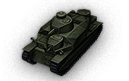
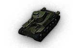
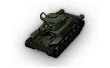
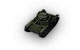

# Japan · Tier III

[All nations and tiers](../buffs_nerfs.md) · EU v20410 → RU v14600ru · 3 November 2026

<label><strong>Find a tank</strong><input type="search" placeholder="Try is7, obj140 or xm57" aria-label="Find a tank" style="display:block;width:100%;padding:.7rem;border:1px solid #888;border-radius:4px;margin:.5rem 0;color:inherit;background:transparent"></label>

Type 91 Heavy · Tier III

type91heavy

<a href="https://tanks.gg/v20410/tank/type-91">EU stats</a> · <a href="https://tanks.gg/v14600ru/tank/type-91">RU stats</a>
<figure style="display:inline-block"><figcaption>Type 91 Heavy</figcaption></figure>
<em>Gun handling</em> 
<strong>Aim time (s)</strong> <small>EU</small> 2.01  <small>RU</small> <strong>1.73</strong> 

<em>Armor &amp; health</em> 
<strong>Health</strong> <small>EU</small> 445  <small>RU</small> <strong>600</strong> 
<strong>Track repair time (s)</strong> <small>EU</small> 10.03  <small>RU</small> <strong>4</strong> 

Type 97 Chi-Ha · Tier III

type97chiha

<a href="https://tanks.gg/v20410/tank/chi-ha">EU stats</a> · <a href="https://tanks.gg/v14600ru/tank/chi-ha">RU stats</a>
<figure style="display:inline-block"><figcaption>EU · Type 97 Chi-Ha</figcaption></figure><figure style="display:inline-block"><figcaption>RU · Type 97 Chi-Ha</figcaption></figure>
<em>Gun handling</em> 
<strong>Aim time (s)</strong> <small>EU</small> 2.21  <small>RU</small> <strong>1.73</strong> 
<strong>Dispersion (m/100 m)</strong> <small>EU</small> 0.42  <small>RU</small> <strong>0.38</strong> 
<strong>Dispersion · damaged</strong> <small>EU</small> 0.84  <small>RU</small> <strong>0.77</strong> 
<strong>Dispersion · turret traverse</strong> <small>EU</small> 0.13  <small>RU</small> <strong>0.16</strong> 
<strong>Dispersion · firing</strong> <small>EU</small> 3  <small>RU</small> <strong>4</strong> 

<em>Mobility</em> 
<strong>Tank traverse on hard terrain (°/s)</strong> <small>EU</small> 49.13  <small>RU</small> <strong>54.98</strong> 
<strong>Tank traverse on medium terrain (°/s)</strong> <small>EU</small> 44.67  <small>RU</small> <strong>49.98</strong> 
<strong>Tank traverse on soft terrain (°/s)</strong> <small>EU</small> 25.86  <small>RU</small> <strong>28.94</strong> 

<em>Armor &amp; health</em> 
<strong>Health</strong> <small>EU</small> 430  <small>RU</small> <strong>460</strong> 
<strong>Track repair time (s)</strong> <small>EU</small> 10.03  <small>RU</small> <strong>4</strong> 

Type 98 Ke-Ni · Tier III

type98keni

<a href="https://tanks.gg/v20410/tank/ke-ni">EU stats</a> · <a href="https://tanks.gg/v14600ru/tank/ke-ni">RU stats</a>
<figure style="display:inline-block"><figcaption>Type 98 Ke-Ni</figcaption></figure>
<em>Armor &amp; health</em> 
<strong>Health</strong> <small>EU</small> 425  <small>RU</small> <strong>450</strong> 
<strong>Track repair time (s)</strong> <small>EU</small> 10.03  <small>RU</small> <strong>4</strong> 

