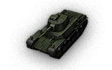
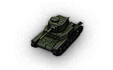
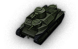

# Japan · Tier IV

[All nations and tiers](../buffs_nerfs.md) · EU v20410 → RU v14600ru · 3 November 2026

<label><strong>Find a tank</strong><input type="search" placeholder="Try is7, obj140 or xm57" aria-label="Find a tank" style="display:block;width:100%;padding:.7rem;border:1px solid #888;border-radius:4px;margin:.5rem 0;color:inherit;background:transparent"></label>

Type 1 Chi-He · Tier IV

type1chihe

<a href="https://tanks.gg/v20410/tank/chi-he">EU stats</a> · <a href="https://tanks.gg/v14600ru/tank/chi-he">RU stats</a>
<figure style="display:inline-block"><figcaption>Type 1 Chi-He</figcaption></figure>
<strong>Penetration (mm)</strong> <b>EU</b>  AP <strong>100</strong> /  AP <strong>131</strong> /  HE <strong>29</strong> → <b>RU</b>  AP <strong>87</strong> /  AP <strong>131</strong> /  HE <strong>29</strong>

<strong>Damage (HP)</strong> <b>EU</b>  AP <strong>85</strong> /  AP <strong>85</strong> /  HE <strong>100</strong> → <b>RU</b>  AP <strong>75</strong> /  AP <strong>75</strong> /  HE <strong>100</strong>

<em>Firepower</em> 
<strong>DPM (HP/min)</strong> <small>EU</small> 1 834.24  <small>RU</small> <strong>1 955.63</strong> 
<strong>Rate of fire (rounds/min)</strong> <small>EU</small> 21.58  <small>RU</small> <strong>26.08</strong> 
<strong>Reload time (s)</strong> <small>EU</small> 2.78  <small>RU</small> <strong>2.30</strong> 
<strong>Potential damage</strong> <small>EU</small> 10 200  <small>RU</small> <strong>9 000</strong> 

<em>Gun handling</em> 
<strong>Aim time (s)</strong> <small>EU</small> 2.21  <small>RU</small> <strong>1.92</strong> 
<strong>Dispersion (m/100 m)</strong> <small>EU</small> 0.36  <small>RU</small> <strong>0.38</strong> 
<strong>Dispersion · damaged</strong> <small>EU</small> 0.73  <small>RU</small> <strong>0.77</strong> 
<strong>Dispersion · moving</strong> <small>EU</small> 0.22  <small>RU</small> <strong>0.20</strong> 
<strong>Dispersion · tank traverse</strong> <small>EU</small> 0.22  <small>RU</small> <strong>0.20</strong> 
<strong>Dispersion · turret traverse</strong> <small>EU</small> 0.12  <small>RU</small> <strong>0.10</strong> 
<strong>Dispersion · firing</strong> <small>EU</small> 3.50  <small>RU</small> <strong>2</strong> 

<em>Mobility</em> 
<strong>Forward speed (km/h)</strong> <small>EU</small> 45  <small>RU</small> <strong>44</strong> 
<strong>Forward speed on hard terrain (km/h)</strong> <small>EU</small> 45  <small>RU</small> <strong>44</strong> 
<strong>Forward speed on medium terrain (km/h)</strong> <small>EU</small> 45  <small>RU</small> <strong>44</strong> 
<strong>Forward speed on soft terrain (km/h)</strong> <small>EU</small> 35.68  <small>RU</small> <strong>31.77</strong> 
<strong>Reverse speed (km/h)</strong> <small>EU</small> 18  <small>RU</small> <strong>20</strong> 
<strong>Engine power (hp)</strong> <small>EU</small> 285  <small>RU</small> <strong>253.75</strong> 
<strong>Power/weight (hp/t)</strong> <small>EU</small> 16.87  <small>RU</small> <strong>15.02</strong> 
<strong>Tank traverse (°/s)</strong> <small>EU</small> 46.93  <small>RU</small> <strong>37.55</strong> 
<strong>Tank traverse on hard terrain (°/s)</strong> <small>EU</small> 52.97  <small>RU</small> <strong>46.39</strong> 
<strong>Tank traverse on medium terrain (°/s)</strong> <small>EU</small> 47.67  <small>RU</small> <strong>41.75</strong> 
<strong>Tank traverse on soft terrain (°/s)</strong> <small>EU</small> 26.49  <small>RU</small> <strong>23.20</strong> 

<em>Armor &amp; health</em> 
<strong>Health</strong> <small>EU</small> 570  <small>RU</small> <strong>640</strong> 
<strong>Track repair time (s)</strong> <small>EU</small> 10.03  <small>RU</small> <strong>5</strong> 

Type 5 Ke-Ho · Tier IV

type5keho

<a href="https://tanks.gg/v20410/tank/ke-ho">EU stats</a> · <a href="https://tanks.gg/v14600ru/tank/ke-ho">RU stats</a>
<figure style="display:inline-block"><figcaption>Type 5 Ke-Ho</figcaption></figure>
<em>Armor &amp; health</em> 
<strong>Track repair time (s)</strong> <small>EU</small> 10.03  <small>RU</small> <strong>5</strong> 

Type 95 Heavy · Tier IV

type95heavy

<a href="https://tanks.gg/v20410/tank/type-95">EU stats</a> · <a href="https://tanks.gg/v14600ru/tank/type-95">RU stats</a>
<figure style="display:inline-block"><figcaption>Type 95 Heavy</figcaption></figure>
<strong>Penetration (mm)</strong> <b>EU</b>  AP <strong>71</strong> /  HEAT <strong>100</strong> /  HE <strong>38</strong> → <b>RU</b>  AP <strong>86</strong> /  HEAT <strong>125</strong> /  HE <strong>38</strong>

<em>Gun handling</em> 
<strong>Aim time (s)</strong> <small>EU</small> 2.21  <small>RU</small> <strong>2.01</strong> 
<strong>Dispersion · firing</strong> <small>EU</small> 4  <small>RU</small> <strong>2</strong> 

<em>Armor &amp; health</em> 
<strong>Health</strong> <small>EU</small> 670  <small>RU</small> <strong>720</strong> 
<strong>Track repair time (s)</strong> <small>EU</small> 12.03  <small>RU</small> <strong>5</strong> 

