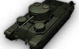
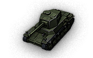
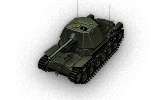

# Japan · Tier V

[All nations and tiers](../buffs_nerfs.md) · EU v20410 → RU v14600ru · 3 November 2026

<label><strong>Find a tank</strong><input type="search" placeholder="Try is7, obj140 or xm57" aria-label="Find a tank" style="display:block;width:100%;padding:.7rem;border:1px solid #888;border-radius:4px;margin:.5rem 0;color:inherit;background:transparent"></label>

Mitsu 108 · Tier V

mitsu108

<a href="https://tanks.gg/v20410/tank/mitsu-108">EU stats</a> · <a href="https://tanks.gg/v14600ru/tank/mitsu-108">RU stats</a>
<figure style="display:inline-block"><figcaption>Mitsu 108</figcaption></figure>
<strong>Penetration (mm)</strong> <b>EU</b>  AP <strong>130</strong> /  AP <strong>165</strong> /  HE <strong>53</strong> → <b>RU</b>  AP <strong>140</strong> /  HEAT <strong>170</strong> /  HE <strong>53</strong>

<strong>Damage (HP)</strong> <b>EU</b>  AP <strong>300</strong> /  AP <strong>300</strong> /  HE <strong>400</strong> → <b>RU</b>  AP <strong>300</strong> /  HEAT <strong>300</strong> /  HE <strong>440</strong>

<em>Firepower</em> 
<strong>DPM (HP/min)</strong> <small>EU</small> 1 360.43  <small>RU</small> <strong>1 668.80</strong> 
<strong>Module damage</strong> <small>EU</small> 150  <small>RU</small> <strong>140</strong> 
<strong>Rate of fire (rounds/min)</strong> <small>EU</small> 4.53  <small>RU</small> <strong>5.56</strong> 
<strong>Reload time (s)</strong> <small>EU</small> 13.23  <small>RU</small> <strong>10.79</strong> 
<strong>Shell velocity (m/s)</strong> <small>EU</small> 800  <small>RU</small> <strong>640</strong> 
<strong>Ammo capacity</strong> <small>EU</small> 50  <small>RU</small> <strong>40</strong> 
<strong>Potential damage</strong> <small>EU</small> 15 000  <small>RU</small> <strong>12 000</strong> 

<em>Gun handling</em> 
<strong>Aim time (s)</strong> <small>EU</small> 2.88  <small>RU</small> <strong>3.07</strong> 
<strong>Dispersion (m/100 m)</strong> <small>EU</small> 0.44  <small>RU</small> <strong>0.48</strong> 
<strong>Dispersion · damaged</strong> <small>EU</small> 0.88  <small>RU</small> <strong>0.96</strong> 
<strong>Dispersion · moving</strong> <small>EU</small> 0.25  <small>RU</small> <strong>0.20</strong> 
<strong>Dispersion · tank traverse</strong> <small>EU</small> 0.25  <small>RU</small> <strong>0.20</strong> 
<strong>Dispersion · turret traverse</strong> <small>EU</small> 0.20  <small>RU</small> <strong>0.14</strong> 
<strong>Depression (°)</strong> <small>EU</small> 10  <small>RU</small> <strong>14</strong> 

<em>Mobility</em> 
<strong>Forward speed on soft terrain (km/h)</strong> <small>EU</small> 32.18  <small>RU</small> <strong>29.16</strong> 
<strong>Reverse speed (km/h)</strong> <small>EU</small> 12  <small>RU</small> <strong>10</strong> 
<strong>Engine power (hp)</strong> <small>EU</small> 700  <small>RU</small> <strong>634.37</strong> 
<strong>Power/weight (hp/t)</strong> <small>EU</small> 15.22  <small>RU</small> <strong>13.79</strong> 
<strong>Turret traverse (°/s)</strong> <small>EU</small> 31.29  <small>RU</small> <strong>20.86</strong> 
<strong>Tank traverse on hard terrain (°/s)</strong> <small>EU</small> 32.85  <small>RU</small> <strong>32.05</strong> 
<strong>Tank traverse on medium terrain (°/s)</strong> <small>EU</small> 29.87  <small>RU</small> <strong>29.14</strong> 
<strong>Tank traverse on soft terrain (°/s)</strong> <small>EU</small> 18.25  <small>RU</small> <strong>17.81</strong> 

<em>Armor &amp; health</em> 
<strong>Hull armor · front (mm)</strong> <small>EU</small> 70  <small>RU</small> <strong>90</strong> 
<strong>Hull armor · side (mm)</strong> <small>EU</small> 40  <small>RU</small> <strong>60</strong> 
<strong>Hull armor · rear (mm)</strong> <small>EU</small> 30  <small>RU</small> <strong>50</strong> 
<strong>Turret armor · front (mm)</strong> <small>EU</small> 105  <small>RU</small> <strong>125</strong> 
<strong>Turret armor · side (mm)</strong> <small>EU</small> 70  <small>RU</small> <strong>90</strong> 
<strong>Turret armor · rear (mm)</strong> <small>EU</small> 60  <small>RU</small> <strong>90</strong> 
<strong>Track armor</strong> <small>EU</small> 20  <small>RU</small> <strong>40</strong> 

<em>Miscellaneous</em> 
<strong>Stationary camo</strong> <small>EU</small> 4.16  <small>RU</small> <strong>4.22</strong> 
<strong>Stationary camo · after firing</strong> <small>EU</small> 1.08  <small>RU</small> <strong>1.10</strong> 
<strong>View range (m)</strong> <small>EU</small> 350  <small>RU</small> <strong>330</strong> 
<strong>Shell cost</strong> <small>EU</small> 280  <small>RU</small> <strong>130</strong> 

Type 3 Chi-Nu · Tier V

type3chinu

<a href="https://tanks.gg/v20410/tank/chi-nu">EU stats</a> · <a href="https://tanks.gg/v14600ru/tank/chi-nu">RU stats</a>
<figure style="display:inline-block"><figcaption>Type 3 Chi-Nu</figcaption></figure>
<em>Gun handling</em> 
<strong>Dispersion · turret traverse</strong> <small>EU</small> 0.12  <small>RU</small> <strong>0.16</strong> 

<em>Mobility</em> 
<strong>Forward speed (km/h)</strong> <small>EU</small> 44  <small>RU</small> <strong>38.80</strong> 
<strong>Forward speed on hard terrain (km/h)</strong> <small>EU</small> 44  <small>RU</small> <strong>38.80</strong> 
<strong>Forward speed on medium terrain (km/h)</strong> <small>EU</small> 44  <small>RU</small> <strong>38.80</strong> 
<strong>Forward speed on soft terrain (km/h)</strong> <small>EU</small> 34.32  <small>RU</small> <strong>33.34</strong> 
<strong>Reverse speed (km/h)</strong> <small>EU</small> 18  <small>RU</small> <strong>16</strong> 
<strong>Engine power (hp)</strong> <small>EU</small> 325  <small>RU</small> <strong>317.18</strong> 
<strong>Weight (kg)</strong> <small>EU</small> 18 970 → <small>RU</small> <strong>19 059</strong> 
<strong>Power/weight (hp/t)</strong> <small>EU</small> 17.13  <small>RU</small> <strong>16.64</strong> 
<strong>Tank traverse (°/s)</strong> <small>EU</small> 46.93  <small>RU</small> <strong>35.46</strong> 
<strong>Tank traverse on hard terrain (°/s)</strong> <small>EU</small> 46.87  <small>RU</small> <strong>38.98</strong> 
<strong>Tank traverse on medium terrain (°/s)</strong> <small>EU</small> 37.50  <small>RU</small> <strong>31.19</strong> 
<strong>Tank traverse on soft terrain (°/s)</strong> <small>EU</small> 19.73  <small>RU</small> <strong>16.41</strong> 

<em>Armor &amp; health</em> 
<strong>Health</strong> <small>EU</small> 700  <small>RU</small> <strong>630</strong> 

Type 3 Ho-Ni III · Tier V

type3honiiii

<a href="https://tanks.gg/v20410/tank/ho-ni-iii">EU stats</a> · <a href="https://tanks.gg/v14600ru/tank/ho-ni-iii">RU stats</a>
<figure style="display:inline-block"><figcaption>EU · Type 3 Ho-Ni III</figcaption></figure><figure style="display:inline-block"><figcaption>RU · Type 3 Ho-Ni III</figcaption></figure>
<strong>Damage (HP)</strong> <b>EU</b>  AP <strong>150</strong> /  AP <strong>150</strong> /  HE <strong>190</strong> → <b>RU</b>  AP <strong>130</strong> /  AP <strong>130</strong> /  HE <strong>175</strong>

<em>Firepower</em> 
<strong>DPM (HP/min)</strong> <small>EU</small> 2 086  <small>RU</small> <strong>1 984.24</strong> 
<strong>Rate of fire (rounds/min)</strong> <small>EU</small> 13.91  <small>RU</small> <strong>15.26</strong> 
<strong>Reload time (s)</strong> <small>EU</small> 4.31  <small>RU</small> <strong>3.93</strong> 
<strong>Potential damage</strong> <small>EU</small> 6 750  <small>RU</small> <strong>5 850</strong> 

<em>Mobility</em> 
<strong>Tank traverse on hard terrain (°/s)</strong> <small>EU</small> 37.11  <small>RU</small> <strong>40.02</strong> 
<strong>Tank traverse on medium terrain (°/s)</strong> <small>EU</small> 29.69  <small>RU</small> <strong>32.01</strong> 
<strong>Tank traverse on soft terrain (°/s)</strong> <small>EU</small> 15.63  <small>RU</small> <strong>16.85</strong> 

<em>Armor &amp; health</em> 
<strong>Health</strong> <small>EU</small> 500  <small>RU</small> <strong>420</strong> 
<strong>Health · engine</strong> <small>EU</small> 170  <small>RU</small> <strong>104</strong> 
<strong>Health · track</strong> <small>EU</small> 115  <small>RU</small> <strong>100</strong> 
<strong>Track repair time (s)</strong> <small>EU</small> 11.80  <small>RU</small> <strong>12.03</strong> 

<em>Miscellaneous</em> 
<strong>View range (m)</strong> <small>EU</small> 320  <small>RU</small> <strong>310</strong> 

