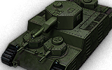
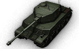
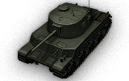
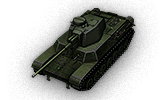
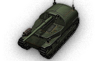

# Japan · Tier VI

[All nations and tiers](../buffs_nerfs.md) · EU v20410 → RU v14600ru · 3 November 2026

<label><strong>Find a tank</strong><input type="search" placeholder="Try is7, obj140 or xm57" aria-label="Find a tank" style="display:block;width:100%;padding:.7rem;border:1px solid #888;border-radius:4px;margin:.5rem 0;color:inherit;background:transparent"></label>

O-I · Tier VI

oi

<a href="https://tanks.gg/v20410/tank/o-i">EU stats</a> · <a href="https://tanks.gg/v14600ru/tank/o-i">RU stats</a>
<figure style="display:inline-block"><figcaption>O-I</figcaption></figure>
<em>Gun handling</em> 
<strong>Dispersion · tank traverse</strong> <small>EU</small> 0.20  <small>RU</small> <strong>0.22</strong> 

<em>Mobility</em> 
<strong>Forward speed (km/h)</strong> <small>EU</small> 25  <small>RU</small> <strong>29.40</strong> 
<strong>Forward speed on hard terrain (km/h)</strong> <small>EU</small> 25  <small>RU</small> <strong>29.26</strong> 
<strong>Forward speed on medium terrain (km/h)</strong> <small>EU</small> 25  <small>RU</small> <strong>24.76</strong> 
<strong>Forward speed on soft terrain (km/h)</strong> <small>EU</small> 18.32  <small>RU</small> <strong>17.88</strong> 
<strong>Engine power (hp)</strong> <small>EU</small> 1 300  <small>RU</small> <strong>1 268.74</strong> 
<strong>Power/weight (hp/t)</strong> <small>EU</small> 8.67  <small>RU</small> <strong>8.46</strong> 
<strong>Tank traverse on hard terrain (°/s)</strong> <small>EU</small> 20.39  <small>RU</small> <strong>20.53</strong> 
<strong>Tank traverse on medium terrain (°/s)</strong> <small>EU</small> 17.25  <small>RU</small> <strong>17.37</strong> 
<strong>Tank traverse on soft terrain (°/s)</strong> <small>EU</small> 12.46  <small>RU</small> <strong>12.55</strong> 

<em>Armor &amp; health</em> 
<strong>Hull armor · rear (mm)</strong> <small>EU</small> 50  <small>RU</small> <strong>105</strong> 
<strong>Turret armor · side (mm)</strong> <small>EU</small> 120  <small>RU</small> <strong>150</strong> 
<strong>Turret armor · rear (mm)</strong> <small>EU</small> 60  <small>RU</small> <strong>105</strong> 
<strong>Health</strong> <small>EU</small> 1 100  <small>RU</small> <strong>1 060</strong> 
<strong>Health · engine</strong> <small>EU</small> 205  <small>RU</small> <strong>360</strong> 

Type 3 Ju-Nu · Tier VI

type3junu

<a href="https://tanks.gg/v20410/tank/ju-nu">EU stats</a> · <a href="https://tanks.gg/v14600ru/tank/ju-nu">RU stats</a>
<figure style="display:inline-block"><figcaption>EU · Type 3 Ju-Nu</figcaption></figure><figure style="display:inline-block"><figcaption>RU · Type 3 Ju-Nu</figcaption></figure>
<strong>Penetration (mm)</strong> <b>EU</b>  AP <strong>150</strong> /  APCR <strong>208</strong> /  HE <strong>44</strong> → <b>RU</b>  AP <strong>160</strong> /  HEAT <strong>205</strong> /  HE <strong>44</strong>

<strong>Damage (HP)</strong> <b>EU</b>  AP <strong>230</strong> /  APCR <strong>230</strong> /  HE <strong>280</strong> → <b>RU</b>  AP <strong>220</strong> /  HEAT <strong>220</strong> /  HE <strong>270</strong>

<em>Firepower</em> 
<strong>DPM (HP/min)</strong> <small>EU</small> 1 971.70  <small>RU</small> <strong>1 912.17</strong> 
<strong>Rate of fire (rounds/min)</strong> <small>EU</small> 8.57  <small>RU</small> <strong>8.69</strong> 
<strong>Reload time (s)</strong> <small>EU</small> 7  <small>RU</small> <strong>6.90</strong> 
<strong>Shell velocity (m/s)</strong> <small>EU</small> 850  <small>RU</small> <strong>940</strong> 
<strong>Potential damage</strong> <small>EU</small> 11 500  <small>RU</small> <strong>11 000</strong> 

<em>Gun handling</em> 
<strong>Dispersion · moving</strong> <small>EU</small> 0.22  <small>RU</small> <strong>0.20</strong> 
<strong>Dispersion · tank traverse</strong> <small>EU</small> 0.22  <small>RU</small> <strong>0.20</strong> 
<strong>Depression (°)</strong> <small>EU</small> 10  <small>RU</small> <strong>12</strong> 

<em>Mobility</em> 
<strong>Forward speed (km/h)</strong> <small>EU</small> 35  <small>RU</small> <strong>40</strong> 
<strong>Forward speed on hard terrain (km/h)</strong> <small>EU</small> 35  <small>RU</small> <strong>40</strong> 
<strong>Forward speed on medium terrain (km/h)</strong> <small>EU</small> 35  <small>RU</small> <strong>33.82</strong> 
<strong>Forward speed on soft terrain (km/h)</strong> <small>EU</small> 25.48  <small>RU</small> <strong>22.06</strong> 
<strong>Engine power (hp)</strong> <small>EU</small> 770  <small>RU</small> <strong>650</strong> 
<strong>Weight (kg)</strong> <small>EU</small> 50 000 → <small>RU</small> <strong>48 760</strong> 
<strong>Power/weight (hp/t)</strong> <small>EU</small> 15.40  <small>RU</small> <strong>13.33</strong> 
<strong>Turret traverse (°/s)</strong> <small>EU</small> 31.29  <small>RU</small> <strong>23.99</strong> 
<strong>Tank traverse (°/s)</strong> <small>EU</small> 31.29  <small>RU</small> <strong>29.20</strong> 
<strong>Tank traverse on hard terrain (°/s)</strong> <small>EU</small> 32.11  <small>RU</small> <strong>30.85</strong> 
<strong>Tank traverse on medium terrain (°/s)</strong> <small>EU</small> 19.27  <small>RU</small> <strong>18.51</strong> 
<strong>Tank traverse on soft terrain (°/s)</strong> <small>EU</small> 12.57  <small>RU</small> <strong>12.07</strong> 

<em>Armor &amp; health</em> 
<strong>Hull armor · front (mm)</strong> <small>EU</small> 130  <small>RU</small> <strong>80</strong> 
<strong>Hull armor · side (mm)</strong> <small>EU</small> 50  <small>RU</small> <strong>60</strong> 
<strong>Hull armor · rear (mm)</strong> <small>EU</small> 40  <small>RU</small> <strong>30</strong> 
<strong>Turret armor · front (mm)</strong> <small>EU</small> 160  <small>RU</small> <strong>170</strong> 
<strong>Turret armor · rear (mm)</strong> <small>EU</small> 40  <small>RU</small> <strong>50</strong> 
<strong>Health · ammo rack</strong> <small>EU</small> 160  <small>RU</small> <strong>180</strong> 

<em>Miscellaneous</em> 
<strong>Stationary camo</strong> <small>EU</small> 5.24  <small>RU</small> <strong>5.76</strong> 
<strong>Stationary camo · after firing</strong> <small>EU</small> 1.25  <small>RU</small> <strong>1.37</strong> 
<strong>Moving camo</strong> <small>EU</small> 2.62  <small>RU</small> <strong>2.88</strong> 
<strong>Moving camo · after firing</strong> <small>EU</small> 0.62  <small>RU</small> <strong>0.69</strong> 
<strong>View range (m)</strong> <small>EU</small> 360  <small>RU</small> <strong>370</strong> 
<strong>Shell cost</strong> <small>EU</small> 270  <small>RU</small> <strong>252</strong> 

Type 4 Chi-To · Tier VI

type4chito

<a href="https://tanks.gg/v20410/tank/chi-to">EU stats</a> · <a href="https://tanks.gg/v14600ru/tank/chi-to">RU stats</a>
<figure style="display:inline-block"><figcaption>Type 4 Chi-To</figcaption></figure>
<em>Mobility</em> 
<strong>Forward speed on soft terrain (km/h)</strong> <small>EU</small> 27.93  <small>RU</small> <strong>24.61</strong> 
<strong>Engine power (hp)</strong> <small>EU</small> 480  <small>RU</small> <strong>422.91</strong> 
<strong>Power/weight (hp/t)</strong> <small>EU</small> 14.68  <small>RU</small> <strong>12.93</strong> 
<strong>Tank traverse (°/s)</strong> <small>EU</small> 44.85  <small>RU</small> <strong>31.29</strong> 
<strong>Tank traverse on hard terrain (°/s)</strong> <small>EU</small> 45.92  <small>RU</small> <strong>37.75</strong> 
<strong>Tank traverse on medium terrain (°/s)</strong> <small>EU</small> 41.33  <small>RU</small> <strong>33.97</strong> 
<strong>Tank traverse on soft terrain (°/s)</strong> <small>EU</small> 20.67  <small>RU</small> <strong>16.99</strong> 

<em>Armor &amp; health</em> 
<strong>Health</strong> <small>EU</small> 950  <small>RU</small> <strong>920</strong> 

Type 95 Ji-Ro · Tier VI

type95jiro

<a href="https://tanks.gg/v20410/tank/ji-ro">EU stats</a> · <a href="https://tanks.gg/v14600ru/tank/ji-ro">RU stats</a>
<figure style="display:inline-block"><figcaption>Type 95 Ji-Ro</figcaption></figure>
<em>Firepower</em> 
<strong>DPM (HP/min)</strong> <small>EU</small> 2 086  <small>RU</small> <strong>2 208.71</strong> 
<strong>Rate of fire (rounds/min)</strong> <small>EU</small> 6.95  <small>RU</small> <strong>7.36</strong> 
<strong>Reload time (s)</strong> <small>EU</small> 8.63  <small>RU</small> <strong>8.15</strong> 

<em>Mobility</em> 
<strong>Forward speed on hard terrain (km/h)</strong> <small>EU</small> 40  <small>RU</small> <strong>39.02</strong> 
<strong>Forward speed on medium terrain (km/h)</strong> <small>EU</small> 32.92  <small>RU</small> <strong>29.26</strong> 
<strong>Forward speed on soft terrain (km/h)</strong> <small>EU</small> 22.90  <small>RU</small> <strong>20.36</strong> 
<strong>Engine power (hp)</strong> <small>EU</small> 450  <small>RU</small> <strong>400</strong> 
<strong>Power/weight (hp/t)</strong> <small>EU</small> 13.84  <small>RU</small> <strong>12.30</strong> 
<strong>Tank traverse on hard terrain (°/s)</strong> <small>EU</small> 42.31  <small>RU</small> <strong>42.72</strong> 
<strong>Tank traverse on medium terrain (°/s)</strong> <small>EU</small> 31.73  <small>RU</small> <strong>32.04</strong> 
<strong>Tank traverse on soft terrain (°/s)</strong> <small>EU</small> 22.08  <small>RU</small> <strong>22.29</strong> 

<em>Armor &amp; health</em> 
<strong>Track armor</strong> <small>EU</small> 20  <small>RU</small> <strong>15</strong> 
<strong>Health · engine</strong> <small>EU</small> 205  <small>RU</small> <strong>145</strong> 
<strong>Health · track</strong> <small>EU</small> 145  <small>RU</small> <strong>120</strong> 
<strong>Track repair time (s)</strong> <small>EU</small> 11.62  <small>RU</small> <strong>12.03</strong> 

<em>Miscellaneous</em> 
<strong>View range (m)</strong> <small>EU</small> 340  <small>RU</small> <strong>350</strong> 

