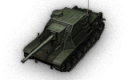
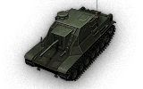
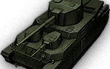
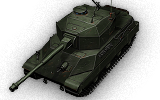
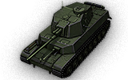

# Japan · Tier VII

[All nations and tiers](../buffs_nerfs.md) · EU v20410 → RU v14600ru · 3 November 2026

<label><strong>Find a tank</strong><input type="search" placeholder="Try is7, obj140 or xm57" aria-label="Find a tank" style="display:block;width:100%;padding:.7rem;border:1px solid #888;border-radius:4px;margin:.5rem 0;color:inherit;background:transparent"></label>

Chi-To SP · Tier VII

chitosp

<a href="https://tanks.gg/v20410/tank/chi-to-sp">EU stats</a> · <a href="https://tanks.gg/v14600ru/tank/chi-to-sp">RU stats</a>
<figure style="display:inline-block"><figcaption>EU · Chi-To SP</figcaption></figure><figure style="display:inline-block"><figcaption>RU · Chi-To SP</figcaption></figure>
<em>Firepower</em> 
<strong>DPM (HP/min)</strong> <small>EU</small> 2 086  <small>RU</small> <strong>2 442.15</strong> 
<strong>Rate of fire (rounds/min)</strong> <small>EU</small> 6.52  <small>RU</small> <strong>7.63</strong> 
<strong>Reload time (s)</strong> <small>EU</small> 9.20  <small>RU</small> <strong>7.86</strong> 

<em>Gun handling</em> 
<strong>Aim time (s)</strong> <small>EU</small> 2.01  <small>RU</small> <strong>1.92</strong> 
<strong>Dispersion (m/100 m)</strong> <small>EU</small> 0.35  <small>RU</small> <strong>0.33</strong> 
<strong>Dispersion · damaged</strong> <small>EU</small> 0.69  <small>RU</small> <strong>0.65</strong> 
<strong>Dispersion · moving</strong> <small>EU</small> 0.19  <small>RU</small> <strong>0.22</strong> 
<strong>Dispersion · tank traverse</strong> <small>EU</small> 0.19  <small>RU</small> <strong>0.22</strong> 
<strong>Dispersion · firing</strong> <small>EU</small> 4  <small>RU</small> <strong>3</strong> 

<em>Mobility</em> 
<strong>Forward speed (km/h)</strong> <small>EU</small> 30  <small>RU</small> <strong>35</strong> 
<strong>Forward speed on hard terrain (km/h)</strong> <small>EU</small> 30  <small>RU</small> <strong>35</strong> 
<strong>Forward speed on medium terrain (km/h)</strong> <small>EU</small> 30  <small>RU</small> <strong>35</strong> 
<strong>Reverse speed (km/h)</strong> <small>EU</small> 12  <small>RU</small> <strong>15</strong> 
<strong>Tank traverse on hard terrain (°/s)</strong> <small>EU</small> 35.34  <small>RU</small> <strong>43.44</strong> 
<strong>Tank traverse on medium terrain (°/s)</strong> <small>EU</small> 29.91  <small>RU</small> <strong>36.76</strong> 
<strong>Tank traverse on soft terrain (°/s)</strong> <small>EU</small> 16.20  <small>RU</small> <strong>19.91</strong> 

<em>Armor &amp; health</em> 
<strong>Hull armor · front (mm)</strong> <small>EU</small> 215  <small>RU</small> <strong>180</strong> 
<strong>Hull armor · rear (mm)</strong> <small>EU</small> 40  <small>RU</small> <strong>30</strong> 
<strong>Track armor</strong> <small>EU</small> 20  <small>RU</small> <strong>25</strong> 
<strong>Health · engine</strong> <small>EU</small> 240  <small>RU</small> <strong>200</strong> 
<strong>Track repair time (s)</strong> <small>EU</small> 11.70  <small>RU</small> <strong>12.03</strong> 

<em>Miscellaneous</em> 
<strong>Stationary camo · after firing</strong> <small>EU</small> 3.47  <small>RU</small> <strong>1.66</strong> 
<strong>Moving camo · after firing</strong> <small>EU</small> 2.08  <small>RU</small> <strong>1</strong> 
<strong>View range (m)</strong> <small>EU</small> 350  <small>RU</small> <strong>370</strong> 

O-Ni · Tier VII

oni

<a href="https://tanks.gg/v20410/tank/o-ni">EU stats</a> · <a href="https://tanks.gg/v14600ru/tank/o-ni">RU stats</a>
<figure style="display:inline-block"><figcaption>O-Ni</figcaption></figure>
<strong>Penetration (mm)</strong> <b>EU</b>  AP <strong>190</strong> /  AP <strong>235</strong> /  HE <strong>53</strong> → <b>RU</b>  AP <strong>190</strong> /  AP <strong>215</strong> /  HE <strong>53</strong>

<strong>Damage (HP)</strong> <b>EU</b>  AP <strong>370</strong> /  AP <strong>370</strong> /  HE <strong>450</strong> → <b>RU</b>  AP <strong>330</strong> /  AP <strong>330</strong> /  HE <strong>430</strong>

<em>Firepower</em> 
<strong>DPM (HP/min)</strong> <small>EU</small> 1 823.20  <small>RU</small> <strong>1 720.95</strong> 
<strong>Rate of fire (rounds/min)</strong> <small>EU</small> 4.93  <small>RU</small> <strong>5.21</strong> 
<strong>Reload time (s)</strong> <small>EU</small> 12.18  <small>RU</small> <strong>11.51</strong> 
<strong>Shell velocity (m/s)</strong> <small>EU</small> 910  <small>RU</small> <strong>916</strong> 
<strong>Potential damage</strong> <small>EU</small> 37 000  <small>RU</small> <strong>33 000</strong> 

<em>Gun handling</em> 
<strong>Aim time (s)</strong> <small>EU</small> 2.88  <small>RU</small> <strong>3.16</strong> 
<strong>Dispersion · firing</strong> <small>EU</small> 4  <small>RU</small> <strong>3</strong> 

<em>Mobility</em> 
<strong>Engine power (hp)</strong> <small>EU</small> 1 300  <small>RU</small> <strong>1 268.74</strong> 
<strong>Power/weight (hp/t)</strong> <small>EU</small> 12.88  <small>RU</small> <strong>12.57</strong> 
<strong>Tank traverse (°/s)</strong> <small>EU</small> 22.95  <small>RU</small> <strong>18.77</strong> 
<strong>Tank traverse on hard terrain (°/s)</strong> <small>EU</small> 24.68  <small>RU</small> <strong>20.31</strong> 
<strong>Tank traverse on medium terrain (°/s)</strong> <small>EU</small> 22.78  <small>RU</small> <strong>18.74</strong> 
<strong>Tank traverse on soft terrain (°/s)</strong> <small>EU</small> 15.59  <small>RU</small> <strong>12.83</strong> 

<em>Armor &amp; health</em> 
<strong>Hull armor · front (mm)</strong> <small>EU</small> 200  <small>RU</small> <strong>175</strong> 
<strong>Hull armor · side (mm)</strong> <small>EU</small> 80  <small>RU</small> <strong>70</strong> 
<strong>Hull armor · rear (mm)</strong> <small>EU</small> 100  <small>RU</small> <strong>150</strong> 
<strong>Turret armor · front (mm)</strong> <small>EU</small> 240  <small>RU</small> <strong>200</strong> 
<strong>Turret armor · rear (mm)</strong> <small>EU</small> 100  <small>RU</small> <strong>150</strong> 
<strong>Health</strong> <small>EU</small> 1 650  <small>RU</small> <strong>1 550</strong> 

Type 4 Ju-To · Tier VII

type4juto

<a href="https://tanks.gg/v20410/tank/ju-to">EU stats</a> · <a href="https://tanks.gg/v14600ru/tank/ju-to">RU stats</a>
<figure style="display:inline-block"><figcaption>Type 4 Ju-To</figcaption></figure>
<strong>Penetration (mm)</strong> <b>EU</b>  AP <strong>195</strong> /  APCR <strong>230</strong> /  HE <strong>53</strong> → <b>RU</b>  AP <strong>194</strong> /  HEAT <strong>235</strong> /  HE <strong>53</strong>

<strong>Damage (HP)</strong> <b>EU</b>  AP <strong>320</strong> /  APCR <strong>320</strong> /  HE <strong>420</strong> → <b>RU</b>  AP <strong>320</strong> /  HEAT <strong>320</strong> /  HE <strong>420</strong>

<em>Firepower</em> 
<strong>DPM (HP/min)</strong> <small>EU</small> 1 772.18  <small>RU</small> <strong>1 871.55</strong> 
<strong>Rate of fire (rounds/min)</strong> <small>EU</small> 5.54  <small>RU</small> <strong>5.85</strong> 
<strong>Reload time (s)</strong> <small>EU</small> 10.83  <small>RU</small> <strong>10.26</strong> 
<strong>Shell velocity (m/s)</strong> <small>EU</small> 900  <small>RU</small> <strong>1 050</strong> 
<strong>Ammo capacity</strong> <small>EU</small> 60  <small>RU</small> <strong>40</strong> 
<strong>Potential damage</strong> <small>EU</small> 19 200  <small>RU</small> <strong>12 800</strong> 

<em>Gun handling</em> 
<strong>Aim time (s)</strong> <small>EU</small> 2.21  <small>RU</small> <strong>2.30</strong> 
<strong>Dispersion (m/100 m)</strong> <small>EU</small> 0.34  <small>RU</small> <strong>0.38</strong> 
<strong>Dispersion · damaged</strong> <small>EU</small> 0.67  <small>RU</small> <strong>0.77</strong> 
<strong>Dispersion · moving</strong> <small>EU</small> 0.20  <small>RU</small> <strong>0.19</strong> 
<strong>Dispersion · tank traverse</strong> <small>EU</small> 0.20  <small>RU</small> <strong>0.19</strong> 
<strong>Dispersion · firing</strong> <small>EU</small> 4  <small>RU</small> <strong>3</strong> 
<strong>Depression (°)</strong> <small>EU</small> 10  <small>RU</small> <strong>12</strong> 

<em>Mobility</em> 
<strong>Forward speed (km/h)</strong> <small>EU</small> 35  <small>RU</small> <strong>40</strong> 
<strong>Forward speed on hard terrain (km/h)</strong> <small>EU</small> 35  <small>RU</small> <strong>40</strong> 
<strong>Forward speed on medium terrain (km/h)</strong> <small>EU</small> 35  <small>RU</small> <strong>40</strong> 
<strong>Forward speed on soft terrain (km/h)</strong> <small>EU</small> 30.96  <small>RU</small> <strong>28.41</strong> 
<strong>Reverse speed (km/h)</strong> <small>EU</small> 12  <small>RU</small> <strong>15</strong> 
<strong>Engine power (hp)</strong> <small>EU</small> 850  <small>RU</small> <strong>780</strong> 
<strong>Power/weight (hp/t)</strong> <small>EU</small> 15.45  <small>RU</small> <strong>14.18</strong> 
<strong>Turret traverse (°/s)</strong> <small>EU</small> 31.29  <small>RU</small> <strong>36.50</strong> 
<strong>Tank traverse (°/s)</strong> <small>EU</small> 31.29  <small>RU</small> <strong>33.38</strong> 
<strong>Tank traverse on hard terrain (°/s)</strong> <small>EU</small> 30.70  <small>RU</small> <strong>36.01</strong> 
<strong>Tank traverse on medium terrain (°/s)</strong> <small>EU</small> 28.33  <small>RU</small> <strong>33.24</strong> 
<strong>Tank traverse on soft terrain (°/s)</strong> <small>EU</small> 19.39  <small>RU</small> <strong>22.74</strong> 

<em>Armor &amp; health</em> 
<strong>Hull armor · front (mm)</strong> <small>EU</small> 85  <small>RU</small> <strong>80</strong> 
<strong>Hull armor · side (mm)</strong> <small>EU</small> 40  <small>RU</small> <strong>50</strong> 
<strong>Hull armor · rear (mm)</strong> <small>EU</small> 40  <small>RU</small> <strong>25</strong> 
<strong>Turret armor · rear (mm)</strong> <small>EU</small> 45  <small>RU</small> <strong>60</strong> 
<strong>Track armor</strong> <small>EU</small> 25  <small>RU</small> <strong>40</strong> 
<strong>Health</strong> <small>EU</small> 1 300  <small>RU</small> <strong>1 350</strong> 
<strong>Health · engine</strong> <small>EU</small> 200  <small>RU</small> <strong>260</strong> 

<em>Miscellaneous</em> 
<strong>Stationary camo</strong> <small>EU</small> 4.62  <small>RU</small> <strong>6.16</strong> 
<strong>Stationary camo · after firing</strong> <small>EU</small> 0.96  <small>RU</small> <strong>1.29</strong> 
<strong>Moving camo</strong> <small>EU</small> 2.34  <small>RU</small> <strong>3.08</strong> 
<strong>Moving camo · after firing</strong> <small>EU</small> 0.49  <small>RU</small> <strong>0.64</strong> 
<strong>View range (m)</strong> <small>EU</small> 370  <small>RU</small> <strong>380</strong> 
<strong>Shell cost</strong> <small>EU</small> 530  <small>RU</small> <strong>490</strong> 

Type 5 Chi-Ri · Tier VII

type5chiri

<a href="https://tanks.gg/v20410/tank/chi-ri">EU stats</a> · <a href="https://tanks.gg/v14600ru/tank/chi-ri">RU stats</a>
<figure style="display:inline-block"><figcaption>Type 5 Chi-Ri</figcaption></figure>
<strong>Penetration (mm)</strong> <b>EU</b>  AP <strong>155</strong> /  AP <strong>186</strong> /  HE <strong>38</strong> → <b>RU</b>  AP <strong>168</strong> /  AP <strong>203</strong> /  HE <strong>38</strong>

<em>Gun handling</em> 
<strong>Dispersion · turret traverse</strong> <small>EU</small> 0.12  <small>RU</small> <strong>0.08</strong> 
<strong>Dispersion · firing</strong> <small>EU</small> 3  <small>RU</small> <strong>2</strong> 

<em>Mobility</em> 
<strong>Forward speed (km/h)</strong> <small>EU</small> 45  <small>RU</small> <strong>42</strong> 
<strong>Forward speed on hard terrain (km/h)</strong> <small>EU</small> 45  <small>RU</small> <strong>42</strong> 
<strong>Forward speed on medium terrain (km/h)</strong> <small>EU</small> 45  <small>RU</small> <strong>42</strong> 
<strong>Forward speed on soft terrain (km/h)</strong> <small>EU</small> 26.61  <small>RU</small> <strong>24.97</strong> 
<strong>Engine power (hp)</strong> <small>EU</small> 650  <small>RU</small> <strong>610</strong> 
<strong>Power/weight (hp/t)</strong> <small>EU</small> 15.38  <small>RU</small> <strong>14.44</strong> 
<strong>Tank traverse (°/s)</strong> <small>EU</small> 49.02  <small>RU</small> <strong>35.46</strong> 
<strong>Tank traverse on hard terrain (°/s)</strong> <small>EU</small> 42.97  <small>RU</small> <strong>31.20</strong> 
<strong>Tank traverse on medium terrain (°/s)</strong> <small>EU</small> 39.07  <small>RU</small> <strong>28.37</strong> 
<strong>Tank traverse on soft terrain (°/s)</strong> <small>EU</small> 19.53  <small>RU</small> <strong>14.18</strong> 

<em>Armor &amp; health</em> 
<strong>Health</strong> <small>EU</small> 1 350  <small>RU</small> <strong>1 250</strong> 

