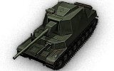
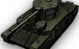
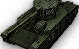
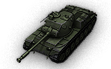
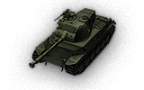
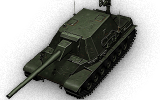
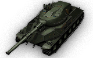
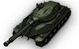
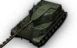

# Japan · Tier VIII

[All nations and tiers](../buffs_nerfs.md) · EU v20410 → RU v14600ru · 3 November 2026

<label><strong>Find a tank</strong><input type="search" placeholder="Try is7, obj140 or xm57" aria-label="Find a tank" style="display:block;width:100%;padding:.7rem;border:1px solid #888;border-radius:4px;margin:.5rem 0;color:inherit;background:transparent"></label>

Ho-Ri 2 · Tier VIII

hori2

<a href="https://tanks.gg/v20410/tank/ho-ri-2">EU stats</a> · <a href="https://tanks.gg/v14600ru/tank/ho-ri-2">RU stats</a>
<figure style="display:inline-block"><figcaption>Ho-Ri 2</figcaption></figure>
<strong>Penetration (mm)</strong> <b>EU</b>  AP <strong>264</strong> /  AP <strong>285</strong> /  HE <strong>80</strong> → <b>RU</b>  AP <strong>250</strong> /  AP <strong>285</strong> /  HE <strong>80</strong>

<strong>Damage (HP)</strong> <b>EU</b>  AP <strong>420</strong> /  AP <strong>420</strong> /  HE <strong>530</strong> → <b>RU</b>  AP <strong>400</strong> /  AP <strong>400</strong> /  HE <strong>515</strong>

<em>Firepower</em> 
<strong>DPM (HP/min)</strong> <small>EU</small> 2 551.81  <small>RU</small> <strong>2 503.20</strong> 
<strong>Rate of fire (rounds/min)</strong> <small>EU</small> 6.08  <small>RU</small> <strong>6.26</strong> 
<strong>Reload time (s)</strong> <small>EU</small> 9.88  <small>RU</small> <strong>9.59</strong> 
<strong>Potential damage</strong> <small>EU</small> 16 800  <small>RU</small> <strong>16 000</strong> 

<em>Gun handling</em> 
<strong>Aim time (s)</strong> <small>EU</small> 2.21  <small>RU</small> <strong>1.92</strong> 
<strong>Dispersion (m/100 m)</strong> <small>EU</small> 0.34  <small>RU</small> <strong>0.31</strong> 
<strong>Dispersion · damaged</strong> <small>EU</small> 0.67  <small>RU</small> <strong>0.61</strong> 
<strong>Dispersion · turret traverse</strong> <small>EU</small> 0.10  <small>RU</small> <strong>0.12</strong> 

<em>Mobility</em> 
<strong>Forward speed (km/h)</strong> <small>EU</small> 30  <small>RU</small> <strong>35</strong> 
<strong>Forward speed on hard terrain (km/h)</strong> <small>EU</small> 30  <small>RU</small> <strong>35</strong> 
<strong>Forward speed on medium terrain (km/h)</strong> <small>EU</small> 30  <small>RU</small> <strong>35</strong> 
<strong>Reverse speed (km/h)</strong> <small>EU</small> 14  <small>RU</small> <strong>15</strong> 
<strong>Tank traverse on hard terrain (°/s)</strong> <small>EU</small> 37.25  <small>RU</small> <strong>36.95</strong> 
<strong>Tank traverse on medium terrain (°/s)</strong> <small>EU</small> 31.52  <small>RU</small> <strong>31.26</strong> 
<strong>Tank traverse on soft terrain (°/s)</strong> <small>EU</small> 17.07  <small>RU</small> <strong>16.93</strong> 

<em>Armor &amp; health</em> 
<strong>Track armor</strong> <small>EU</small> 20  <small>RU</small> <strong>25</strong> 
<strong>Health</strong> <small>EU</small> 1 400  <small>RU</small> <strong>1 300</strong> 
<strong>Health · engine</strong> <small>EU</small> 275  <small>RU</small> <strong>360</strong> 
<strong>Health · track</strong> <small>EU</small> 220  <small>RU</small> <strong>210</strong> 
<strong>Track repair time (s)</strong> <small>EU</small> 11.70  <small>RU</small> <strong>12.03</strong> 

<em>Miscellaneous</em> 
<strong>View range (m)</strong> <small>EU</small> 360  <small>RU</small> <strong>380</strong> 
<strong>Fire chance (%)</strong> <small>EU</small> 20  <small>RU</small> <strong>12</strong> 

O-Ho · Tier VIII

oho

<a href="https://tanks.gg/v20410/tank/o-ho">EU stats</a> · <a href="https://tanks.gg/v14600ru/tank/o-ho">RU stats</a>
<figure style="display:inline-block"><figcaption>EU · O-Ho</figcaption></figure><figure style="display:inline-block"><figcaption>RU · O-Ho</figcaption></figure>
<strong>Penetration (mm)</strong> <b>EU</b>  AP <strong>230</strong> /  AP <strong>258</strong> /  HE <strong>64</strong> → <b>RU</b>  AP <strong>212</strong> /  AP <strong>248</strong> /  HE <strong>75</strong>

<strong>Damage (HP)</strong> <b>EU</b>  AP <strong>460</strong> /  AP <strong>460</strong> /  HE <strong>640</strong> → <b>RU</b>  AP <strong>600</strong> /  AP <strong>600</strong> /  HE <strong>800</strong>

<em>Firepower</em> 
<strong>DPM (HP/min)</strong> <small>EU</small> 1 985.30  <small>RU</small> <strong>1 877.40</strong> 
<strong>Module damage</strong> <small>EU</small> 171  <small>RU</small> <strong>203</strong> 
<strong>Rate of fire (rounds/min)</strong> <small>EU</small> 4.32  <small>RU</small> <strong>3.13</strong> 
<strong>Reload time (s)</strong> <small>EU</small> 13.90  <small>RU</small> <strong>19.18</strong> 
<strong>Caliber</strong> <small>EU</small> 127  <small>RU</small> <strong>152.40</strong> 
<strong>Shell velocity (m/s)</strong> <small>EU</small> 910  <small>RU</small> <strong>780</strong> 
<strong>Ammo capacity</strong> <small>EU</small> 80  <small>RU</small> <strong>60</strong> 
<strong>Potential damage</strong> <small>EU</small> 36 800  <small>RU</small> <strong>36 000</strong> 

<em>Gun handling</em> 
<strong>Aim time (s)</strong> <small>EU</small> 2.59  <small>RU</small> <strong>2.88</strong> 
<strong>Dispersion (m/100 m)</strong> <small>EU</small> 0.36  <small>RU</small> <strong>0.44</strong> 
<strong>Dispersion · damaged</strong> <small>EU</small> 0.73  <small>RU</small> <strong>0.88</strong> 
<strong>Dispersion · turret traverse</strong> <small>EU</small> 0.12  <small>RU</small> <strong>0.14</strong> 

<em>Mobility</em> 
<strong>Forward speed on soft terrain (km/h)</strong> <small>EU</small> 20.12  <small>RU</small> <strong>20.09</strong> 
<strong>Engine power (hp)</strong> <small>EU</small> 1 300  <small>RU</small> <strong>1 268.74</strong> 
<strong>Weight (kg)</strong> <small>EU</small> 122 963 → <small>RU</small> <strong>120 150</strong> 
<strong>Power/weight (hp/t)</strong> <small>EU</small> 10.57  <small>RU</small> <strong>10.56</strong> 
<strong>Turret traverse (°/s)</strong> <small>EU</small> 20.86  <small>RU</small> <strong>17.73</strong> 
<strong>Tank traverse (°/s)</strong> <small>EU</small> 22.95  <small>RU</small> <strong>17.73</strong> 
<strong>Tank traverse on hard terrain (°/s)</strong> <small>EU</small> 24.51  <small>RU</small> <strong>19.32</strong> 
<strong>Tank traverse on medium terrain (°/s)</strong> <small>EU</small> 22.46  <small>RU</small> <strong>17.71</strong> 
<strong>Tank traverse on soft terrain (°/s)</strong> <small>EU</small> 13.48  <small>RU</small> <strong>10.63</strong> 

<em>Armor &amp; health</em> 
<strong>Hull armor · side (mm)</strong> <small>EU</small> 125  <small>RU</small> <strong>105</strong> 
<strong>Hull armor · rear (mm)</strong> <small>EU</small> 110  <small>RU</small> <strong>150</strong> 
<strong>Turret armor · side (mm)</strong> <small>EU</small> 180  <small>RU</small> <strong>200</strong> 
<strong>Turret armor · rear (mm)</strong> <small>EU</small> 120  <small>RU</small> <strong>200</strong> 
<strong>Health</strong> <small>EU</small> 1 850  <small>RU</small> <strong>1 700</strong> 

<em>Miscellaneous</em> 
<strong>Moving camo</strong> <small>EU</small> 0.23  <small>RU</small> <strong>0.17</strong> 
<strong>Moving camo · after firing</strong> <small>EU</small> 0.04  <small>RU</small> <strong>0.03</strong> 
<strong>Shell cost</strong> <small>EU</small> 790  <small>RU</small> <strong>540</strong> 

STA-1 · Tier VIII

sta1

<a href="https://tanks.gg/v20410/tank/sta-1">EU stats</a> · <a href="https://tanks.gg/v14600ru/tank/sta-1">RU stats</a>
<figure style="display:inline-block"><figcaption>STA-1</figcaption></figure>
<strong>Penetration (mm)</strong> <b>EU</b>  AP <strong>219</strong> /  HEAT <strong>285</strong> /  HE <strong>45</strong> → <b>RU</b>  AP <strong>230</strong> /  HEAT <strong>275</strong> /  HE <strong>45</strong>

<em>Gun handling</em> 
<strong>Aim time (s)</strong> <small>EU</small> 2.11  <small>RU</small> <strong>1.82</strong> 
<strong>Dispersion (m/100 m)</strong> <small>EU</small> 0.35  <small>RU</small> <strong>0.33</strong> 
<strong>Dispersion · damaged</strong> <small>EU</small> 0.71  <small>RU</small> <strong>0.65</strong> 

<em>Mobility</em> 
<strong>Forward speed (km/h)</strong> <small>EU</small> 45  <small>RU</small> <strong>50</strong> 
<strong>Forward speed on hard terrain (km/h)</strong> <small>EU</small> 45  <small>RU</small> <strong>50</strong> 
<strong>Forward speed on medium terrain (km/h)</strong> <small>EU</small> 45  <small>RU</small> <strong>50</strong> 
<strong>Tank traverse (°/s)</strong> <small>EU</small> 55.28  <small>RU</small> <strong>45.89</strong> 
<strong>Tank traverse on hard terrain (°/s)</strong> <small>EU</small> 58.51  <small>RU</small> <strong>53.05</strong> 
<strong>Tank traverse on medium terrain (°/s)</strong> <small>EU</small> 53.19  <small>RU</small> <strong>48.23</strong> 
<strong>Tank traverse on soft terrain (°/s)</strong> <small>EU</small> 26.59  <small>RU</small> <strong>24.11</strong> 

<em>Armor &amp; health</em> 
<strong>Health</strong> <small>EU</small> 1 600  <small>RU</small> <strong>1 450</strong> 

STA-2 · Tier VIII

sta2

<a href="https://tanks.gg/v20410/tank/sta-2">EU stats</a> · <a href="https://tanks.gg/v14600ru/tank/sta-2">RU stats</a>
<figure style="display:inline-block"><figcaption>STA-2</figcaption></figure>
<strong>Penetration (mm)</strong> <b>EU</b>  AP <strong>212</strong> /  HEAT <strong>275</strong> /  HE <strong>45</strong> → <b>RU</b>  AP <strong>226</strong> /  HEAT <strong>275</strong> /  HE <strong>45</strong>

<em>Firepower</em> 
<strong>DPM (HP/min)</strong> <small>EU</small> 2 002.56  <small>RU</small> <strong>2 310.65</strong> 
<strong>Rate of fire (rounds/min)</strong> <small>EU</small> 8.34  <small>RU</small> <strong>9.63</strong> 
<strong>Reload time (s)</strong> <small>EU</small> 7.19  <small>RU</small> <strong>6.23</strong> 

<em>Gun handling</em> 
<strong>Dispersion (m/100 m)</strong> <small>EU</small> 0.34  <small>RU</small> <strong>0.32</strong> 
<strong>Dispersion · damaged</strong> <small>EU</small> 0.67  <small>RU</small> <strong>0.63</strong> 

Type 5 Ka-Ri · Tier VIII

type5kari

<a href="https://tanks.gg/v20410/tank/ka-ri">EU stats</a> · <a href="https://tanks.gg/v14600ru/tank/ka-ri">RU stats</a>
<figure style="display:inline-block"><figcaption>Type 5 Ka-Ri</figcaption></figure>
<em>Gun handling</em> 
<strong>Aim time (s)</strong> <small>EU</small> 1.92  <small>RU</small> <strong>1.73</strong> 
<strong>Dispersion (m/100 m)</strong> <small>EU</small> 0.33  <small>RU</small> <strong>0.30</strong> 
<strong>Dispersion · damaged</strong> <small>EU</small> 0.65  <small>RU</small> <strong>0.59</strong> 

<em>Mobility</em> 
<strong>Reverse speed (km/h)</strong> <small>EU</small> 18  <small>RU</small> <strong>12</strong> 

<em>Armor &amp; health</em> 
<strong>Hull armor · front (mm)</strong> <small>EU</small> 220  <small>RU</small> <strong>190</strong> 
<strong>Turret armor · front (mm)</strong> <small>EU</small> 300  <small>RU</small> <strong>200</strong> 

<em>Miscellaneous</em> 
<strong>View range (m)</strong> <small>EU</small> 380  <small>RU</small> <strong>360</strong> 

Type 57 · Tier VIII

type57

<a href="https://tanks.gg/v20410/tank/type-57">EU stats</a> · <a href="https://tanks.gg/v14600ru/tank/type-57">RU stats</a>
<figure style="display:inline-block"><figcaption>EU · Type 57</figcaption></figure><figure style="display:inline-block"><figcaption>RU · Type 57</figcaption></figure>
<strong>Penetration (mm)</strong> <b>EU</b>  AP <strong>225</strong> /  APCR <strong>252</strong> /  HE <strong>53</strong> → <b>RU</b>  AP <strong>228</strong> /  HEAT <strong>280</strong> /  HE <strong>53</strong>

<strong>Damage (HP)</strong> <b>EU</b>  AP <strong>360</strong> /  APCR <strong>360</strong> /  HE <strong>440</strong> → <b>RU</b>  AP <strong>360</strong> /  HEAT <strong>360</strong> /  HE <strong>440</strong>

<em>Firepower</em> 
<strong>DPM (HP/min)</strong> <small>EU</small> 1 894.74  <small>RU</small> <strong>2 160</strong> 
<strong>Rate of fire (rounds/min)</strong> <small>EU</small> 5.26  <small>RU</small> <strong>6</strong> 
<strong>Reload time (s)</strong> <small>EU</small> 11.40  <small>RU</small> <strong>10</strong> 
<strong>Shell velocity (m/s)</strong> <small>EU</small> 1 000  <small>RU</small> <strong>1 160</strong> 
<strong>Ammo capacity</strong> <small>EU</small> 50  <small>RU</small> <strong>60</strong> 
<strong>Potential damage</strong> <small>EU</small> 18 000  <small>RU</small> <strong>21 600</strong> 

<em>Gun handling</em> 
<strong>Cooldown delay</strong> <small>EU</small> 14.53  <small>RU</small> <strong>13.08</strong> 
<strong>Dispersion (m/100 m)</strong> <small>EU</small> 0.23  <small>RU</small> <strong>0.27</strong> 
<strong>Dispersion · before cooldown</strong> <small>EU</small> 0.38  <small>RU</small> <strong>0.40</strong> 
<strong>Dispersion · damaged</strong> <small>EU</small> 0.46  <small>RU</small> <strong>0.54</strong> 
<strong>Dispersion · moving</strong> <small>EU</small> 0.20  <small>RU</small> <strong>0.21</strong> 
<strong>Dispersion · tank traverse</strong> <small>EU</small> 0.20  <small>RU</small> <strong>0.21</strong> 
<strong>Dispersion · turret traverse</strong> <small>EU</small> 0.10  <small>RU</small> <strong>0.12</strong> 
<strong>Depression (°)</strong> <small>EU</small> 12  <small>RU</small> <strong>14</strong> 

<em>Mobility</em> 
<strong>Forward speed (km/h)</strong> <small>EU</small> 35  <small>RU</small> <strong>40</strong> 
<strong>Forward speed on hard terrain (km/h)</strong> <small>EU</small> 35  <small>RU</small> <strong>40</strong> 
<strong>Forward speed on medium terrain (km/h)</strong> <small>EU</small> 35  <small>RU</small> <strong>38.78</strong> 
<strong>Forward speed on soft terrain (km/h)</strong> <small>EU</small> 23.17  <small>RU</small> <strong>25.29</strong> 
<strong>Reverse speed (km/h)</strong> <small>EU</small> 12  <small>RU</small> <strong>15</strong> 
<strong>Engine power (hp)</strong> <small>EU</small> 700  <small>RU</small> <strong>780</strong> 
<strong>Weight (kg)</strong> <small>EU</small> 50 000 → <small>RU</small> <strong>51 038</strong> 
<strong>Power/weight (hp/t)</strong> <small>EU</small> 14  <small>RU</small> <strong>15.28</strong> 
<strong>Turret traverse (°/s)</strong> <small>EU</small> 22.95  <small>RU</small> <strong>28.16</strong> 
<strong>Tank traverse (°/s)</strong> <small>EU</small> 31.29  <small>RU</small> <strong>35.46</strong> 
<strong>Tank traverse on hard terrain (°/s)</strong> <small>EU</small> 31.72  <small>RU</small> <strong>38.73</strong> 
<strong>Tank traverse on medium terrain (°/s)</strong> <small>EU</small> 25.38  <small>RU</small> <strong>30.98</strong> 
<strong>Tank traverse on soft terrain (°/s)</strong> <small>EU</small> 16.55  <small>RU</small> <strong>20.20</strong> 

<em>Armor &amp; health</em> 
<strong>Hull armor · side (mm)</strong> <small>EU</small> 70  <small>RU</small> <strong>50</strong> 
<strong>Hull armor · rear (mm)</strong> <small>EU</small> 30  <small>RU</small> <strong>50</strong> 
<strong>Turret armor · front (mm)</strong> <small>EU</small> 260  <small>RU</small> <strong>200</strong> 
<strong>Turret armor · rear (mm)</strong> <small>EU</small> 30  <small>RU</small> <strong>50</strong> 

<em>Miscellaneous</em> 
<strong>Stationary camo</strong> <small>EU</small> 5.99  <small>RU</small> <strong>6.44</strong> 
<strong>Stationary camo · after firing</strong> <small>EU</small> 1.25  <small>RU</small> <strong>1.28</strong> 
<strong>Moving camo</strong> <small>EU</small> 3.02  <small>RU</small> <strong>3.19</strong> 
<strong>View range (m)</strong> <small>EU</small> 380  <small>RU</small> <strong>390</strong> 
<strong>Fire chance (%)</strong> <small>EU</small> 15  <small>RU</small> <strong>20</strong> 
<strong>Shell cost</strong> <small>EU</small> 1 000  <small>RU</small> <strong>1 200</strong> 

Type 63 · Tier VIII

type63

<a href="https://tanks.gg/v20410/tank/type-63">EU stats</a> · <a href="https://tanks.gg/v14600ru/tank/type-63">RU stats</a>
<figure style="display:inline-block"><figcaption>Type 63</figcaption></figure>
<strong>Penetration (mm)</strong> <b>EU</b>  AP <strong>230</strong> /  HEAT <strong>290</strong> /  HE <strong>53</strong> → <b>RU</b>  AP <strong>230</strong> /  HEAT <strong>290</strong> /  HE <strong>60</strong>

<em>Firepower</em> 
<strong>DPM (HP/min)</strong> <small>EU</small> 1 794.39  <small>RU</small> <strong>2 133.33</strong> 
<strong>Rate of fire (rounds/min)</strong> <small>EU</small> 5.61  <small>RU</small> <strong>6.67</strong> 
<strong>Reload time (s)</strong> <small>EU</small> 10.70  <small>RU</small> <strong>9</strong> 

<em>Gun handling</em> 
<strong>Aim time (s)</strong> <small>EU</small> 1.92  <small>RU</small> <strong>2.59</strong> 
<strong>Cooldown delay</strong> <small>EU</small> 13.56  <small>RU</small> <strong>12.30</strong> 
<strong>Dispersion · before cooldown</strong> <small>EU</small> 0.36  <small>RU</small> <strong>0.38</strong> 
<strong>Dispersion · turret traverse</strong> <small>EU</small> 0.08  <small>RU</small> <strong>0.12</strong> 
<strong>Depression (°)</strong> <small>EU</small> 12  <small>RU</small> <strong>14</strong> 

<em>Mobility</em> 
<strong>Forward speed (km/h)</strong> <small>EU</small> 40  <small>RU</small> <strong>35</strong> 
<strong>Forward speed on hard terrain (km/h)</strong> <small>EU</small> 40  <small>RU</small> <strong>35</strong> 
<strong>Forward speed on medium terrain (km/h)</strong> <small>EU</small> 40  <small>RU</small> <strong>35</strong> 
<strong>Forward speed on soft terrain (km/h)</strong> <small>EU</small> 27.37  <small>RU</small> <strong>25.46</strong> 
<strong>Reverse speed (km/h)</strong> <small>EU</small> 15  <small>RU</small> <strong>14</strong> 
<strong>Engine power (hp)</strong> <small>EU</small> 860  <small>RU</small> <strong>800</strong> 
<strong>Power/weight (hp/t)</strong> <small>EU</small> 16.54  <small>RU</small> <strong>15.38</strong> 
<strong>Tank traverse (°/s)</strong> <small>EU</small> 35.46  <small>RU</small> <strong>29.20</strong> 
<strong>Tank traverse on hard terrain (°/s)</strong> <small>EU</small> 35.46  <small>RU</small> <strong>29.20</strong> 
<strong>Tank traverse on medium terrain (°/s)</strong> <small>EU</small> 32.51  <small>RU</small> <strong>26.77</strong> 
<strong>Tank traverse on soft terrain (°/s)</strong> <small>EU</small> 16.96  <small>RU</small> <strong>13.97</strong> 

<em>Armor &amp; health</em> 
<strong>Hull armor · front (mm)</strong> <small>EU</small> 80  <small>RU</small> <strong>90</strong> 
<strong>Health</strong> <small>EU</small> 1 400  <small>RU</small> <strong>1 500</strong> 

Alternate mode

<a href="https://tanks.gg/v20410/tank/type-63-siege">EU stats</a> · <a href="https://tanks.gg/v14600ru/tank/type-63-siege">RU stats</a>
<em>Firepower</em> 
<strong>DPM (HP/min)</strong> <small>EU</small> 1 794.39  <small>RU</small> <strong>2 133.33</strong> 
<strong>Rate of fire (rounds/min)</strong> <small>EU</small> 5.61  <small>RU</small> <strong>6.67</strong> 
<strong>Reload time (s)</strong> <small>EU</small> 10.70  <small>RU</small> <strong>9</strong> 

<em>Gun handling</em> 
<strong>Aim time (s)</strong> <small>EU</small> 1.92  <small>RU</small> <strong>2.59</strong> 
<strong>Cooldown delay</strong> <small>EU</small> 13.56  <small>RU</small> <strong>12.30</strong> 
<strong>Dispersion · before cooldown</strong> <small>EU</small> 0.36  <small>RU</small> <strong>0.38</strong> 
<strong>Dispersion · turret traverse</strong> <small>EU</small> 0.08  <small>RU</small> <strong>0.12</strong> 
<strong>Depression (°)</strong> <small>EU</small> 12  <small>RU</small> <strong>14</strong> 

<em>Mobility</em> 
<strong>Forward speed (km/h)</strong> <small>EU</small> 40  <small>RU</small> <strong>35</strong> 
<strong>Forward speed on hard terrain (km/h)</strong> <small>EU</small> 40  <small>RU</small> <strong>35</strong> 
<strong>Forward speed on medium terrain (km/h)</strong> <small>EU</small> 40  <small>RU</small> <strong>35</strong> 
<strong>Forward speed on soft terrain (km/h)</strong> <small>EU</small> 27.37  <small>RU</small> <strong>25.46</strong> 
<strong>Reverse speed (km/h)</strong> <small>EU</small> 15  <small>RU</small> <strong>14</strong> 
<strong>Engine power (hp)</strong> <small>EU</small> 860  <small>RU</small> <strong>800</strong> 
<strong>Power/weight (hp/t)</strong> <small>EU</small> 16.54  <small>RU</small> <strong>15.38</strong> 
<strong>Tank traverse (°/s)</strong> <small>EU</small> 35.46  <small>RU</small> <strong>29.20</strong> 
<strong>Tank traverse on hard terrain (°/s)</strong> <small>EU</small> 35.46  <small>RU</small> <strong>29.20</strong> 
<strong>Tank traverse on medium terrain (°/s)</strong> <small>EU</small> 32.51  <small>RU</small> <strong>26.77</strong> 
<strong>Tank traverse on soft terrain (°/s)</strong> <small>EU</small> 16.96  <small>RU</small> <strong>13.97</strong> 

<em>Armor &amp; health</em> 
<strong>Hull armor · front (mm)</strong> <small>EU</small> 80  <small>RU</small> <strong>90</strong> 
<strong>Health</strong> <small>EU</small> 1 400  <small>RU</small> <strong>1 500</strong> 

