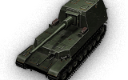
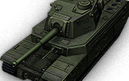
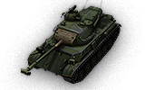
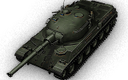

# Japan · Tier IX

[All nations and tiers](../buffs_nerfs.md) · EU v20410 → RU v14600ru · 3 November 2026

<label><strong>Find a tank</strong><input type="search" placeholder="Try is7, obj140 or xm57" aria-label="Find a tank" style="display:block;width:100%;padding:.7rem;border:1px solid #888;border-radius:4px;margin:.5rem 0;color:inherit;background:transparent"></label>

Ho-Ri 1 · Tier IX

hori1

<a href="https://tanks.gg/v20410/tank/ho-ri-1">EU stats</a> · <a href="https://tanks.gg/v14600ru/tank/ho-ri-1">RU stats</a>
<figure style="display:inline-block"><figcaption>Ho-Ri 1</figcaption></figure>
<em>Gun handling</em> 
<strong>Aim time (s)</strong> <small>EU</small> 2.49  <small>RU</small> <strong>2.21</strong> 
<strong>Dispersion (m/100 m)</strong> <small>EU</small> 0.35  <small>RU</small> <strong>0.29</strong> 
<strong>Dispersion · damaged</strong> <small>EU</small> 0.71  <small>RU</small> <strong>0.58</strong> 
<strong>Dispersion · moving</strong> <small>EU</small> 0.20  <small>RU</small> <strong>0.23</strong> 
<strong>Dispersion · tank traverse</strong> <small>EU</small> 0.20  <small>RU</small> <strong>0.23</strong> 

<em>Mobility</em> 
<strong>Forward speed (km/h)</strong> <small>EU</small> 32  <small>RU</small> <strong>35</strong> 
<strong>Forward speed on hard terrain (km/h)</strong> <small>EU</small> 32  <small>RU</small> <strong>35</strong> 
<strong>Forward speed on medium terrain (km/h)</strong> <small>EU</small> 32  <small>RU</small> <strong>35</strong> 
<strong>Reverse speed (km/h)</strong> <small>EU</small> 14  <small>RU</small> <strong>16</strong> 
<strong>Tank traverse on hard terrain (°/s)</strong> <small>EU</small> 31.56  <small>RU</small> <strong>31.38</strong> 
<strong>Tank traverse on medium terrain (°/s)</strong> <small>EU</small> 26.71  <small>RU</small> <strong>26.55</strong> 
<strong>Tank traverse on soft terrain (°/s)</strong> <small>EU</small> 14.47  <small>RU</small> <strong>14.38</strong> 

<em>Armor &amp; health</em> 
<strong>Track armor</strong> <small>EU</small> 20  <small>RU</small> <strong>25</strong> 
<strong>Health</strong> <small>EU</small> 1 800  <small>RU</small> <strong>1 650</strong> 
<strong>Health · engine</strong> <small>EU</small> 310  <small>RU</small> <strong>360</strong> 
<strong>Health · track</strong> <small>EU</small> 240  <small>RU</small> <strong>220</strong> 
<strong>Track repair time (s)</strong> <small>EU</small> 11.70  <small>RU</small> <strong>12.03</strong> 

<em>Miscellaneous</em> 
<strong>View range (m)</strong> <small>EU</small> 370  <small>RU</small> <strong>390</strong> 

Type 4 Heavy · Tier IX

type4heavy

<a href="https://tanks.gg/v20410/tank/type-4-h">EU stats</a> · <a href="https://tanks.gg/v14600ru/tank/type-4-h">RU stats</a>
<figure style="display:inline-block"><figcaption>Type 4 Heavy</figcaption></figure>
<strong>Damage (HP)</strong> <b>EU</b>  AP <strong>600</strong> /  AP <strong>600</strong> /  HE <strong>800</strong> → <b>RU</b>  AP <strong>600</strong> /  AP <strong>600</strong> /  HE <strong>770</strong>

<em>Firepower</em> 
<strong>DPM (HP/min)</strong> <small>EU</small> 2 195.79  <small>RU</small> <strong>1 896.36</strong> 
<strong>Rate of fire (rounds/min)</strong> <small>EU</small> 3.66  <small>RU</small> <strong>3.16</strong> 
<strong>Reload time (s)</strong> <small>EU</small> 16.40  <small>RU</small> <strong>18.98</strong> 

<em>Gun handling</em> 
<strong>Aim time (s)</strong> <small>EU</small> 2.59  <small>RU</small> <strong>2.78</strong> 
<strong>Dispersion · moving</strong> <small>EU</small> 0.18  <small>RU</small> <strong>0.22</strong> 
<strong>Dispersion · tank traverse</strong> <small>EU</small> 0.18  <small>RU</small> <strong>0.22</strong> 
<strong>Dispersion · turret traverse</strong> <small>EU</small> 0.14  <small>RU</small> <strong>0.16</strong> 

<em>Mobility</em> 
<strong>Forward speed on soft terrain (km/h)</strong> <small>EU</small> 19.76  <small>RU</small> <strong>16.71</strong> 
<strong>Reverse speed (km/h)</strong> <small>EU</small> 12  <small>RU</small> <strong>14</strong> 
<strong>Engine power (hp)</strong> <small>EU</small> 1 500  <small>RU</small> <strong>1 268.74</strong> 
<strong>Power/weight (hp/t)</strong> <small>EU</small> 9.35  <small>RU</small> <strong>7.90</strong> 
<strong>Turret traverse (°/s)</strong> <small>EU</small> 18.77  <small>RU</small> <strong>17.73</strong> 
<strong>Tank traverse (°/s)</strong> <small>EU</small> 20.86  <small>RU</small> <strong>17.73</strong> 
<strong>Tank traverse on hard terrain (°/s)</strong> <small>EU</small> 22.16  <small>RU</small> <strong>19.12</strong> 
<strong>Tank traverse on medium terrain (°/s)</strong> <small>EU</small> 20.31  <small>RU</small> <strong>17.52</strong> 
<strong>Tank traverse on soft terrain (°/s)</strong> <small>EU</small> 13.54  <small>RU</small> <strong>11.68</strong> 

<em>Armor &amp; health</em> 
<strong>Hull armor · rear (mm)</strong> <small>EU</small> 140  <small>RU</small> <strong>150</strong> 
<strong>Turret armor · front (mm)</strong> <small>EU</small> 300  <small>RU</small> <strong>290</strong> 
<strong>Turret armor · rear (mm)</strong> <small>EU</small> 140  <small>RU</small> <strong>200</strong> 
<strong>Health</strong> <small>EU</small> 2 150  <small>RU</small> <strong>2 050</strong> 

<em>Miscellaneous</em> 
<strong>Moving camo</strong> <small>EU</small> 0.11  <small>RU</small> <strong>0.06</strong> 
<strong>Moving camo · after firing</strong> <small>EU</small> 0.02  <small>RU</small> <strong>0.01</strong> 

Type 61 · Tier IX

type61

<a href="https://tanks.gg/v20410/tank/type-61">EU stats</a> · <a href="https://tanks.gg/v14600ru/tank/type-61">RU stats</a>
<figure style="display:inline-block"><figcaption>Type 61</figcaption></figure>
<em>Gun handling</em> 
<strong>Dispersion · turret traverse</strong> <small>EU</small> 0.10  <small>RU</small> <strong>0.11</strong> 

<em>Mobility</em> 
<strong>Forward speed (km/h)</strong> <small>EU</small> 45  <small>RU</small> <strong>50</strong> 
<strong>Forward speed on hard terrain (km/h)</strong> <small>EU</small> 45  <small>RU</small> <strong>50</strong> 
<strong>Forward speed on medium terrain (km/h)</strong> <small>EU</small> 45  <small>RU</small> <strong>50</strong> 
<strong>Forward speed on soft terrain (km/h)</strong> <small>EU</small> 38.06  <small>RU</small> <strong>37.07</strong> 
<strong>Engine power (hp)</strong> <small>EU</small> 770  <small>RU</small> <strong>750</strong> 
<strong>Power/weight (hp/t)</strong> <small>EU</small> 22  <small>RU</small> <strong>21.43</strong> 
<strong>Tank traverse (°/s)</strong> <small>EU</small> 57.36  <small>RU</small> <strong>52.15</strong> 
<strong>Tank traverse on hard terrain (°/s)</strong> <small>EU</small> 59.43  <small>RU</small> <strong>56.54</strong> 
<strong>Tank traverse on medium terrain (°/s)</strong> <small>EU</small> 54.03  <small>RU</small> <strong>51.40</strong> 
<strong>Tank traverse on soft terrain (°/s)</strong> <small>EU</small> 27.01  <small>RU</small> <strong>25.70</strong> 

<em>Armor &amp; health</em> 
<strong>Health</strong> <small>EU</small> 1 800  <small>RU</small> <strong>1 750</strong> 

Type 68 · Tier IX

type68

<a href="https://tanks.gg/v20410/tank/type-68">EU stats</a> · <a href="https://tanks.gg/v14600ru/tank/type-68">RU stats</a>
<figure style="display:inline-block"><figcaption>Type 68</figcaption></figure>
<strong>Penetration (mm)</strong> <b>EU</b>  AP <strong>250</strong> /  APCR <strong>311</strong> /  HE <strong>60</strong> → <b>RU</b>  AP <strong>248</strong> /  HEAT <strong>300</strong> /  HE <strong>60</strong>

<strong>Damage (HP)</strong> <b>EU</b>  AP <strong>400</strong> /  APCR <strong>400</strong> /  HE <strong>515</strong> → <b>RU</b>  AP <strong>400</strong> /  HEAT <strong>400</strong> /  HE <strong>515</strong>

<em>Firepower</em> 
<strong>Shell velocity (m/s)</strong> <small>EU</small> 1 050  <small>RU</small> <strong>1 120</strong> 
<strong>Ammo capacity</strong> <small>EU</small> 45  <small>RU</small> <strong>50</strong> 
<strong>Potential damage</strong> <small>EU</small> 18 000  <small>RU</small> <strong>20 000</strong> 

<em>Gun handling</em> 
<strong>Aim time (s)</strong> <small>EU</small> 2.11  <small>RU</small> <strong>2.30</strong> 
<strong>Cooldown delay</strong> <small>EU</small> 13.56  <small>RU</small> <strong>12.79</strong> 
<strong>Dispersion (m/100 m)</strong> <small>EU</small> 0.23  <small>RU</small> <strong>0.27</strong> 
<strong>Dispersion · before cooldown</strong> <small>EU</small> 0.38  <small>RU</small> <strong>0.40</strong> 
<strong>Dispersion · damaged</strong> <small>EU</small> 0.46  <small>RU</small> <strong>0.54</strong> 
<strong>Depression (°)</strong> <small>EU</small> 12  <small>RU</small> <strong>14</strong> 

<em>Mobility</em> 
<strong>Forward speed (km/h)</strong> <small>EU</small> 35  <small>RU</small> <strong>40</strong> 
<strong>Forward speed on hard terrain (km/h)</strong> <small>EU</small> 35  <small>RU</small> <strong>40</strong> 
<strong>Forward speed on medium terrain (km/h)</strong> <small>EU</small> 35  <small>RU</small> <strong>40</strong> 
<strong>Forward speed on soft terrain (km/h)</strong> <small>EU</small> 28.05  <small>RU</small> <strong>25.24</strong> 
<strong>Engine power (hp)</strong> <small>EU</small> 1 000  <small>RU</small> <strong>900</strong> 
<strong>Power/weight (hp/t)</strong> <small>EU</small> 16.95  <small>RU</small> <strong>15.25</strong> 
<strong>Turret traverse (°/s)</strong> <small>EU</small> 36.50  <small>RU</small> <strong>33.38</strong> 
<strong>Tank traverse (°/s)</strong> <small>EU</small> 31.29  <small>RU</small> <strong>30.25</strong> 
<strong>Tank traverse on hard terrain (°/s)</strong> <small>EU</small> 30.79  <small>RU</small> <strong>30.09</strong> 
<strong>Tank traverse on medium terrain (°/s)</strong> <small>EU</small> 26.05  <small>RU</small> <strong>25.46</strong> 
<strong>Tank traverse on soft terrain (°/s)</strong> <small>EU</small> 14.73  <small>RU</small> <strong>14.39</strong> 
<strong>Auto siege on/off · engage (km/h)</strong> <small>EU</small> 25 → <small>RU</small> <strong>20</strong> 
<strong>Auto siege on/off · disengage (km/h)</strong> <small>EU</small> 25 → <small>RU</small> <strong>20</strong> 

<em>Armor &amp; health</em> 
<strong>Hull armor · front (mm)</strong> <small>EU</small> 110  <small>RU</small> <strong>120</strong> 
<strong>Hull armor · rear (mm)</strong> <small>EU</small> 30  <small>RU</small> <strong>50</strong> 
<strong>Turret armor · front (mm)</strong> <small>EU</small> 280  <small>RU</small> <strong>260</strong> 
<strong>Turret armor · side (mm)</strong> <small>EU</small> 80  <small>RU</small> <strong>100</strong> 
<strong>Turret armor · rear (mm)</strong> <small>EU</small> 40  <small>RU</small> <strong>90</strong> 
<strong>Track armor</strong> <small>EU</small> 20  <small>RU</small> <strong>25</strong> 
<strong>Health</strong> <small>EU</small> 1 950  <small>RU</small> <strong>2 000</strong> 

<em>Miscellaneous</em> 
<strong>View range (m)</strong> <small>EU</small> 390  <small>RU</small> <strong>400</strong> 
<strong>Fire chance (%)</strong> <small>EU</small> 12  <small>RU</small> <strong>10</strong> 
<strong>Shell cost</strong> <small>EU</small> 1 100  <small>RU</small> <strong>1 060</strong> 

Alternate mode

<a href="https://tanks.gg/v20410/tank/type-68-siege">EU stats</a> · <a href="https://tanks.gg/v14600ru/tank/type-68-siege">RU stats</a>
<em>Firepower</em> 
<strong>Shell velocity (m/s)</strong> <small>EU</small> 1 050  <small>RU</small> <strong>1 120</strong> 
<strong>Ammo capacity</strong> <small>EU</small> 45  <small>RU</small> <strong>50</strong> 
<strong>Potential damage</strong> <small>EU</small> 18 000  <small>RU</small> <strong>20 000</strong> 

<em>Gun handling</em> 
<strong>Aim time (s)</strong> <small>EU</small> 2.11  <small>RU</small> <strong>2.30</strong> 
<strong>Cooldown delay</strong> <small>EU</small> 13.56  <small>RU</small> <strong>12.79</strong> 
<strong>Dispersion (m/100 m)</strong> <small>EU</small> 0.23  <small>RU</small> <strong>0.27</strong> 
<strong>Dispersion · before cooldown</strong> <small>EU</small> 0.38  <small>RU</small> <strong>0.40</strong> 
<strong>Dispersion · damaged</strong> <small>EU</small> 0.46  <small>RU</small> <strong>0.54</strong> 
<strong>Depression (°)</strong> <small>EU</small> 12  <small>RU</small> <strong>14</strong> 

<em>Mobility</em> 
<strong>Forward speed (km/h)</strong> <small>EU</small> 35  <small>RU</small> <strong>40</strong> 
<strong>Forward speed on hard terrain (km/h)</strong> <small>EU</small> 35  <small>RU</small> <strong>40</strong> 
<strong>Forward speed on medium terrain (km/h)</strong> <small>EU</small> 35  <small>RU</small> <strong>40</strong> 
<strong>Forward speed on soft terrain (km/h)</strong> <small>EU</small> 28.05  <small>RU</small> <strong>25.24</strong> 
<strong>Engine power (hp)</strong> <small>EU</small> 1 000  <small>RU</small> <strong>900</strong> 
<strong>Power/weight (hp/t)</strong> <small>EU</small> 16.95  <small>RU</small> <strong>15.25</strong> 
<strong>Turret traverse (°/s)</strong> <small>EU</small> 36.50  <small>RU</small> <strong>33.38</strong> 
<strong>Tank traverse (°/s)</strong> <small>EU</small> 31.29  <small>RU</small> <strong>30.25</strong> 
<strong>Tank traverse on hard terrain (°/s)</strong> <small>EU</small> 30.79  <small>RU</small> <strong>30.09</strong> 
<strong>Tank traverse on medium terrain (°/s)</strong> <small>EU</small> 26.05  <small>RU</small> <strong>25.46</strong> 
<strong>Tank traverse on soft terrain (°/s)</strong> <small>EU</small> 14.73  <small>RU</small> <strong>14.39</strong> 
<strong>Auto siege on/off · engage (km/h)</strong> <small>EU</small> 25 → <small>RU</small> <strong>20</strong> 
<strong>Auto siege on/off · disengage (km/h)</strong> <small>EU</small> 25 → <small>RU</small> <strong>20</strong> 

<em>Armor &amp; health</em> 
<strong>Hull armor · front (mm)</strong> <small>EU</small> 110  <small>RU</small> <strong>120</strong> 
<strong>Hull armor · rear (mm)</strong> <small>EU</small> 30  <small>RU</small> <strong>50</strong> 
<strong>Turret armor · front (mm)</strong> <small>EU</small> 280  <small>RU</small> <strong>260</strong> 
<strong>Turret armor · side (mm)</strong> <small>EU</small> 80  <small>RU</small> <strong>100</strong> 
<strong>Turret armor · rear (mm)</strong> <small>EU</small> 40  <small>RU</small> <strong>90</strong> 
<strong>Track armor</strong> <small>EU</small> 20  <small>RU</small> <strong>25</strong> 
<strong>Health</strong> <small>EU</small> 1 950  <small>RU</small> <strong>2 000</strong> 

<em>Miscellaneous</em> 
<strong>View range (m)</strong> <small>EU</small> 390  <small>RU</small> <strong>400</strong> 
<strong>Fire chance (%)</strong> <small>EU</small> 12  <small>RU</small> <strong>10</strong> 
<strong>Shell cost</strong> <small>EU</small> 1 100  <small>RU</small> <strong>1 060</strong> 

