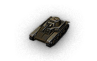

# Poland · Tier I

[All nations and tiers](../buffs_nerfs.md) · EU v20410 → RU v14600ru · 3 November 2026

<label><strong>Find a tank</strong><input type="search" placeholder="Try is7, obj140 or xm57" aria-label="Find a tank" style="display:block;width:100%;padding:.7rem;border:1px solid #888;border-radius:4px;margin:.5rem 0;color:inherit;background:transparent"></label>

4TP · Tier I

4tp

<a href="https://tanks.gg/v20410/tank/4tp">EU stats</a> · <a href="https://tanks.gg/v14600ru/tank/4tp">RU stats</a>
<figure style="display:inline-block"><figcaption>4TP</figcaption></figure>
<em>Firepower</em> 
<strong>DPM (HP/min)</strong> <small>EU</small> 634.62  <small>RU</small> <strong>868.42</strong> 
<strong>Rate of fire (rounds/min)</strong> <small>EU</small> 11.54  <small>RU</small> <strong>15.79</strong> 
<strong>Reload time (s)</strong> <small>EU</small> 5.20  <small>RU</small> <strong>3.80</strong> 

<em>Gun handling</em> 
<strong>Aim time (s)</strong> <small>EU</small> 2.80  <small>RU</small> <strong>2</strong> 
<strong>Dispersion (m/100 m)</strong> <small>EU</small> 0.46  <small>RU</small> <strong>0.40</strong> 
<strong>Dispersion · damaged</strong> <small>EU</small> 0.92  <small>RU</small> <strong>0.80</strong> 
<strong>Dispersion · moving</strong> <small>EU</small> 0.28  <small>RU</small> <strong>0.10</strong> 
<strong>Dispersion · tank traverse</strong> <small>EU</small> 0.28  <small>RU</small> <strong>0.10</strong> 
<strong>Dispersion · turret traverse</strong> <small>EU</small> 0.16  <small>RU</small> <strong>0.10</strong> 
<strong>Dispersion · firing</strong> <small>EU</small> 3.50  <small>RU</small> <strong>3</strong> 

<em>Mobility</em> 
<strong>Tank traverse (°/s)</strong> <small>EU</small> 52.15  <small>RU</small> <strong>46.93</strong> 
<strong>Tank traverse on hard terrain (°/s)</strong> <small>EU</small> 51.69  <small>RU</small> <strong>46.52</strong> 
<strong>Tank traverse on medium terrain (°/s)</strong> <small>EU</small> 43.07  <small>RU</small> <strong>38.77</strong> 
<strong>Tank traverse on soft terrain (°/s)</strong> <small>EU</small> 24.61  <small>RU</small> <strong>22.15</strong> 

<em>Armor &amp; health</em> 
<strong>Health</strong> <small>EU</small> 235  <small>RU</small> <strong>280</strong> 
<strong>Track repair time (s)</strong> <small>EU</small> 6  <small>RU</small> <strong>3</strong> 

<em>Miscellaneous</em> 
<strong>View range (m)</strong> <small>EU</small> 280  <small>RU</small> <strong>300</strong> 

