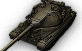
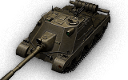
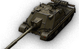

# Poland · Tier X

[All nations and tiers](../buffs_nerfs.md) · EU v20410 → RU v14600ru · 3 November 2026

<label><strong>Find a tank</strong><input type="search" placeholder="Try is7, obj140 or xm57" aria-label="Find a tank" style="display:block;width:100%;padding:.7rem;border:1px solid #888;border-radius:4px;margin:.5rem 0;color:inherit;background:transparent"></label>

60TP Lewandowskiego · Tier X

60tplewandowskiego

<a href="https://tanks.gg/v20410/tank/60tp">EU stats</a> · <a href="https://tanks.gg/v14600ru/tank/60tp">RU stats</a>
<figure style="display:inline-block"><figcaption>60TP Lewandowskiego</figcaption></figure>
<em>Firepower</em> 
<strong>DPM (HP/min)</strong> <small>EU</small> 2 289.51  <small>RU</small> <strong>2 406.92</strong> 
<strong>Rate of fire (rounds/min)</strong> <small>EU</small> 3.05  <small>RU</small> <strong>3.21</strong> 
<strong>Reload time (s)</strong> <small>EU</small> 19.65  <small>RU</small> <strong>18.70</strong> 

<em>Gun handling</em> 
<strong>Dispersion (m/100 m)</strong> <small>EU</small> 0.38  <small>RU</small> <strong>0.36</strong> 
<strong>Dispersion · damaged</strong> <small>EU</small> 0.77  <small>RU</small> <strong>0.73</strong> 

<em>Armor &amp; health</em> 
<strong>Health</strong> <small>EU</small> 2 500  <small>RU</small> <strong>2 600</strong> 

<em>Miscellaneous</em> 
<strong>Moving camo</strong> <small>EU</small> 3.02  <small>RU</small> <strong>2.96</strong> 
<strong>Moving camo · after firing</strong> <small>EU</small> 0.41  <small>RU</small> <strong>0.40</strong> 

NC 70 Błyskawica · Tier X

nc70błyskawica

<a href="https://tanks.gg/v20410/tank/byskawica">EU stats</a> · <a href="https://tanks.gg/v14600ru/tank/zubr">RU stats</a>
<figure style="display:inline-block"><figcaption>EU · NC 70 Błyskawica</figcaption></figure><figure style="display:inline-block"><figcaption>RU · Wz.70 Żubr</figcaption></figure>
<strong>Penetration (mm)</strong> <b>EU</b>  APCR <strong>292</strong> /  APCR <strong>321</strong> /  HIGH_EXPLOSIVE <strong>85</strong> → <b>RU</b>  APCR <strong>294</strong> /  APCR <strong>354</strong> /  HE <strong>85</strong>

<strong>Damage (HP)</strong> <b>EU</b>  APCR <strong>800</strong> /  APCR <strong>800</strong> /  HIGH_EXPLOSIVE <strong>800</strong> → <b>RU</b>  APCR <strong>620</strong> /  APCR <strong>620</strong> /  HE <strong>780</strong>

<em>Firepower</em> 
<strong>DPM (HP/min)</strong> <small>EU</small> 3 654.31  <small>RU</small> <strong>2 771.40</strong> 
<strong>DPM · at 500m</strong> <small>EU</small> 1 370.36  <small>RU</small> <strong>2 771.40</strong> 
<strong>Module damage</strong> <small>EU</small> 203  <small>RU</small> <strong>175</strong> 
<strong>Rate of fire (rounds/min)</strong> <small>EU</small> 4.57  <small>RU</small> <strong>4.47</strong> 
<strong>Reload time (s)</strong> <small>EU</small> 13.14  <small>RU</small> <strong>13.42</strong> 
<strong>Shell velocity (m/s)</strong> <small>EU</small> 1 700  <small>RU</small> <strong>1 640</strong> 
<strong>Ammo capacity</strong> <small>EU</small> 60  <small>RU</small> <strong>54</strong> 
<strong>Potential damage</strong> <small>EU</small> 48 000  <small>RU</small> <strong>33 480</strong> 

<em>Gun handling</em> 
<strong>Aim time (s)</strong> <small>EU</small> 2.40  <small>RU</small> <strong>2.01</strong> 
<strong>Dispersion (m/100 m)</strong> <small>EU</small> 0.34  <small>RU</small> <strong>0.35</strong> 
<strong>Dispersion · damaged</strong> <small>EU</small> 0.67  <small>RU</small> <strong>0.69</strong> 
<strong>Dispersion · moving</strong> <small>EU</small> 0.18  <small>RU</small> <strong>0.20</strong> 
<strong>Dispersion · tank traverse</strong> <small>EU</small> 0.18  <small>RU</small> <strong>0.14</strong> 
<strong>Dispersion · turret traverse</strong> <small>EU</small> 0.08  <small>RU</small> <strong>0.05</strong> 
<strong>Dispersion · firing</strong> <small>EU</small> 4  <small>RU</small> <strong>8</strong> 
<strong>Depression (°)</strong> <small>EU</small> 7  <small>RU</small> <strong>8</strong> 
<strong>Gun traverse · left (°)</strong> <small>EU</small> -5  <small>RU</small> <strong>-10</strong> 
<strong>Gun traverse · right (°)</strong> <small>EU</small> 5  <small>RU</small> <strong>10</strong> 

<em>Mobility</em> 
<strong>Forward speed (km/h)</strong> <small>EU</small> 45  <small>RU</small> <strong>30</strong> 
<strong>Forward speed on hard terrain (km/h)</strong> <small>EU</small> 45  <small>RU</small> <strong>30</strong> 
<strong>Forward speed on medium terrain (km/h)</strong> <small>EU</small> 45  <small>RU</small> <strong>30</strong> 
<strong>Forward speed on soft terrain (km/h)</strong> <small>EU</small> 31.14  <small>RU</small> <strong>25.31</strong> 
<strong>Reverse speed (km/h)</strong> <small>EU</small> 15  <small>RU</small> <strong>16</strong> 
<strong>Engine power (hp)</strong> <small>EU</small> 900  <small>RU</small> <strong>750</strong> 
<strong>Weight (kg)</strong> <small>EU</small> 55 000 → <small>RU</small> <strong>56 390</strong> 
<strong>Power/weight (hp/t)</strong> <small>EU</small> 16.36  <small>RU</small> <strong>13.30</strong> 

<em>Armor &amp; health</em> 
<strong>Hull armor · front (mm)</strong> <small>EU</small> 200  <small>RU</small> <strong>220</strong> 
<strong>Hull armor · side (mm)</strong> <small>EU</small> 70  <small>RU</small> <strong>100</strong> 
<strong>Track armor</strong> <small>EU</small> 30  <small>RU</small> <strong>20</strong> 
<strong>Health</strong> <small>EU</small> 2 000  <small>RU</small> <strong>1 900</strong> 
<strong>Health · engine</strong> <small>EU</small> 340  <small>RU</small> <strong>370</strong> 
<strong>Health · ammo rack</strong> <small>EU</small> 210  <small>RU</small> <strong>260</strong> 

<em>Miscellaneous</em> 
<strong>Stationary camo</strong> <small>EU</small> 12.77  <small>RU</small> <strong>17.21</strong> 
<strong>Stationary camo · after firing</strong> <small>EU</small> 1.46  <small>RU</small> <strong>3.60</strong> 
<strong>Moving camo</strong> <small>EU</small> 7.64  <small>RU</small> <strong>10.32</strong> 
<strong>Moving camo · after firing</strong> <small>EU</small> 0.87  <small>RU</small> <strong>2.16</strong> 
<strong>Shell cost</strong> <small>EU</small> 1 840  <small>RU</small> <strong>1 480</strong> 

