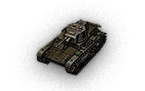
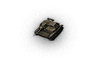

# Poland · Tier II

[All nations and tiers](../buffs_nerfs.md) · EU v20410 → RU v14600ru · 3 November 2026

<label><strong>Find a tank</strong><input type="search" placeholder="Try is7, obj140 or xm57" aria-label="Find a tank" style="display:block;width:100%;padding:.7rem;border:1px solid #888;border-radius:4px;margin:.5rem 0;color:inherit;background:transparent"></label>

7TP · Tier II

7tp

<a href="https://tanks.gg/v20410/tank/7tp">EU stats</a> · <a href="https://tanks.gg/v14600ru/tank/7tp">RU stats</a>
<figure style="display:inline-block"><figcaption>7TP</figcaption></figure>
<em>Gun handling</em> 
<strong>Aim time (s)</strong> <small>EU</small> 2.21  <small>RU</small> <strong>1.53</strong> 
<strong>Dispersion · moving</strong> <small>EU</small> 0.24  <small>RU</small> <strong>0.20</strong> 
<strong>Dispersion · tank traverse</strong> <small>EU</small> 0.24  <small>RU</small> <strong>0.20</strong> 
<strong>Dispersion · turret traverse</strong> <small>EU</small> 0.14  <small>RU</small> <strong>0.10</strong> 
<strong>Dispersion · firing</strong> <small>EU</small> 3.50  <small>RU</small> <strong>1</strong> 

<em>Mobility</em> 
<strong>Forward speed (km/h)</strong> <small>EU</small> 40  <small>RU</small> <strong>35</strong> 
<strong>Forward speed on hard terrain (km/h)</strong> <small>EU</small> 40  <small>RU</small> <strong>35</strong> 
<strong>Forward speed on medium terrain (km/h)</strong> <small>EU</small> 40  <small>RU</small> <strong>35</strong> 
<strong>Forward speed on soft terrain (km/h)</strong> <small>EU</small> 24.67  <small>RU</small> <strong>23.03</strong> 
<strong>Engine power (hp)</strong> <small>EU</small> 150  <small>RU</small> <strong>140</strong> 
<strong>Power/weight (hp/t)</strong> <small>EU</small> 14.91  <small>RU</small> <strong>13.92</strong> 
<strong>Tank traverse on hard terrain (°/s)</strong> <small>EU</small> 49.09  <small>RU</small> <strong>46.19</strong> 
<strong>Tank traverse on medium terrain (°/s)</strong> <small>EU</small> 44.63  <small>RU</small> <strong>41.99</strong> 
<strong>Tank traverse on soft terrain (°/s)</strong> <small>EU</small> 21.34  <small>RU</small> <strong>20.08</strong> 

<em>Armor &amp; health</em> 
<strong>Track repair time (s)</strong> <small>EU</small> 12.03  <small>RU</small> <strong>3</strong> 

<em>Miscellaneous</em> 
<strong>View range (m)</strong> <small>EU</small> 300  <small>RU</small> <strong>310</strong> 

TKS z n.k.m. 20 mm · Tier II

tksznkm20mm

<a href="https://tanks.gg/v20410/tank/tks-20">EU stats</a> · <a href="https://tanks.gg/v14600ru/tank/tks-20">RU stats</a>
<figure style="display:inline-block"><figcaption>TKS z n.k.m. 20 mm</figcaption></figure>
<em>Firepower</em> 
<strong>DPM (HP/min)</strong> <small>EU</small> 836.77  <small>RU</small> <strong>1 081.23</strong> 
<strong>Rate of fire (rounds/min)</strong> <small>EU</small> 76.07  <small>RU</small> <strong>98.29</strong> 
<strong>Reload time (s)</strong> <small>EU</small> 6.20  <small>RU</small> <strong>7.80</strong> 
<strong>Clip size</strong> <small>EU</small> 10  <small>RU</small> <strong>18</strong> 
<strong>Clip size · burst size</strong> <small>EU</small> 2  <small>RU</small> <strong>3</strong> 
<strong>Clip damage · damage</strong> <small>EU</small> 110  <small>RU</small> <strong>198</strong> 
<strong>Clip damage · time (s)</strong> <small>EU</small> 1.69  <small>RU</small> <strong>3.19</strong> 
<strong>Clip damage · burst damage · damage</strong> <small>EU</small> 22  <small>RU</small> <strong>33</strong> 
<strong>Clip damage · burst damage · time (s)</strong> <small>EU</small> 0.19  <small>RU</small> <strong>0.38</strong> 
<strong>Ammo capacity</strong> <small>EU</small> 500  <small>RU</small> <strong>540</strong> 
<strong>Potential damage</strong> <small>EU</small> 5 500  <small>RU</small> <strong>5 940</strong> 

<em>Gun handling</em> 
<strong>Dispersion (m/100 m)</strong> <small>EU</small> 0.40  <small>RU</small> <strong>0.38</strong> 
<strong>Dispersion · damaged</strong> <small>EU</small> 0.80  <small>RU</small> <strong>0.76</strong> 
<strong>Dispersion · moving</strong> <small>EU</small> 0.18  <small>RU</small> <strong>0.12</strong> 
<strong>Dispersion · tank traverse</strong> <small>EU</small> 0.18  <small>RU</small> <strong>0.12</strong> 

<em>Mobility</em> 
<strong>Tank traverse (°/s)</strong> <small>EU</small> 46.93  <small>RU</small> <strong>73.01</strong> 
<strong>Tank traverse on hard terrain (°/s)</strong> <small>EU</small> 44.59  <small>RU</small> <strong>69.36</strong> 
<strong>Tank traverse on medium terrain (°/s)</strong> <small>EU</small> 33.44  <small>RU</small> <strong>52.02</strong> 
<strong>Tank traverse on soft terrain (°/s)</strong> <small>EU</small> 19.11  <small>RU</small> <strong>29.73</strong> 

<em>Armor &amp; health</em> 
<strong>Health</strong> <small>EU</small> 320  <small>RU</small> <strong>380</strong> 
<strong>Track repair time (s)</strong> <small>EU</small> 12.03  <small>RU</small> <strong>3</strong> 

<em>Miscellaneous</em> 
<strong>View range (m)</strong> <small>EU</small> 290  <small>RU</small> <strong>310</strong> 

