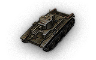

# Poland · Tier III

[All nations and tiers](../buffs_nerfs.md) · EU v20410 → RU v14600ru · 3 November 2026

<label><strong>Find a tank</strong><input type="search" placeholder="Try is7, obj140 or xm57" aria-label="Find a tank" style="display:block;width:100%;padding:.7rem;border:1px solid #888;border-radius:4px;margin:.5rem 0;color:inherit;background:transparent"></label>

10TP · Tier III

10tp

<a href="https://tanks.gg/v20410/tank/10tp">EU stats</a> · <a href="https://tanks.gg/v14600ru/tank/10tp">RU stats</a>
<figure style="display:inline-block"><figcaption>10TP</figcaption></figure>
<strong>Penetration (mm)</strong> <b>EU</b>  AP <strong>63</strong> /  AP <strong>82</strong> /  HE <strong>24</strong> → <b>RU</b>  AP <strong>56</strong> /  AP <strong>82</strong> /  HE <strong>24</strong>

<em>Firepower</em> 
<strong>DPM (HP/min)</strong> <small>EU</small> 1 000  <small>RU</small> <strong>1 071.43</strong> 
<strong>Rate of fire (rounds/min)</strong> <small>EU</small> 13.33  <small>RU</small> <strong>14.29</strong> 
<strong>Reload time (s)</strong> <small>EU</small> 4.50  <small>RU</small> <strong>4.20</strong> 

<em>Gun handling</em> 
<strong>Aim time (s)</strong> <small>EU</small> 2.01  <small>RU</small> <strong>1.53</strong> 
<strong>Dispersion (m/100 m)</strong> <small>EU</small> 0.36  <small>RU</small> <strong>0.38</strong> 
<strong>Dispersion · damaged</strong> <small>EU</small> 0.73  <small>RU</small> <strong>0.77</strong> 
<strong>Dispersion · moving</strong> <small>EU</small> 0.20  <small>RU</small> <strong>0.23</strong> 
<strong>Dispersion · tank traverse</strong> <small>EU</small> 0.20  <small>RU</small> <strong>0.23</strong> 
<strong>Dispersion · turret traverse</strong> <small>EU</small> 0.12  <small>RU</small> <strong>0.10</strong> 
<strong>Dispersion · firing</strong> <small>EU</small> 3.50  <small>RU</small> <strong>3</strong> 

<em>Mobility</em> 
<strong>Tank traverse (°/s)</strong> <small>EU</small> 46.93  <small>RU</small> <strong>52.15</strong> 
<strong>Tank traverse on hard terrain (°/s)</strong> <small>EU</small> 51.01  <small>RU</small> <strong>56.68</strong> 
<strong>Tank traverse on medium terrain (°/s)</strong> <small>EU</small> 40.81  <small>RU</small> <strong>45.34</strong> 
<strong>Tank traverse on soft terrain (°/s)</strong> <small>EU</small> 17.74  <small>RU</small> <strong>19.72</strong> 

<em>Armor &amp; health</em> 
<strong>Health</strong> <small>EU</small> 410  <small>RU</small> <strong>450</strong> 
<strong>Track repair time (s)</strong> <small>EU</small> 10.03  <small>RU</small> <strong>4</strong> 

