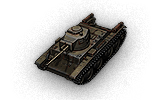
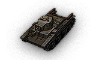

# Poland · Tier IV

[All nations and tiers](../buffs_nerfs.md) · EU v20410 → RU v14600ru · 3 November 2026

<label><strong>Find a tank</strong><input type="search" placeholder="Try is7, obj140 or xm57" aria-label="Find a tank" style="display:block;width:100%;padding:.7rem;border:1px solid #888;border-radius:4px;margin:.5rem 0;color:inherit;background:transparent"></label>

14TP · Tier IV

14tp

<a href="https://tanks.gg/v20410/tank/14tp">EU stats</a> · <a href="https://tanks.gg/v14600ru/tank/14tp">RU stats</a>
<figure style="display:inline-block"><figcaption>EU · 14TP</figcaption></figure><figure style="display:inline-block"><figcaption>RU · 14TP</figcaption></figure>
<strong>Penetration (mm)</strong> <b>EU</b>  AP <strong>75</strong> /  APCR <strong>98</strong> /  HE <strong>23</strong> → <b>RU</b>  AP <strong>72</strong> /  APCR <strong>111</strong> /  HE <strong>23</strong>

<em>Firepower</em> 
<strong>DPM (HP/min)</strong> <small>EU</small> 1 578.95  <small>RU</small> <strong>1 558.44</strong> 
<strong>Rate of fire (rounds/min)</strong> <small>EU</small> 31.58  <small>RU</small> <strong>31.17</strong> 
<strong>Reload time (s)</strong> <small>EU</small> 6.40  <small>RU</small> <strong>6.50</strong> 
<strong>Ammo capacity</strong> <small>EU</small> 120  <small>RU</small> <strong>92</strong> 
<strong>Potential damage</strong> <small>EU</small> 6 000  <small>RU</small> <strong>4 600</strong> 

<em>Gun handling</em> 
<strong>Aim time (s)</strong> <small>EU</small> 2.30  <small>RU</small> <strong>1.73</strong> 
<strong>Dispersion (m/100 m)</strong> <small>EU</small> 0.37  <small>RU</small> <strong>0.38</strong> 
<strong>Dispersion · damaged</strong> <small>EU</small> 0.75  <small>RU</small> <strong>0.77</strong> 
<strong>Dispersion · turret traverse</strong> <small>EU</small> 0.16  <small>RU</small> <strong>0.10</strong> 
<strong>Dispersion · firing</strong> <small>EU</small> 3.50  <small>RU</small> <strong>2</strong> 

<em>Mobility</em> 
<strong>Forward speed (km/h)</strong> <small>EU</small> 55  <small>RU</small> <strong>50</strong> 
<strong>Forward speed on hard terrain (km/h)</strong> <small>EU</small> 55  <small>RU</small> <strong>50</strong> 
<strong>Forward speed on medium terrain (km/h)</strong> <small>EU</small> 55  <small>RU</small> <strong>50</strong> 
<strong>Forward speed on soft terrain (km/h)</strong> <small>EU</small> 40.96  <small>RU</small> <strong>38.23</strong> 
<strong>Engine power (hp)</strong> <small>EU</small> 300  <small>RU</small> <strong>280</strong> 
<strong>Power/weight (hp/t)</strong> <small>EU</small> 20.45  <small>RU</small> <strong>19.09</strong> 
<strong>Tank traverse (°/s)</strong> <small>EU</small> 54.24  <small>RU</small> <strong>52.15</strong> 
<strong>Tank traverse on hard terrain (°/s)</strong> <small>EU</small> 57.67  <small>RU</small> <strong>55.46</strong> 
<strong>Tank traverse on medium terrain (°/s)</strong> <small>EU</small> 52.43  <small>RU</small> <strong>50.42</strong> 
<strong>Tank traverse on soft terrain (°/s)</strong> <small>EU</small> 30.35  <small>RU</small> <strong>29.19</strong> 

<em>Armor &amp; health</em> 
<strong>Track repair time (s)</strong> <small>EU</small> 8.02  <small>RU</small> <strong>5</strong> 

