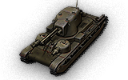
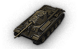
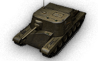

# Poland · Tier V

[All nations and tiers](../buffs_nerfs.md) · EU v20410 → RU v14600ru · 3 November 2026

<label><strong>Find a tank</strong><input type="search" placeholder="Try is7, obj140 or xm57" aria-label="Find a tank" style="display:block;width:100%;padding:.7rem;border:1px solid #888;border-radius:4px;margin:.5rem 0;color:inherit;background:transparent"></label>

25TP KSUST II · Tier V

25tpksustii

<a href="https://tanks.gg/v20410/tank/25tp">EU stats</a> · <a href="https://tanks.gg/v14600ru/tank/25tp">RU stats</a>
<figure style="display:inline-block"><figcaption>25TP KSUST II</figcaption></figure>
<strong>Penetration (mm)</strong> <b>EU</b>  AP <strong>135</strong> /  HEAT <strong>175</strong> /  HE <strong>38</strong> → <b>RU</b>  AP <strong>135</strong> /  APCR <strong>175</strong> /  HE <strong>38</strong>

<strong>Damage (HP)</strong> <b>EU</b>  AP <strong>135</strong> /  HEAT <strong>135</strong> /  HE <strong>175</strong> → <b>RU</b>  AP <strong>135</strong> /  APCR <strong>135</strong> /  HE <strong>175</strong>

<em>Mobility</em> 
<strong>Forward speed on medium terrain (km/h)</strong> <small>EU</small> 55.51  <small>RU</small> <strong>55.38</strong> 
<strong>Forward speed on soft terrain (km/h)</strong> <small>EU</small> 31.38  <small>RU</small> <strong>31.30</strong> 
<strong>Weight (kg)</strong> <small>EU</small> 26 370 → <small>RU</small> <strong>26 430</strong> 
<strong>Power/weight (hp/t)</strong> <small>EU</small> 18.96  <small>RU</small> <strong>18.92</strong> 
<strong>Tank traverse on hard terrain (°/s)</strong> <small>EU</small> 45.31  <small>RU</small> <strong>45.21</strong> 
<strong>Tank traverse on medium terrain (°/s)</strong> <small>EU</small> 38.34  <small>RU</small> <strong>38.26</strong> 
<strong>Tank traverse on soft terrain (°/s)</strong> <small>EU</small> 21.67  <small>RU</small> <strong>21.62</strong> 

<em>Armor &amp; health</em> 
<strong>Health</strong> <small>EU</small> 660  <small>RU</small> <strong>590</strong> 

DS PZInż · Tier V

dspzinż

<a href="https://tanks.gg/v20410/tank/ds-pzinz">EU stats</a> · <a href="https://tanks.gg/v14600ru/tank/ds-pzinz">RU stats</a>
<figure style="display:inline-block"><figcaption>DS PZInż</figcaption></figure>
<em>Armor &amp; health</em> 
<strong>Health</strong> <small>EU</small> 650  <small>RU</small> <strong>590</strong> 

<em>Miscellaneous</em> 
<strong>View range (m)</strong> <small>EU</small> 340  <small>RU</small> <strong>350</strong> 

SDP 40 Zadymka · Tier V

sdp40zadymka

<a href="https://tanks.gg/v20410/tank/zadymka">EU stats</a> · <a href="https://tanks.gg/v14600ru/tank/wz40">RU stats</a>
<figure style="display:inline-block"><figcaption>SDP 40 Zadymka</figcaption></figure>
<strong>Penetration (mm)</strong> <b>EU</b>  AP <strong>150</strong> /  APCR <strong>188</strong> /  HE <strong>45</strong> → <b>RU</b>  AP <strong>150</strong> /  APCR <strong>175</strong> /  HE <strong>38</strong>

<strong>Damage (HP)</strong> <b>EU</b>  AP <strong>240</strong> /  APCR <strong>240</strong> /  HE <strong>320</strong> → <b>RU</b>  AP <strong>135</strong> /  APCR <strong>135</strong> /  HE <strong>190</strong>

<em>Firepower</em> 
<strong>DPM (HP/min)</strong> <small>EU</small> 1 877.40  <small>RU</small> <strong>1 536.05</strong> 
<strong>Module damage</strong> <small>EU</small> 122  <small>RU</small> <strong>100</strong> 
<strong>Rate of fire (rounds/min)</strong> <small>EU</small> 7.82  <small>RU</small> <strong>11.38</strong> 
<strong>Reload time (s)</strong> <small>EU</small> 7.67  <small>RU</small> <strong>5.27</strong> 
<strong>Caliber</strong> <small>EU</small> 90  <small>RU</small> <strong>75</strong> 
<strong>Shell velocity (m/s)</strong> <small>EU</small> 950  <small>RU</small> <strong>850</strong> 
<strong>Ammo capacity</strong> <small>EU</small> 55  <small>RU</small> <strong>90</strong> 
<strong>Potential damage</strong> <small>EU</small> 13 200  <small>RU</small> <strong>12 150</strong> 

<em>Gun handling</em> 
<strong>Aim time (s)</strong> <small>EU</small> 2.11  <small>RU</small> <strong>2.21</strong> 
<strong>Dispersion (m/100 m)</strong> <small>EU</small> 0.36  <small>RU</small> <strong>0.35</strong> 
<strong>Dispersion · damaged</strong> <small>EU</small> 0.73  <small>RU</small> <strong>0.69</strong> 
<strong>Dispersion · moving</strong> <small>EU</small> 0.22  <small>RU</small> <strong>0.24</strong> 
<strong>Dispersion · tank traverse</strong> <small>EU</small> 0.22  <small>RU</small> <strong>0.24</strong> 
<strong>Dispersion · turret traverse</strong> <small>EU</small> 0.10  <small>RU</small> <strong>0.06</strong> 
<strong>Dispersion · firing</strong> <small>EU</small> 4  <small>RU</small> <strong>3.50</strong> 
<strong>Gun traverse · left (°)</strong> <small>EU</small> -5  <small>RU</small> <strong>-10</strong> 
<strong>Gun traverse · right (°)</strong> <small>EU</small> 5  <small>RU</small> <strong>10</strong> 

<em>Mobility</em> 
<strong>Forward speed (km/h)</strong> <small>EU</small> 50  <small>RU</small> <strong>30</strong> 
<strong>Forward speed on hard terrain (km/h)</strong> <small>EU</small> 50  <small>RU</small> <strong>30</strong> 
<strong>Forward speed on medium terrain (km/h)</strong> <small>EU</small> 41.68  <small>RU</small> <strong>30</strong> 
<strong>Forward speed on soft terrain (km/h)</strong> <small>EU</small> 27.79  <small>RU</small> <strong>22.18</strong> 
<strong>Engine power (hp)</strong> <small>EU</small> 460  <small>RU</small> <strong>560</strong> 
<strong>Weight (kg)</strong> <small>EU</small> 30 000 → <small>RU</small> <strong>45 764</strong> 
<strong>Power/weight (hp/t)</strong> <small>EU</small> 15.33  <small>RU</small> <strong>12.24</strong> 
<strong>Turret traverse (°/s)</strong> <small>EU</small> 45.89  <small>RU</small> <strong>27.12</strong> 
<strong>Tank traverse (°/s)</strong> <small>EU</small> 36.50  <small>RU</small> <strong>31.29</strong> 
<strong>Tank traverse on hard terrain (°/s)</strong> <small>EU</small> 37.48  <small>RU</small> <strong>34.63</strong> 
<strong>Tank traverse on medium terrain (°/s)</strong> <small>EU</small> 29.45  <small>RU</small> <strong>27.21</strong> 
<strong>Tank traverse on soft terrain (°/s)</strong> <small>EU</small> 19.63  <small>RU</small> <strong>18.14</strong> 

<em>Armor &amp; health</em> 
<strong>Hull armor · front (mm)</strong> <small>EU</small> 100  <small>RU</small> <strong>120</strong> 
<strong>Hull armor · side (mm)</strong> <small>EU</small> 50  <small>RU</small> <strong>40</strong> 
<strong>Hull armor · rear (mm)</strong> <small>EU</small> 30  <small>RU</small> <strong>40</strong> 
<strong>Health · engine</strong> <small>EU</small> 140  <small>RU</small> <strong>124</strong> 
<strong>Health · ammo rack</strong> <small>EU</small> 150  <small>RU</small> <strong>130</strong> 

<em>Miscellaneous</em> 
<strong>Stationary camo</strong> <small>EU</small> 18.75  <small>RU</small> <strong>18.52</strong> 
<strong>Stationary camo · after firing</strong> <small>EU</small> 4.69  <small>RU</small> <strong>4.58</strong> 
<strong>Moving camo</strong> <small>EU</small> 11.29  <small>RU</small> <strong>11.12</strong> 
<strong>Moving camo · after firing</strong> <small>EU</small> 2.82  <small>RU</small> <strong>2.75</strong> 
<strong>View range (m)</strong> <small>EU</small> 280  <small>RU</small> <strong>320</strong> 
<strong>Shell cost</strong> <small>EU</small> 260  <small>RU</small> <strong>134</strong> 

