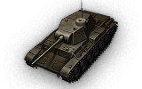
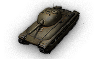
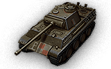
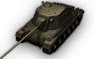
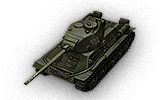

# Poland · Tier VI

[All nations and tiers](../buffs_nerfs.md) · EU v20410 → RU v14600ru · 3 November 2026

<label><strong>Find a tank</strong><input type="search" placeholder="Try is7, obj140 or xm57" aria-label="Find a tank" style="display:block;width:100%;padding:.7rem;border:1px solid #888;border-radius:4px;margin:.5rem 0;color:inherit;background:transparent"></label>

40TP Habicha · Tier VI

40tphabicha

<a href="https://tanks.gg/v20410/tank/40tp">EU stats</a> · <a href="https://tanks.gg/v14600ru/tank/40tp">RU stats</a>
<figure style="display:inline-block"><figcaption>40TP Habicha</figcaption></figure>
<em>Mobility</em> 
<strong>Forward speed on hard terrain (km/h)</strong> <small>EU</small> 50  <small>RU</small> <strong>38.75</strong> 
<strong>Forward speed on medium terrain (km/h)</strong> <small>EU</small> 43.72  <small>RU</small> <strong>32.79</strong> 
<strong>Forward speed on soft terrain (km/h)</strong> <small>EU</small> 27.06  <small>RU</small> <strong>20.30</strong> 
<strong>Engine power (hp)</strong> <small>EU</small> 600  <small>RU</small> <strong>450</strong> 
<strong>Power/weight (hp/t)</strong> <small>EU</small> 14.93  <small>RU</small> <strong>11.20</strong> 
<strong>Tank traverse on hard terrain (°/s)</strong> <small>EU</small> 44.04  <small>RU</small> <strong>45.35</strong> 
<strong>Tank traverse on medium terrain (°/s)</strong> <small>EU</small> 37.26  <small>RU</small> <strong>38.37</strong> 
<strong>Tank traverse on soft terrain (°/s)</strong> <small>EU</small> 23.07  <small>RU</small> <strong>23.75</strong> 

<em>Armor &amp; health</em> 
<strong>Health</strong> <small>EU</small> 920  <small>RU</small> <strong>840</strong> 

B.U.G.I. · Tier VI

bugi

<a href="https://tanks.gg/v20410/tank/bugi">EU stats</a> · <a href="https://tanks.gg/v14600ru/tank/bugi">RU stats</a>
<figure style="display:inline-block"><figcaption>EU · B.U.G.I.</figcaption></figure><figure style="display:inline-block"><figcaption>RU · B.U.G.I.</figcaption></figure>
<em>Mobility</em> 
<strong>Tank traverse on hard terrain (°/s)</strong> <small>EU</small> 37.95  <small>RU</small> <strong>43.47</strong> 
<strong>Tank traverse on medium terrain (°/s)</strong> <small>EU</small> 33.49  <small>RU</small> <strong>38.36</strong> 
<strong>Tank traverse on soft terrain (°/s)</strong> <small>EU</small> 21.09  <small>RU</small> <strong>24.15</strong> 

<em>Armor &amp; health</em> 
<strong>Health</strong> <small>EU</small> 920  <small>RU</small> <strong>840</strong> 

<em>Miscellaneous</em> 
<strong>View range (m)</strong> <small>EU</small> 350  <small>RU</small> <strong>360</strong> 

Pudel · Tier VI

pudel

<a href="https://tanks.gg/v20410/tank/pudel">EU stats</a> · <a href="https://tanks.gg/v14600ru/tank/pudel">RU stats</a>
<figure style="display:inline-block"><figcaption>Pudel</figcaption></figure>
<em>Gun handling</em> 
<strong>Aim time (s)</strong> <small>EU</small> 1.92  <small>RU</small> <strong>2.21</strong> 
<strong>Dispersion (m/100 m)</strong> <small>EU</small> 0.33  <small>RU</small> <strong>0.34</strong> 
<strong>Dispersion · damaged</strong> <small>EU</small> 0.65  <small>RU</small> <strong>0.67</strong> 

<em>Mobility</em> 
<strong>Forward speed on medium terrain (km/h)</strong> <small>EU</small> 55  <small>RU</small> <strong>53.06</strong> 
<strong>Forward speed on soft terrain (km/h)</strong> <small>EU</small> 29.92  <small>RU</small> <strong>27.68</strong> 
<strong>Engine power (hp)</strong> <small>EU</small> 800  <small>RU</small> <strong>740.10</strong> 
<strong>Power/weight (hp/t)</strong> <small>EU</small> 18.09  <small>RU</small> <strong>16.73</strong> 
<strong>Tank traverse (°/s)</strong> <small>EU</small> 39.63  <small>RU</small> <strong>31.29</strong> 
<strong>Tank traverse on hard terrain (°/s)</strong> <small>EU</small> 37.65  <small>RU</small> <strong>29.73</strong> 
<strong>Tank traverse on medium terrain (°/s)</strong> <small>EU</small> 31.38  <small>RU</small> <strong>24.77</strong> 
<strong>Tank traverse on soft terrain (°/s)</strong> <small>EU</small> 16.37  <small>RU</small> <strong>12.92</strong> 

SDP 44 Burza · Tier VI

sdp44burza

<a href="https://tanks.gg/v20410/tank/burza">EU stats</a> · <a href="https://tanks.gg/v14600ru/tank/wz44">RU stats</a>
<figure style="display:inline-block"><figcaption>SDP 44 Burza</figcaption></figure>
<strong>Penetration (mm)</strong> <b>EU</b>  AP <strong>182</strong> /  APCR <strong>220</strong> /  HE <strong>53</strong> → <b>RU</b>  AP <strong>175</strong> /  APCR <strong>205</strong> /  HE <strong>45</strong>

<strong>Damage (HP)</strong> <b>EU</b>  AP <strong>280</strong> /  APCR <strong>280</strong> /  HE <strong>390</strong> → <b>RU</b>  AP <strong>240</strong> /  APCR <strong>240</strong> /  HE <strong>320</strong>

<em>Firepower</em> 
<strong>DPM (HP/min)</strong> <small>EU</small> 2 086  <small>RU</small> <strong>1 788</strong> 
<strong>Module damage</strong> <small>EU</small> 135  <small>RU</small> <strong>122</strong> 
<strong>Caliber</strong> <small>EU</small> 100  <small>RU</small> <strong>90</strong> 
<strong>Shell velocity (m/s)</strong> <small>EU</small> 966  <small>RU</small> <strong>950</strong> 
<strong>Ammo capacity</strong> <small>EU</small> 44  <small>RU</small> <strong>56</strong> 
<strong>Potential damage</strong> <small>EU</small> 12 320  <small>RU</small> <strong>13 440</strong> 

<em>Gun handling</em> 
<strong>Aim time (s)</strong> <small>EU</small> 2.01  <small>RU</small> <strong>2.40</strong> 
<strong>Dispersion (m/100 m)</strong> <small>EU</small> 0.38  <small>RU</small> <strong>0.36</strong> 
<strong>Dispersion · damaged</strong> <small>EU</small> 0.77  <small>RU</small> <strong>0.73</strong> 
<strong>Dispersion · moving</strong> <small>EU</small> 0.25  <small>RU</small> <strong>0.24</strong> 
<strong>Dispersion · tank traverse</strong> <small>EU</small> 0.25  <small>RU</small> <strong>0.24</strong> 
<strong>Dispersion · turret traverse</strong> <small>EU</small> 0.10  <small>RU</small> <strong>0.06</strong> 
<strong>Dispersion · firing</strong> <small>EU</small> 4  <small>RU</small> <strong>3.50</strong> 
<strong>Depression (°)</strong> <small>EU</small> 7  <small>RU</small> <strong>8</strong> 
<strong>Gun traverse · left (°)</strong> <small>EU</small> -5  <small>RU</small> <strong>-10</strong> 
<strong>Gun traverse · right (°)</strong> <small>EU</small> 5  <small>RU</small> <strong>10</strong> 

<em>Mobility</em> 
<strong>Forward speed (km/h)</strong> <small>EU</small> 50  <small>RU</small> <strong>30</strong> 
<strong>Forward speed on hard terrain (km/h)</strong> <small>EU</small> 50  <small>RU</small> <strong>30</strong> 
<strong>Forward speed on medium terrain (km/h)</strong> <small>EU</small> 40.39  <small>RU</small> <strong>30</strong> 
<strong>Forward speed on soft terrain (km/h)</strong> <small>EU</small> 26.93  <small>RU</small> <strong>25.95</strong> 
<strong>Engine power (hp)</strong> <small>EU</small> 520  <small>RU</small> <strong>650</strong> 
<strong>Weight (kg)</strong> <small>EU</small> 35 000 → <small>RU</small> <strong>45 395</strong> 
<strong>Power/weight (hp/t)</strong> <small>EU</small> 14.86  <small>RU</small> <strong>14.32</strong> 
<strong>Turret traverse (°/s)</strong> <small>EU</small> 45.89  <small>RU</small> <strong>27.12</strong> 
<strong>Tank traverse on hard terrain (°/s)</strong> <small>EU</small> 33.41  <small>RU</small> <strong>31.92</strong> 
<strong>Tank traverse on medium terrain (°/s)</strong> <small>EU</small> 26.25  <small>RU</small> <strong>25.08</strong> 
<strong>Tank traverse on soft terrain (°/s)</strong> <small>EU</small> 17.50  <small>RU</small> <strong>16.72</strong> 

<em>Armor &amp; health</em> 
<strong>Hull armor · front (mm)</strong> <small>EU</small> 150  <small>RU</small> <strong>160</strong> 
<strong>Hull armor · side (mm)</strong> <small>EU</small> 50  <small>RU</small> <strong>60</strong> 
<strong>Hull armor · rear (mm)</strong> <small>EU</small> 30  <small>RU</small> <strong>40</strong> 
<strong>Health</strong> <small>EU</small> 700  <small>RU</small> <strong>750</strong> 
<strong>Health · engine</strong> <small>EU</small> 180  <small>RU</small> <strong>260</strong> 
<strong>Health · ammo rack</strong> <small>EU</small> 160  <small>RU</small> <strong>140</strong> 

<em>Miscellaneous</em> 
<strong>Stationary camo</strong> <small>EU</small> 14.02  <small>RU</small> <strong>13.85</strong> 
<strong>Stationary camo · after firing</strong> <small>EU</small> 2.93  <small>RU</small> <strong>3.46</strong> 
<strong>Moving camo</strong> <small>EU</small> 8.44  <small>RU</small> <strong>8.32</strong> 
<strong>Moving camo · after firing</strong> <small>EU</small> 1.76  <small>RU</small> <strong>2.08</strong> 
<strong>View range (m)</strong> <small>EU</small> 320  <small>RU</small> <strong>330</strong> 
<strong>Radio range (m)</strong> <small>EU</small> 430  <small>RU</small> <strong>700</strong> 
<strong>Shell cost</strong> <small>EU</small> 400  <small>RU</small> <strong>290</strong> 

T-34-85 Rudy · Tier VI

t3485rudy

<a href="https://tanks.gg/v20410/tank/rudy-pl">EU stats</a> · <a href="https://tanks.gg/v14600ru/tank/rudy-pl">RU stats</a>
<figure style="display:inline-block"><figcaption>EU · T-34-85 Rudy</figcaption></figure><figure style="display:inline-block"><figcaption>RU · T-34-85 Rudy</figcaption></figure>
<em>Mobility</em> 
<strong>Forward speed on soft terrain (km/h)</strong> <small>EU</small> 36.46  <small>RU</small> <strong>34.41</strong> 
<strong>Engine power (hp)</strong> <small>EU</small> 560  <small>RU</small> <strong>528.64</strong> 
<strong>Power/weight (hp/t)</strong> <small>EU</small> 17.24  <small>RU</small> <strong>16.28</strong> 

