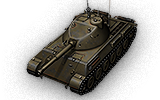
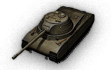
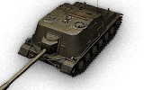
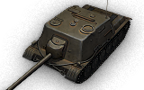

# Poland · Tier VII

[All nations and tiers](../buffs_nerfs.md) · EU v20410 → RU v14600ru · 3 November 2026

<label><strong>Find a tank</strong><input type="search" placeholder="Try is7, obj140 or xm57" aria-label="Find a tank" style="display:block;width:100%;padding:.7rem;border:1px solid #888;border-radius:4px;margin:.5rem 0;color:inherit;background:transparent"></label>

45TP Habicha · Tier VII

45tphabicha

<a href="https://tanks.gg/v20410/tank/45tp">EU stats</a> · <a href="https://tanks.gg/v14600ru/tank/45tp">RU stats</a>
<figure style="display:inline-block"><figcaption>45TP Habicha</figcaption></figure>
<em>Mobility</em> 
<strong>Tank traverse (°/s)</strong> <small>EU</small> 41.72  <small>RU</small> <strong>36.50</strong> 
<strong>Tank traverse on hard terrain (°/s)</strong> <small>EU</small> 47.87  <small>RU</small> <strong>41.86</strong> 
<strong>Tank traverse on medium terrain (°/s)</strong> <small>EU</small> 37.62  <small>RU</small> <strong>32.89</strong> 
<strong>Tank traverse on soft terrain (°/s)</strong> <small>EU</small> 22.90  <small>RU</small> <strong>20.02</strong> 

<em>Armor &amp; health</em> 
<strong>Health</strong> <small>EU</small> 1 350  <small>RU</small> <strong>1 200</strong> 

<em>Miscellaneous</em> 
<strong>Moving camo</strong> <small>EU</small> 3.54  <small>RU</small> <strong>3.17</strong> 
<strong>Moving camo · after firing</strong> <small>EU</small> 0.74  <small>RU</small> <strong>0.66</strong> 

CS-44 · Tier VII

cs44

<a href="https://tanks.gg/v20410/tank/cs-44">EU stats</a> · <a href="https://tanks.gg/v14600ru/tank/cs-44">RU stats</a>
<figure style="display:inline-block"><figcaption>EU · CS-44</figcaption></figure><figure style="display:inline-block"><figcaption>RU · CS-44</figcaption></figure>
<em>Mobility</em> 
<strong>Tank traverse on hard terrain (°/s)</strong> <small>EU</small> 39.25  <small>RU</small> <strong>39.19</strong> 
<strong>Tank traverse on medium terrain (°/s)</strong> <small>EU</small> 32.71  <small>RU</small> <strong>32.65</strong> 
<strong>Tank traverse on soft terrain (°/s)</strong> <small>EU</small> 19.63  <small>RU</small> <strong>19.59</strong> 

<em>Armor &amp; health</em> 
<strong>Health</strong> <small>EU</small> 1 200  <small>RU</small> <strong>1 100</strong> 

SDP 57 Gowika · Tier VII

sdp57gowika

<a href="https://tanks.gg/v20410/tank/gowika">EU stats</a> · <a href="https://tanks.gg/v14600ru/tank/wz57d">RU stats</a>
<figure style="display:inline-block"><figcaption>EU · SDP 57 Gowika</figcaption></figure><figure style="display:inline-block"><figcaption>RU · Wz.57D</figcaption></figure>
<strong>Penetration (mm)</strong> <b>EU</b>  AP <strong>202</strong> /  APCR <strong>245</strong> /  HE <strong>68</strong> → <b>RU</b>  AP <strong>199</strong> /  APCR <strong>230</strong> /  HE <strong>53</strong>

<strong>Damage (HP)</strong> <b>EU</b>  AP <strong>420</strong> /  APCR <strong>420</strong> /  HE <strong>560</strong> → <b>RU</b>  AP <strong>320</strong> /  APCR <strong>320</strong> /  HE <strong>420</strong>

<em>Firepower</em> 
<strong>DPM (HP/min)</strong> <small>EU</small> 2 037.49  <small>RU</small> <strong>2 043.43</strong> 
<strong>Module damage</strong> <small>EU</small> 165  <small>RU</small> <strong>135</strong> 
<strong>Rate of fire (rounds/min)</strong> <small>EU</small> 4.85  <small>RU</small> <strong>6.39</strong> 
<strong>Reload time (s)</strong> <small>EU</small> 12.37  <small>RU</small> <strong>9.40</strong> 
<strong>Caliber</strong> <small>EU</small> 122  <small>RU</small> <strong>100</strong> 
<strong>Shell velocity (m/s)</strong> <small>EU</small> 1 007  <small>RU</small> <strong>1 170</strong> 
<strong>Ammo capacity</strong> <small>EU</small> 40  <small>RU</small> <strong>56</strong> 
<strong>Potential damage</strong> <small>EU</small> 16 800  <small>RU</small> <strong>17 920</strong> 

<em>Gun handling</em> 
<strong>Aim time (s)</strong> <small>EU</small> 2.11  <small>RU</small> <strong>2.40</strong> 
<strong>Dispersion · moving</strong> <small>EU</small> 0.25  <small>RU</small> <strong>0.24</strong> 
<strong>Dispersion · tank traverse</strong> <small>EU</small> 0.25  <small>RU</small> <strong>0.24</strong> 
<strong>Dispersion · turret traverse</strong> <small>EU</small> 0.10  <small>RU</small> <strong>0.06</strong> 
<strong>Dispersion · firing</strong> <small>EU</small> 4  <small>RU</small> <strong>4.50</strong> 
<strong>Gun traverse · left (°)</strong> <small>EU</small> -5  <small>RU</small> <strong>-10</strong> 
<strong>Gun traverse · right (°)</strong> <small>EU</small> 5  <small>RU</small> <strong>10</strong> 

<em>Mobility</em> 
<strong>Forward speed (km/h)</strong> <small>EU</small> 50  <small>RU</small> <strong>30</strong> 
<strong>Forward speed on hard terrain (km/h)</strong> <small>EU</small> 50  <small>RU</small> <strong>30</strong> 
<strong>Forward speed on medium terrain (km/h)</strong> <small>EU</small> 42.01  <small>RU</small> <strong>30</strong> 
<strong>Forward speed on soft terrain (km/h)</strong> <small>EU</small> 25.57  <small>RU</small> <strong>23.40</strong> 
<strong>Engine power (hp)</strong> <small>EU</small> 680  <small>RU</small> <strong>720</strong> 
<strong>Weight (kg)</strong> <small>EU</small> 44 000 → <small>RU</small> <strong>50 925</strong> 
<strong>Power/weight (hp/t)</strong> <small>EU</small> 15.45  <small>RU</small> <strong>14.14</strong> 
<strong>Tank traverse (°/s)</strong> <small>EU</small> 33.38  <small>RU</small> <strong>31.29</strong> 
<strong>Tank traverse on hard terrain (°/s)</strong> <small>EU</small> 34.75  <small>RU</small> <strong>33.08</strong> 
<strong>Tank traverse on medium terrain (°/s)</strong> <small>EU</small> 27.30  <small>RU</small> <strong>25.99</strong> 
<strong>Tank traverse on soft terrain (°/s)</strong> <small>EU</small> 16.62  <small>RU</small> <strong>15.82</strong> 

<em>Armor &amp; health</em> 
<strong>Hull armor · side (mm)</strong> <small>EU</small> 50  <small>RU</small> <strong>40</strong> 
<strong>Hull armor · rear (mm)</strong> <small>EU</small> 40  <small>RU</small> <strong>50</strong> 
<strong>Health</strong> <small>EU</small> 900  <small>RU</small> <strong>1 000</strong> 
<strong>Health · engine</strong> <small>EU</small> 220  <small>RU</small> <strong>260</strong> 
<strong>Health · ammo rack</strong> <small>EU</small> 190  <small>RU</small> <strong>180</strong> 

<em>Miscellaneous</em> 
<strong>Stationary camo</strong> <small>EU</small> 18.30  <small>RU</small> <strong>18.35</strong> 
<strong>Stationary camo · after firing</strong> <small>EU</small> 3.29  <small>RU</small> <strong>3.84</strong> 
<strong>Moving camo · after firing</strong> <small>EU</small> 1.98  <small>RU</small> <strong>2.30</strong> 
<strong>Radio range (m)</strong> <small>EU</small> 530  <small>RU</small> <strong>700</strong> 
<strong>Shell cost</strong> <small>EU</small> 720  <small>RU</small> <strong>345</strong> 

