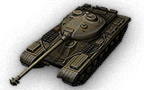
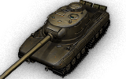
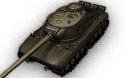
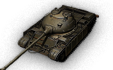
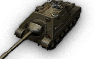
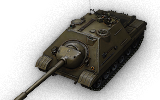

# Poland · Tier IX

[All nations and tiers](../buffs_nerfs.md) · EU v20410 → RU v14600ru · 3 November 2026

<label><strong>Find a tank</strong><input type="search" placeholder="Try is7, obj140 or xm57" aria-label="Find a tank" style="display:block;width:100%;padding:.7rem;border:1px solid #888;border-radius:4px;margin:.5rem 0;color:inherit;background:transparent"></label>

50TP Tyszkiewicza · Tier IX

50tptyszkiewicza

<a href="https://tanks.gg/v20410/tank/50tp">EU stats</a> · <a href="https://tanks.gg/v14600ru/tank/50tp">RU stats</a>
<figure style="display:inline-block"><figcaption>50TP Tyszkiewicza</figcaption></figure>
<em>Gun handling</em> 
<strong>Dispersion · moving</strong> <small>EU</small> 0.19  <small>RU</small> <strong>0.20</strong> 
<strong>Dispersion · tank traverse</strong> <small>EU</small> 0.19  <small>RU</small> <strong>0.20</strong> 

<em>Mobility</em> 
<strong>Tank traverse on hard terrain (°/s)</strong> <small>EU</small> 28.09  <small>RU</small> <strong>28.13</strong> 
<strong>Tank traverse on medium terrain (°/s)</strong> <small>EU</small> 22.47  <small>RU</small> <strong>22.50</strong> 
<strong>Tank traverse on soft terrain (°/s)</strong> <small>EU</small> 12.36  <small>RU</small> <strong>12.38</strong> 

<em>Armor &amp; health</em> 
<strong>Health</strong> <small>EU</small> 2 100  <small>RU</small> <strong>2 000</strong> 

CC-46 Pancernik · EU IX → RU X

cc46pancernik

<a href="https://tanks.gg/v20410/tank/pancernik">EU stats</a> · <a href="https://tanks.gg/v14600ru/tank/czog-p">RU stats</a>
<figure style="display:inline-block"><figcaption>EU · CC-46 Pancernik</figcaption></figure><figure style="display:inline-block"><figcaption>RU · Czołg Pancernik wz.46</figcaption></figure>
<strong>Penetration (mm)</strong> <b>EU</b>  AP <strong>248</strong> /  HEAT <strong>310</strong> /  HE <strong>77</strong> → <b>RU</b>  AP <strong>254</strong> /  APCR <strong>315</strong> /  HE <strong>65</strong>

<strong>Damage (HP)</strong> <b>EU</b>  AP <strong>650</strong> /  HEAT <strong>650</strong> /  HE <strong>800</strong> → <b>RU</b>  AP <strong>560</strong> /  APCR <strong>560</strong> /  HE <strong>700</strong>

<em>General</em> 
<strong>Tier</strong> <small>EU</small> 9 → <small>RU</small> <strong>10</strong> 

<em>Firepower</em> 
<strong>DPM (HP/min)</strong> <small>EU</small> 1 937  <small>RU</small> <strong>2 595.91</strong> 
<strong>Module damage</strong> <small>EU</small> 210  <small>RU</small> <strong>180</strong> 
<strong>Rate of fire (rounds/min)</strong> <small>EU</small> 2.98  <small>RU</small> <strong>4.64</strong> 
<strong>Reload time (s)</strong> <small>EU</small> 20.13  <small>RU</small> <strong>12.94</strong> 
<strong>Caliber</strong> <small>EU</small> 155  <small>RU</small> <strong>130</strong> 
<strong>Shell velocity (m/s)</strong> <small>EU</small> 900  <small>RU</small> <strong>1 000</strong> 
<strong>Ammo capacity</strong> <small>EU</small> 30  <small>RU</small> <strong>60</strong> 
<strong>Potential damage</strong> <small>EU</small> 19 500  <small>RU</small> <strong>33 600</strong> 

<em>Gun handling</em> 
<strong>Aim time (s)</strong> <small>EU</small> 3.07  <small>RU</small> <strong>2.30</strong> 
<strong>Dispersion (m/100 m)</strong> <small>EU</small> 0.42  <small>RU</small> <strong>0.38</strong> 
<strong>Dispersion · damaged</strong> <small>EU</small> 0.84  <small>RU</small> <strong>0.77</strong> 
<strong>Dispersion · moving</strong> <small>EU</small> 0.25  <small>RU</small> <strong>0.26</strong> 
<strong>Dispersion · tank traverse</strong> <small>EU</small> 0.25  <small>RU</small> <strong>0.26</strong> 
<strong>Dispersion · firing</strong> <small>EU</small> 4  <small>RU</small> <strong>5</strong> 

<em>Mobility</em> 
<strong>Forward speed on soft terrain (km/h)</strong> <small>EU</small> 20.93  <small>RU</small> <strong>30</strong> 
<strong>Engine power (hp)</strong> <small>EU</small> 1 100  <small>RU</small> <strong>900</strong> 
<strong>Weight (kg)</strong> <small>EU</small> 100 000 → <small>RU</small> <strong>72 400</strong> 
<strong>Power/weight (hp/t)</strong> <small>EU</small> 11  <small>RU</small> <strong>12.43</strong> 
<strong>Terrain resist (hard)</strong> <small>EU</small> 0.96  <small>RU</small> <strong>0.67</strong> 
<strong>Terrain resist (med)</strong> <small>EU</small> 1.15  <small>RU</small> <strong>0.96</strong> 
<strong>Terrain resist (soft)</strong> <small>EU</small> 1.92  <small>RU</small> <strong>1.49</strong> 
<strong>Turret traverse (°/s)</strong> <small>EU</small> 20.86  <small>RU</small> <strong>25.03</strong> 
<strong>Tank traverse (°/s)</strong> <small>EU</small> 20.86  <small>RU</small> <strong>27.12</strong> 
<strong>Tank traverse on hard terrain (°/s)</strong> <small>EU</small> 20.86  <small>RU</small> <strong>25.76</strong> 
<strong>Tank traverse on medium terrain (°/s)</strong> <small>EU</small> 17.38  <small>RU</small> <strong>18.06</strong> 
<strong>Tank traverse on soft terrain (°/s)</strong> <small>EU</small> 10.43  <small>RU</small> <strong>11.65</strong> 

<em>Armor &amp; health</em> 
<strong>Hull armor · front (mm)</strong> <small>EU</small> 300  <small>RU</small> <strong>350</strong> 
<strong>Hull armor · rear (mm)</strong> <small>EU</small> 80  <small>RU</small> <strong>100</strong> 
<strong>Turret armor · side (mm)</strong> <small>EU</small> 120  <small>RU</small> <strong>185</strong> 
<strong>Turret armor · rear (mm)</strong> <small>EU</small> 90  <small>RU</small> <strong>150</strong> 
<strong>Health</strong> <small>EU</small> 1 900  <small>RU</small> <strong>2 500</strong> 
<strong>Health · engine</strong> <small>EU</small> 310  <small>RU</small> <strong>370</strong> 
<strong>Health · track</strong> <small>EU</small> 240  <small>RU</small> <strong>250</strong> 
<strong>Health · ammo rack</strong> <small>EU</small> 230  <small>RU</small> <strong>280</strong> 
<strong>Track repair time (s)</strong> <small>EU</small> 11.70  <small>RU</small> <strong>12.03</strong> 

<em>Miscellaneous</em> 
<strong>Stationary camo</strong> <small>EU</small> 4.79  <small>RU</small> <strong>4.96</strong> 
<strong>Stationary camo · after firing</strong> <small>EU</small> 0.65  <small>RU</small> <strong>0.76</strong> 
<strong>Moving camo</strong> <small>EU</small> 2.39  <small>RU</small> <strong>2.51</strong> 
<strong>Moving camo · after firing</strong> <small>EU</small> 0.32  <small>RU</small> <strong>0.38</strong> 
<strong>View range (m)</strong> <small>EU</small> 380  <small>RU</small> <strong>400</strong> 
<strong>Radio range (m)</strong> <small>EU</small> 700  <small>RU</small> <strong>730.10</strong> 
<strong>Shell cost</strong> <small>EU</small> 1 486  <small>RU</small> <strong>1 215</strong> 

CS-59 · Tier IX

cs59

<a href="https://tanks.gg/v20410/tank/cs-59">EU stats</a> · <a href="https://tanks.gg/v14600ru/tank/cs-59">RU stats</a>
<figure style="display:inline-block"><figcaption>EU · CS-59</figcaption></figure><figure style="display:inline-block"><figcaption>RU · CS-59</figcaption></figure>
<em>Gun handling</em> 
<strong>Dispersion · moving</strong> <small>EU</small> 0.15  <small>RU</small> <strong>0.13</strong> 
<strong>Dispersion · tank traverse</strong> <small>EU</small> 0.15  <small>RU</small> <strong>0.13</strong> 
<strong>Dispersion · turret traverse</strong> <small>EU</small> 0.10  <small>RU</small> <strong>0.08</strong> 

<em>Mobility</em> 
<strong>Tank traverse on hard terrain (°/s)</strong> <small>EU</small> 43.62  <small>RU</small> <strong>41.44</strong> 
<strong>Tank traverse on medium terrain (°/s)</strong> <small>EU</small> 39.65  <small>RU</small> <strong>37.67</strong> 
<strong>Tank traverse on soft terrain (°/s)</strong> <small>EU</small> 19.83  <small>RU</small> <strong>18.83</strong> 

<em>Armor &amp; health</em> 
<strong>Health</strong> <small>EU</small> 1 850  <small>RU</small> <strong>1 800</strong> 

SDP 60 Gonkiewicza · Tier IX

sdp60gonkiewicza

<a href="https://tanks.gg/v20410/tank/gonkiewicza">EU stats</a> · <a href="https://tanks.gg/v14600ru/tank/niedzwiedz">RU stats</a>
<figure style="display:inline-block"><figcaption>EU · SDP 60 Gonkiewicza</figcaption></figure><figure style="display:inline-block"><figcaption>RU · Wz.60 Niedźwiedź</figcaption></figure>
<strong>Penetration (mm)</strong> <b>EU</b>  APCR <strong>292</strong> /  APCR <strong>321</strong> /  HIGH_EXPLOSIVE <strong>85</strong> → <b>RU</b>  APCR <strong>276</strong> /  APCR <strong>348</strong> /  HE <strong>50</strong>

<strong>Damage (HP)</strong> <b>EU</b>  APCR <strong>800</strong> /  APCR <strong>800</strong> /  HIGH_EXPLOSIVE <strong>800</strong> → <b>RU</b>  APCR <strong>530</strong> /  APCR <strong>530</strong> /  HE <strong>670</strong>

<em>Firepower</em> 
<strong>DPM (HP/min)</strong> <small>EU</small> 3 337.60  <small>RU</small> <strong>2 531.86</strong> 
<strong>DPM · at 500m</strong> <small>EU</small> 1 251.60  <small>RU</small> <strong>2 531.86</strong> 
<strong>Module damage</strong> <small>EU</small> 203  <small>RU</small> <strong>162</strong> 
<strong>Rate of fire (rounds/min)</strong> <small>EU</small> 4.17  <small>RU</small> <strong>4.78</strong> 
<strong>Reload time (s)</strong> <small>EU</small> 14.38  <small>RU</small> <strong>12.56</strong> 
<strong>Caliber</strong> <small>EU</small> 85  <small>RU</small> <strong>100</strong> 
<strong>Shell velocity (m/s)</strong> <small>EU</small> 1 700  <small>RU</small> <strong>1 560</strong> 
<strong>Ammo capacity</strong> <small>EU</small> 45  <small>RU</small> <strong>54</strong> 
<strong>Potential damage</strong> <small>EU</small> 36 000  <small>RU</small> <strong>28 620</strong> 

<em>Gun handling</em> 
<strong>Aim time (s)</strong> <small>EU</small> 2.59  <small>RU</small> <strong>2.01</strong> 
<strong>Dispersion (m/100 m)</strong> <small>EU</small> 0.36  <small>RU</small> <strong>0.35</strong> 
<strong>Dispersion · damaged</strong> <small>EU</small> 0.73  <small>RU</small> <strong>0.69</strong> 
<strong>Dispersion · moving</strong> <small>EU</small> 0.21  <small>RU</small> <strong>0.20</strong> 
<strong>Dispersion · tank traverse</strong> <small>EU</small> 0.21  <small>RU</small> <strong>0.16</strong> 
<strong>Dispersion · turret traverse</strong> <small>EU</small> 0.08  <small>RU</small> <strong>0.05</strong> 
<strong>Dispersion · firing</strong> <small>EU</small> 4  <small>RU</small> <strong>8</strong> 
<strong>Depression (°)</strong> <small>EU</small> 7  <small>RU</small> <strong>8</strong> 
<strong>Gun traverse · left (°)</strong> <small>EU</small> -5  <small>RU</small> <strong>-10</strong> 
<strong>Gun traverse · right (°)</strong> <small>EU</small> 5  <small>RU</small> <strong>10</strong> 

<em>Mobility</em> 
<strong>Forward speed (km/h)</strong> <small>EU</small> 42  <small>RU</small> <strong>30</strong> 
<strong>Forward speed on hard terrain (km/h)</strong> <small>EU</small> 42  <small>RU</small> <strong>30</strong> 
<strong>Forward speed on medium terrain (km/h)</strong> <small>EU</small> 42  <small>RU</small> <strong>30</strong> 
<strong>Forward speed on soft terrain (km/h)</strong> <small>EU</small> 29.69  <small>RU</small> <strong>28.27</strong> 
<strong>Reverse speed (km/h)</strong> <small>EU</small> 15  <small>RU</small> <strong>16</strong> 
<strong>Engine power (hp)</strong> <small>EU</small> 780  <small>RU</small> <strong>760</strong> 
<strong>Weight (kg)</strong> <small>EU</small> 50 000 → <small>RU</small> <strong>56 745</strong> 
<strong>Power/weight (hp/t)</strong> <small>EU</small> 15.60  <small>RU</small> <strong>13.39</strong> 
<strong>Terrain resist (hard)</strong> <small>EU</small> 1.05  <small>RU</small> <strong>0.82</strong> 
<strong>Terrain resist (med)</strong> <small>EU</small> 1.25  <small>RU</small> <strong>1.10</strong> 
<strong>Terrain resist (soft)</strong> <small>EU</small> 1.92  <small>RU</small> <strong>1.73</strong> 
<strong>Tank traverse on hard terrain (°/s)</strong> <small>EU</small> 33.12  <small>RU</small> <strong>31.57</strong> 
<strong>Tank traverse on medium terrain (°/s)</strong> <small>EU</small> 28.03  <small>RU</small> <strong>23.34</strong> 
<strong>Tank traverse on soft terrain (°/s)</strong> <small>EU</small> 18.22  <small>RU</small> <strong>14.91</strong> 

<em>Armor &amp; health</em> 
<strong>Hull armor · front (mm)</strong> <small>EU</small> 190  <small>RU</small> <strong>200</strong> 
<strong>Hull armor · side (mm)</strong> <small>EU</small> 75  <small>RU</small> <strong>100</strong> 
<strong>Hull armor · rear (mm)</strong> <small>EU</small> 55  <small>RU</small> <strong>60</strong> 
<strong>Health</strong> <small>EU</small> 1 800  <small>RU</small> <strong>1 600</strong> 
<strong>Health · engine</strong> <small>EU</small> 300  <small>RU</small> <strong>370</strong> 
<strong>Health · fuel tank</strong> <small>EU</small> 200  <small>RU</small> <strong>175</strong> 

<em>Miscellaneous</em> 
<strong>Stationary camo · after firing</strong> <small>EU</small> 2.03  <small>RU</small> <strong>3.73</strong> 
<strong>Moving camo · after firing</strong> <small>EU</small> 1.22  <small>RU</small> <strong>2.24</strong> 
<strong>Radio range (m)</strong> <small>EU</small> 700  <small>RU</small> <strong>730</strong> 
<strong>Shell cost</strong> <small>EU</small> 1 840  <small>RU</small> <strong>1 260</strong> 

