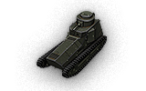

# Sweden · Tier I

[All nations and tiers](../buffs_nerfs.md) · EU v20410 → RU v14600ru · 3 November 2026

<label><strong>Find a tank</strong><input type="search" placeholder="Try is7, obj140 or xm57" aria-label="Find a tank" style="display:block;width:100%;padding:.7rem;border:1px solid #888;border-radius:4px;margin:.5rem 0;color:inherit;background:transparent"></label>

Strv fm/21 · Tier I

strvfm21

<a href="https://tanks.gg/v20410/tank/strv-fm21">EU stats</a> · <a href="https://tanks.gg/v14600ru/tank/strv-fm21">RU stats</a>
<figure style="display:inline-block"><figcaption>Strv fm/21</figcaption></figure>
<strong>Penetration (mm)</strong> <b>EU</b>  AP <strong>30</strong> /  AP <strong>44</strong> /  HE <strong>10</strong> → <b>RU</b>  AP <strong>32</strong> /  AP <strong>44</strong> /  HE <strong>10</strong>

<em>Firepower</em> 
<strong>DPM (HP/min)</strong> <small>EU</small> 1 147.27  <small>RU</small> <strong>869.07</strong> 
<strong>Rate of fire (rounds/min)</strong> <small>EU</small> 95.61  <small>RU</small> <strong>72.42</strong> 
<strong>Reload time (s)</strong> <small>EU</small> 4.22  <small>RU</small> <strong>7.67</strong> 
<strong>Clip size</strong> <small>EU</small> 10  <small>RU</small> <strong>12</strong> 
<strong>Clip size · burst size</strong> <small>EU</small> 2  <small>RU</small> <strong>3</strong> 
<strong>Clip damage · damage</strong> <small>EU</small> 120  <small>RU</small> <strong>144</strong> 
<strong>Clip damage · time (s)</strong> <small>EU</small> 2.06  <small>RU</small> <strong>2.27</strong> 
<strong>Clip damage · burst damage · damage</strong> <small>EU</small> 24  <small>RU</small> <strong>36</strong> 
<strong>Clip damage · burst damage · time (s)</strong> <small>EU</small> 0.17  <small>RU</small> <strong>0.34</strong> 
<strong>Ammo capacity</strong> <small>EU</small> 1 110  <small>RU</small> <strong>1 116</strong> 
<strong>Potential damage</strong> <small>EU</small> 13 320  <small>RU</small> <strong>13 392</strong> 

<em>Gun handling</em> 
<strong>Aim time (s)</strong> <small>EU</small> 2.10  <small>RU</small> <strong>2</strong> 
<strong>Dispersion (m/100 m)</strong> <small>EU</small> 0.50  <small>RU</small> <strong>0.40</strong> 
<strong>Dispersion · damaged</strong> <small>EU</small> 1  <small>RU</small> <strong>0.80</strong> 
<strong>Dispersion · moving</strong> <small>EU</small> 0.32  <small>RU</small> <strong>0.10</strong> 
<strong>Dispersion · tank traverse</strong> <small>EU</small> 0.32  <small>RU</small> <strong>0.10</strong> 
<strong>Dispersion · firing</strong> <small>EU</small> 1.50  <small>RU</small> <strong>1</strong> 

<em>Mobility</em> 
<strong>Forward speed on soft terrain (km/h)</strong> <small>EU</small> 24.77  <small>RU</small> <strong>25</strong> 
<strong>Engine power (hp)</strong> <small>EU</small> 110  <small>RU</small> <strong>120</strong> 
<strong>Power/weight (hp/t)</strong> <small>EU</small> 12.20  <small>RU</small> <strong>13.31</strong> 

<em>Armor &amp; health</em> 
<strong>Track repair time (s)</strong> <small>EU</small> 6  <small>RU</small> <strong>3</strong> 

<em>Miscellaneous</em> 
<strong>View range (m)</strong> <small>EU</small> 290  <small>RU</small> <strong>300</strong> 

