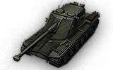
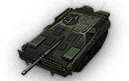
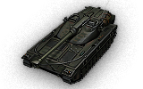

# Sweden · Tier X

[All nations and tiers](../buffs_nerfs.md) · EU v20410 → RU v14600ru · 3 November 2026

<label><strong>Find a tank</strong><input type="search" placeholder="Try is7, obj140 or xm57" aria-label="Find a tank" style="display:block;width:100%;padding:.7rem;border:1px solid #888;border-radius:4px;margin:.5rem 0;color:inherit;background:transparent"></label>

Kranvagn · Tier X

kranvagn

<a href="https://tanks.gg/v20410/tank/kranvagn">EU stats</a> · <a href="https://tanks.gg/v14600ru/tank/kranvagn">RU stats</a>
<figure style="display:inline-block"><figcaption>Kranvagn</figcaption></figure>
<strong>Penetration (mm)</strong> <b>EU</b>  APCR <strong>265</strong> /  HEAT <strong>310</strong> /  HE <strong>60</strong> → <b>RU</b>  APCR <strong>258</strong> /  HEAT <strong>310</strong> /  HE <strong>60</strong>

<em>Firepower</em> 
<strong>DPM (HP/min)</strong> <small>EU</small> 2 687.58  <small>RU</small> <strong>2 642.35</strong> 
<strong>Rate of fire (rounds/min)</strong> <small>EU</small> 6.11  <small>RU</small> <strong>6.01</strong> 
<strong>Reload time (s)</strong> <small>EU</small> 23.97  <small>RU</small> <strong>24.47</strong> 
<strong>Shell velocity (m/s)</strong> <small>EU</small> 1 150  <small>RU</small> <strong>1 000</strong> 

<em>Gun handling</em> 
<strong>Dispersion (m/100 m)</strong> <small>EU</small> 0.38  <small>RU</small> <strong>0.36</strong> 
<strong>Dispersion · damaged</strong> <small>EU</small> 0.77  <small>RU</small> <strong>0.73</strong> 

<em>Armor &amp; health</em> 
<strong>Health</strong> <small>EU</small> 2 000  <small>RU</small> <strong>2 300</strong> 

<em>Miscellaneous</em> 
<strong>Moving camo</strong> <small>EU</small> 2.68  <small>RU</small> <strong>2.62</strong> 
<strong>Moving camo · after firing</strong> <small>EU</small> 0.48  <small>RU</small> <strong>0.47</strong> 

Strv 103B · Tier X

strv103b

<a href="https://tanks.gg/v20410/tank/strv-103b">EU stats</a> · <a href="https://tanks.gg/v14600ru/tank/strv-103b">RU stats</a>
<figure style="display:inline-block"><figcaption>Strv 103B</figcaption></figure>
<em>Gun handling</em> 
<strong>Aim time (s)</strong> <small>EU</small> 2.88  <small>RU</small> <strong>2.94</strong> 
<strong>Dispersion · damaged</strong> <small>EU</small> 0.58  <small>RU</small> <strong>0.59</strong> 

<em>Mobility</em> 
<strong>Forward speed on soft terrain (km/h)</strong> <small>EU</small> 42.50  <small>RU</small> <strong>40.61</strong> 
<strong>Engine power (hp)</strong> <small>EU</small> 900  <small>RU</small> <strong>860</strong> 
<strong>Power/weight (hp/t)</strong> <small>EU</small> 22.33  <small>RU</small> <strong>21.34</strong> 
<strong>Turret traverse (°/s)</strong> <small>EU</small> 16.69  <small>RU</small> <strong>16.34</strong> 

<em>Armor &amp; health</em> 
<strong>Hull armor · front (mm)</strong> <small>EU</small> 40  <small>RU</small> <strong>50</strong> 

Alternate mode

<a href="https://tanks.gg/v20410/tank/strv-103b-siege">EU stats</a> · <a href="https://tanks.gg/v14600ru/tank/strv-103b-siege">RU stats</a>
<em>Gun handling</em> 
<strong>Aim time (s)</strong> <small>EU</small> 0.96  <small>RU</small> <strong>0.98</strong> 
<strong>Dispersion · damaged</strong> <small>EU</small> 0.48  <small>RU</small> <strong>0.49</strong> 

<em>Mobility</em> 
<strong>Turret traverse (°/s)</strong> <small>EU</small> 16.69  <small>RU</small> <strong>16.34</strong> 

<em>Armor &amp; health</em> 
<strong>Hull armor · front (mm)</strong> <small>EU</small> 40  <small>RU</small> <strong>50</strong> 

UDES 15/16 · Tier X

udes1516

<a href="https://tanks.gg/v20410/tank/udes-1516">EU stats</a> · <a href="https://tanks.gg/v14600ru/tank/udes-1516">RU stats</a>
<figure style="display:inline-block"><figcaption>UDES 15/16</figcaption></figure>
<em>Firepower</em> 
<strong>DPM (HP/min)</strong> <small>EU</small> 2 929.28  <small>RU</small> <strong>2 868.89</strong> 
<strong>Rate of fire (rounds/min)</strong> <small>EU</small> 6.66  <small>RU</small> <strong>6.52</strong> 
<strong>Reload time (s)</strong> <small>EU</small> 9.01  <small>RU</small> <strong>9.20</strong> 

Alternate mode

<a href="https://tanks.gg/v20410/tank/udes-1516-siege">EU stats</a> · <a href="https://tanks.gg/v14600ru/tank/udes-1516-siege">RU stats</a>
<em>Firepower</em> 
<strong>DPM (HP/min)</strong> <small>EU</small> 2 929.28  <small>RU</small> <strong>2 868.89</strong> 
<strong>Rate of fire (rounds/min)</strong> <small>EU</small> 6.66  <small>RU</small> <strong>6.52</strong> 
<strong>Reload time (s)</strong> <small>EU</small> 9.01  <small>RU</small> <strong>9.20</strong> 

