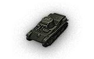
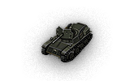
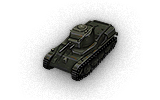

# Sweden · Tier II

[All nations and tiers](../buffs_nerfs.md) · EU v20410 → RU v14600ru · 3 November 2026

<label><strong>Find a tank</strong><input type="search" placeholder="Try is7, obj140 or xm57" aria-label="Find a tank" style="display:block;width:100%;padding:.7rem;border:1px solid #888;border-radius:4px;margin:.5rem 0;color:inherit;background:transparent"></label>

L-60 · Tier II

l60

<a href="https://tanks.gg/v20410/tank/l-60">EU stats</a> · <a href="https://tanks.gg/v14600ru/tank/l-60">RU stats</a>
<figure style="display:inline-block"><figcaption>L-60</figcaption></figure>
<strong>Penetration (mm)</strong> <b>EU</b>  AP <strong>27</strong> /  AP <strong>38</strong> /  HE <strong>10</strong> → <b>RU</b>  AP <strong>36</strong> /  AP <strong>50</strong> /  HE <strong>10</strong>

<em>Gun handling</em> 
<strong>Dispersion (m/100 m)</strong> <small>EU</small> 0.46  <small>RU</small> <strong>0.38</strong> 
<strong>Dispersion · damaged</strong> <small>EU</small> 0.92  <small>RU</small> <strong>0.77</strong> 
<strong>Dispersion · moving</strong> <small>EU</small> 0.20  <small>RU</small> <strong>0.14</strong> 
<strong>Dispersion · tank traverse</strong> <small>EU</small> 0.20  <small>RU</small> <strong>0.14</strong> 
<strong>Dispersion · turret traverse</strong> <small>EU</small> 0.12  <small>RU</small> <strong>0.08</strong> 

<em>Armor &amp; health</em> 
<strong>Track repair time (s)</strong> <small>EU</small> 12.03  <small>RU</small> <strong>3</strong> 

<em>Miscellaneous</em> 
<strong>View range (m)</strong> <small>EU</small> 280  <small>RU</small> <strong>300</strong> 

Pvlvv fm/42 · Tier II

pvlvvfm42

<a href="https://tanks.gg/v20410/tank/pvlvv-fm42">EU stats</a> · <a href="https://tanks.gg/v14600ru/tank/pvlvv-fm42">RU stats</a>
<figure style="display:inline-block"><figcaption>Pvlvv fm/42</figcaption></figure>
<strong>Damage (HP)</strong> <b>EU</b>  AP <strong>40</strong> /  APCR <strong>40</strong> /  HE <strong>50</strong> → <b>RU</b>  AP <strong>45</strong> /  APCR <strong>45</strong> /  HE <strong>50</strong>

<em>Firepower</em> 
<strong>DPM (HP/min)</strong> <small>EU</small> 1 088.35  <small>RU</small> <strong>1 408.05</strong> 
<strong>Rate of fire (rounds/min)</strong> <small>EU</small> 27.21  <small>RU</small> <strong>31.29</strong> 
<strong>Reload time (s)</strong> <small>EU</small> 2.21  <small>RU</small> <strong>1.92</strong> 
<strong>Potential damage</strong> <small>EU</small> 8 000  <small>RU</small> <strong>9 000</strong> 

<em>Gun handling</em> 
<strong>Aim time (s)</strong> <small>EU</small> 1.92  <small>RU</small> <strong>1.82</strong> 
<strong>Dispersion (m/100 m)</strong> <small>EU</small> 0.38  <small>RU</small> <strong>0.35</strong> 
<strong>Dispersion · damaged</strong> <small>EU</small> 0.77  <small>RU</small> <strong>0.69</strong> 
<strong>Dispersion · moving</strong> <small>EU</small> 0.38  <small>RU</small> <strong>0.20</strong> 
<strong>Dispersion · tank traverse</strong> <small>EU</small> 0.38  <small>RU</small> <strong>0.20</strong> 
<strong>Dispersion · turret traverse</strong> <small>EU</small> 0.12  <small>RU</small> <strong>0.10</strong> 
<strong>Dispersion · firing</strong> <small>EU</small> 4  <small>RU</small> <strong>3</strong> 
<strong>Gun traverse · left (°)</strong> <small>EU</small> -30  <small>RU</small> <strong>-180</strong> 
<strong>Gun traverse · right (°)</strong> <small>EU</small> 30  <small>RU</small> <strong>180</strong> 

<em>Mobility</em> 
<strong>Turret traverse (°/s)</strong> <small>EU</small> 41.72  <small>RU</small> <strong>31.29</strong> 

<em>Armor &amp; health</em> 
<strong>Health</strong> <small>EU</small> 220  <small>RU</small> <strong>390</strong> 
<strong>Track repair time (s)</strong> <small>EU</small> 12.03  <small>RU</small> <strong>3</strong> 

<em>Miscellaneous</em> 
<strong>View range (m)</strong> <small>EU</small> 280  <small>RU</small> <strong>300</strong> 

Strv m/38 · Tier II

strvm38

<a href="https://tanks.gg/v20410/tank/strv-m38">EU stats</a> · <a href="https://tanks.gg/v14600ru/tank/strv-m38">RU stats</a>
<figure style="display:inline-block"><figcaption>Strv m/38</figcaption></figure>
<strong>Penetration (mm)</strong> <b>EU</b>  AP <strong>55</strong> /  APCR <strong>78</strong> /  HE <strong>19</strong> → <b>RU</b>  AP <strong>60</strong> /  APCR <strong>78</strong> /  HE <strong>19</strong>

<strong>Damage (HP)</strong> <b>EU</b>  AP <strong>40</strong> /  APCR <strong>40</strong> /  HE <strong>50</strong> → <b>RU</b>  AP <strong>45</strong> /  APCR <strong>45</strong> /  HE <strong>50</strong>

<em>Firepower</em> 
<strong>DPM (HP/min)</strong> <small>EU</small> 1 065.19  <small>RU</small> <strong>1 224.39</strong> 
<strong>Rate of fire (rounds/min)</strong> <small>EU</small> 26.63  <small>RU</small> <strong>27.21</strong> 
<strong>Reload time (s)</strong> <small>EU</small> 2.25  <small>RU</small> <strong>2.21</strong> 
<strong>Potential damage</strong> <small>EU</small> 8 000  <small>RU</small> <strong>9 000</strong> 

<em>Gun handling</em> 
<strong>Aim time (s)</strong> <small>EU</small> 1.73  <small>RU</small> <strong>1.44</strong> 
<strong>Dispersion · moving</strong> <small>EU</small> 0.30  <small>RU</small> <strong>0.20</strong> 
<strong>Dispersion · tank traverse</strong> <small>EU</small> 0.30  <small>RU</small> <strong>0.20</strong> 
<strong>Dispersion · firing</strong> <small>EU</small> 3  <small>RU</small> <strong>1</strong> 

<em>Mobility</em> 
<strong>Forward speed on medium terrain (km/h)</strong> <small>EU</small> 45  <small>RU</small> <strong>44.38</strong> 
<strong>Forward speed on soft terrain (km/h)</strong> <small>EU</small> 34.14  <small>RU</small> <strong>30.72</strong> 
<strong>Engine power (hp)</strong> <small>EU</small> 200  <small>RU</small> <strong>180</strong> 
<strong>Power/weight (hp/t)</strong> <small>EU</small> 21.86  <small>RU</small> <strong>19.68</strong> 
<strong>Tank traverse on hard terrain (°/s)</strong> <small>EU</small> 49.08  <small>RU</small> <strong>42.27</strong> 
<strong>Tank traverse on medium terrain (°/s)</strong> <small>EU</small> 36.36  <small>RU</small> <strong>31.31</strong> 
<strong>Tank traverse on soft terrain (°/s)</strong> <small>EU</small> 25.17  <small>RU</small> <strong>21.68</strong> 

<em>Armor &amp; health</em> 
<strong>Health</strong> <small>EU</small> 340  <small>RU</small> <strong>360</strong> 
<strong>Track repair time (s)</strong> <small>EU</small> 12.03  <small>RU</small> <strong>3</strong> 

<em>Miscellaneous</em> 
<strong>View range (m)</strong> <small>EU</small> 300  <small>RU</small> <strong>310</strong> 

