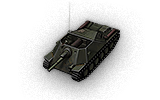
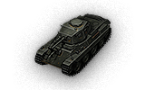
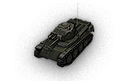

# Sweden · Tier III

[All nations and tiers](../buffs_nerfs.md) · EU v20410 → RU v14600ru · 3 November 2026

<label><strong>Find a tank</strong><input type="search" placeholder="Try is7, obj140 or xm57" aria-label="Find a tank" style="display:block;width:100%;padding:.7rem;border:1px solid #888;border-radius:4px;margin:.5rem 0;color:inherit;background:transparent"></label>

Ikv 72 · Tier III

ikv72

<a href="https://tanks.gg/v20410/tank/ikv-72">EU stats</a> · <a href="https://tanks.gg/v14600ru/tank/ikv-72">RU stats</a>
<figure style="display:inline-block"><figcaption>Ikv 72</figcaption></figure>
<em>Gun handling</em> 
<strong>Aim time (s)</strong> <small>EU</small> 2.01  <small>RU</small> <strong>1.53</strong> 
<strong>Dispersion · moving</strong> <small>EU</small> 0.26  <small>RU</small> <strong>0.22</strong> 
<strong>Dispersion · tank traverse</strong> <small>EU</small> 0.26  <small>RU</small> <strong>0.22</strong> 

<em>Armor &amp; health</em> 
<strong>Health</strong> <small>EU</small> 265  <small>RU</small> <strong>490</strong> 
<strong>Track repair time (s)</strong> <small>EU</small> 10.03  <small>RU</small> <strong>4</strong> 

Lago M38 · Tier III

lagom38

<a href="https://tanks.gg/v20410/tank/lago-m38">EU stats</a> · <a href="https://tanks.gg/v14600ru/tank/lago-m38">RU stats</a>
<figure style="display:inline-block"><figcaption>Lago M38</figcaption></figure>
<em>Armor &amp; health</em> 
<strong>Health</strong> <small>EU</small> 465  <small>RU</small> <strong>470</strong> 
<strong>Track repair time (s)</strong> <small>EU</small> 10.03  <small>RU</small> <strong>4</strong> 

Strv m/40L · Tier III

strvm40l

<a href="https://tanks.gg/v20410/tank/strv-m40l">EU stats</a> · <a href="https://tanks.gg/v14600ru/tank/strv-m40l">RU stats</a>
<figure style="display:inline-block"><figcaption>Strv m/40L</figcaption></figure>
<em>Gun handling</em> 
<strong>Dispersion (m/100 m)</strong> <small>EU</small> 0.36  <small>RU</small> <strong>0.35</strong> 
<strong>Dispersion · damaged</strong> <small>EU</small> 0.73  <small>RU</small> <strong>0.71</strong> 
<strong>Dispersion · moving</strong> <small>EU</small> 0.30  <small>RU</small> <strong>0.24</strong> 
<strong>Dispersion · tank traverse</strong> <small>EU</small> 0.30  <small>RU</small> <strong>0.24</strong> 
<strong>Dispersion · firing</strong> <small>EU</small> 3  <small>RU</small> <strong>2</strong> 

<em>Mobility</em> 
<strong>Forward speed on soft terrain (km/h)</strong> <small>EU</small> 34.07  <small>RU</small> <strong>33.87</strong> 
<strong>Weight (kg)</strong> <small>EU</small> 10 082 → <small>RU</small> <strong>10 142</strong> 
<strong>Power/weight (hp/t)</strong> <small>EU</small> 21.82  <small>RU</small> <strong>21.69</strong> 
<strong>Tank traverse on hard terrain (°/s)</strong> <small>EU</small> 49.47  <small>RU</small> <strong>54.95</strong> 
<strong>Tank traverse on medium terrain (°/s)</strong> <small>EU</small> 36.64  <small>RU</small> <strong>40.70</strong> 
<strong>Tank traverse on soft terrain (°/s)</strong> <small>EU</small> 25.37  <small>RU</small> <strong>28.18</strong> 

<em>Armor &amp; health</em> 
<strong>Health</strong> <small>EU</small> 410  <small>RU</small> <strong>450</strong> 
<strong>Health · engine</strong> <small>EU</small> 100  <small>RU</small> <strong>80</strong> 
<strong>Track repair time (s)</strong> <small>EU</small> 12.03  <small>RU</small> <strong>4</strong> 

