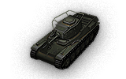
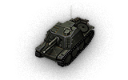

# Sweden · Tier IV

[All nations and tiers](../buffs_nerfs.md) · EU v20410 → RU v14600ru · 3 November 2026

<label><strong>Find a tank</strong><input type="search" placeholder="Try is7, obj140 or xm57" aria-label="Find a tank" style="display:block;width:100%;padding:.7rem;border:1px solid #888;border-radius:4px;margin:.5rem 0;color:inherit;background:transparent"></label>

Lago · Tier IV

lago

<a href="https://tanks.gg/v20410/tank/lago">EU stats</a> · <a href="https://tanks.gg/v14600ru/tank/lago">RU stats</a>
<figure style="display:inline-block"><figcaption>Lago</figcaption></figure>
<strong>Penetration (mm)</strong> <b>EU</b>  AP <strong>98</strong> /  HEAT <strong>130</strong> /  HE <strong>38</strong> → <b>RU</b>  AP <strong>93</strong> /  HEAT <strong>140</strong> /  HE <strong>38</strong>

<em>Firepower</em> 
<strong>DPM (HP/min)</strong> <small>EU</small> 1 546.92  <small>RU</small> <strong>1 582.48</strong> 
<strong>Rate of fire (rounds/min)</strong> <small>EU</small> 14.06  <small>RU</small> <strong>14.39</strong> 
<strong>Reload time (s)</strong> <small>EU</small> 4.27  <small>RU</small> <strong>4.17</strong> 
<strong>Shell velocity (m/s)</strong> <small>EU</small> 820  <small>RU</small> <strong>590</strong> 

<em>Gun handling</em> 
<strong>Aim time (s)</strong> <small>EU</small> 2.21  <small>RU</small> <strong>1.92</strong> 
<strong>Dispersion · moving</strong> <small>EU</small> 0.25  <small>RU</small> <strong>0.20</strong> 
<strong>Dispersion · tank traverse</strong> <small>EU</small> 0.25  <small>RU</small> <strong>0.20</strong> 
<strong>Dispersion · firing</strong> <small>EU</small> 4  <small>RU</small> <strong>2</strong> 

<em>Mobility</em> 
<strong>Forward speed on medium terrain (km/h)</strong> <small>EU</small> 45  <small>RU</small> <strong>43.71</strong> 
<strong>Forward speed on soft terrain (km/h)</strong> <small>EU</small> 31.29  <small>RU</small> <strong>29.80</strong> 
<strong>Engine power (hp)</strong> <small>EU</small> 420  <small>RU</small> <strong>400</strong> 
<strong>Power/weight (hp/t)</strong> <small>EU</small> 22.61  <small>RU</small> <strong>21.53</strong> 
<strong>Tank traverse on hard terrain (°/s)</strong> <small>EU</small> 46.93  <small>RU</small> <strong>50.66</strong> 
<strong>Tank traverse on medium terrain (°/s)</strong> <small>EU</small> 40.68  <small>RU</small> <strong>43.90</strong> 
<strong>Tank traverse on soft terrain (°/s)</strong> <small>EU</small> 27.73  <small>RU</small> <strong>29.93</strong> 

<em>Armor &amp; health</em> 
<strong>Health</strong> <small>EU</small> 570  <small>RU</small> <strong>630</strong> 
<strong>Track repair time (s)</strong> <small>EU</small> 10.03  <small>RU</small> <strong>5</strong> 

Sav m/43 · Tier IV

savm43

<a href="https://tanks.gg/v20410/tank/sav-m43">EU stats</a> · <a href="https://tanks.gg/v14600ru/tank/sav-m43">RU stats</a>
<figure style="display:inline-block"><figcaption>Sav m/43</figcaption></figure>
<em>Gun handling</em> 
<strong>Aim time (s)</strong> <small>EU</small> 2.88  <small>RU</small> <strong>2.68</strong> 
<strong>Dispersion · turret traverse</strong> <small>EU</small> 0.22  <small>RU</small> <strong>0.16</strong> 

<em>Mobility</em> 
<strong>Forward speed (km/h)</strong> <small>EU</small> 45  <small>RU</small> <strong>43</strong> 
<strong>Forward speed on hard terrain (km/h)</strong> <small>EU</small> 44.52  <small>RU</small> <strong>37.84</strong> 
<strong>Forward speed on medium terrain (km/h)</strong> <small>EU</small> 37.67  <small>RU</small> <strong>32.02</strong> 
<strong>Forward speed on soft terrain (km/h)</strong> <small>EU</small> 21.29  <small>RU</small> <strong>18.10</strong> 
<strong>Engine power (hp)</strong> <small>EU</small> 200  <small>RU</small> <strong>170</strong> 
<strong>Power/weight (hp/t)</strong> <small>EU</small> 16.08  <small>RU</small> <strong>13.67</strong> 
<strong>Tank traverse (°/s)</strong> <small>EU</small> 39.63  <small>RU</small> <strong>33.38</strong> 
<strong>Tank traverse on hard terrain (°/s)</strong> <small>EU</small> 41.65  <small>RU</small> <strong>35.78</strong> 
<strong>Tank traverse on medium terrain (°/s)</strong> <small>EU</small> 35.24  <small>RU</small> <strong>30.27</strong> 
<strong>Tank traverse on soft terrain (°/s)</strong> <small>EU</small> 19.92  <small>RU</small> <strong>17.11</strong> 

<em>Armor &amp; health</em> 
<strong>Health</strong> <small>EU</small> 430  <small>RU</small> <strong>540</strong> 
<strong>Health · engine</strong> <small>EU</small> 135  <small>RU</small> <strong>55</strong> 
<strong>Track repair time (s)</strong> <small>EU</small> 10.03  <small>RU</small> <strong>5</strong> 

