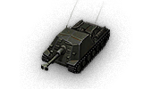
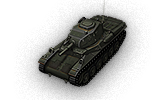

# Sweden · Tier V

[All nations and tiers](../buffs_nerfs.md) · EU v20410 → RU v14600ru · 3 November 2026

<label><strong>Find a tank</strong><input type="search" placeholder="Try is7, obj140 or xm57" aria-label="Find a tank" style="display:block;width:100%;padding:.7rem;border:1px solid #888;border-radius:4px;margin:.5rem 0;color:inherit;background:transparent"></label>

Ikv 103 · Tier V

ikv103

<a href="https://tanks.gg/v20410/tank/ikv-103">EU stats</a> · <a href="https://tanks.gg/v14600ru/tank/ikv-103">RU stats</a>
<figure style="display:inline-block"><figcaption>Ikv 103</figcaption></figure>
<strong>Penetration (mm)</strong> <b>EU</b>  HEAT <strong>120</strong> /  HEAT <strong>160</strong> /  HE <strong>53</strong> → <b>RU</b>  HEAT <strong>120</strong> /  HEAT <strong>140</strong>

<strong>Damage (HP)</strong> <b>EU</b>  HEAT <strong>300</strong> /  HEAT <strong>300</strong> /  HE <strong>370</strong> → <b>RU</b>  HEAT <strong>300</strong> /  HEAT <strong>300</strong>

<em>Firepower</em> 
<strong>Shell velocity (m/s)</strong> <small>EU</small> 600  <small>RU</small> <strong>418</strong> 

<em>Gun handling</em> 
<strong>Dispersion · turret traverse</strong> <small>EU</small> 0.14  <small>RU</small> <strong>0.16</strong> 

<em>Mobility</em> 
<strong>Forward speed on hard terrain (km/h)</strong> <small>EU</small> 60  <small>RU</small> <strong>48.44</strong> 
<strong>Forward speed on medium terrain (km/h)</strong> <small>EU</small> 56.62  <small>RU</small> <strong>44.04</strong> 
<strong>Forward speed on soft terrain (km/h)</strong> <small>EU</small> 29.66  <small>RU</small> <strong>23.07</strong> 
<strong>Engine power (hp)</strong> <small>EU</small> 180  <small>RU</small> <strong>140</strong> 
<strong>Power/weight (hp/t)</strong> <small>EU</small> 20.45  <small>RU</small> <strong>15.91</strong> 
<strong>Tank traverse on hard terrain (°/s)</strong> <small>EU</small> 35.67  <small>RU</small> <strong>40.38</strong> 
<strong>Tank traverse on medium terrain (°/s)</strong> <small>EU</small> 32.43  <small>RU</small> <strong>36.71</strong> 
<strong>Tank traverse on soft terrain (°/s)</strong> <small>EU</small> 16.99  <small>RU</small> <strong>19.23</strong> 

<em>Armor &amp; health</em> 
<strong>Health</strong> <small>EU</small> 500  <small>RU</small> <strong>460</strong> 

Strv m/42 · Tier V

strvm42

<a href="https://tanks.gg/v20410/tank/strv-m42">EU stats</a> · <a href="https://tanks.gg/v14600ru/tank/strv-m42">RU stats</a>
<figure style="display:inline-block"><figcaption>Strv m/42</figcaption></figure>
<strong>Penetration (mm)</strong> <b>EU</b>  AP <strong>128</strong> /  AP <strong>144</strong> /  HE <strong>38</strong> → <b>RU</b>  AP <strong>115</strong> /  AP <strong>144</strong> /  HE <strong>38</strong>

<em>Firepower</em> 
<strong>Module damage</strong> <small>EU</small> 100  <small>RU</small> <strong>105</strong> 
<strong>Shell velocity (m/s)</strong> <small>EU</small> 850  <small>RU</small> <strong>815</strong> 

<em>Mobility</em> 
<strong>Forward speed on hard terrain (km/h)</strong> <small>EU</small> 43.32  <small>RU</small> <strong>41.51</strong> 
<strong>Forward speed on medium terrain (km/h)</strong> <small>EU</small> 38.22  <small>RU</small> <strong>36.63</strong> 
<strong>Forward speed on soft terrain (km/h)</strong> <small>EU</small> 28.25  <small>RU</small> <strong>27.07</strong> 
<strong>Engine power (hp)</strong> <small>EU</small> 480  <small>RU</small> <strong>460</strong> 
<strong>Power/weight (hp/t)</strong> <small>EU</small> 21.34  <small>RU</small> <strong>20.45</strong> 
<strong>Tank traverse on hard terrain (°/s)</strong> <small>EU</small> 49.47  <small>RU</small> <strong>57.85</strong> 
<strong>Tank traverse on medium terrain (°/s)</strong> <small>EU</small> 43.65  <small>RU</small> <strong>51.04</strong> 
<strong>Tank traverse on soft terrain (°/s)</strong> <small>EU</small> 32.26  <small>RU</small> <strong>37.73</strong> 

<em>Armor &amp; health</em> 
<strong>Health</strong> <small>EU</small> 650  <small>RU</small> <strong>590</strong> 

