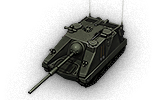
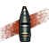
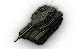
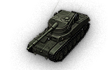

# Sweden · Tier VI

[All nations and tiers](../buffs_nerfs.md) · EU v20410 → RU v14600ru · 3 November 2026

<label><strong>Find a tank</strong><input type="search" placeholder="Try is7, obj140 or xm57" aria-label="Find a tank" style="display:block;width:100%;padding:.7rem;border:1px solid #888;border-radius:4px;margin:.5rem 0;color:inherit;background:transparent"></label>

Ikv 65 Alt II · Tier VI

ikv65altii

<a href="https://tanks.gg/v20410/tank/ikv-65-ii">EU stats</a> · <a href="https://tanks.gg/v14600ru/tank/ikv-65-ii">RU stats</a>
<figure style="display:inline-block"><figcaption>Ikv 65 Alt II</figcaption></figure>
<strong>Penetration (mm)</strong> <b>EU</b>  AP <strong>190</strong> /  HEAT <strong>230</strong> /  HE <strong>45</strong> → <b>RU</b>  AP <strong>180</strong> /  HEAT <strong>230</strong> /  HE <strong>45</strong>

<em>Firepower</em> 
<strong>DPM (HP/min)</strong> <small>EU</small> 1 766.96  <small>RU</small> <strong>1 548.37</strong> 
<strong>Rate of fire (rounds/min)</strong> <small>EU</small> 7.36  <small>RU</small> <strong>6.45</strong> 
<strong>Reload time (s)</strong> <small>EU</small> 8.15  <small>RU</small> <strong>9.30</strong> 
<strong>Shell velocity (m/s)</strong> <small>EU</small> 980  <small>RU</small> <strong>960</strong> 

<em>Gun handling</em> 
<strong>Dispersion · moving</strong> <small>EU</small> 0.20  <small>RU</small> <strong>0.24</strong> 
<strong>Dispersion · tank traverse</strong> <small>EU</small> 0.20  <small>RU</small> <strong>0.24</strong> 
<strong>Dispersion · turret traverse</strong> <small>EU</small> 0.12  <small>RU</small> <strong>0.14</strong> 

<em>Mobility</em> 
<strong>Forward speed on hard terrain (km/h)</strong> <small>EU</small> 57.87  <small>RU</small> <strong>57.20</strong> 
<strong>Forward speed on medium terrain (km/h)</strong> <small>EU</small> 48.97  <small>RU</small> <strong>48.40</strong> 
<strong>Forward speed on soft terrain (km/h)</strong> <small>EU</small> 26.53  <small>RU</small> <strong>26.22</strong> 
<strong>Engine power (hp)</strong> <small>EU</small> 230  <small>RU</small> <strong>227.32</strong> 
<strong>Power/weight (hp/t)</strong> <small>EU</small> 20.91  <small>RU</small> <strong>20.67</strong> 
<strong>Tank traverse on hard terrain (°/s)</strong> <small>EU</small> 33.92  <small>RU</small> <strong>35.05</strong> 
<strong>Tank traverse on medium terrain (°/s)</strong> <small>EU</small> 28.70  <small>RU</small> <strong>29.66</strong> 
<strong>Tank traverse on soft terrain (°/s)</strong> <small>EU</small> 15.55  <small>RU</small> <strong>16.07</strong> 

Strv 74 · Tier VI

strv74

<a href="https://tanks.gg/v20410/tank/strv-74">EU stats</a> · <a href="https://tanks.gg/v14600ru/tank/strv-74">RU stats</a>
<figure style="display:inline-block"><figcaption>Strv 74</figcaption></figure>
<em>Firepower</em> 
<strong>Module damage</strong> <small>EU</small> 100  <small>RU</small> <strong>105</strong> 

<em>Mobility</em> 
<strong>Tank traverse on hard terrain (°/s)</strong> <small>EU</small> 40.81  <small>RU</small> <strong>44.50</strong> 
<strong>Tank traverse on medium terrain (°/s)</strong> <small>EU</small> 37.10  <small>RU</small> <strong>40.45</strong> 
<strong>Tank traverse on soft terrain (°/s)</strong> <small>EU</small> 21.48  <small>RU</small> <strong>23.42</strong> 

<em>Armor &amp; health</em> 
<strong>Health</strong> <small>EU</small> 920  <small>RU</small> <strong>840</strong> 
<strong>Health · engine</strong> <small>EU</small> 205  <small>RU</small> <strong>123</strong> 

Strv m/42-57 Alt A.2 · Tier VI

strvm4257alta2

<a href="https://tanks.gg/v20410/tank/strv-m42-57">EU stats</a> · <a href="https://tanks.gg/v14600ru/tank/strv-m42-57">RU stats</a>
<figure style="display:inline-block"><figcaption>Strv m/42-57 Alt A.2</figcaption></figure>
<em>Firepower</em> 
<strong>DPM (HP/min)</strong> <small>EU</small> 1 686.94  <small>RU</small> <strong>1 661.80</strong> 
<strong>Rate of fire (rounds/min)</strong> <small>EU</small> 11.25  <small>RU</small> <strong>11.08</strong> 
<strong>Reload time (s)</strong> <small>EU</small> 15.34  <small>RU</small> <strong>15.66</strong> 

