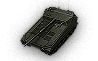
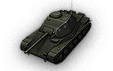

# Sweden · Tier VII

[All nations and tiers](../buffs_nerfs.md) · EU v20410 → RU v14600ru · 3 November 2026

<label><strong>Find a tank</strong><input type="search" placeholder="Try is7, obj140 or xm57" aria-label="Find a tank" style="display:block;width:100%;padding:.7rem;border:1px solid #888;border-radius:4px;margin:.5rem 0;color:inherit;background:transparent"></label>

Ikv 90 Typ B · Tier VII

ikv90typb

<a href="https://tanks.gg/v20410/tank/ikv-90-b">EU stats</a> · <a href="https://tanks.gg/v14600ru/tank/ikv-90-b">RU stats</a>
<figure style="display:inline-block"><figcaption>Ikv 90 Typ B</figcaption></figure>
<strong>Penetration (mm)</strong> <b>EU</b>  AP <strong>210</strong> /  HEAT <strong>270</strong> /  HE <strong>45</strong> → <b>RU</b>  AP <strong>210</strong> /  HEAT <strong>250</strong> /  HE <strong>45</strong>

<em>Firepower</em> 
<strong>DPM (HP/min)</strong> <small>EU</small> 2 176.70  <small>RU</small> <strong>2 029.62</strong> 
<strong>Rate of fire (rounds/min)</strong> <small>EU</small> 9.07  <small>RU</small> <strong>8.46</strong> 
<strong>Reload time (s)</strong> <small>EU</small> 6.62  <small>RU</small> <strong>7.09</strong> 

<em>Gun handling</em> 
<strong>Dispersion · moving</strong> <small>EU</small> 0.18  <small>RU</small> <strong>0.24</strong> 
<strong>Dispersion · tank traverse</strong> <small>EU</small> 0.18  <small>RU</small> <strong>0.24</strong> 

<em>Mobility</em> 
<strong>Forward speed on hard terrain (km/h)</strong> <small>EU</small> 48.99  <small>RU</small> <strong>50.88</strong> 
<strong>Forward speed on medium terrain (km/h)</strong> <small>EU</small> 41.99  <small>RU</small> <strong>43.61</strong> 
<strong>Forward speed on soft terrain (km/h)</strong> <small>EU</small> 25.56  <small>RU</small> <strong>26.54</strong> 
<strong>Engine power (hp)</strong> <small>EU</small> 260  <small>RU</small> <strong>270</strong> 
<strong>Power/weight (hp/t)</strong> <small>EU</small> 19.31  <small>RU</small> <strong>20.05</strong> 
<strong>Tank traverse (°/s)</strong> <small>EU</small> 43.81  <small>RU</small> <strong>31.29</strong> 
<strong>Tank traverse on hard terrain (°/s)</strong> <small>EU</small> 46.29  <small>RU</small> <strong>31.60</strong> 
<strong>Tank traverse on medium terrain (°/s)</strong> <small>EU</small> 39.68  <small>RU</small> <strong>27.08</strong> 
<strong>Tank traverse on soft terrain (°/s)</strong> <small>EU</small> 24.15  <small>RU</small> <strong>16.48</strong> 

<em>Armor &amp; health</em> 
<strong>Health</strong> <small>EU</small> 900  <small>RU</small> <strong>800</strong> 

Leo · Tier VII

leo

<a href="https://tanks.gg/v20410/tank/leo">EU stats</a> · <a href="https://tanks.gg/v14600ru/tank/leo">RU stats</a>
<figure style="display:inline-block"><figcaption>Leo</figcaption></figure>
<em>Mobility</em> 
<strong>Tank traverse on hard terrain (°/s)</strong> <small>EU</small> 47.74  <small>RU</small> <strong>47.72</strong> 
<strong>Tank traverse on medium terrain (°/s)</strong> <small>EU</small> 43.40  <small>RU</small> <strong>43.38</strong> 
<strong>Tank traverse on soft terrain (°/s)</strong> <small>EU</small> 28.08  <small>RU</small> <strong>28.07</strong> 

<em>Armor &amp; health</em> 
<strong>Health</strong> <small>EU</small> 1 200  <small>RU</small> <strong>1 100</strong> 

