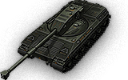
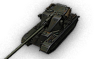
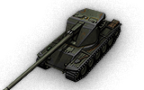
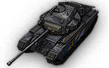
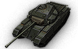
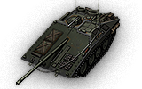
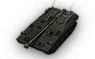
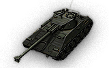

# Sweden · Tier VIII

[All nations and tiers](../buffs_nerfs.md) · EU v20410 → RU v14600ru · 3 November 2026

<label><strong>Find a tank</strong><input type="search" placeholder="Try is7, obj140 or xm57" aria-label="Find a tank" style="display:block;width:100%;padding:.7rem;border:1px solid #888;border-radius:4px;margin:.5rem 0;color:inherit;background:transparent"></label>

Bofors Tornvagn · Tier VIII

boforstornvagn

<a href="https://tanks.gg/v20410/tank/tornvagn">EU stats</a> · <a href="https://tanks.gg/v14600ru/tank/tornvagn">RU stats</a>
<figure style="display:inline-block"><figcaption>Bofors Tornvagn</figcaption></figure>
<em>Firepower</em> 
<strong>DPM (HP/min)</strong> <small>EU</small> 1 668.80  <small>RU</small> <strong>1 634.40</strong> 
<strong>Rate of fire (rounds/min)</strong> <small>EU</small> 4.17  <small>RU</small> <strong>4.09</strong> 
<strong>Reload time (s)</strong> <small>EU</small> 14.38  <small>RU</small> <strong>14.68</strong> 

<em>Gun handling</em> 
<strong>Dispersion (m/100 m)</strong> <small>EU</small> 0.38  <small>RU</small> <strong>0.42</strong> 
<strong>Dispersion · damaged</strong> <small>EU</small> 0.77  <small>RU</small> <strong>0.84</strong> 
<strong>Dispersion · turret traverse</strong> <small>EU</small> 0.20  <small>RU</small> <strong>0.25</strong> 

<em>Mobility</em> 
<strong>Forward speed (km/h)</strong> <small>EU</small> 35  <small>RU</small> <strong>32</strong> 
<strong>Forward speed on hard terrain (km/h)</strong> <small>EU</small> 35  <small>RU</small> <strong>32</strong> 
<strong>Forward speed on medium terrain (km/h)</strong> <small>EU</small> 34.04  <small>RU</small> <strong>32</strong> 
<strong>Turret traverse (°/s)</strong> <small>EU</small> 26.08  <small>RU</small> <strong>22.95</strong> 
<strong>Tank traverse (°/s)</strong> <small>EU</small> 26.08  <small>RU</small> <strong>22.95</strong> 
<strong>Tank traverse on hard terrain (°/s)</strong> <small>EU</small> 26.08  <small>RU</small> <strong>22.95</strong> 
<strong>Tank traverse on medium terrain (°/s)</strong> <small>EU</small> 24.07  <small>RU</small> <strong>21.18</strong> 
<strong>Tank traverse on soft terrain (°/s)</strong> <small>EU</small> 14.90  <small>RU</small> <strong>13.11</strong> 

<em>Miscellaneous</em> 
<strong>View range (m)</strong> <small>EU</small> 370  <small>RU</small> <strong>360</strong> 

EMIL 1951 · Tier VIII

emil1951

<a href="https://tanks.gg/v20410/tank/emil-1951">EU stats</a> · <a href="https://tanks.gg/v14600ru/tank/emil-1951">RU stats</a>
<figure style="display:inline-block"><figcaption>EMIL 1951</figcaption></figure>
<em>Firepower</em> 
<strong>DPM (HP/min)</strong> <small>EU</small> 1 891.27  <small>RU</small> <strong>1 858.43</strong> 
<strong>Rate of fire (rounds/min)</strong> <small>EU</small> 5.25  <small>RU</small> <strong>5.16</strong> 
<strong>Reload time (s)</strong> <small>EU</small> 28.76  <small>RU</small> <strong>29.37</strong> 

<em>Gun handling</em> 
<strong>Dispersion · moving</strong> <small>EU</small> 0.26  <small>RU</small> <strong>0.28</strong> 
<strong>Dispersion · tank traverse</strong> <small>EU</small> 0.26  <small>RU</small> <strong>0.28</strong> 

<em>Mobility</em> 
<strong>Tank traverse (°/s)</strong> <small>EU</small> 31.29  <small>RU</small> <strong>29.20</strong> 
<strong>Tank traverse on hard terrain (°/s)</strong> <small>EU</small> 31.29  <small>RU</small> <strong>29.20</strong> 
<strong>Tank traverse on medium terrain (°/s)</strong> <small>EU</small> 28.88  <small>RU</small> <strong>26.96</strong> 
<strong>Tank traverse on soft terrain (°/s)</strong> <small>EU</small> 17.88  <small>RU</small> <strong>16.69</strong> 

<em>Armor &amp; health</em> 
<strong>Health</strong> <small>EU</small> 1 400  <small>RU</small> <strong>1 550</strong> 

Emil I · Tier VIII

emili

<a href="https://tanks.gg/v20410/tank/emil-i">EU stats</a> · <a href="https://tanks.gg/v14600ru/tank/emil-i">RU stats</a>
<figure style="display:inline-block"><figcaption>Emil I</figcaption></figure>
<strong>Penetration (mm)</strong> <b>EU</b>  APCR <strong>217</strong> /  APCR <strong>242</strong> /  HE <strong>53</strong> → <b>RU</b>  APCR <strong>217</strong> /  APCR <strong>248</strong> /  HE <strong>53</strong>

<em>Firepower</em> 
<strong>DPM (HP/min)</strong> <small>EU</small> 2 032.18  <small>RU</small> <strong>2 060.23</strong> 
<strong>Rate of fire (rounds/min)</strong> <small>EU</small> 5.64  <small>RU</small> <strong>5.72</strong> 
<strong>Reload time (s)</strong> <small>EU</small> 25.89  <small>RU</small> <strong>25.45</strong> 

<em>Gun handling</em> 
<strong>Aim time (s)</strong> <small>EU</small> 3.07  <small>RU</small> <strong>2.88</strong> 
<strong>Dispersion · moving</strong> <small>EU</small> 0.26  <small>RU</small> <strong>0.24</strong> 
<strong>Dispersion · tank traverse</strong> <small>EU</small> 0.26  <small>RU</small> <strong>0.24</strong> 
<strong>Dispersion · firing</strong> <small>EU</small> 3.50  <small>RU</small> <strong>4</strong> 

<em>Mobility</em> 
<strong>Tank traverse on hard terrain (°/s)</strong> <small>EU</small> 30.82  <small>RU</small> <strong>30.84</strong> 
<strong>Tank traverse on medium terrain (°/s)</strong> <small>EU</small> 28.45  <small>RU</small> <strong>28.47</strong> 
<strong>Tank traverse on soft terrain (°/s)</strong> <small>EU</small> 17.61  <small>RU</small> <strong>17.62</strong> 

<em>Miscellaneous</em> 
<strong>Moving camo</strong> <small>EU</small> 3.31  <small>RU</small> <strong>3.25</strong> 
<strong>Moving camo · after firing</strong> <small>EU</small> 0.65  <small>RU</small> <strong>0.64</strong> 

Primo Victoria · Tier VIII

primovictoria

<a href="https://tanks.gg/v20410/tank/pvictoria">EU stats</a> · <a href="https://tanks.gg/v14600ru/tank/pvictoria">RU stats</a>
<figure style="display:inline-block"><figcaption>Primo Victoria</figcaption></figure>
<strong>Penetration (mm)</strong> <b>EU</b>  APCR <strong>226</strong> /  APCR <strong>258</strong> /  HE <strong>42</strong> → <b>RU</b>  APCR <strong>226</strong> /  APCR <strong>258</strong> /  HE <strong>84</strong>

<em>Firepower</em> 
<strong>DPM (HP/min)</strong> <small>EU</small> 2 180.82  <small>RU</small> <strong>2 214.37</strong> 
<strong>Rate of fire (rounds/min)</strong> <small>EU</small> 9.48  <small>RU</small> <strong>9.63</strong> 
<strong>Reload time (s)</strong> <small>EU</small> 6.33  <small>RU</small> <strong>6.23</strong> 

<em>Gun handling</em> 
<strong>Aim time (s)</strong> <small>EU</small> 2.21  <small>RU</small> <strong>1.82</strong> 
<strong>Dispersion · moving</strong> <small>EU</small> 0.14  <small>RU</small> <strong>0.12</strong> 
<strong>Dispersion · tank traverse</strong> <small>EU</small> 0.14  <small>RU</small> <strong>0.12</strong> 
<strong>Dispersion · turret traverse</strong> <small>EU</small> 0.12  <small>RU</small> <strong>0.10</strong> 

<em>Mobility</em> 
<strong>Forward speed on medium terrain (km/h)</strong> <small>EU</small> 50  <small>RU</small> <strong>49.04</strong> 
<strong>Forward speed on soft terrain (km/h)</strong> <small>EU</small> 29.97  <small>RU</small> <strong>28.39</strong> 
<strong>Engine power (hp)</strong> <small>EU</small> 950  <small>RU</small> <strong>900</strong> 
<strong>Power/weight (hp/t)</strong> <small>EU</small> 18.70  <small>RU</small> <strong>17.72</strong> 

Strv 81 · Tier VIII

strv81

<a href="https://tanks.gg/v20410/tank/strv-81">EU stats</a> · <a href="https://tanks.gg/v14600ru/tank/strv-81">RU stats</a>
<figure style="display:inline-block"><figcaption>Strv 81</figcaption></figure>
<strong>Penetration (mm)</strong> <b>EU</b>  APCR <strong>226</strong> /  APCR <strong>258</strong> /  HE <strong>42</strong> → <b>RU</b>  APCR <strong>226</strong> /  APCR <strong>258</strong> /  HE <strong>84</strong>

<em>Firepower</em> 
<strong>DPM (HP/min)</strong> <small>EU</small> 2 180.82  <small>RU</small> <strong>2 214.37</strong> 
<strong>Rate of fire (rounds/min)</strong> <small>EU</small> 9.48  <small>RU</small> <strong>9.63</strong> 
<strong>Reload time (s)</strong> <small>EU</small> 6.33  <small>RU</small> <strong>6.23</strong> 

<em>Gun handling</em> 
<strong>Aim time (s)</strong> <small>EU</small> 2.21  <small>RU</small> <strong>1.82</strong> 
<strong>Dispersion · moving</strong> <small>EU</small> 0.14  <small>RU</small> <strong>0.12</strong> 
<strong>Dispersion · tank traverse</strong> <small>EU</small> 0.14  <small>RU</small> <strong>0.12</strong> 
<strong>Dispersion · turret traverse</strong> <small>EU</small> 0.12  <small>RU</small> <strong>0.10</strong> 

<em>Mobility</em> 
<strong>Forward speed on medium terrain (km/h)</strong> <small>EU</small> 50  <small>RU</small> <strong>49.04</strong> 
<strong>Forward speed on soft terrain (km/h)</strong> <small>EU</small> 29.97  <small>RU</small> <strong>28.39</strong> 
<strong>Engine power (hp)</strong> <small>EU</small> 950  <small>RU</small> <strong>900</strong> 
<strong>Power/weight (hp/t)</strong> <small>EU</small> 18.70  <small>RU</small> <strong>17.72</strong> 

Strv S1 · Tier VIII

strvs1

<a href="https://tanks.gg/v20410/tank/strv-s1">EU stats</a> · <a href="https://tanks.gg/v14600ru/tank/strv-s1">RU stats</a>
<figure style="display:inline-block"><figcaption>Strv S1</figcaption></figure>
<em>Gun handling</em> 
<strong>Aim time (s)</strong> <small>EU</small> 2.88  <small>RU</small> <strong>2.94</strong> 
<strong>Dispersion (m/100 m)</strong> <small>EU</small> 0.38  <small>RU</small> <strong>0.39</strong> 
<strong>Dispersion · damaged</strong> <small>EU</small> 0.77  <small>RU</small> <strong>0.78</strong> 

<em>Mobility</em> 
<strong>Turret traverse (°/s)</strong> <small>EU</small> 16.69  <small>RU</small> <strong>16.34</strong> 

Alternate mode

<a href="https://tanks.gg/v20410/tank/strv-s1-siege">EU stats</a> · <a href="https://tanks.gg/v14600ru/tank/strv-s1-siege">RU stats</a>
<em>Gun handling</em> 
<strong>Aim time (s)</strong> <small>EU</small> 1.34  <small>RU</small> <strong>1.37</strong> 
<strong>Dispersion · damaged</strong> <small>EU</small> 0.58  <small>RU</small> <strong>0.59</strong> 

<em>Mobility</em> 
<strong>Turret traverse (°/s)</strong> <small>EU</small> 16.69  <small>RU</small> <strong>16.34</strong> 

Strv S1 FL · Tier VIII

strvs1fl

<a href="https://tanks.gg/v20410/tank/strv-s1-fl">EU stats</a> · <a href="https://tanks.gg/v14600ru/tank/strv-s1-fl">RU stats</a>
<figure style="display:inline-block"><figcaption>Strv S1 FL</figcaption></figure>
<em>Gun handling</em> 
<strong>Aim time (s)</strong> <small>EU</small> 2.88  <small>RU</small> <strong>2.94</strong> 
<strong>Dispersion (m/100 m)</strong> <small>EU</small> 0.38  <small>RU</small> <strong>0.39</strong> 
<strong>Dispersion · damaged</strong> <small>EU</small> 0.77  <small>RU</small> <strong>0.78</strong> 

<em>Mobility</em> 
<strong>Turret traverse (°/s)</strong> <small>EU</small> 16.69  <small>RU</small> <strong>16.34</strong> 

Alternate mode

<a href="https://tanks.gg/v20410/tank/strv-s1-fl-siege">EU stats</a> · <a href="https://tanks.gg/v14600ru/tank/strv-s1-fl-siege">RU stats</a>
<em>Gun handling</em> 
<strong>Aim time (s)</strong> <small>EU</small> 1.34  <small>RU</small> <strong>1.37</strong> 
<strong>Dispersion · damaged</strong> <small>EU</small> 0.58  <small>RU</small> <strong>0.59</strong> 

<em>Mobility</em> 
<strong>Turret traverse (°/s)</strong> <small>EU</small> 16.69  <small>RU</small> <strong>16.34</strong> 

UDES 03 · Tier VIII

udes03

<a href="https://tanks.gg/v20410/tank/udes-03">EU stats</a> · <a href="https://tanks.gg/v14600ru/tank/udes-03">RU stats</a>
<figure style="display:inline-block"><figcaption>UDES 03</figcaption></figure>
<em>Firepower</em> 
<strong>DPM (HP/min)</strong> <small>EU</small> 2 440.62  <small>RU</small> <strong>2 369.53</strong> 
<strong>Rate of fire (rounds/min)</strong> <small>EU</small> 6.26  <small>RU</small> <strong>6.08</strong> 
<strong>Reload time (s)</strong> <small>EU</small> 9.59  <small>RU</small> <strong>9.88</strong> 

<em>Gun handling</em> 
<strong>Aim time (s)</strong> <small>EU</small> 2.88  <small>RU</small> <strong>2.94</strong> 
<strong>Dispersion · damaged</strong> <small>EU</small> 0.67  <small>RU</small> <strong>0.69</strong> 
<strong>Dispersion · moving</strong> <small>EU</small> 0.40  <small>RU</small> <strong>0.30</strong> 
<strong>Dispersion · tank traverse</strong> <small>EU</small> 0.10  <small>RU</small> <strong>0.20</strong> 

<em>Mobility</em> 
<strong>Forward speed on hard terrain (km/h)</strong> <small>EU</small> 56.14  <small>RU</small> <strong>60.63</strong> 
<strong>Forward speed on medium terrain (km/h)</strong> <small>EU</small> 52.13  <small>RU</small> <strong>56.30</strong> 
<strong>Forward speed on soft terrain (km/h)</strong> <small>EU</small> 30.41  <small>RU</small> <strong>32.84</strong> 
<strong>Engine power (hp)</strong> <small>EU</small> 500  <small>RU</small> <strong>540</strong> 
<strong>Power/weight (hp/t)</strong> <small>EU</small> 23.97  <small>RU</small> <strong>25.89</strong> 
<strong>Turret traverse (°/s)</strong> <small>EU</small> 16.69  <small>RU</small> <strong>16.34</strong> 
<strong>Tank traverse (°/s)</strong> <small>EU</small> 41.72  <small>RU</small> <strong>29.20</strong> 
<strong>Tank traverse on hard terrain (°/s)</strong> <small>EU</small> 42.33  <small>RU</small> <strong>30.29</strong> 
<strong>Tank traverse on medium terrain (°/s)</strong> <small>EU</small> 39.30  <small>RU</small> <strong>28.13</strong> 
<strong>Tank traverse on soft terrain (°/s)</strong> <small>EU</small> 22.93  <small>RU</small> <strong>16.41</strong> 

<em>Armor &amp; health</em> 
<strong>Hull armor · front (mm)</strong> <small>EU</small> 20  <small>RU</small> <strong>35</strong> 
<strong>Hull armor · rear (mm)</strong> <small>EU</small> 20  <small>RU</small> <strong>30</strong> 

Alternate mode

<a href="https://tanks.gg/v20410/tank/udes-03-siege">EU stats</a> · <a href="https://tanks.gg/v14600ru/tank/udes-03-siege">RU stats</a>
<em>Gun handling</em> 
<strong>Aim time (s)</strong> <small>EU</small> 1.44  <small>RU</small> <strong>1.47</strong> 
<strong>Dispersion · damaged</strong> <small>EU</small> 0.48  <small>RU</small> <strong>0.49</strong> 
<strong>Dispersion · moving</strong> <small>EU</small> 0.40  <small>RU</small> <strong>0.30</strong> 
<strong>Dispersion · tank traverse</strong> <small>EU</small> 0.10  <small>RU</small> <strong>0.01</strong> 

<em>Mobility</em> 
<strong>Forward speed (km/h)</strong> <small>EU</small> 5  <small>RU</small> <strong>10</strong> 
<strong>Forward speed on hard terrain (km/h)</strong> <small>EU</small> 5  <small>RU</small> <strong>10</strong> 
<strong>Forward speed on medium terrain (km/h)</strong> <small>EU</small> 5  <small>RU</small> <strong>10</strong> 
<strong>Forward speed on soft terrain (km/h)</strong> <small>EU</small> 5  <small>RU</small> <strong>10</strong> 
<strong>Turret traverse (°/s)</strong> <small>EU</small> 16.69  <small>RU</small> <strong>16.34</strong> 
<strong>Tank traverse (°/s)</strong> <small>EU</small> 41.72  <small>RU</small> <strong>29.20</strong> 
<strong>Tank traverse on hard terrain (°/s)</strong> <small>EU</small> 47.62  <small>RU</small> <strong>33.31</strong> 
<strong>Tank traverse on medium terrain (°/s)</strong> <small>EU</small> 44.22  <small>RU</small> <strong>30.93</strong> 
<strong>Tank traverse on soft terrain (°/s)</strong> <small>EU</small> 25.79  <small>RU</small> <strong>18.04</strong> 

<em>Armor &amp; health</em> 
<strong>Hull armor · front (mm)</strong> <small>EU</small> 20  <small>RU</small> <strong>35</strong> 
<strong>Hull armor · rear (mm)</strong> <small>EU</small> 20  <small>RU</small> <strong>30</strong> 

UDES 14 Alt 5 · Tier VIII

udes14alt5

<a href="https://tanks.gg/v20410/tank/udes-14-5">EU stats</a> · <a href="https://tanks.gg/v14600ru/tank/udes-14-5">RU stats</a>
<figure style="display:inline-block"><figcaption>UDES 14 Alt 5</figcaption></figure>
<em>Firepower</em> 
<strong>DPM (HP/min)</strong> <small>EU</small> 1 959.03  <small>RU</small> <strong>1 918.64</strong> 
<strong>Rate of fire (rounds/min)</strong> <small>EU</small> 5.44  <small>RU</small> <strong>5.33</strong> 
<strong>Reload time (s)</strong> <small>EU</small> 11.03  <small>RU</small> <strong>11.26</strong> 

<em>Mobility</em> 
<strong>Tank traverse on hard terrain (°/s)</strong> <small>EU</small> 42.76  <small>RU</small> <strong>42.29</strong> 
<strong>Tank traverse on medium terrain (°/s)</strong> <small>EU</small> 36.18  <small>RU</small> <strong>35.79</strong> 
<strong>Tank traverse on soft terrain (°/s)</strong> <small>EU</small> 22.40  <small>RU</small> <strong>22.15</strong> 

<em>Armor &amp; health</em> 
<strong>Health</strong> <small>EU</small> 1 550  <small>RU</small> <strong>1 400</strong> 

Alternate mode

<a href="https://tanks.gg/v20410/tank/udes-14-5-siege">EU stats</a> · <a href="https://tanks.gg/v14600ru/tank/udes-14-5-siege">RU stats</a>
<em>Firepower</em> 
<strong>DPM (HP/min)</strong> <small>EU</small> 1 959.03  <small>RU</small> <strong>1 918.64</strong> 
<strong>Rate of fire (rounds/min)</strong> <small>EU</small> 5.44  <small>RU</small> <strong>5.33</strong> 
<strong>Reload time (s)</strong> <small>EU</small> 11.03  <small>RU</small> <strong>11.26</strong> 

<em>Mobility</em> 
<strong>Tank traverse on hard terrain (°/s)</strong> <small>EU</small> 42.76  <small>RU</small> <strong>42.29</strong> 
<strong>Tank traverse on medium terrain (°/s)</strong> <small>EU</small> 36.18  <small>RU</small> <strong>35.79</strong> 
<strong>Tank traverse on soft terrain (°/s)</strong> <small>EU</small> 22.40  <small>RU</small> <strong>22.15</strong> 

<em>Armor &amp; health</em> 
<strong>Health</strong> <small>EU</small> 1 550  <small>RU</small> <strong>1 400</strong> 

