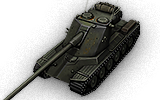
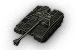
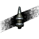
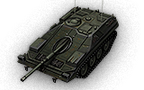
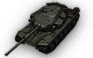
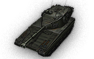
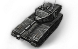
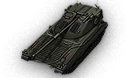

# Sweden · Tier IX

[All nations and tiers](../buffs_nerfs.md) · EU v20410 → RU v14600ru · 3 November 2026

<label><strong>Find a tank</strong><input type="search" placeholder="Try is7, obj140 or xm57" aria-label="Find a tank" style="display:block;width:100%;padding:.7rem;border:1px solid #888;border-radius:4px;margin:.5rem 0;color:inherit;background:transparent"></label>

Emil II · Tier IX

emilii

<a href="https://tanks.gg/v20410/tank/emil-ii">EU stats</a> · <a href="https://tanks.gg/v14600ru/tank/emil-ii">RU stats</a>
<figure style="display:inline-block"><figcaption>Emil II</figcaption></figure>
<em>Firepower</em> 
<strong>DPM (HP/min)</strong> <small>EU</small> 2 278.27  <small>RU</small> <strong>2 239.28</strong> 
<strong>Rate of fire (rounds/min)</strong> <small>EU</small> 5.18  <small>RU</small> <strong>5.09</strong> 
<strong>Reload time (s)</strong> <small>EU</small> 28.76  <small>RU</small> <strong>29.37</strong> 
<strong>Shell velocity (m/s)</strong> <small>EU</small> 1 080  <small>RU</small> <strong>1 000</strong> 

<em>Gun handling</em> 
<strong>Dispersion (m/100 m)</strong> <small>EU</small> 0.40  <small>RU</small> <strong>0.38</strong> 
<strong>Dispersion · damaged</strong> <small>EU</small> 0.81  <small>RU</small> <strong>0.77</strong> 
<strong>Dispersion · moving</strong> <small>EU</small> 0.25  <small>RU</small> <strong>0.22</strong> 
<strong>Dispersion · tank traverse</strong> <small>EU</small> 0.25  <small>RU</small> <strong>0.22</strong> 

<em>Mobility</em> 
<strong>Tank traverse on hard terrain (°/s)</strong> <small>EU</small> 36.57  <small>RU</small> <strong>41.81</strong> 
<strong>Tank traverse on medium terrain (°/s)</strong> <small>EU</small> 33.96  <small>RU</small> <strong>38.82</strong> 
<strong>Tank traverse on soft terrain (°/s)</strong> <small>EU</small> 20.67  <small>RU</small> <strong>23.63</strong> 

<em>Armor &amp; health</em> 
<strong>Health</strong> <small>EU</small> 1 800  <small>RU</small> <strong>1 900</strong> 

<em>Miscellaneous</em> 
<strong>Moving camo</strong> <small>EU</small> 3.02  <small>RU</small> <strong>2.96</strong> 
<strong>Moving camo · after firing</strong> <small>EU</small> 0.54  <small>RU</small> <strong>0.53</strong> 

Lätt Stridsfordon 120 · Tier IX

lättstridsfordon120

<a href="https://tanks.gg/v20410/tank/latt-strf-120">EU stats</a> · <a href="https://tanks.gg/v14600ru/tank/latt-strf-120">RU stats</a>
<figure style="display:inline-block"><figcaption>Lätt Stridsfordon 120</figcaption></figure>
<strong>Damage (HP)</strong> <b>EU</b>  APCR <strong>420</strong> /  HEAT <strong>420</strong> /  HE <strong>530</strong> → <b>RU</b>  APCR <strong>440</strong> /  HEAT <strong>440</strong> /  HE <strong>530</strong>

<em>Firepower</em> 
<strong>DPM (HP/min)</strong> <small>EU</small> 2 766.69  <small>RU</small> <strong>2 294.60</strong> 
<strong>Rate of fire (rounds/min)</strong> <small>EU</small> 6.59  <small>RU</small> <strong>5.21</strong> 
<strong>Reload time (s)</strong> <small>EU</small> 9.11  <small>RU</small> <strong>11.51</strong> 
<strong>Potential damage</strong> <small>EU</small> 16 800  <small>RU</small> <strong>17 600</strong> 

<em>Gun handling</em> 
<strong>Aim time (s)</strong> <small>EU</small> 2.88  <small>RU</small> <strong>2.94</strong> 
<strong>Dispersion (m/100 m)</strong> <small>EU</small> 0.38  <small>RU</small> <strong>0.39</strong> 
<strong>Dispersion · damaged</strong> <small>EU</small> 0.77  <small>RU</small> <strong>0.78</strong> 

<em>Mobility</em> 
<strong>Forward speed (km/h)</strong> <small>EU</small> 50  <small>RU</small> <strong>60</strong> 
<strong>Forward speed on hard terrain (km/h)</strong> <small>EU</small> 50  <small>RU</small> <strong>45</strong> 
<strong>Forward speed on medium terrain (km/h)</strong> <small>EU</small> 50  <small>RU</small> <strong>42</strong> 
<strong>Forward speed on soft terrain (km/h)</strong> <small>EU</small> 40.44  <small>RU</small> <strong>24.23</strong> 
<strong>Reverse speed (km/h)</strong> <small>EU</small> 45  <small>RU</small> <strong>40</strong> 
<strong>Engine power (hp)</strong> <small>EU</small> 340  <small>RU</small> <strong>380</strong> 
<strong>Weight (kg)</strong> <small>EU</small> 20 000 → <small>RU</small> <strong>22 955</strong> 
<strong>Power/weight (hp/t)</strong> <small>EU</small> 17  <small>RU</small> <strong>16.55</strong> 
<strong>Terrain resist (hard)</strong> <small>EU</small> 0.77  <small>RU</small> <strong>1.34</strong> 
<strong>Terrain resist (med)</strong> <small>EU</small> 0.86  <small>RU</small> <strong>1.44</strong> 
<strong>Terrain resist (soft)</strong> <small>EU</small> 1.53  <small>RU</small> <strong>2.49</strong> 
<strong>Turret traverse (°/s)</strong> <small>EU</small> 16.69  <small>RU</small> <strong>16.34</strong> 
<strong>Tank traverse on medium terrain (°/s)</strong> <small>EU</small> 26.42  <small>RU</small> <strong>27.74</strong> 
<strong>Tank traverse on soft terrain (°/s)</strong> <small>EU</small> 14.86  <small>RU</small> <strong>16.01</strong> 

<em>Armor &amp; health</em> 
<strong>Hull armor · front (mm)</strong> <small>EU</small> 40  <small>RU</small> <strong>20</strong> 

<em>Miscellaneous</em> 
<strong>Stationary camo</strong> <small>EU</small> 25.99  <small>RU</small> <strong>26.05</strong> 
<strong>Stationary camo · after firing</strong> <small>EU</small> 4.68  <small>RU</small> <strong>5.16</strong> 
<strong>Moving camo · after firing</strong> <small>EU</small> 2.81  <small>RU</small> <strong>3.09</strong> 

Alternate mode

<a href="https://tanks.gg/v20410/tank/latt-strf-120-siege">EU stats</a> · <a href="https://tanks.gg/v14600ru/tank/latt-strf-120-siege">RU stats</a>
<em>Firepower</em> 
<strong>DPM (HP/min)</strong> <small>EU</small> 2 766.69  <small>RU</small> <strong>2 898.44</strong> 
<strong>Potential damage</strong> <small>EU</small> 16 800  <small>RU</small> <strong>17 600</strong> 

<em>Gun handling</em> 
<strong>Aim time (s)</strong> <small>EU</small> 1.15  <small>RU</small> <strong>1.47</strong> 
<strong>Dispersion · damaged</strong> <small>EU</small> 0.58  <small>RU</small> <strong>0.59</strong> 
<strong>Dispersion · moving</strong> <small>EU</small> 0.40  <small>RU</small> <strong>0.10</strong> 

<em>Mobility</em> 
<strong>Forward speed (km/h)</strong> <small>EU</small> 10  <small>RU</small> <strong>20</strong> 
<strong>Forward speed on hard terrain (km/h)</strong> <small>EU</small> 10  <small>RU</small> <strong>20</strong> 
<strong>Forward speed on medium terrain (km/h)</strong> <small>EU</small> 10  <small>RU</small> <strong>20</strong> 
<strong>Forward speed on soft terrain (km/h)</strong> <small>EU</small> 10  <small>RU</small> <strong>20</strong> 
<strong>Reverse speed (km/h)</strong> <small>EU</small> 10  <small>RU</small> <strong>20</strong> 
<strong>Engine power (hp)</strong> <small>EU</small> 340  <small>RU</small> <strong>380</strong> 
<strong>Weight (kg)</strong> <small>EU</small> 20 000 → <small>RU</small> <strong>22 955</strong> 
<strong>Power/weight (hp/t)</strong> <small>EU</small> 17  <small>RU</small> <strong>16.55</strong> 
<strong>Terrain resist (hard)</strong> <small>EU</small> 0.77  <small>RU</small> <strong>0.96</strong> 
<strong>Terrain resist (med)</strong> <small>EU</small> 0.86  <small>RU</small> <strong>1.08</strong> 
<strong>Terrain resist (soft)</strong> <small>EU</small> 1.53  <small>RU</small> <strong>1.92</strong> 
<strong>Turret traverse (°/s)</strong> <small>EU</small> 16.69  <small>RU</small> <strong>16.34</strong> 

<em>Armor &amp; health</em> 
<strong>Hull armor · front (mm)</strong> <small>EU</small> 40  <small>RU</small> <strong>20</strong> 

<em>Miscellaneous</em> 
<strong>Stationary camo</strong> <small>EU</small> 25.99  <small>RU</small> <strong>26.05</strong> 
<strong>Stationary camo · after firing</strong> <small>EU</small> 4.68  <small>RU</small> <strong>5.16</strong> 
<strong>Moving camo · after firing</strong> <small>EU</small> 2.81  <small>RU</small> <strong>3.09</strong> 

Strv 103-0 · Tier IX

strv1030

<a href="https://tanks.gg/v20410/tank/strv-103-0">EU stats</a> · <a href="https://tanks.gg/v14600ru/tank/strv-103-0">RU stats</a>
<figure style="display:inline-block"><figcaption>Strv 103-0</figcaption></figure>
<em>Firepower</em> 
<strong>DPM (HP/min)</strong> <small>EU</small> 3 089.39  <small>RU</small> <strong>2 976.37</strong> 
<strong>Rate of fire (rounds/min)</strong> <small>EU</small> 7.92  <small>RU</small> <strong>7.63</strong> 
<strong>Reload time (s)</strong> <small>EU</small> 7.57  <small>RU</small> <strong>7.86</strong> 

<em>Gun handling</em> 
<strong>Aim time (s)</strong> <small>EU</small> 2.88  <small>RU</small> <strong>2.94</strong> 
<strong>Dispersion (m/100 m)</strong> <small>EU</small> 0.38  <small>RU</small> <strong>0.39</strong> 
<strong>Dispersion · damaged</strong> <small>EU</small> 0.77  <small>RU</small> <strong>0.78</strong> 

<em>Mobility</em> 
<strong>Forward speed on soft terrain (km/h)</strong> <small>EU</small> 38.57  <small>RU</small> <strong>32.63</strong> 
<strong>Engine power (hp)</strong> <small>EU</small> 750  <small>RU</small> <strong>634.37</strong> 
<strong>Power/weight (hp/t)</strong> <small>EU</small> 20.27  <small>RU</small> <strong>17.15</strong> 
<strong>Turret traverse (°/s)</strong> <small>EU</small> 16.69  <small>RU</small> <strong>16.34</strong> 
<strong>Tank traverse (°/s)</strong> <small>EU</small> 36.50  <small>RU</small> <strong>33.38</strong> 
<strong>Tank traverse on hard terrain (°/s)</strong> <small>EU</small> 36.86  <small>RU</small> <strong>34.97</strong> 
<strong>Tank traverse on medium terrain (°/s)</strong> <small>EU</small> 32.77  <small>RU</small> <strong>31.08</strong> 
<strong>Tank traverse on soft terrain (°/s)</strong> <small>EU</small> 18.43  <small>RU</small> <strong>17.48</strong> 

<em>Armor &amp; health</em> 
<strong>Hull armor · front (mm)</strong> <small>EU</small> 40  <small>RU</small> <strong>45</strong> 

Alternate mode

<a href="https://tanks.gg/v20410/tank/strv-103-0-siege">EU stats</a> · <a href="https://tanks.gg/v14600ru/tank/strv-103-0-siege">RU stats</a>
<em>Firepower</em> 
<strong>DPM (HP/min)</strong> <small>EU</small> 3 089.39  <small>RU</small> <strong>2 976.37</strong> 
<strong>Rate of fire (rounds/min)</strong> <small>EU</small> 7.92  <small>RU</small> <strong>7.63</strong> 
<strong>Reload time (s)</strong> <small>EU</small> 7.57  <small>RU</small> <strong>7.86</strong> 

<em>Gun handling</em> 
<strong>Aim time (s)</strong> <small>EU</small> 1.15  <small>RU</small> <strong>1.17</strong> 
<strong>Dispersion · damaged</strong> <small>EU</small> 0.58  <small>RU</small> <strong>0.59</strong> 
<strong>Dispersion · tank traverse</strong> <small>EU</small> 0.10  <small>RU</small> <strong>0.01</strong> 

<em>Mobility</em> 
<strong>Turret traverse (°/s)</strong> <small>EU</small> 16.69  <small>RU</small> <strong>16.34</strong> 
<strong>Tank traverse (°/s)</strong> <small>EU</small> 36.50  <small>RU</small> <strong>33.38</strong> 
<strong>Tank traverse on hard terrain (°/s)</strong> <small>EU</small> 41.28  <small>RU</small> <strong>37.76</strong> 
<strong>Tank traverse on medium terrain (°/s)</strong> <small>EU</small> 36.70  <small>RU</small> <strong>33.57</strong> 
<strong>Tank traverse on soft terrain (°/s)</strong> <small>EU</small> 20.64  <small>RU</small> <strong>18.88</strong> 

<em>Armor &amp; health</em> 
<strong>Hull armor · front (mm)</strong> <small>EU</small> 40  <small>RU</small> <strong>45</strong> 

Strv 103-0 FL · Tier IX

strv1030fl

<a href="https://tanks.gg/v20410/tank/strv-103-0-fl">EU stats</a> · <a href="https://tanks.gg/v14600ru/tank/strv-103-0-fl">RU stats</a>
<figure style="display:inline-block"><figcaption>Strv 103-0 FL</figcaption></figure>
<em>Firepower</em> 
<strong>DPM (HP/min)</strong> <small>EU</small> 3 089.39  <small>RU</small> <strong>2 837.93</strong> 
<strong>Rate of fire (rounds/min)</strong> <small>EU</small> 7.92  <small>RU</small> <strong>7.28</strong> 
<strong>Reload time (s)</strong> <small>EU</small> 7.57  <small>RU</small> <strong>8.25</strong> 

<em>Gun handling</em> 
<strong>Aim time (s)</strong> <small>EU</small> 2.88  <small>RU</small> <strong>2.94</strong> 
<strong>Dispersion (m/100 m)</strong> <small>EU</small> 0.38  <small>RU</small> <strong>0.39</strong> 
<strong>Dispersion · damaged</strong> <small>EU</small> 0.77  <small>RU</small> <strong>0.78</strong> 

<em>Mobility</em> 
<strong>Forward speed on soft terrain (km/h)</strong> <small>EU</small> 38.57  <small>RU</small> <strong>32.63</strong> 
<strong>Engine power (hp)</strong> <small>EU</small> 750  <small>RU</small> <strong>634.37</strong> 
<strong>Power/weight (hp/t)</strong> <small>EU</small> 20.27  <small>RU</small> <strong>17.15</strong> 
<strong>Turret traverse (°/s)</strong> <small>EU</small> 16.69  <small>RU</small> <strong>16.34</strong> 
<strong>Tank traverse (°/s)</strong> <small>EU</small> 36.50  <small>RU</small> <strong>41.72</strong> 
<strong>Tank traverse on hard terrain (°/s)</strong> <small>EU</small> 34.68  <small>RU</small> <strong>39.63</strong> 
<strong>Tank traverse on medium terrain (°/s)</strong> <small>EU</small> 30.83  <small>RU</small> <strong>35.23</strong> 
<strong>Tank traverse on soft terrain (°/s)</strong> <small>EU</small> 17.34  <small>RU</small> <strong>19.82</strong> 

Alternate mode

<a href="https://tanks.gg/v20410/tank/strv-103-0-fl-siege">EU stats</a> · <a href="https://tanks.gg/v14600ru/tank/strv-103-0-fl-siege">RU stats</a>
<em>Firepower</em> 
<strong>DPM (HP/min)</strong> <small>EU</small> 3 089.39  <small>RU</small> <strong>2 837.93</strong> 
<strong>Rate of fire (rounds/min)</strong> <small>EU</small> 7.92  <small>RU</small> <strong>7.28</strong> 
<strong>Reload time (s)</strong> <small>EU</small> 7.57  <small>RU</small> <strong>8.25</strong> 

<em>Gun handling</em> 
<strong>Aim time (s)</strong> <small>EU</small> 1.15  <small>RU</small> <strong>1.17</strong> 
<strong>Dispersion · damaged</strong> <small>EU</small> 0.58  <small>RU</small> <strong>0.59</strong> 

<em>Mobility</em> 
<strong>Turret traverse (°/s)</strong> <small>EU</small> 16.69  <small>RU</small> <strong>16.34</strong> 
<strong>Tank traverse (°/s)</strong> <small>EU</small> 36.50  <small>RU</small> <strong>41.72</strong> 
<strong>Tank traverse on hard terrain (°/s)</strong> <small>EU</small> 34.68  <small>RU</small> <strong>39.63</strong> 
<strong>Tank traverse on medium terrain (°/s)</strong> <small>EU</small> 30.83  <small>RU</small> <strong>35.23</strong> 
<strong>Tank traverse on soft terrain (°/s)</strong> <small>EU</small> 17.34  <small>RU</small> <strong>19.82</strong> 

Strv K · Tier IX

strvk

<a href="https://tanks.gg/v20410/tank/strv-k">EU stats</a> · <a href="https://tanks.gg/v14600ru/tank/strv-k">RU stats</a>
<figure style="display:inline-block"><figcaption>EU · Strv K</figcaption></figure><figure style="display:inline-block"><figcaption>RU · Strv K</figcaption></figure>
<strong>Damage (HP)</strong> <b>EU</b>  AP <strong>420</strong> /  APCR <strong>420</strong> /  HE <strong>515</strong> → <b>RU</b>  AP <strong>390</strong> /  APCR <strong>390</strong> /  HE <strong>480</strong>

<em>Firepower</em> 
<strong>DPM (HP/min)</strong> <small>EU</small> 2 456.41  <small>RU</small> <strong>2 324.40</strong> 
<strong>Rate of fire (rounds/min)</strong> <small>EU</small> 5.85  <small>RU</small> <strong>5.96</strong> 
<strong>Reload time (s)</strong> <small>EU</small> 10.26  <small>RU</small> <strong>10.07</strong> 
<strong>Potential damage</strong> <small>EU</small> 18 900  <small>RU</small> <strong>17 550</strong> 

<em>Gun handling</em> 
<strong>Aim time (s)</strong> <small>EU</small> 2.21  <small>RU</small> <strong>2.40</strong> 
<strong>Dispersion · moving</strong> <small>EU</small> 0.17  <small>RU</small> <strong>0.19</strong> 
<strong>Dispersion · tank traverse</strong> <small>EU</small> 0.17  <small>RU</small> <strong>0.19</strong> 
<strong>Dispersion · turret traverse</strong> <small>EU</small> 0.12  <small>RU</small> <strong>0.15</strong> 

<em>Mobility</em> 
<strong>Forward speed (km/h)</strong> <small>EU</small> 45  <small>RU</small> <strong>40</strong> 

<em>Armor &amp; health</em> 
<strong>Turret armor · front (mm)</strong> <small>EU</small> 254  <small>RU</small> <strong>304.80</strong> 

UDES 03 Alt 3 · Tier IX

udes03alt3

<a href="https://tanks.gg/v20410/tank/udes-03-3">EU stats</a> · <a href="https://tanks.gg/v14600ru/tank/udes-03-3">RU stats</a>
<figure style="display:inline-block"><figcaption>EU · UDES 03 Alt 3</figcaption></figure><figure style="display:inline-block"><figcaption>RU · UDES 03 Alt 3</figcaption></figure>
<em>Firepower</em> 
<strong>DPM (HP/min)</strong> <small>EU</small> 1 864.04  <small>RU</small> <strong>1 832.13</strong> 
<strong>Rate of fire (rounds/min)</strong> <small>EU</small> 5.18  <small>RU</small> <strong>5.09</strong> 
<strong>Reload time (s)</strong> <small>EU</small> 28.76  <small>RU</small> <strong>29.37</strong> 

<em>Mobility</em> 
<strong>Forward speed (km/h)</strong> <small>EU</small> 55  <small>RU</small> <strong>60</strong> 
<strong>Forward speed on hard terrain (km/h)</strong> <small>EU</small> 55  <small>RU</small> <strong>60</strong> 
<strong>Forward speed on medium terrain (km/h)</strong> <small>EU</small> 55  <small>RU</small> <strong>60</strong> 
<strong>Forward speed on soft terrain (km/h)</strong> <small>EU</small> 31.14  <small>RU</small> <strong>35.75</strong> 
<strong>Engine power (hp)</strong> <small>EU</small> 540  <small>RU</small> <strong>620</strong> 
<strong>Power/weight (hp/t)</strong> <small>EU</small> 18  <small>RU</small> <strong>20.67</strong> 
<strong>Auto siege on/off · engage (km/h)</strong> <small>EU</small> 10 → <small>RU</small> <strong>25</strong> 
<strong>Auto siege on/off · disengage (km/h)</strong> <small>EU</small> 19 → <small>RU</small> <strong>25</strong> 

Alternate mode

<a href="https://tanks.gg/v20410/tank/udes-03-3-siege">EU stats</a> · <a href="https://tanks.gg/v14600ru/tank/udes-03-3-siege">RU stats</a>
<em>Firepower</em> 
<strong>DPM (HP/min)</strong> <small>EU</small> 1 864.04  <small>RU</small> <strong>1 832.13</strong> 
<strong>Rate of fire (rounds/min)</strong> <small>EU</small> 5.18  <small>RU</small> <strong>5.09</strong> 
<strong>Reload time (s)</strong> <small>EU</small> 28.76  <small>RU</small> <strong>29.37</strong> 

<em>Mobility</em> 
<strong>Forward speed (km/h)</strong> <small>EU</small> 55  <small>RU</small> <strong>60</strong> 
<strong>Forward speed on hard terrain (km/h)</strong> <small>EU</small> 55  <small>RU</small> <strong>60</strong> 
<strong>Forward speed on medium terrain (km/h)</strong> <small>EU</small> 55  <small>RU</small> <strong>60</strong> 
<strong>Forward speed on soft terrain (km/h)</strong> <small>EU</small> 31.14  <small>RU</small> <strong>35.75</strong> 
<strong>Engine power (hp)</strong> <small>EU</small> 540  <small>RU</small> <strong>620</strong> 
<strong>Power/weight (hp/t)</strong> <small>EU</small> 18  <small>RU</small> <strong>20.67</strong> 
<strong>Auto siege on/off · engage (km/h)</strong> <small>EU</small> 10 → <small>RU</small> <strong>25</strong> 
<strong>Auto siege on/off · disengage (km/h)</strong> <small>EU</small> 19 → <small>RU</small> <strong>25</strong> 

UDES 16 · Tier IX

udes16

<a href="https://tanks.gg/v20410/tank/udes-16">EU stats</a> · <a href="https://tanks.gg/v14600ru/tank/udes-16">RU stats</a>
<figure style="display:inline-block"><figcaption>UDES 16</figcaption></figure>
<em>Firepower</em> 
<strong>DPM (HP/min)</strong> <small>EU</small> 2 392.76  <small>RU</small> <strong>2 343.44</strong> 
<strong>Rate of fire (rounds/min)</strong> <small>EU</small> 6.14  <small>RU</small> <strong>6.01</strong> 
<strong>Reload time (s)</strong> <small>EU</small> 9.78  <small>RU</small> <strong>9.99</strong> 
<strong>Shell velocity (m/s)</strong> <small>EU</small> 1 300  <small>RU</small> <strong>1 150</strong> 

<em>Gun handling</em> 
<strong>Dispersion · moving</strong> <small>EU</small> 0.16  <small>RU</small> <strong>0.20</strong> 
<strong>Dispersion · tank traverse</strong> <small>EU</small> 0.07  <small>RU</small> <strong>0.10</strong> 

<em>Mobility</em> 
<strong>Tank traverse on hard terrain (°/s)</strong> <small>EU</small> 54.94  <small>RU</small> <strong>54.92</strong> 
<strong>Tank traverse on medium terrain (°/s)</strong> <small>EU</small> 49.95  <small>RU</small> <strong>49.92</strong> 
<strong>Tank traverse on soft terrain (°/s)</strong> <small>EU</small> 24.97  <small>RU</small> <strong>24.96</strong> 

<em>Armor &amp; health</em> 
<strong>Health</strong> <small>EU</small> 1 700  <small>RU</small> <strong>1 650</strong> 

Alternate mode

<a href="https://tanks.gg/v20410/tank/udes-16-siege">EU stats</a> · <a href="https://tanks.gg/v14600ru/tank/udes-16-siege">RU stats</a>
<em>Firepower</em> 
<strong>DPM (HP/min)</strong> <small>EU</small> 2 392.76  <small>RU</small> <strong>2 343.44</strong> 
<strong>Rate of fire (rounds/min)</strong> <small>EU</small> 6.14  <small>RU</small> <strong>6.01</strong> 
<strong>Reload time (s)</strong> <small>EU</small> 9.78  <small>RU</small> <strong>9.99</strong> 
<strong>Shell velocity (m/s)</strong> <small>EU</small> 1 300  <small>RU</small> <strong>1 150</strong> 

<em>Gun handling</em> 
<strong>Dispersion · moving</strong> <small>EU</small> 0.16  <small>RU</small> <strong>0.20</strong> 
<strong>Dispersion · tank traverse</strong> <small>EU</small> 0.07  <small>RU</small> <strong>0.10</strong> 

<em>Mobility</em> 
<strong>Tank traverse on hard terrain (°/s)</strong> <small>EU</small> 54.94  <small>RU</small> <strong>54.92</strong> 
<strong>Tank traverse on medium terrain (°/s)</strong> <small>EU</small> 49.95  <small>RU</small> <strong>49.92</strong> 
<strong>Tank traverse on soft terrain (°/s)</strong> <small>EU</small> 24.97  <small>RU</small> <strong>24.96</strong> 

<em>Armor &amp; health</em> 
<strong>Health</strong> <small>EU</small> 1 700  <small>RU</small> <strong>1 650</strong> 

