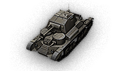
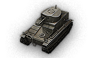

# United Kingdom · Tier I

[All nations and tiers](../buffs_nerfs.md) · EU v20410 → RU v14600ru · 3 November 2026

<label><strong>Find a tank</strong><input type="search" placeholder="Try is7, obj140 or xm57" aria-label="Find a tank" style="display:block;width:100%;padding:.7rem;border:1px solid #888;border-radius:4px;margin:.5rem 0;color:inherit;background:transparent"></label>

Cruiser Mk. I · Tier I

cruisermki

<a href="https://tanks.gg/v20410/tank/cruiser-i">EU stats</a> · <a href="https://tanks.gg/v14600ru/tank/cruiser-i">RU stats</a>
<figure style="display:inline-block"><figcaption>Cruiser Mk. I</figcaption></figure>
<strong>Penetration (mm)</strong> <b>EU</b>  AP <strong>40</strong> /  APCR <strong>65</strong> /  HE <strong>23</strong> → <b>RU</b>  AP <strong>35</strong> /  APCR <strong>58</strong> /  HE <strong>23</strong>

<em>Firepower</em> 
<strong>DPM (HP/min)</strong> <small>EU</small> 837.15  <small>RU</small> <strong>932.02</strong> 
<strong>Rate of fire (rounds/min)</strong> <small>EU</small> 18.60  <small>RU</small> <strong>20.71</strong> 
<strong>Reload time (s)</strong> <small>EU</small> 11.03  <small>RU</small> <strong>9.59</strong> 
<strong>Clip damage · time (s)</strong> <small>EU</small> 1.88  <small>RU</small> <strong>2</strong> 
<strong>Clip damage · burst damage · time (s)</strong> <small>EU</small> 0.63  <small>RU</small> <strong>0.50</strong> 
<strong>Intra-clip reload</strong> <small>EU</small> 0.63  <small>RU</small> <strong>1</strong> 

<em>Gun handling</em> 
<strong>Aim time (s)</strong> <small>EU</small> 2.40  <small>RU</small> <strong>1.92</strong> 
<strong>Dispersion (m/100 m)</strong> <small>EU</small> 0.50  <small>RU</small> <strong>0.40</strong> 
<strong>Dispersion · damaged</strong> <small>EU</small> 1  <small>RU</small> <strong>0.81</strong> 
<strong>Dispersion · moving</strong> <small>EU</small> 0.36  <small>RU</small> <strong>0.10</strong> 
<strong>Dispersion · tank traverse</strong> <small>EU</small> 0.36  <small>RU</small> <strong>0.10</strong> 
<strong>Dispersion · turret traverse</strong> <small>EU</small> 0.18  <small>RU</small> <strong>0.10</strong> 
<strong>Dispersion · firing</strong> <small>EU</small> 5  <small>RU</small> <strong>3</strong> 

<em>Mobility</em> 
<strong>Forward speed on hard terrain (km/h)</strong> <small>EU</small> 35  <small>RU</small> <strong>34.34</strong> 
<strong>Forward speed on medium terrain (km/h)</strong> <small>EU</small> 28.71  <small>RU</small> <strong>26.98</strong> 
<strong>Forward speed on soft terrain (km/h)</strong> <small>EU</small> 20.10  <small>RU</small> <strong>18.89</strong> 
<strong>Engine power (hp)</strong> <small>EU</small> 135  <small>RU</small> <strong>126.87</strong> 
<strong>Power/weight (hp/t)</strong> <small>EU</small> 10.56  <small>RU</small> <strong>9.93</strong> 

<em>Armor &amp; health</em> 
<strong>Health</strong> <small>EU</small> 260  <small>RU</small> <strong>280</strong> 
<strong>Track repair time (s)</strong> <small>EU</small> 6  <small>RU</small> <strong>3</strong> 

<em>Miscellaneous</em> 
<strong>View range (m)</strong> <small>EU</small> 280  <small>RU</small> <strong>300</strong> 

Vickers Medium Mk. I · Tier I

vickersmediummki

<a href="https://tanks.gg/v20410/tank/medium-i">EU stats</a> · <a href="https://tanks.gg/v14600ru/tank/medium-i">RU stats</a>
<figure style="display:inline-block"><figcaption>Vickers Medium Mk. I</figcaption></figure>
<em>Gun handling</em> 
<strong>Aim time (s)</strong> <small>EU</small> 2.21  <small>RU</small> <strong>1.82</strong> 
<strong>Dispersion (m/100 m)</strong> <small>EU</small> 0.50  <small>RU</small> <strong>0.36</strong> 
<strong>Dispersion · damaged</strong> <small>EU</small> 1  <small>RU</small> <strong>0.73</strong> 
<strong>Dispersion · moving</strong> <small>EU</small> 0.36  <small>RU</small> <strong>0.10</strong> 
<strong>Dispersion · tank traverse</strong> <small>EU</small> 0.36  <small>RU</small> <strong>0.10</strong> 
<strong>Dispersion · turret traverse</strong> <small>EU</small> 0.16  <small>RU</small> <strong>0.10</strong> 
<strong>Dispersion · firing</strong> <small>EU</small> 4  <small>RU</small> <strong>3</strong> 

<em>Mobility</em> 
<strong>Forward speed (km/h)</strong> <small>EU</small> 24  <small>RU</small> <strong>26</strong> 
<strong>Forward speed on hard terrain (km/h)</strong> <small>EU</small> 24  <small>RU</small> <strong>26</strong> 
<strong>Forward speed on medium terrain (km/h)</strong> <small>EU</small> 24  <small>RU</small> <strong>26</strong> 
<strong>Forward speed on soft terrain (km/h)</strong> <small>EU</small> 13.89  <small>RU</small> <strong>19.71</strong> 
<strong>Reverse speed (km/h)</strong> <small>EU</small> 8  <small>RU</small> <strong>10</strong> 
<strong>Engine power (hp)</strong> <small>EU</small> 95.16  <small>RU</small> <strong>135</strong> 
<strong>Power/weight (hp/t)</strong> <small>EU</small> 8.03  <small>RU</small> <strong>11.39</strong> 

<em>Armor &amp; health</em> 
<strong>Track repair time (s)</strong> <small>EU</small> 6  <small>RU</small> <strong>3</strong> 

<em>Miscellaneous</em> 
<strong>View range (m)</strong> <small>EU</small> 280  <small>RU</small> <strong>300</strong> 

