# United Kingdom · Tier X

[All nations and tiers](../buffs_nerfs.md) · EU v20410 → RU v14600ru · 3 November 2026

<label><strong>Find a tank</strong><input type="search" placeholder="Try is7, obj140 or xm57" aria-label="Find a tank" style="display:block;width:100%;padding:.7rem;border:1px solid #888;border-radius:4px;margin:.5rem 0;color:inherit;background:transparent"></label>

Chieftain Mk. 6 · Tier X

chieftainmk6

<a href="https://tanks.gg/v20410/tank/chieftain">EU stats</a> · <a href="https://tanks.gg/v14600ru/tank/chieftain">RU stats</a>
<figure style="display:inline-block">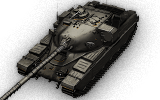<figcaption>EU · Chieftain Mk. 6</figcaption></figure><figure style="display:inline-block">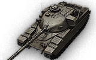<figcaption>RU · Chieftain Mk. 6</figcaption></figure>
<strong>Penetration (mm)</strong> <b>EU</b>  APCR <strong>270</strong> /  APCR <strong>310</strong> /  HE <strong>140</strong> → <b>RU</b>  AP <strong>260</strong> /  HEAT <strong>340</strong> /  HE <strong>140</strong>

<strong>Damage (HP)</strong> <b>EU</b>  APCR <strong>400</strong> /  APCR <strong>400</strong> /  HE <strong>515</strong> → <b>RU</b>  AP <strong>400</strong> /  HEAT <strong>400</strong> /  HE <strong>530</strong>

<em>Firepower</em> 
<strong>Caliber</strong> <small>EU</small> 119.38  <small>RU</small> <strong>120</strong> 
<strong>Shell velocity (m/s)</strong> <small>EU</small> 1 372  <small>RU</small> <strong>1 250</strong> 
<strong>Normalization</strong> <small>EU</small> 2  <small>RU</small> <strong>5</strong> 

<em>Miscellaneous</em> 
<strong>Shell cost</strong> <small>EU</small> 1 050  <small>RU</small> <strong>1 060</strong> 

Concept No. 5 · Tier X

conceptno5

<a href="https://tanks.gg/v20410/tank/concept-5">EU stats</a> · <a href="https://tanks.gg/v14600ru/tank/concept-5">RU stats</a>
<figure style="display:inline-block">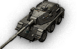<figcaption>Concept No. 5</figcaption></figure>
<strong>Penetration (mm)</strong> <b>EU</b>  AP <strong>260</strong> /  APCR <strong>328</strong> /  HE <strong>55</strong> → <b>RU</b>  AP <strong>260</strong> /  APCR <strong>318</strong> /  HE <strong>55</strong>

<strong>Damage (HP)</strong> <b>EU</b>  AP <strong>460</strong> /  APCR <strong>460</strong> /  HE <strong>540</strong> → <b>RU</b>  AP <strong>430</strong> /  APCR <strong>430</strong> /  HE <strong>515</strong>

<em>Firepower</em> 
<strong>DPM (HP/min)</strong> <small>EU</small> 2 460.41  <small>RU</small> <strong>2 609.38</strong> 
<strong>Rate of fire (rounds/min)</strong> <small>EU</small> 5.35  <small>RU</small> <strong>6.07</strong> 
<strong>Reload time (s)</strong> <small>EU</small> 11.22  <small>RU</small> <strong>9.89</strong> 
<strong>Potential damage</strong> <small>EU</small> 18 400  <small>RU</small> <strong>17 200</strong> 

<em>Gun handling</em> 
<strong>Aim time (s)</strong> <small>EU</small> 1.73  <small>RU</small> <strong>1.82</strong> 
<strong>Dispersion (m/100 m)</strong> <small>EU</small> 0.26  <small>RU</small> <strong>0.31</strong> 
<strong>Dispersion · damaged</strong> <small>EU</small> 0.52  <small>RU</small> <strong>0.61</strong> 
<strong>Dispersion · moving</strong> <small>EU</small> 0.10  <small>RU</small> <strong>0.11</strong> 
<strong>Dispersion · tank traverse</strong> <small>EU</small> 0.10  <small>RU</small> <strong>0.11</strong> 

<em>Mobility</em> 
<strong>Forward speed (km/h)</strong> <small>EU</small> 65  <small>RU</small> <strong>70</strong> 
<strong>Forward speed on hard terrain (km/h)</strong> <small>EU</small> 65  <small>RU</small> <strong>70</strong> 
<strong>Forward speed on medium terrain (km/h)</strong> <small>EU</small> 65  <small>RU</small> <strong>70</strong> 
<strong>Forward speed on soft terrain (km/h)</strong> <small>EU</small> 49.22  <small>RU</small> <strong>70</strong> 
<strong>Engine power (hp)</strong> <small>EU</small> 580  <small>RU</small> <strong>680</strong> 
<strong>Power/weight (hp/t)</strong> <small>EU</small> 25.22  <small>RU</small> <strong>29.57</strong> 
<strong>Terrain resist (hard)</strong> <small>EU</small> 0.96  <small>RU</small> <strong>0.12</strong> 
<strong>Terrain resist (med)</strong> <small>EU</small> 1.29  <small>RU</small> <strong>0.12</strong> 
<strong>Terrain resist (soft)</strong> <small>EU</small> 1.87  <small>RU</small> <strong>0.12</strong> 
<strong>Tank traverse (°/s)</strong> <small>EU</small> 41.72  <small>RU</small> <strong>67.80</strong> 
<strong>Tank traverse on hard terrain (°/s)</strong> <small>EU</small> 39.63  <small>RU</small> <strong>64.41</strong> 
<strong>Tank traverse on medium terrain (°/s)</strong> <small>EU</small> 29.36  <small>RU</small> <strong>64.41</strong> 
<strong>Tank traverse on soft terrain (°/s)</strong> <small>EU</small> 20.33  <small>RU</small> <strong>64.41</strong> 

<em>Armor &amp; health</em> 
<strong>Health</strong> <small>EU</small> 1 900  <small>RU</small> <strong>1 800</strong> 

Conqueror Gun Carriage · Tier X

conquerorguncarriage

<a href="https://tanks.gg/v20410/tank/conqueror-gc">EU stats</a> · <a href="https://tanks.gg/v14600ru/tank/conquerorgc">RU stats</a>
<figure style="display:inline-block">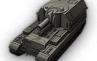<figcaption>Conqueror Gun Carriage</figcaption></figure>
<strong>Penetration (mm)</strong> <b>EU</b>  HE <strong>59</strong> /  HE <strong>74</strong> /  AP <strong>370</strong> → <b>RU</b>  HE <strong>59</strong> /  AP <strong>370</strong>

<strong>Damage (HP)</strong> <b>EU</b>  HE <strong>1000</strong> /  HE <strong>1350</strong> /  AP <strong>720</strong> → <b>RU</b>  HE <strong>1450</strong> /  AP <strong>800</strong>

<em>Firepower</em> 
<strong>DPM (HP/min)</strong> <small>EU</small> 1 360.43  <small>RU</small> <strong>1 972.63</strong> 
<strong>Explosion radius</strong> <small>EU</small> 11.60  <small>RU</small> <strong>9.50</strong> 
<strong>Stun duration · maximum (s)</strong> <small>EU</small> 33 → <small>RU</small> <strong>—</strong> 
<strong>Stun duration · minimum (s)</strong> <small>EU</small> 13.20 → <small>RU</small> <strong>—</strong> 
<strong>Potential damage</strong> <small>EU</small> 24 000  <small>RU</small> <strong>34 800</strong> 

<em>Gun handling</em> 
<strong>Dispersion (m/100 m)</strong> <small>EU</small> 1.04  <small>RU</small> <strong>0.96</strong> 
<strong>Dispersion · damaged</strong> <small>EU</small> 2.07  <small>RU</small> <strong>1.92</strong> 

<em>Miscellaneous</em> 
<strong>Shell cost</strong> <small>EU</small> 2 450  <small>RU</small> <strong>2 850</strong> 

FV215b · Tier X

fv215b

<a href="https://tanks.gg/v20410/tank/fv215b">EU stats</a> · <a href="https://tanks.gg/v14600ru/tank/fv215b">RU stats</a>
<figure style="display:inline-block">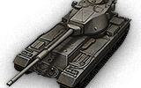<figcaption>FV215b</figcaption></figure>
<strong>Damage (HP)</strong> <b>EU</b>  AP <strong>400</strong> /  APCR <strong>400</strong> /  HE <strong>515</strong> → <b>RU</b>  AP <strong>440</strong> /  APCR <strong>440</strong> /  HE <strong>530</strong>

<em>Firepower</em> 
<strong>DPM (HP/min)</strong> <small>EU</small> 2 877.24  <small>RU</small> <strong>3 164.97</strong> 
<strong>Ammo capacity</strong> <small>EU</small> 35  <small>RU</small> <strong>45</strong> 
<strong>Potential damage</strong> <small>EU</small> 14 000  <small>RU</small> <strong>19 800</strong> 

<em>Armor &amp; health</em> 
<strong>Hull armor · front (mm)</strong> <small>EU</small> 152.40  <small>RU</small> <strong>177.80</strong> 

<em>Miscellaneous</em> 
<strong>Shell cost</strong> <small>EU</small> 1 060  <small>RU</small> <strong>1 160</strong> 

FV217 Badger · Tier X

fv217badger

<a href="https://tanks.gg/v20410/tank/badger">EU stats</a> · <a href="https://tanks.gg/v14600ru/tank/badger">RU stats</a>
<figure style="display:inline-block">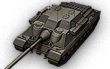<figcaption>FV217 Badger</figcaption></figure>
<em>Firepower</em> 
<strong>Module damage</strong> <small>EU</small> 166  <small>RU</small> <strong>165</strong> 

<em>Mobility</em> 
<strong>Forward speed on medium terrain (km/h)</strong> <small>EU</small> 30  <small>RU</small> <strong>29.28</strong> 
<strong>Forward speed on soft terrain (km/h)</strong> <small>EU</small> 20.49  <small>RU</small> <strong>19.52</strong> 
<strong>Engine power (hp)</strong> <small>EU</small> 1 050  <small>RU</small> <strong>1 000</strong> 
<strong>Power/weight (hp/t)</strong> <small>EU</small> 16.15  <small>RU</small> <strong>15.38</strong> 
<strong>Tank traverse (°/s)</strong> <small>EU</small> 26.08  <small>RU</small> <strong>22.95</strong> 
<strong>Tank traverse on hard terrain (°/s)</strong> <small>EU</small> 24.77  <small>RU</small> <strong>21.80</strong> 
<strong>Tank traverse on medium terrain (°/s)</strong> <small>EU</small> 22.29  <small>RU</small> <strong>19.62</strong> 
<strong>Tank traverse on soft terrain (°/s)</strong> <small>EU</small> 14.86  <small>RU</small> <strong>13.08</strong> 

FV4005 Stage II · Tier X

fv4005stageii

<a href="https://tanks.gg/v20410/tank/fv4005">EU stats</a> · <a href="https://tanks.gg/v14600ru/tank/fv4005">RU stats</a>
<figure style="display:inline-block">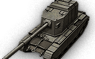<figcaption>FV4005 Stage II</figcaption></figure>
<em>Firepower</em> 
<strong>Module damage</strong> <small>EU</small> 247  <small>RU</small> <strong>244</strong> 

<em>Miscellaneous</em> 
<strong>Moving camo</strong> <small>EU</small> 0.80  <small>RU</small> <strong>0.85</strong> 
<strong>Moving camo · after firing</strong> <small>EU</small> 0.09  <small>RU</small> <strong>0.10</strong> 

Manticore · Tier X

manticore

<a href="https://tanks.gg/v20410/tank/manticore">EU stats</a> · <a href="https://tanks.gg/v14600ru/tank/manticore">RU stats</a>
<figure style="display:inline-block">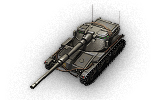<figcaption>Manticore</figcaption></figure>
<em>Firepower</em> 
<strong>Ammo capacity</strong> <small>EU</small> 30  <small>RU</small> <strong>20</strong> 
<strong>Potential damage</strong> <small>EU</small> 11 700  <small>RU</small> <strong>7 800</strong> 

<em>Armor &amp; health</em> 
<strong>Health</strong> <small>EU</small> 1 600  <small>RU</small> <strong>1 400</strong> 

Super Conqueror · Tier X

superconqueror

<a href="https://tanks.gg/v20410/tank/s-conqueror">EU stats</a> · <a href="https://tanks.gg/v14600ru/tank/s-conqueror">RU stats</a>
<figure style="display:inline-block">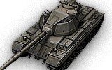<figcaption>Super Conqueror</figcaption></figure>
<em>Firepower</em> 
<strong>DPM (HP/min)</strong> <small>EU</small> 2 607.50  <small>RU</small> <strong>2 634.95</strong> 
<strong>Rate of fire (rounds/min)</strong> <small>EU</small> 6.52  <small>RU</small> <strong>6.59</strong> 
<strong>Reload time (s)</strong> <small>EU</small> 9.20  <small>RU</small> <strong>9.11</strong> 

<em>Mobility</em> 
<strong>Forward speed on soft terrain (km/h)</strong> <small>EU</small> 24.07  <small>RU</small> <strong>22.78</strong> 
<strong>Engine power (hp)</strong> <small>EU</small> 1 120  <small>RU</small> <strong>1 060</strong> 
<strong>Power/weight (hp/t)</strong> <small>EU</small> 14.55  <small>RU</small> <strong>13.77</strong> 

<em>Armor &amp; health</em> 
<strong>Health</strong> <small>EU</small> 2 300  <small>RU</small> <strong>2 400</strong> 

<em>Miscellaneous</em> 
<strong>Moving camo</strong> <small>EU</small> 2.34  <small>RU</small> <strong>2.28</strong> 
<strong>Moving camo · after firing</strong> <small>EU</small> 0.44  <small>RU</small> <strong>0.43</strong> 

T95/FV4201 Chieftain · Tier X

t95fv4201chieftain

<a href="https://tanks.gg/v20410/tank/t95fv4201">EU stats</a> · <a href="https://tanks.gg/v14600ru/tank/t95fv4201">RU stats</a>
<figure style="display:inline-block">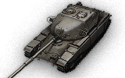<figcaption>T95/FV4201 Chieftain</figcaption></figure>
<strong>Penetration (mm)</strong> <b>EU</b>  APCR <strong>270</strong> /  APCR <strong>311</strong> /  HE <strong>140</strong> → <b>RU</b>  APCR <strong>270</strong> /  APCR <strong>319</strong> /  HE <strong>140</strong>

<em>Firepower</em> 
<strong>DPM (HP/min)</strong> <small>EU</small> 2 294.60  <small>RU</small> <strong>2 622.40</strong> 
<strong>Rate of fire (rounds/min)</strong> <small>EU</small> 5.21  <small>RU</small> <strong>5.96</strong> 
<strong>Reload time (s)</strong> <small>EU</small> 11.51  <small>RU</small> <strong>10.07</strong> 

<em>Gun handling</em> 
<strong>Dispersion (m/100 m)</strong> <small>EU</small> 0.34  <small>RU</small> <strong>0.35</strong> 
<strong>Dispersion · damaged</strong> <small>EU</small> 0.67  <small>RU</small> <strong>0.71</strong> 
<strong>Depression (°)</strong> <small>EU</small> 10  <small>RU</small> <strong>8</strong> 

<em>Mobility</em> 
<strong>Forward speed (km/h)</strong> <small>EU</small> 40  <small>RU</small> <strong>46</strong> 
<strong>Forward speed on hard terrain (km/h)</strong> <small>EU</small> 40  <small>RU</small> <strong>46</strong> 
<strong>Forward speed on medium terrain (km/h)</strong> <small>EU</small> 40  <small>RU</small> <strong>46</strong> 
<strong>Turret traverse (°/s)</strong> <small>EU</small> 31.29  <small>RU</small> <strong>37.55</strong> 
<strong>Tank traverse (°/s)</strong> <small>EU</small> 29.20  <small>RU</small> <strong>37.55</strong> 
<strong>Tank traverse on hard terrain (°/s)</strong> <small>EU</small> 27.74  <small>RU</small> <strong>35.67</strong> 
<strong>Tank traverse on medium terrain (°/s)</strong> <small>EU</small> 21.34  <small>RU</small> <strong>27.44</strong> 
<strong>Tank traverse on soft terrain (°/s)</strong> <small>EU</small> 11.10  <small>RU</small> <strong>14.27</strong> 

<em>Armor &amp; health</em> 
<strong>Hull armor · front (mm)</strong> <small>EU</small> 127  <small>RU</small> <strong>114.30</strong> 
<strong>Health</strong> <small>EU</small> 2 200  <small>RU</small> <strong>2 400</strong> 

<em>Miscellaneous</em> 
<strong>View range (m)</strong> <small>EU</small> 410  <small>RU</small> <strong>400</strong> 

Vickers MBT Mk. 3 · EU X → RU VIII

vickersmbtmk3

<a href="https://tanks.gg/v20410/tank/vickers-3">EU stats</a> · <a href="https://tanks.gg/v14600ru/tank/vickers-mk3">RU stats</a>
<figure style="display:inline-block">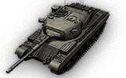<figcaption>EU · Vickers MBT Mk. 3</figcaption></figure><figure style="display:inline-block">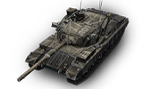<figcaption>RU · Vickers Mark 3</figcaption></figure>
<strong>Penetration (mm)</strong> <b>EU</b>  APCR <strong>268</strong> /  HEAT <strong>330</strong> /  HE <strong>105</strong> → <b>RU</b>  HE <strong>210</strong> /  APCR <strong>252</strong>

<strong>Damage (HP)</strong> <b>EU</b>  APCR <strong>390</strong> /  HEAT <strong>390</strong> /  HE <strong>480</strong> → <b>RU</b>  HE <strong>480</strong> /  APCR <strong>390</strong>

<em>General</em> 
<strong>Tier</strong> <small>EU</small> 10 → <small>RU</small> <strong>8</strong> 

<em>Firepower</em> 
<strong>DPM (HP/min)</strong> <small>EU</small> 3 050.78  <small>RU</small> <strong>2 115.38</strong> 
<strong>Rate of fire (rounds/min)</strong> <small>EU</small> 7.82  <small>RU</small> <strong>4.41</strong> 
<strong>Reload time (s)</strong> <small>EU</small> 7.67  <small>RU</small> <strong>13.61</strong> 
<strong>Shell velocity (m/s)</strong> <small>EU</small> 1 540  <small>RU</small> <strong>1 173</strong> 
<strong>Normalization</strong> <small>EU</small> 2  <small>RU</small> <strong>0</strong> 
<strong>Ricochet angle</strong> <small>EU</small> 70  <small>RU</small> <strong>90</strong> 
<strong>Ammo capacity</strong> <small>EU</small> 50  <small>RU</small> <strong>40</strong> 
<strong>Potential damage</strong> <small>EU</small> 19 500  <small>RU</small> <strong>19 200</strong> 
<strong>Explosion radius</strong> <small>EU</small> — → <small>RU</small> <strong>1.91</strong> 

<em>Gun handling</em> 
<strong>Aim time (s)</strong> <small>EU</small> 1.92  <small>RU</small> <strong>2.30</strong> 
<strong>Dispersion (m/100 m)</strong> <small>EU</small> 0.26  <small>RU</small> <strong>0.33</strong> 
<strong>Dispersion · damaged</strong> <small>EU</small> 0.52  <small>RU</small> <strong>0.65</strong> 
<strong>Dispersion · moving</strong> <small>EU</small> 0.10  <small>RU</small> <strong>0.18</strong> 
<strong>Dispersion · tank traverse</strong> <small>EU</small> 0.10  <small>RU</small> <strong>0.18</strong> 
<strong>Dispersion · turret traverse</strong> <small>EU</small> 0.08  <small>RU</small> <strong>0.12</strong> 
<strong>Dispersion · firing</strong> <small>EU</small> 3  <small>RU</small> <strong>4</strong> 

<em>Mobility</em> 
<strong>Forward speed (km/h)</strong> <small>EU</small> 55  <small>RU</small> <strong>50</strong> 
<strong>Forward speed on hard terrain (km/h)</strong> <small>EU</small> 55  <small>RU</small> <strong>50</strong> 
<strong>Forward speed on medium terrain (km/h)</strong> <small>EU</small> 55  <small>RU</small> <strong>50</strong> 
<strong>Forward speed on soft terrain (km/h)</strong> <small>EU</small> 55  <small>RU</small> <strong>39.02</strong> 
<strong>Reverse speed (km/h)</strong> <small>EU</small> 25  <small>RU</small> <strong>20</strong> 
<strong>Engine power (hp)</strong> <small>EU</small> 850  <small>RU</small> <strong>750</strong> 
<strong>Weight (kg)</strong> <small>EU</small> 38 700 → <small>RU</small> <strong>38 500</strong> 
<strong>Power/weight (hp/t)</strong> <small>EU</small> 21.96  <small>RU</small> <strong>19.48</strong> 
<strong>Terrain resist (hard)</strong> <small>EU</small> 0.58  <small>RU</small> <strong>0.96</strong> 
<strong>Terrain resist (med)</strong> <small>EU</small> 0.67  <small>RU</small> <strong>1.05</strong> 
<strong>Terrain resist (soft)</strong> <small>EU</small> 1.44  <small>RU</small> <strong>1.82</strong> 
<strong>Turret traverse (°/s)</strong> <small>EU</small> 50.06  <small>RU</small> <strong>43.81</strong> 
<strong>Tank traverse (°/s)</strong> <small>EU</small> 52.15  <small>RU</small> <strong>43.81</strong> 
<strong>Tank traverse on hard terrain (°/s)</strong> <small>EU</small> 49.54  <small>RU</small> <strong>41.62</strong> 
<strong>Tank traverse on medium terrain (°/s)</strong> <small>EU</small> 42.47  <small>RU</small> <strong>37.83</strong> 
<strong>Tank traverse on soft terrain (°/s)</strong> <small>EU</small> 19.82  <small>RU</small> <strong>21.90</strong> 

<em>Armor &amp; health</em> 
<strong>Hull armor · front (mm)</strong> <small>EU</small> 60  <small>RU</small> <strong>80</strong> 
<strong>Health</strong> <small>EU</small> 1 900  <small>RU</small> <strong>1 350</strong> 
<strong>Health · track</strong> <small>EU</small> 250  <small>RU</small> <strong>240</strong> 
<strong>Health · ammo rack</strong> <small>EU</small> 260  <small>RU</small> <strong>205</strong> 
<strong>Track repair time (s)</strong> <small>EU</small> 12.03  <small>RU</small> <strong>11.46</strong> 

<em>Miscellaneous</em> 
<strong>Stationary camo · after firing</strong> <small>EU</small> 2.89  <small>RU</small> <strong>2.74</strong> 
<strong>Moving camo · after firing</strong> <small>EU</small> 2.17  <small>RU</small> <strong>2.05</strong> 
<strong>View range (m)</strong> <small>EU</small> 410  <small>RU</small> <strong>390</strong> 
<strong>Shell cost</strong> <small>EU</small> 1 200  <small>RU</small> <strong>1 050</strong> 

