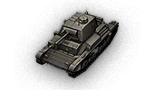
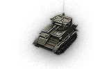
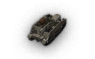
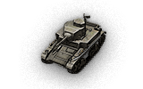
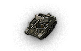
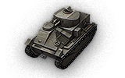

# United Kingdom · Tier II

[All nations and tiers](../buffs_nerfs.md) · EU v20410 → RU v14600ru · 3 November 2026

<label><strong>Find a tank</strong><input type="search" placeholder="Try is7, obj140 or xm57" aria-label="Find a tank" style="display:block;width:100%;padding:.7rem;border:1px solid #888;border-radius:4px;margin:.5rem 0;color:inherit;background:transparent"></label>

Cruiser Mk. II · Tier II

cruisermkii

<a href="https://tanks.gg/v20410/tank/cruiser-ii">EU stats</a> · <a href="https://tanks.gg/v14600ru/tank/cruiser-ii">RU stats</a>
<figure style="display:inline-block"><figcaption>Cruiser Mk. II</figcaption></figure>
<strong>Penetration (mm)</strong> <b>EU</b>  AP <strong>49</strong> /  APCR <strong>71</strong> /  HE <strong>23</strong> → <b>RU</b>  AP <strong>49</strong> /  APCR <strong>81</strong> /  HE <strong>23</strong>

<em>Firepower</em> 
<strong>DPM (HP/min)</strong> <small>EU</small> 869.46  <small>RU</small> <strong>983.31</strong> 
<strong>Rate of fire (rounds/min)</strong> <small>EU</small> 19.32  <small>RU</small> <strong>21.85</strong> 
<strong>Reload time (s)</strong> <small>EU</small> 10.55  <small>RU</small> <strong>9.11</strong> 

<em>Gun handling</em> 
<strong>Aim time (s)</strong> <small>EU</small> 2.30  <small>RU</small> <strong>1.53</strong> 
<strong>Dispersion · moving</strong> <small>EU</small> 0.28  <small>RU</small> <strong>0.23</strong> 
<strong>Dispersion · tank traverse</strong> <small>EU</small> 0.28  <small>RU</small> <strong>0.23</strong> 
<strong>Dispersion · turret traverse</strong> <small>EU</small> 0.16  <small>RU</small> <strong>0.10</strong> 
<strong>Dispersion · firing</strong> <small>EU</small> 3  <small>RU</small> <strong>1.50</strong> 

<em>Mobility</em> 
<strong>Forward speed on medium terrain (km/h)</strong> <small>EU</small> 37.50  <small>RU</small> <strong>34.99</strong> 
<strong>Forward speed on soft terrain (km/h)</strong> <small>EU</small> 25  <small>RU</small> <strong>23.33</strong> 
<strong>Engine power (hp)</strong> <small>EU</small> 170  <small>RU</small> <strong>158.59</strong> 
<strong>Power/weight (hp/t)</strong> <small>EU</small> 11.83  <small>RU</small> <strong>11.03</strong> 
<strong>Tank traverse on hard terrain (°/s)</strong> <small>EU</small> 46.31  <small>RU</small> <strong>39.55</strong> 
<strong>Tank traverse on medium terrain (°/s)</strong> <small>EU</small> 38.59  <small>RU</small> <strong>32.96</strong> 
<strong>Tank traverse on soft terrain (°/s)</strong> <small>EU</small> 25.73  <small>RU</small> <strong>21.97</strong> 

<em>Armor &amp; health</em> 
<strong>Track repair time (s)</strong> <small>EU</small> 12.03  <small>RU</small> <strong>3</strong> 

<em>Miscellaneous</em> 
<strong>View range (m)</strong> <small>EU</small> 300  <small>RU</small> <strong>310</strong> 

Light Mk. VIC · Tier II

lightmkvic

<a href="https://tanks.gg/v20410/tank/light-vic">EU stats</a> · <a href="https://tanks.gg/v14600ru/tank/light-vic">RU stats</a>
<figure style="display:inline-block"><figcaption>Light Mk. VIC</figcaption></figure>
<strong>Penetration (mm)</strong> <b>EU</b>  AP <strong>27</strong> → <b>RU</b>  AP <strong>33</strong>

<em>Gun handling</em> 
<strong>Aim time (s)</strong> <small>EU</small> 1.44  <small>RU</small> <strong>0.96</strong> 
<strong>Dispersion (m/100 m)</strong> <small>EU</small> 0.50  <small>RU</small> <strong>0.48</strong> 
<strong>Dispersion · damaged</strong> <small>EU</small> 1  <small>RU</small> <strong>0.96</strong> 
<strong>Dispersion · moving</strong> <small>EU</small> 0.32  <small>RU</small> <strong>0.30</strong> 
<strong>Dispersion · tank traverse</strong> <small>EU</small> 0.32  <small>RU</small> <strong>0.30</strong> 
<strong>Dispersion · firing</strong> <small>EU</small> 1.10  <small>RU</small> <strong>0.50</strong> 

<em>Mobility</em> 
<strong>Terrain resist (hard)</strong> <small>EU</small> 1.05  <small>RU</small> <strong>0.34</strong> 
<strong>Tank traverse on medium terrain (°/s)</strong> <small>EU</small> 35.30  <small>RU</small> <strong>11.38</strong> 
<strong>Tank traverse on soft terrain (°/s)</strong> <small>EU</small> 19.95  <small>RU</small> <strong>6.43</strong> 

<em>Armor &amp; health</em> 
<strong>Health</strong> <small>EU</small> 300  <small>RU</small> <strong>350</strong> 
<strong>Track repair time (s)</strong> <small>EU</small> 12.03  <small>RU</small> <strong>3</strong> 

Loyd Gun Carriage · Tier II

loydguncarriage

<a href="https://tanks.gg/v20410/tank/loyd-gc">EU stats</a> · <a href="https://tanks.gg/v14600ru/tank/loyd-gc">RU stats</a>
<figure style="display:inline-block"><figcaption>EU · Loyd Gun Carriage</figcaption></figure><figure style="display:inline-block"><figcaption>RU · Loyd Gun Carriage</figcaption></figure>
<em>Gun handling</em> 
<strong>Dispersion · moving</strong> <small>EU</small> 0.48  <small>RU</small> <strong>0.24</strong> 
<strong>Dispersion · tank traverse</strong> <small>EU</small> 0.48  <small>RU</small> <strong>0.24</strong> 
<strong>Dispersion · turret traverse</strong> <small>EU</small> 0.60  <small>RU</small> <strong>0.40</strong> 

<em>Armor &amp; health</em> 
<strong>Health</strong> <small>EU</small> 160  <small>RU</small> <strong>200</strong> 
<strong>Track repair time (s)</strong> <small>EU</small> 13.16  <small>RU</small> <strong>3</strong> 

M2 · Tier II

m2

<a href="https://tanks.gg/v20410/tank/m2">EU stats</a> · <a href="https://tanks.gg/v14600ru/tank/m2">RU stats</a>
<figure style="display:inline-block"><figcaption>EU · M2</figcaption></figure><figure style="display:inline-block"><figcaption>RU · M2</figcaption></figure>
<em>Firepower</em> 
<strong>DPM (HP/min)</strong> <small>EU</small> 923.08  <small>RU</small> <strong>1 043.48</strong> 
<strong>Rate of fire (rounds/min)</strong> <small>EU</small> 23.08  <small>RU</small> <strong>26.09</strong> 
<strong>Reload time (s)</strong> <small>EU</small> 2.60  <small>RU</small> <strong>2.30</strong> 

<em>Gun handling</em> 
<strong>Aim time (s)</strong> <small>EU</small> 2.01  <small>RU</small> <strong>1.44</strong> 
<strong>Dispersion (m/100 m)</strong> <small>EU</small> 0.45  <small>RU</small> <strong>0.40</strong> 
<strong>Dispersion · damaged</strong> <small>EU</small> 0.90  <small>RU</small> <strong>0.81</strong> 
<strong>Dispersion · moving</strong> <small>EU</small> 0.25  <small>RU</small> <strong>0.22</strong> 
<strong>Dispersion · tank traverse</strong> <small>EU</small> 0.25  <small>RU</small> <strong>0.22</strong> 
<strong>Dispersion · turret traverse</strong> <small>EU</small> 0.12  <small>RU</small> <strong>0.10</strong> 
<strong>Dispersion · firing</strong> <small>EU</small> 4  <small>RU</small> <strong>1</strong> 

<em>Armor &amp; health</em> 
<strong>Health</strong> <small>EU</small> 330  <small>RU</small> <strong>360</strong> 
<strong>Track repair time (s)</strong> <small>EU</small> 12.03  <small>RU</small> <strong>3</strong> 

Universal Carrier 2-pdr · Tier II

universalcarrier2pdr

<a href="https://tanks.gg/v20410/tank/uc-2-pdr">EU stats</a> · <a href="https://tanks.gg/v14600ru/tank/uc-2-pdr">RU stats</a>
<figure style="display:inline-block"><figcaption>Universal Carrier 2-pdr</figcaption></figure>
<em>Gun handling</em> 
<strong>Dispersion (m/100 m)</strong> <small>EU</small> 0.43  <small>RU</small> <strong>0.34</strong> 
<strong>Dispersion · damaged</strong> <small>EU</small> 0.86  <small>RU</small> <strong>0.67</strong> 
<strong>Dispersion · moving</strong> <small>EU</small> 0.34  <small>RU</small> <strong>0.24</strong> 
<strong>Dispersion · tank traverse</strong> <small>EU</small> 0.34  <small>RU</small> <strong>0.24</strong> 
<strong>Dispersion · firing</strong> <small>EU</small> 4  <small>RU</small> <strong>3.50</strong> 
<strong>Depression (°)</strong> <small>EU</small> 5  <small>RU</small> <strong>7</strong> 

<em>Armor &amp; health</em> 
<strong>Health</strong> <small>EU</small> 240  <small>RU</small> <strong>390</strong> 
<strong>Track repair time (s)</strong> <small>EU</small> 12.03  <small>RU</small> <strong>3</strong> 

Vickers Medium Mk. II · Tier II

vickersmediummkii

<a href="https://tanks.gg/v20410/tank/medium-ii">EU stats</a> · <a href="https://tanks.gg/v14600ru/tank/medium-ii">RU stats</a>
<figure style="display:inline-block"><figcaption>Vickers Medium Mk. II</figcaption></figure>
<em>Gun handling</em> 
<strong>Aim time (s)</strong> <small>EU</small> 2.21  <small>RU</small> <strong>1.53</strong> 
<strong>Dispersion (m/100 m)</strong> <small>EU</small> 0.45  <small>RU</small> <strong>0.40</strong> 
<strong>Dispersion · damaged</strong> <small>EU</small> 0.90  <small>RU</small> <strong>0.81</strong> 
<strong>Dispersion · moving</strong> <small>EU</small> 0.31  <small>RU</small> <strong>0.20</strong> 
<strong>Dispersion · tank traverse</strong> <small>EU</small> 0.31  <small>RU</small> <strong>0.20</strong> 
<strong>Dispersion · turret traverse</strong> <small>EU</small> 0.14  <small>RU</small> <strong>0.08</strong> 

<em>Armor &amp; health</em> 
<strong>Health</strong> <small>EU</small> 380  <small>RU</small> <strong>460</strong> 
<strong>Track repair time (s)</strong> <small>EU</small> 12.03  <small>RU</small> <strong>3</strong> 

<em>Miscellaneous</em> 
<strong>View range (m)</strong> <small>EU</small> 300  <small>RU</small> <strong>310</strong> 

