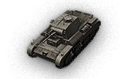
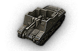
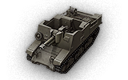
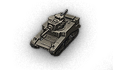
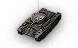
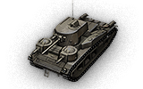

# United Kingdom · Tier III

[All nations and tiers](../buffs_nerfs.md) · EU v20410 → RU v14600ru · 3 November 2026

<label><strong>Find a tank</strong><input type="search" placeholder="Try is7, obj140 or xm57" aria-label="Find a tank" style="display:block;width:100%;padding:.7rem;border:1px solid #888;border-radius:4px;margin:.5rem 0;color:inherit;background:transparent"></label>

Cruiser Mk. III · Tier III

cruisermkiii

<a href="https://tanks.gg/v20410/tank/cruiser-iii">EU stats</a> · <a href="https://tanks.gg/v14600ru/tank/cruiser-iii">RU stats</a>
<figure style="display:inline-block"><figcaption>Cruiser Mk. III</figcaption></figure>
<strong>Penetration (mm)</strong> <b>EU</b>  AP <strong>49</strong> /  APCR <strong>71</strong> /  HE <strong>23</strong> → <b>RU</b>  AP <strong>49</strong> /  APCR <strong>81</strong> /  HE <strong>23</strong>

<em>Firepower</em> 
<strong>DPM (HP/min)</strong> <small>EU</small> 1 190.17  <small>RU</small> <strong>1 066.25</strong> 
<strong>Rate of fire (rounds/min)</strong> <small>EU</small> 26.45  <small>RU</small> <strong>23.69</strong> 
<strong>Reload time (s)</strong> <small>EU</small> 7.57  <small>RU</small> <strong>8.63</strong> 

<em>Gun handling</em> 
<strong>Aim time (s)</strong> <small>EU</small> 2.01  <small>RU</small> <strong>1.73</strong> 
<strong>Dispersion (m/100 m)</strong> <small>EU</small> 0.40  <small>RU</small> <strong>0.38</strong> 
<strong>Dispersion · damaged</strong> <small>EU</small> 0.81  <small>RU</small> <strong>0.77</strong> 
<strong>Dispersion · moving</strong> <small>EU</small> 0.23  <small>RU</small> <strong>0.20</strong> 
<strong>Dispersion · tank traverse</strong> <small>EU</small> 0.23  <small>RU</small> <strong>0.20</strong> 
<strong>Dispersion · turret traverse</strong> <small>EU</small> 0.12  <small>RU</small> <strong>0.10</strong> 
<strong>Dispersion · firing</strong> <small>EU</small> 3  <small>RU</small> <strong>2</strong> 

<em>Mobility</em> 
<strong>Engine power (hp)</strong> <small>EU</small> 425  <small>RU</small> <strong>417.63</strong> 
<strong>Power/weight (hp/t)</strong> <small>EU</small> 29.25  <small>RU</small> <strong>28.74</strong> 
<strong>Turret traverse (°/s)</strong> <small>EU</small> 47.98  <small>RU</small> <strong>43.81</strong> 
<strong>Tank traverse (°/s)</strong> <small>EU</small> 45.89  <small>RU</small> <strong>36.50</strong> 
<strong>Tank traverse on hard terrain (°/s)</strong> <small>EU</small> 51.70  <small>RU</small> <strong>41.59</strong> 
<strong>Tank traverse on medium terrain (°/s)</strong> <small>EU</small> 43.08  <small>RU</small> <strong>34.66</strong> 
<strong>Tank traverse on soft terrain (°/s)</strong> <small>EU</small> 28.72  <small>RU</small> <strong>23.11</strong> 

<em>Armor &amp; health</em> 
<strong>Health</strong> <small>EU</small> 390  <small>RU</small> <strong>450</strong> 
<strong>Track repair time (s)</strong> <small>EU</small> 12.03  <small>RU</small> <strong>4</strong> 

Sexton I · Tier III

sextoni

<a href="https://tanks.gg/v20410/tank/sexton-i">EU stats</a> · <a href="https://tanks.gg/v14600ru/tank/sexton-i">RU stats</a>
<figure style="display:inline-block"><figcaption>Sexton I</figcaption></figure>
<em>Armor &amp; health</em> 
<strong>Track repair time (s)</strong> <small>EU</small> 13.40  <small>RU</small> <strong>4</strong> 

Sexton II · Tier III

sextonii

<a href="https://tanks.gg/v20410/tank/sexton-ii">EU stats</a> · <a href="https://tanks.gg/v14600ru/tank/sexton-ii">RU stats</a>
<figure style="display:inline-block"><figcaption>Sexton II</figcaption></figure>
<em>Armor &amp; health</em> 
<strong>Track repair time (s)</strong> <small>EU</small> 13.40  <small>RU</small> <strong>4</strong> 

<em>Miscellaneous</em> 
<strong>View range (m)</strong> <small>EU</small> 260  <small>RU</small> <strong>300</strong> 

Stuart I-IV · Tier III

stuartiiv

<a href="https://tanks.gg/v20410/tank/stuart-i-iv">EU stats</a> · <a href="https://tanks.gg/v14600ru/tank/stuart-i-iv">RU stats</a>
<figure style="display:inline-block"><figcaption>Stuart I-IV</figcaption></figure>
<em>Firepower</em> 
<strong>DPM (HP/min)</strong> <small>EU</small> 1 038.46  <small>RU</small> <strong>1 173.91</strong> 
<strong>Rate of fire (rounds/min)</strong> <small>EU</small> 23.08  <small>RU</small> <strong>26.09</strong> 
<strong>Reload time (s)</strong> <small>EU</small> 2.60  <small>RU</small> <strong>2.30</strong> 

<em>Gun handling</em> 
<strong>Aim time (s)</strong> <small>EU</small> 1.92  <small>RU</small> <strong>1.63</strong> 
<strong>Dispersion · turret traverse</strong> <small>EU</small> 0.16  <small>RU</small> <strong>0.10</strong> 
<strong>Dispersion · firing</strong> <small>EU</small> 3  <small>RU</small> <strong>2</strong> 

<em>Armor &amp; health</em> 
<strong>Health</strong> <small>EU</small> 445  <small>RU</small> <strong>460</strong> 
<strong>Track repair time (s)</strong> <small>EU</small> 6.02  <small>RU</small> <strong>4</strong> 

Valentine · Tier III

valentine

<a href="https://tanks.gg/v20410/tank/valentine">EU stats</a> · <a href="https://tanks.gg/v14600ru/tank/valentine">RU stats</a>
<figure style="display:inline-block"><figcaption>Valentine</figcaption></figure>
<em>Gun handling</em> 
<strong>Aim time (s)</strong> <small>EU</small> 2.30  <small>RU</small> <strong>2.70</strong> 
<strong>Dispersion (m/100 m)</strong> <small>EU</small> 0.41  <small>RU</small> <strong>0.43</strong> 
<strong>Dispersion · damaged</strong> <small>EU</small> 0.82  <small>RU</small> <strong>0.86</strong> 

<em>Mobility</em> 
<strong>Forward speed on soft terrain (km/h)</strong> <small>EU</small> 21.09  <small>RU</small> <strong>19.89</strong> 
<strong>Engine power (hp)</strong> <small>EU</small> 185  <small>RU</small> <strong>174.45</strong> 
<strong>Power/weight (hp/t)</strong> <small>EU</small> 9.97  <small>RU</small> <strong>9.41</strong> 
<strong>Tank traverse on hard terrain (°/s)</strong> <small>EU</small> 42.28  <small>RU</small> <strong>44.23</strong> 
<strong>Tank traverse on medium terrain (°/s)</strong> <small>EU</small> 34.59  <small>RU</small> <strong>36.19</strong> 
<strong>Tank traverse on soft terrain (°/s)</strong> <small>EU</small> 21.14  <small>RU</small> <strong>22.12</strong> 

<em>Armor &amp; health</em> 
<strong>Hull armor · side (mm)</strong> <small>EU</small> 43  <small>RU</small> <strong>60</strong> 
<strong>Health</strong> <small>EU</small> 390  <small>RU</small> <strong>460</strong> 
<strong>Track repair time (s)</strong> <small>EU</small> 12.03  <small>RU</small> <strong>4</strong> 

<em>Miscellaneous</em> 
<strong>Radio range (m)</strong> <small>EU</small> 375  <small>RU</small> <strong>400</strong> 

Vickers Medium Mk. III · Tier III

vickersmediummkiii

<a href="https://tanks.gg/v20410/tank/medium-iii">EU stats</a> · <a href="https://tanks.gg/v14600ru/tank/medium-iii">RU stats</a>
<figure style="display:inline-block"><figcaption>Vickers Medium Mk. III</figcaption></figure>
<em>Gun handling</em> 
<strong>Dispersion (m/100 m)</strong> <small>EU</small> 0.42  <small>RU</small> <strong>0.38</strong> 
<strong>Dispersion · damaged</strong> <small>EU</small> 0.84  <small>RU</small> <strong>0.77</strong> 
<strong>Dispersion · firing</strong> <small>EU</small> 4  <small>RU</small> <strong>2</strong> 

<em>Armor &amp; health</em> 
<strong>Health</strong> <small>EU</small> 500  <small>RU</small> <strong>550</strong> 
<strong>Track repair time (s)</strong> <small>EU</small> 12.03  <small>RU</small> <strong>4</strong> 

