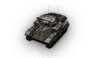
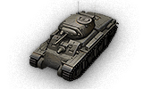
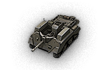
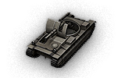
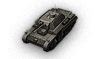
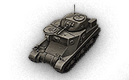
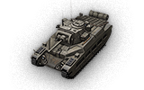
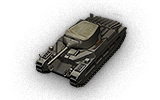
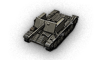

# United Kingdom · Tier IV

[All nations and tiers](../buffs_nerfs.md) · EU v20410 → RU v14600ru · 3 November 2026

<label><strong>Find a tank</strong><input type="search" placeholder="Try is7, obj140 or xm57" aria-label="Find a tank" style="display:block;width:100%;padding:.7rem;border:1px solid #888;border-radius:4px;margin:.5rem 0;color:inherit;background:transparent"></label>

A25 Harry Hopkins I · Tier IV

a25harryhopkinsi

<a href="https://tanks.gg/v20410/tank/a25-hh-i">EU stats</a> · <a href="https://tanks.gg/v14600ru/tank/a25-hh-i">RU stats</a>
<figure style="display:inline-block"><figcaption>A25 Harry Hopkins I</figcaption></figure>
<em>Firepower</em> 
<strong>DPM (HP/min)</strong> <small>EU</small> 1 355.08  <small>RU</small> <strong>1 465.63</strong> 
<strong>Rate of fire (rounds/min)</strong> <small>EU</small> 24.64  <small>RU</small> <strong>26.65</strong> 
<strong>Reload time (s)</strong> <small>EU</small> 2.44  <small>RU</small> <strong>2.25</strong> 

<em>Gun handling</em> 
<strong>Aim time (s)</strong> <small>EU</small> 1.92  <small>RU</small> <strong>1.73</strong> 
<strong>Dispersion · moving</strong> <small>EU</small> 0.30  <small>RU</small> <strong>0.24</strong> 
<strong>Dispersion · tank traverse</strong> <small>EU</small> 0.30  <small>RU</small> <strong>0.24</strong> 
<strong>Dispersion · turret traverse</strong> <small>EU</small> 0.16  <small>RU</small> <strong>0.14</strong> 
<strong>Dispersion · firing</strong> <small>EU</small> 4  <small>RU</small> <strong>3</strong> 

<em>Armor &amp; health</em> 
<strong>Track repair time (s)</strong> <small>EU</small> 8.02  <small>RU</small> <strong>5</strong> 

<em>Miscellaneous</em> 
<strong>Moving camo</strong> <small>EU</small> 17.73  <small>RU</small> <strong>13.28</strong> 
<strong>Moving camo · after firing</strong> <small>EU</small> 5.05  <small>RU</small> <strong>3.79</strong> 

AC 1 Sentinel · Tier IV

ac1sentinel

<a href="https://tanks.gg/v20410/tank/sentinel">EU stats</a> · <a href="https://tanks.gg/v14600ru/tank/sentinel">RU stats</a>
<figure style="display:inline-block"><figcaption>AC 1 Sentinel</figcaption></figure>
<em>Firepower</em> 
<strong>DPM (HP/min)</strong> <small>EU</small> 1 360.43  <small>RU</small> <strong>1 564.50</strong> 
<strong>Rate of fire (rounds/min)</strong> <small>EU</small> 30.23  <small>RU</small> <strong>34.77</strong> 
<strong>Reload time (s)</strong> <small>EU</small> 1.98  <small>RU</small> <strong>1.73</strong> 

<em>Gun handling</em> 
<strong>Aim time (s)</strong> <small>EU</small> 2.59  <small>RU</small> <strong>1.63</strong> 
<strong>Dispersion · turret traverse</strong> <small>EU</small> 0.08  <small>RU</small> <strong>0.10</strong> 
<strong>Dispersion · firing</strong> <small>EU</small> 4  <small>RU</small> <strong>2</strong> 

<em>Armor &amp; health</em> 
<strong>Health</strong> <small>EU</small> 570  <small>RU</small> <strong>620</strong> 
<strong>Track repair time (s)</strong> <small>EU</small> 10.03  <small>RU</small> <strong>5</strong> 

Alecto · Tier IV

alecto

<a href="https://tanks.gg/v20410/tank/alecto">EU stats</a> · <a href="https://tanks.gg/v14600ru/tank/alecto">RU stats</a>
<figure style="display:inline-block"><figcaption>Alecto</figcaption></figure>
<em>Gun handling</em> 
<strong>Dispersion (m/100 m)</strong> <small>EU</small> 0.44  <small>RU</small> <strong>0.36</strong> 
<strong>Dispersion · damaged</strong> <small>EU</small> 0.88  <small>RU</small> <strong>0.73</strong> 
<strong>Dispersion · moving</strong> <small>EU</small> 0.24  <small>RU</small> <strong>0.20</strong> 
<strong>Dispersion · tank traverse</strong> <small>EU</small> 0.24  <small>RU</small> <strong>0.20</strong> 

<em>Armor &amp; health</em> 
<strong>Health</strong> <small>EU</small> 415  <small>RU</small> <strong>550</strong> 
<strong>Track repair time (s)</strong> <small>EU</small> 8.02  <small>RU</small> <strong>5</strong> 

Birch Gun · Tier IV

birchgun

<a href="https://tanks.gg/v20410/tank/birch-gun">EU stats</a> · <a href="https://tanks.gg/v14600ru/tank/birch-gun">RU stats</a>
<figure style="display:inline-block"><figcaption>Birch Gun</figcaption></figure>
<em>Gun handling</em> 
<strong>Aim time (s)</strong> <small>EU</small> 4.79  <small>RU</small> <strong>3.84</strong> 

<em>Armor &amp; health</em> 
<strong>Health</strong> <small>EU</small> 290  <small>RU</small> <strong>310</strong> 
<strong>Track repair time (s)</strong> <small>EU</small> 13.40  <small>RU</small> <strong>5</strong> 

<em>Miscellaneous</em> 
<strong>View range (m)</strong> <small>EU</small> 265  <small>RU</small> <strong>300</strong> 

Cruiser Mk. IV · Tier IV

cruisermkiv

<a href="https://tanks.gg/v20410/tank/cruiser-iv">EU stats</a> · <a href="https://tanks.gg/v14600ru/tank/cruiser-iv">RU stats</a>
<figure style="display:inline-block"><figcaption>Cruiser Mk. IV</figcaption></figure>
<em>Mobility</em> 
<strong>Engine power (hp)</strong> <small>EU</small> 425  <small>RU</small> <strong>417.63</strong> 
<strong>Power/weight (hp/t)</strong> <small>EU</small> 28.16  <small>RU</small> <strong>27.67</strong> 
<strong>Tank traverse (°/s)</strong> <small>EU</small> 49.02  <small>RU</small> <strong>39.63</strong> 
<strong>Tank traverse on hard terrain (°/s)</strong> <small>EU</small> 55.04  <small>RU</small> <strong>45.10</strong> 
<strong>Tank traverse on medium terrain (°/s)</strong> <small>EU</small> 45.87  <small>RU</small> <strong>37.58</strong> 
<strong>Tank traverse on soft terrain (°/s)</strong> <small>EU</small> 30.58  <small>RU</small> <strong>25.06</strong> 

<em>Armor &amp; health</em> 
<strong>Track repair time (s)</strong> <small>EU</small> 8.02  <small>RU</small> <strong>5</strong> 

<em>Miscellaneous</em> 
<strong>Moving camo</strong> <small>EU</small> 15.39  <small>RU</small> <strong>11.57</strong> 
<strong>Moving camo · after firing</strong> <small>EU</small> 3.46  <small>RU</small> <strong>2.60</strong> 

Grant · Tier IV

grant

<a href="https://tanks.gg/v20410/tank/grant">EU stats</a> · <a href="https://tanks.gg/v14600ru/tank/grant">RU stats</a>
<figure style="display:inline-block"><figcaption>Grant</figcaption></figure>
<em>Gun handling</em> 
<strong>Aim time (s)</strong> <small>EU</small> 2.01  <small>RU</small> <strong>1.63</strong> 
<strong>Dispersion (m/100 m)</strong> <small>EU</small> 0.39  <small>RU</small> <strong>0.35</strong> 
<strong>Dispersion · damaged</strong> <small>EU</small> 0.79  <small>RU</small> <strong>0.69</strong> 
<strong>Dispersion · moving</strong> <small>EU</small> 0.22  <small>RU</small> <strong>0.20</strong> 
<strong>Dispersion · tank traverse</strong> <small>EU</small> 0.22  <small>RU</small> <strong>0.16</strong> 
<strong>Dispersion · turret traverse</strong> <small>EU</small> 0.16  <small>RU</small> <strong>0.06</strong> 
<strong>Dispersion · firing</strong> <small>EU</small> 4  <small>RU</small> <strong>3.50</strong> 

<em>Armor &amp; health</em> 
<strong>Health</strong> <small>EU</small> 490  <small>RU</small> <strong>630</strong> 
<strong>Track repair time (s)</strong> <small>EU</small> 10.03  <small>RU</small> <strong>5</strong> 

Matilda · Tier IV

matilda

<a href="https://tanks.gg/v20410/tank/matilda">EU stats</a> · <a href="https://tanks.gg/v14600ru/tank/matilda">RU stats</a>
<figure style="display:inline-block"><figcaption>Matilda</figcaption></figure>
<strong>Penetration (mm)</strong> <b>EU</b>  AP <strong>102</strong> /  APCR <strong>135</strong> /  HE <strong>23</strong> → <b>RU</b>  AP <strong>121</strong> /  APCR <strong>145</strong>

<strong>Damage (HP)</strong> <b>EU</b>  AP <strong>55</strong> /  APCR <strong>55</strong> /  HE <strong>60</strong> → <b>RU</b>  AP <strong>55</strong> /  APCR <strong>55</strong>

<em>Firepower</em> 
<strong>Shell velocity (m/s)</strong> <small>EU</small> 1 041  <small>RU</small> <strong>1 341</strong> 

<em>Mobility</em> 
<strong>Forward speed on medium terrain (km/h)</strong> <small>EU</small> 24  <small>RU</small> <strong>23.62</strong> 
<strong>Forward speed on soft terrain (km/h)</strong> <small>EU</small> 14.11  <small>RU</small> <strong>13.50</strong> 
<strong>Engine power (hp)</strong> <small>EU</small> 210  <small>RU</small> <strong>200.88</strong> 
<strong>Power/weight (hp/t)</strong> <small>EU</small> 7.79  <small>RU</small> <strong>7.45</strong> 
<strong>Tank traverse (°/s)</strong> <small>EU</small> 41.72  <small>RU</small> <strong>37.55</strong> 
<strong>Tank traverse on hard terrain (°/s)</strong> <small>EU</small> 44.19  <small>RU</small> <strong>40.32</strong> 
<strong>Tank traverse on medium terrain (°/s)</strong> <small>EU</small> 33.14  <small>RU</small> <strong>30.24</strong> 
<strong>Tank traverse on soft terrain (°/s)</strong> <small>EU</small> 18.94  <small>RU</small> <strong>17.28</strong> 

<em>Armor &amp; health</em> 
<strong>Health</strong> <small>EU</small> 570  <small>RU</small> <strong>620</strong> 
<strong>Health · engine</strong> <small>EU</small> 135  <small>RU</small> <strong>65</strong> 
<strong>Track repair time (s)</strong> <small>EU</small> 10.03  <small>RU</small> <strong>5</strong> 

Matilda LVT · Tier IV

matildalvt

<a href="https://tanks.gg/v20410/tank/matilda-lvt">EU stats</a> · <a href="https://tanks.gg/v14600ru/tank/matilda-lvt">RU stats</a>
<figure style="display:inline-block"><figcaption>Matilda LVT</figcaption></figure>
<em>Gun handling</em> 
<strong>Dispersion (m/100 m)</strong> <small>EU</small> 0.41  <small>RU</small> <strong>0.38</strong> 
<strong>Dispersion · damaged</strong> <small>EU</small> 0.82  <small>RU</small> <strong>0.77</strong> 
<strong>Dispersion · turret traverse</strong> <small>EU</small> 0.16  <small>RU</small> <strong>0.12</strong> 

<em>Armor &amp; health</em> 
<strong>Health</strong> <small>EU</small> 500  <small>RU</small> <strong>610</strong> 
<strong>Track repair time (s)</strong> <small>EU</small> 10.03  <small>RU</small> <strong>5</strong> 

Valentine AT · Tier IV

valentineat

<a href="https://tanks.gg/v20410/tank/valentine-at">EU stats</a> · <a href="https://tanks.gg/v14600ru/tank/valentine-at">RU stats</a>
<figure style="display:inline-block"><figcaption>Valentine AT</figcaption></figure>
<strong>Penetration (mm)</strong> <b>EU</b>  AP <strong>110</strong> /  APCR <strong>180</strong> /  HE <strong>30</strong> → <b>RU</b>  HE <strong>47</strong> /  HEAT <strong>110</strong>

<strong>Damage (HP)</strong> <b>EU</b>  AP <strong>75</strong> /  APCR <strong>75</strong> /  HE <strong>100</strong> → <b>RU</b>  HE <strong>370</strong> /  HEAT <strong>280</strong>

<em>Firepower</em> 
<strong>DPM (HP/min)</strong> <small>EU</small> 2 235  <small>RU</small> <strong>2 894.33</strong> 
<strong>Module damage</strong> <small>EU</small> 76  <small>RU</small> <strong>130</strong> 
<strong>Rate of fire (rounds/min)</strong> <small>EU</small> 29.80  <small>RU</small> <strong>7.82</strong> 
<strong>Reload time (s)</strong> <small>EU</small> 2.01  <small>RU</small> <strong>7.67</strong> 
<strong>Caliber</strong> <small>EU</small> 57  <small>RU</small> <strong>94</strong> 
<strong>Shell velocity (m/s)</strong> <small>EU</small> 892  <small>RU</small> <strong>243</strong> 
<strong>Normalization</strong> <small>EU</small> 5  <small>RU</small> <strong>0</strong> 
<strong>Ricochet angle</strong> <small>EU</small> 70  <small>RU</small> <strong>90</strong> 
<strong>Ammo capacity</strong> <small>EU</small> 208  <small>RU</small> <strong>70</strong> 
<strong>Potential damage</strong> <small>EU</small> 15 600  <small>RU</small> <strong>25 900</strong> 
<strong>Explosion radius</strong> <small>EU</small> — → <small>RU</small> <strong>1.58</strong> 

<em>Gun handling</em> 
<strong>Aim time (s)</strong> <small>EU</small> 1.50  <small>RU</small> <strong>2.10</strong> 
<strong>Dispersion (m/100 m)</strong> <small>EU</small> 0.35  <small>RU</small> <strong>0.45</strong> 
<strong>Dispersion · damaged</strong> <small>EU</small> 0.70  <small>RU</small> <strong>0.90</strong> 
<strong>Dispersion · turret traverse</strong> <small>EU</small> 0.08  <small>RU</small> <strong>0.10</strong> 
<strong>Dispersion · firing</strong> <small>EU</small> 3  <small>RU</small> <strong>4</strong> 

<em>Mobility</em> 
<strong>Reverse speed (km/h)</strong> <small>EU</small> 12  <small>RU</small> <strong>15</strong> 
<strong>Engine power (hp)</strong> <small>EU</small> 185  <small>RU</small> <strong>174.45</strong> 
<strong>Weight (kg)</strong> <small>EU</small> 14 991 → <small>RU</small> <strong>14 934</strong> 
<strong>Power/weight (hp/t)</strong> <small>EU</small> 12.34  <small>RU</small> <strong>11.68</strong> 
<strong>Tank traverse (°/s)</strong> <small>EU</small> 52.15  <small>RU</small> <strong>39.63</strong> 
<strong>Tank traverse on hard terrain (°/s)</strong> <small>EU</small> 56.36  <small>RU</small> <strong>45.04</strong> 
<strong>Tank traverse on medium terrain (°/s)</strong> <small>EU</small> 46.11  <small>RU</small> <strong>36.85</strong> 
<strong>Tank traverse on soft terrain (°/s)</strong> <small>EU</small> 28.18  <small>RU</small> <strong>22.52</strong> 

<em>Armor &amp; health</em> 
<strong>Health</strong> <small>EU</small> 410  <small>RU</small> <strong>560</strong> 
<strong>Health · engine</strong> <small>EU</small> 135  <small>RU</small> <strong>72</strong> 
<strong>Track repair time (s)</strong> <small>EU</small> 10.03  <small>RU</small> <strong>5</strong> 

<em>Miscellaneous</em> 
<strong>Stationary camo · after firing</strong> <small>EU</small> 5.04  <small>RU</small> <strong>5</strong> 
<strong>Moving camo · after firing</strong> <small>EU</small> 3.03  <small>RU</small> <strong>3.01</strong> 
<strong>Shell cost</strong> <small>EU</small> 45  <small>RU</small> <strong>156</strong> 

