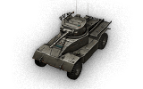
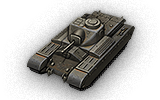
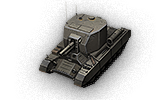
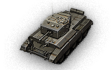
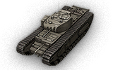
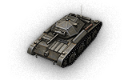

# United Kingdom · Tier V

[All nations and tiers](../buffs_nerfs.md) · EU v20410 → RU v14600ru · 3 November 2026

<label><strong>Find a tank</strong><input type="search" placeholder="Try is7, obj140 or xm57" aria-label="Find a tank" style="display:block;width:100%;padding:.7rem;border:1px solid #888;border-radius:4px;margin:.5rem 0;color:inherit;background:transparent"></label>

AEC Armoured Car · Tier V

aecarmouredcar

<a href="https://tanks.gg/v20410/tank/aec">EU stats</a> · <a href="https://tanks.gg/v14600ru/tank/aec">RU stats</a>
<figure style="display:inline-block"><figcaption>AEC Armoured Car</figcaption></figure>
<em>Firepower</em> 
<strong>DPM (HP/min)</strong> <small>EU</small> 2 011.50  <small>RU</small> <strong>1 970.04</strong> 
<strong>Rate of fire (rounds/min)</strong> <small>EU</small> 22.35  <small>RU</small> <strong>21.89</strong> 
<strong>Reload time (s)</strong> <small>EU</small> 2.68  <small>RU</small> <strong>2.74</strong> 

<em>Gun handling</em> 
<strong>Aim time (s)</strong> <small>EU</small> 1.73  <small>RU</small> <strong>1.92</strong> 
<strong>Dispersion (m/100 m)</strong> <small>EU</small> 0.35  <small>RU</small> <strong>0.37</strong> 
<strong>Dispersion · damaged</strong> <small>EU</small> 0.71  <small>RU</small> <strong>0.75</strong> 
<strong>Dispersion · moving</strong> <small>EU</small> 0.16  <small>RU</small> <strong>0.14</strong> 
<strong>Dispersion · tank traverse</strong> <small>EU</small> 0.16  <small>RU</small> <strong>0.14</strong> 
<strong>Dispersion · turret traverse</strong> <small>EU</small> 0.08  <small>RU</small> <strong>0.10</strong> 
<strong>Dispersion · firing</strong> <small>EU</small> 3  <small>RU</small> <strong>3.50</strong> 

<em>Mobility</em> 
<strong>Forward speed (km/h)</strong> <small>EU</small> 60  <small>RU</small> <strong>55</strong> 
<strong>Forward speed on hard terrain (km/h)</strong> <small>EU</small> 60  <small>RU</small> <strong>55</strong> 
<strong>Forward speed on medium terrain (km/h)</strong> <small>EU</small> 60  <small>RU</small> <strong>55</strong> 
<strong>Forward speed on soft terrain (km/h)</strong> <small>EU</small> 43.80  <small>RU</small> <strong>55</strong> 
<strong>Terrain resist (hard)</strong> <small>EU</small> 0.86  <small>RU</small> <strong>0.12</strong> 
<strong>Terrain resist (med)</strong> <small>EU</small> 0.96  <small>RU</small> <strong>0.12</strong> 
<strong>Terrain resist (soft)</strong> <small>EU</small> 1.73  <small>RU</small> <strong>0.12</strong> 
<strong>Tank traverse (°/s)</strong> <small>EU</small> 31.29  <small>RU</small> <strong>62.58</strong> 
<strong>Tank traverse on hard terrain (°/s)</strong> <small>EU</small> 30.78  <small>RU</small> <strong>61.56</strong> 
<strong>Tank traverse on medium terrain (°/s)</strong> <small>EU</small> 27.70  <small>RU</small> <strong>61.56</strong> 
<strong>Tank traverse on soft terrain (°/s)</strong> <small>EU</small> 15.39  <small>RU</small> <strong>61.56</strong> 

<em>Armor &amp; health</em> 
<strong>Health</strong> <small>EU</small> 650  <small>RU</small> <strong>580</strong> 

AT 2 · Tier V

at2

<a href="https://tanks.gg/v20410/tank/at-2">EU stats</a> · <a href="https://tanks.gg/v14600ru/tank/at-2">RU stats</a>
<figure style="display:inline-block"><figcaption>AT 2</figcaption></figure>
<strong>Penetration (mm)</strong> <b>EU</b>  AP <strong>125</strong> /  APCR <strong>180</strong> /  HE <strong>30</strong> → <b>RU</b>  AP <strong>110</strong> /  APCR <strong>180</strong> /  HE <strong>30</strong>

<em>Gun handling</em> 
<strong>Dispersion (m/100 m)</strong> <small>EU</small> 0.31  <small>RU</small> <strong>0.35</strong> 
<strong>Dispersion · damaged</strong> <small>EU</small> 0.61  <small>RU</small> <strong>0.71</strong> 

<em>Mobility</em> 
<strong>Forward speed on soft terrain (km/h)</strong> <small>EU</small> 14.09  <small>RU</small> <strong>13.85</strong> 
<strong>Engine power (hp)</strong> <small>EU</small> 425  <small>RU</small> <strong>417.63</strong> 
<strong>Power/weight (hp/t)</strong> <small>EU</small> 10.37  <small>RU</small> <strong>10.19</strong> 
<strong>Tank traverse (°/s)</strong> <small>EU</small> 27.12  <small>RU</small> <strong>20.86</strong> 
<strong>Tank traverse on hard terrain (°/s)</strong> <small>EU</small> 28.78  <small>RU</small> <strong>22.99</strong> 
<strong>Tank traverse on medium terrain (°/s)</strong> <small>EU</small> 25.18  <small>RU</small> <strong>20.12</strong> 
<strong>Tank traverse on soft terrain (°/s)</strong> <small>EU</small> 14.39  <small>RU</small> <strong>11.50</strong> 

<em>Armor &amp; health</em> 
<strong>Health</strong> <small>EU</small> 650  <small>RU</small> <strong>590</strong> 
<strong>Health · engine</strong> <small>EU</small> 170  <small>RU</small> <strong>104</strong> 

<em>Miscellaneous</em> 
<strong>View range (m)</strong> <small>EU</small> 330  <small>RU</small> <strong>310</strong> 

Bishop · Tier V

bishop

<a href="https://tanks.gg/v20410/tank/bishop">EU stats</a> · <a href="https://tanks.gg/v14600ru/tank/bishop">RU stats</a>
<figure style="display:inline-block"><figcaption>Bishop</figcaption></figure>
<em>Firepower</em> 
<strong>DPM (HP/min)</strong> <small>EU</small> 1 877.40  <small>RU</small> <strong>2 183.02</strong> 
<strong>Rate of fire (rounds/min)</strong> <small>EU</small> 4.17  <small>RU</small> <strong>4.85</strong> 
<strong>Reload time (s)</strong> <small>EU</small> 14.38  <small>RU</small> <strong>12.37</strong> 

<em>Gun handling</em> 
<strong>Dispersion (m/100 m)</strong> <small>EU</small> 0.77  <small>RU</small> <strong>0.69</strong> 
<strong>Dispersion · damaged</strong> <small>EU</small> 1.53  <small>RU</small> <strong>1.38</strong> 

<em>Mobility</em> 
<strong>Tank traverse on hard terrain (°/s)</strong> <small>EU</small> 26.01  <small>RU</small> <strong>26.43</strong> 
<strong>Tank traverse on medium terrain (°/s)</strong> <small>EU</small> 22.01  <small>RU</small> <strong>22.36</strong> 
<strong>Tank traverse on soft terrain (°/s)</strong> <small>EU</small> 13.63  <small>RU</small> <strong>13.84</strong> 

<em>Armor &amp; health</em> 
<strong>Health · engine</strong> <small>EU</small> 170  <small>RU</small> <strong>72</strong> 
<strong>Health · ammo rack</strong> <small>EU</small> 150  <small>RU</small> <strong>90</strong> 

Cavalier · Tier V

cavalier

<a href="https://tanks.gg/v20410/tank/cavalier">EU stats</a> · <a href="https://tanks.gg/v14600ru/tank/cavalier">RU stats</a>
<figure style="display:inline-block"><figcaption>EU · Cavalier</figcaption></figure><figure style="display:inline-block"><figcaption>RU · Cavalier</figcaption></figure>
<strong>Penetration (mm)</strong> <b>EU</b>  AP <strong>110</strong> /  APCR <strong>180</strong> /  HE <strong>30</strong> → <b>RU</b>  HE <strong>47</strong> /  HEAT <strong>110</strong>

<strong>Damage (HP)</strong> <b>EU</b>  AP <strong>75</strong> /  APCR <strong>75</strong> /  HE <strong>100</strong> → <b>RU</b>  HE <strong>370</strong> /  HEAT <strong>280</strong>

<em>Firepower</em> 
<strong>DPM (HP/min)</strong> <small>EU</small> 2 235  <small>RU</small> <strong>3 087.28</strong> 
<strong>Module damage</strong> <small>EU</small> 76  <small>RU</small> <strong>130</strong> 
<strong>Rate of fire (rounds/min)</strong> <small>EU</small> 29.80  <small>RU</small> <strong>8.34</strong> 
<strong>Reload time (s)</strong> <small>EU</small> 2.01  <small>RU</small> <strong>7.19</strong> 
<strong>Caliber</strong> <small>EU</small> 57  <small>RU</small> <strong>94</strong> 
<strong>Shell velocity (m/s)</strong> <small>EU</small> 892  <small>RU</small> <strong>243</strong> 
<strong>Normalization</strong> <small>EU</small> 5  <small>RU</small> <strong>0</strong> 
<strong>Ricochet angle</strong> <small>EU</small> 70  <small>RU</small> <strong>90</strong> 
<strong>Ammo capacity</strong> <small>EU</small> 115  <small>RU</small> <strong>48</strong> 
<strong>Potential damage</strong> <small>EU</small> 8 625  <small>RU</small> <strong>17 760</strong> 
<strong>Explosion radius</strong> <small>EU</small> — → <small>RU</small> <strong>1.58</strong> 

<em>Gun handling</em> 
<strong>Aim time (s)</strong> <small>EU</small> 1.63  <small>RU</small> <strong>2.21</strong> 
<strong>Dispersion (m/100 m)</strong> <small>EU</small> 0.35  <small>RU</small> <strong>0.51</strong> 
<strong>Dispersion · damaged</strong> <small>EU</small> 0.69  <small>RU</small> <strong>1.02</strong> 
<strong>Dispersion · turret traverse</strong> <small>EU</small> 0.10  <small>RU</small> <strong>0.12</strong> 
<strong>Dispersion · firing</strong> <small>EU</small> 3  <small>RU</small> <strong>4</strong> 

<em>Mobility</em> 
<strong>Forward speed on soft terrain (km/h)</strong> <small>EU</small> 38.79  <small>RU</small> <strong>36.83</strong> 
<strong>Engine power (hp)</strong> <small>EU</small> 475  <small>RU</small> <strong>450</strong> 
<strong>Weight (kg)</strong> <small>EU</small> 25 894 → <small>RU</small> <strong>25 837</strong> 
<strong>Power/weight (hp/t)</strong> <small>EU</small> 18.34  <small>RU</small> <strong>17.42</strong> 
<strong>Tank traverse on hard terrain (°/s)</strong> <small>EU</small> 37.02  <small>RU</small> <strong>39.21</strong> 
<strong>Tank traverse on medium terrain (°/s)</strong> <small>EU</small> 33.32  <small>RU</small> <strong>35.29</strong> 
<strong>Tank traverse on soft terrain (°/s)</strong> <small>EU</small> 18.51  <small>RU</small> <strong>19.60</strong> 

<em>Armor &amp; health</em> 
<strong>Health</strong> <small>EU</small> 700  <small>RU</small> <strong>610</strong> 
<strong>Health · engine</strong> <small>EU</small> 170  <small>RU</small> <strong>104</strong> 

<em>Miscellaneous</em> 
<strong>Stationary camo · after firing</strong> <small>EU</small> 3.68  <small>RU</small> <strong>3.46</strong> 
<strong>Moving camo · after firing</strong> <small>EU</small> 2.77  <small>RU</small> <strong>2.61</strong> 
<strong>Shell cost</strong> <small>EU</small> 45  <small>RU</small> <strong>156</strong> 

Churchill I · Tier V

churchilli

<a href="https://tanks.gg/v20410/tank/churchill-i">EU stats</a> · <a href="https://tanks.gg/v14600ru/tank/churchill-i">RU stats</a>
<figure style="display:inline-block"><figcaption>Churchill I</figcaption></figure>
<strong>Penetration (mm)</strong> <b>EU</b>  AP <strong>110</strong> /  APCR <strong>180</strong> /  HE <strong>30</strong> → <b>RU</b>  AP <strong>145</strong> /  APCR <strong>202</strong> /  HE <strong>38</strong>

<strong>Damage (HP)</strong> <b>EU</b>  AP <strong>75</strong> /  APCR <strong>75</strong> /  HE <strong>100</strong> → <b>RU</b>  AP <strong>135</strong> /  APCR <strong>135</strong> /  HE <strong>175</strong>

<em>Firepower</em> 
<strong>DPM (HP/min)</strong> <small>EU</small> 2 133.41  <small>RU</small> <strong>1 760.06</strong> 
<strong>Module damage</strong> <small>EU</small> 76  <small>RU</small> <strong>100</strong> 
<strong>Rate of fire (rounds/min)</strong> <small>EU</small> 28.45  <small>RU</small> <strong>13.04</strong> 
<strong>Reload time (s)</strong> <small>EU</small> 2.11  <small>RU</small> <strong>4.60</strong> 
<strong>Caliber</strong> <small>EU</small> 57  <small>RU</small> <strong>75</strong> 
<strong>Shell velocity (m/s)</strong> <small>EU</small> 892  <small>RU</small> <strong>785</strong> 
<strong>Ammo capacity</strong> <small>EU</small> 145  <small>RU</small> <strong>100</strong> 
<strong>Potential damage</strong> <small>EU</small> 10 875  <small>RU</small> <strong>13 500</strong> 

<em>Gun handling</em> 
<strong>Aim time (s)</strong> <small>EU</small> 1.63  <small>RU</small> <strong>2.21</strong> 
<strong>Dispersion · damaged</strong> <small>EU</small> 0.71  <small>RU</small> <strong>0.69</strong> 
<strong>Dispersion · moving</strong> <small>EU</small> 0.18  <small>RU</small> <strong>0.20</strong> 
<strong>Dispersion · tank traverse</strong> <small>EU</small> 0.18  <small>RU</small> <strong>0.20</strong> 
<strong>Dispersion · turret traverse</strong> <small>EU</small> 0.08  <small>RU</small> <strong>0.20</strong> 
<strong>Dispersion · firing</strong> <small>EU</small> 3  <small>RU</small> <strong>4</strong> 
<strong>Elevation (°)</strong> <small>EU</small> 20  <small>RU</small> <strong>12</strong> 
<strong>Depression (°)</strong> <small>EU</small> 9  <small>RU</small> <strong>4</strong> 

<em>Mobility</em> 
<strong>Forward speed on soft terrain (km/h)</strong> <small>EU</small> 17.27  <small>RU</small> <strong>16.76</strong> 
<strong>Engine power (hp)</strong> <small>EU</small> 380  <small>RU</small> <strong>370.05</strong> 
<strong>Weight (kg)</strong> <small>EU</small> 39 874 → <small>RU</small> <strong>40 015</strong> 
<strong>Power/weight (hp/t)</strong> <small>EU</small> 9.53  <small>RU</small> <strong>9.25</strong> 
<strong>Tank traverse (°/s)</strong> <small>EU</small> 29.20  <small>RU</small> <strong>22.95</strong> 
<strong>Tank traverse on hard terrain (°/s)</strong> <small>EU</small> 32.43  <small>RU</small> <strong>25.72</strong> 
<strong>Tank traverse on medium terrain (°/s)</strong> <small>EU</small> 27.02  <small>RU</small> <strong>21.43</strong> 
<strong>Tank traverse on soft terrain (°/s)</strong> <small>EU</small> 15.44  <small>RU</small> <strong>12.25</strong> 

<em>Armor &amp; health</em> 
<strong>Turret armor · front (mm)</strong> <small>EU</small> 101.60  <small>RU</small> <strong>88.90</strong> 
<strong>Health · engine</strong> <small>EU</small> 170  <small>RU</small> <strong>104</strong> 

<em>Miscellaneous</em> 
<strong>Stationary camo · after firing</strong> <small>EU</small> 2.15  <small>RU</small> <strong>2</strong> 
<strong>Moving camo · after firing</strong> <small>EU</small> 1.08  <small>RU</small> <strong>1</strong> 
<strong>Shell cost</strong> <small>EU</small> 45  <small>RU</small> <strong>100</strong> 

Covenanter · Tier V

covenanter

<a href="https://tanks.gg/v20410/tank/covenanter">EU stats</a> · <a href="https://tanks.gg/v14600ru/tank/covenanter">RU stats</a>
<figure style="display:inline-block"><figcaption>Covenanter</figcaption></figure>
<em>Mobility</em> 
<strong>Forward speed (km/h)</strong> <small>EU</small> 60  <small>RU</small> <strong>55</strong> 
<strong>Forward speed on hard terrain (km/h)</strong> <small>EU</small> 60  <small>RU</small> <strong>55</strong> 
<strong>Forward speed on medium terrain (km/h)</strong> <small>EU</small> 60  <small>RU</small> <strong>55</strong> 
<strong>Forward speed on soft terrain (km/h)</strong> <small>EU</small> 52.59  <small>RU</small> <strong>45.73</strong> 
<strong>Engine power (hp)</strong> <small>EU</small> 460  <small>RU</small> <strong>400</strong> 
<strong>Power/weight (hp/t)</strong> <small>EU</small> 24.87  <small>RU</small> <strong>21.63</strong> 
<strong>Tank traverse (°/s)</strong> <small>EU</small> 54.24  <small>RU</small> <strong>41.72</strong> 
<strong>Tank traverse on hard terrain (°/s)</strong> <small>EU</small> 61.22  <small>RU</small> <strong>51.65</strong> 
<strong>Tank traverse on medium terrain (°/s)</strong> <small>EU</small> 55.10  <small>RU</small> <strong>46.48</strong> 
<strong>Tank traverse on soft terrain (°/s)</strong> <small>EU</small> 30.61  <small>RU</small> <strong>25.82</strong> 

<em>Armor &amp; health</em> 
<strong>Health</strong> <small>EU</small> 600  <small>RU</small> <strong>540</strong> 
<strong>Health · engine</strong> <small>EU</small> 170  <small>RU</small> <strong>82</strong> 

<em>Miscellaneous</em> 
<strong>View range (m)</strong> <small>EU</small> 360  <small>RU</small> <strong>350</strong> 

