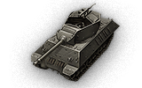
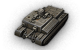
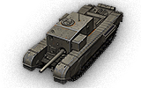
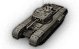
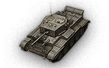
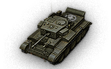
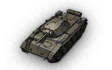
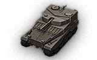
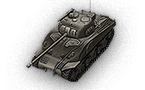
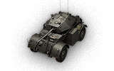

# United Kingdom · Tier VI

[All nations and tiers](../buffs_nerfs.md) · EU v20410 → RU v14600ru · 3 November 2026

<label><strong>Find a tank</strong><input type="search" placeholder="Try is7, obj140 or xm57" aria-label="Find a tank" style="display:block;width:100%;padding:.7rem;border:1px solid #888;border-radius:4px;margin:.5rem 0;color:inherit;background:transparent"></label>

Achilles · Tier VI

achilles

<a href="https://tanks.gg/v20410/tank/achilles">EU stats</a> · <a href="https://tanks.gg/v14600ru/tank/achilles">RU stats</a>
<figure style="display:inline-block"><figcaption>Achilles</figcaption></figure>
<em>Firepower</em> 
<strong>DPM (HP/min)</strong> <small>EU</small> 2 235  <small>RU</small> <strong>2 133.41</strong> 
<strong>Rate of fire (rounds/min)</strong> <small>EU</small> 14.90  <small>RU</small> <strong>14.22</strong> 
<strong>Reload time (s)</strong> <small>EU</small> 4.03  <small>RU</small> <strong>4.22</strong> 

<em>Gun handling</em> 
<strong>Aim time (s)</strong> <small>EU</small> 1.63  <small>RU</small> <strong>1.82</strong> 
<strong>Dispersion · firing</strong> <small>EU</small> 3  <small>RU</small> <strong>3.50</strong> 

<em>Mobility</em> 
<strong>Forward speed on soft terrain (km/h)</strong> <small>EU</small> 41.11  <small>RU</small> <strong>39.51</strong> 
<strong>Engine power (hp)</strong> <small>EU</small> 550  <small>RU</small> <strong>528.64</strong> 
<strong>Power/weight (hp/t)</strong> <small>EU</small> 19.44  <small>RU</small> <strong>18.69</strong> 
<strong>Tank traverse (°/s)</strong> <small>EU</small> 43.81  <small>RU</small> <strong>35.46</strong> 
<strong>Tank traverse on hard terrain (°/s)</strong> <small>EU</small> 46.80  <small>RU</small> <strong>42.95</strong> 
<strong>Tank traverse on medium terrain (°/s)</strong> <small>EU</small> 38.29  <small>RU</small> <strong>35.14</strong> 
<strong>Tank traverse on soft terrain (°/s)</strong> <small>EU</small> 23.40  <small>RU</small> <strong>21.48</strong> 

AT 8 · Tier VI

at8

<a href="https://tanks.gg/v20410/tank/at-8">EU stats</a> · <a href="https://tanks.gg/v14600ru/tank/at-8">RU stats</a>
<figure style="display:inline-block"><figcaption>AT 8</figcaption></figure>
<em>Firepower</em> 
<strong>DPM (HP/min)</strong> <small>EU</small> 2 040.65  <small>RU</small> <strong>2 183.02</strong> 
<strong>Rate of fire (rounds/min)</strong> <small>EU</small> 13.60  <small>RU</small> <strong>14.55</strong> 
<strong>Reload time (s)</strong> <small>EU</small> 4.41  <small>RU</small> <strong>4.12</strong> 

<em>Gun handling</em> 
<strong>Elevation (°)</strong> <small>EU</small> 18  <small>RU</small> <strong>7.50</strong> 

<em>Mobility</em> 
<strong>Forward speed on soft terrain (km/h)</strong> <small>EU</small> 14.78  <small>RU</small> <strong>14.24</strong> 
<strong>Engine power (hp)</strong> <small>EU</small> 450  <small>RU</small> <strong>433.49</strong> 
<strong>Power/weight (hp/t)</strong> <small>EU</small> 10.88  <small>RU</small> <strong>10.48</strong> 
<strong>Tank traverse (°/s)</strong> <small>EU</small> 29.20  <small>RU</small> <strong>20.86</strong> 
<strong>Tank traverse on hard terrain (°/s)</strong> <small>EU</small> 29.27  <small>RU</small> <strong>23.68</strong> 
<strong>Tank traverse on medium terrain (°/s)</strong> <small>EU</small> 25.61  <small>RU</small> <strong>20.72</strong> 
<strong>Tank traverse on soft terrain (°/s)</strong> <small>EU</small> 14.64  <small>RU</small> <strong>11.84</strong> 

Churchill Gun Carrier · Tier VI

churchillguncarrier

<a href="https://tanks.gg/v20410/tank/churchill-gc">EU stats</a> · <a href="https://tanks.gg/v14600ru/tank/churchill-gc">RU stats</a>
<figure style="display:inline-block"><figcaption>Churchill Gun Carrier</figcaption></figure>
<em>Firepower</em> 
<strong>DPM (HP/min)</strong> <small>EU</small> 1 844.46  <small>RU</small> <strong>1 946.93</strong> 
<strong>Rate of fire (rounds/min)</strong> <small>EU</small> 6.59  <small>RU</small> <strong>6.95</strong> 
<strong>Reload time (s)</strong> <small>EU</small> 9.11  <small>RU</small> <strong>8.63</strong> 

<em>Gun handling</em> 
<strong>Aim time (s)</strong> <small>EU</small> 2.01  <small>RU</small> <strong>1.82</strong> 

<em>Armor &amp; health</em> 
<strong>Health</strong> <small>EU</small> 730  <small>RU</small> <strong>950</strong> 

<em>Miscellaneous</em> 
<strong>View range (m)</strong> <small>EU</small> 340  <small>RU</small> <strong>360</strong> 

Churchill VII · Tier VI

churchillvii

<a href="https://tanks.gg/v20410/tank/churchill-vii">EU stats</a> · <a href="https://tanks.gg/v14600ru/tank/churchill-vii">RU stats</a>
<figure style="display:inline-block"><figcaption>Churchill VII</figcaption></figure>
<strong>Penetration (mm)</strong> <b>EU</b>  AP <strong>148</strong> /  APCR <strong>208</strong> /  HE <strong>38</strong> → <b>RU</b>  AP <strong>156</strong> /  APCR <strong>208</strong> /  HE <strong>38</strong>

<em>Gun handling</em> 
<strong>Aim time (s)</strong> <small>EU</small> 1.92  <small>RU</small> <strong>2.21</strong> 
<strong>Dispersion · moving</strong> <small>EU</small> 0.16  <small>RU</small> <strong>0.18</strong> 
<strong>Dispersion · tank traverse</strong> <small>EU</small> 0.16  <small>RU</small> <strong>0.18</strong> 
<strong>Dispersion · turret traverse</strong> <small>EU</small> 0.14  <small>RU</small> <strong>0.16</strong> 
<strong>Elevation (°)</strong> <small>EU</small> 20  <small>RU</small> <strong>12</strong> 
<strong>Depression (°)</strong> <small>EU</small> 8  <small>RU</small> <strong>4</strong> 

<em>Mobility</em> 
<strong>Forward speed (km/h)</strong> <small>EU</small> 25  <small>RU</small> <strong>20</strong> 
<strong>Forward speed on hard terrain (km/h)</strong> <small>EU</small> 25  <small>RU</small> <strong>20</strong> 
<strong>Forward speed on medium terrain (km/h)</strong> <small>EU</small> 25  <small>RU</small> <strong>20</strong> 
<strong>Forward speed on soft terrain (km/h)</strong> <small>EU</small> 15.44  <small>RU</small> <strong>15.04</strong> 
<strong>Reverse speed (km/h)</strong> <small>EU</small> 14  <small>RU</small> <strong>12</strong> 
<strong>Engine power (hp)</strong> <small>EU</small> 380  <small>RU</small> <strong>370.05</strong> 
<strong>Power/weight (hp/t)</strong> <small>EU</small> 9.33  <small>RU</small> <strong>9.09</strong> 
<strong>Tank traverse (°/s)</strong> <small>EU</small> 25.03  <small>RU</small> <strong>20.86</strong> 
<strong>Tank traverse on hard terrain (°/s)</strong> <small>EU</small> 27.77  <small>RU</small> <strong>23.42</strong> 
<strong>Tank traverse on medium terrain (°/s)</strong> <small>EU</small> 23.50  <small>RU</small> <strong>19.81</strong> 
<strong>Tank traverse on soft terrain (°/s)</strong> <small>EU</small> 13.28  <small>RU</small> <strong>11.20</strong> 

<em>Armor &amp; health</em> 
<strong>Health</strong> <small>EU</small> 1 200  <small>RU</small> <strong>1 080</strong> 
<strong>Health · engine</strong> <small>EU</small> 205  <small>RU</small> <strong>104</strong> 

<em>Miscellaneous</em> 
<strong>Moving camo</strong> <small>EU</small> 3.76  <small>RU</small> <strong>3.71</strong> 
<strong>Moving camo · after firing</strong> <small>EU</small> 0.93  <small>RU</small> <strong>0.92</strong> 

Cromwell · Tier VI

cromwell

<a href="https://tanks.gg/v20410/tank/cromwell">EU stats</a> · <a href="https://tanks.gg/v14600ru/tank/cromwell">RU stats</a>
<figure style="display:inline-block"><figcaption>Cromwell</figcaption></figure>
<em>Gun handling</em> 
<strong>Elevation (°)</strong> <small>EU</small> 20  <small>RU</small> <strong>15</strong> 
<strong>Depression (°)</strong> <small>EU</small> 13  <small>RU</small> <strong>8</strong> 

<em>Mobility</em> 
<strong>Forward speed on soft terrain (km/h)</strong> <small>EU</small> 52.98  <small>RU</small> <strong>51.85</strong> 
<strong>Engine power (hp)</strong> <small>EU</small> 700  <small>RU</small> <strong>687.23</strong> 
<strong>Weight (kg)</strong> <small>EU</small> 27 934 → <small>RU</small> <strong>28 025</strong> 
<strong>Power/weight (hp/t)</strong> <small>EU</small> 25.06  <small>RU</small> <strong>24.52</strong> 
<strong>Tank traverse on hard terrain (°/s)</strong> <small>EU</small> 40.36  <small>RU</small> <strong>58.35</strong> 
<strong>Tank traverse on medium terrain (°/s)</strong> <small>EU</small> 36.33  <small>RU</small> <strong>52.52</strong> 
<strong>Tank traverse on soft terrain (°/s)</strong> <small>EU</small> 20.18  <small>RU</small> <strong>29.18</strong> 

<em>Armor &amp; health</em> 
<strong>Health</strong> <small>EU</small> 950  <small>RU</small> <strong>840</strong> 

Cromwell B · Tier VI

cromwellb

<a href="https://tanks.gg/v20410/tank/cromwell-b">EU stats</a> · <a href="https://tanks.gg/v14600ru/tank/cromwell-b">RU stats</a>
<figure style="display:inline-block"><figcaption>EU · Cromwell B</figcaption></figure><figure style="display:inline-block"><figcaption>RU · Cromwell B</figcaption></figure>
<em>Gun handling</em> 
<strong>Elevation (°)</strong> <small>EU</small> 20  <small>RU</small> <strong>15</strong> 
<strong>Depression (°)</strong> <small>EU</small> 11  <small>RU</small> <strong>8</strong> 

Crusader · Tier VI

crusader

<a href="https://tanks.gg/v20410/tank/crusader">EU stats</a> · <a href="https://tanks.gg/v14600ru/tank/crusader">RU stats</a>
<figure style="display:inline-block"><figcaption>EU · Crusader</figcaption></figure><figure style="display:inline-block"><figcaption>RU · Crusader</figcaption></figure>
<strong>Penetration (mm)</strong> <b>EU</b>  AP <strong>126</strong> /  APCR <strong>180</strong> /  HE <strong>30</strong> → <b>RU</b>  AP <strong>110</strong> /  APCR <strong>180</strong> /  HE <strong>30</strong>

<em>Mobility</em> 
<strong>Forward speed (km/h)</strong> <small>EU</small> 65  <small>RU</small> <strong>58</strong> 
<strong>Forward speed on hard terrain (km/h)</strong> <small>EU</small> 65  <small>RU</small> <strong>58</strong> 
<strong>Forward speed on medium terrain (km/h)</strong> <small>EU</small> 65  <small>RU</small> <strong>58</strong> 
<strong>Forward speed on soft terrain (km/h)</strong> <small>EU</small> 59.94  <small>RU</small> <strong>46.40</strong> 
<strong>Engine power (hp)</strong> <small>EU</small> 560  <small>RU</small> <strong>433.49</strong> 
<strong>Power/weight (hp/t)</strong> <small>EU</small> 28.35  <small>RU</small> <strong>21.95</strong> 
<strong>Tank traverse on hard terrain (°/s)</strong> <small>EU</small> 49.56  <small>RU</small> <strong>46.85</strong> 
<strong>Tank traverse on medium terrain (°/s)</strong> <small>EU</small> 44.61  <small>RU</small> <strong>42.17</strong> 
<strong>Tank traverse on soft terrain (°/s)</strong> <small>EU</small> 24.78  <small>RU</small> <strong>23.43</strong> 

<em>Armor &amp; health</em> 
<strong>Health</strong> <small>EU</small> 800  <small>RU</small> <strong>680</strong> 

FV304 · Tier VI

fv304

<a href="https://tanks.gg/v20410/tank/fv304">EU stats</a> · <a href="https://tanks.gg/v14600ru/tank/fv304">RU stats</a>
<figure style="display:inline-block"><figcaption>FV304</figcaption></figure>
<em>Armor &amp; health</em> 
<strong>Health · track</strong> <small>EU</small> 145  <small>RU</small> <strong>90</strong> 
<strong>Health · ammo rack</strong> <small>EU</small> 170  <small>RU</small> <strong>100</strong> 
<strong>Track repair time (s)</strong> <small>EU</small> 11.62  <small>RU</small> <strong>12.63</strong> 

Sherman Firefly · Tier VI

shermanfirefly

<a href="https://tanks.gg/v20410/tank/firefly">EU stats</a> · <a href="https://tanks.gg/v14600ru/tank/firefly">RU stats</a>
<figure style="display:inline-block"><figcaption>Sherman Firefly</figcaption></figure>
<em>Firepower</em> 
<strong>DPM (HP/min)</strong> <small>EU</small> 1 997.23  <small>RU</small> <strong>2 183.02</strong> 
<strong>Rate of fire (rounds/min)</strong> <small>EU</small> 13.31  <small>RU</small> <strong>14.55</strong> 
<strong>Reload time (s)</strong> <small>EU</small> 4.51  <small>RU</small> <strong>4.12</strong> 

<em>Gun handling</em> 
<strong>Aim time (s)</strong> <small>EU</small> 2.01  <small>RU</small> <strong>1.73</strong> 

<em>Mobility</em> 
<strong>Tank traverse on hard terrain (°/s)</strong> <small>EU</small> 47.47  <small>RU</small> <strong>47.67</strong> 
<strong>Tank traverse on medium terrain (°/s)</strong> <small>EU</small> 37.97  <small>RU</small> <strong>38.14</strong> 
<strong>Tank traverse on soft terrain (°/s)</strong> <small>EU</small> 21.10  <small>RU</small> <strong>21.19</strong> 

Staghound Mk. III · Tier VI

staghoundmkiii

<a href="https://tanks.gg/v20410/tank/staghound">EU stats</a> · <a href="https://tanks.gg/v14600ru/tank/staghound">RU stats</a>
<figure style="display:inline-block"><figcaption>Staghound Mk. III</figcaption></figure>
<strong>Penetration (mm)</strong> <b>EU</b>  AP <strong>162</strong> /  APCR <strong>190</strong> /  HE <strong>38</strong> → <b>RU</b>  AP <strong>138</strong> /  APCR <strong>190</strong> /  HE <strong>38</strong>

<em>Firepower</em> 
<strong>DPM (HP/min)</strong> <small>EU</small> 2 370.45  <small>RU</small> <strong>2 016.12</strong> 
<strong>Rate of fire (rounds/min)</strong> <small>EU</small> 18.96  <small>RU</small> <strong>16.13</strong> 
<strong>Reload time (s)</strong> <small>EU</small> 3.16  <small>RU</small> <strong>3.72</strong> 

<em>Gun handling</em> 
<strong>Aim time (s)</strong> <small>EU</small> 1.92  <small>RU</small> <strong>2.11</strong> 
<strong>Dispersion (m/100 m)</strong> <small>EU</small> 0.33  <small>RU</small> <strong>0.36</strong> 
<strong>Dispersion · damaged</strong> <small>EU</small> 0.65  <small>RU</small> <strong>0.73</strong> 
<strong>Dispersion · firing</strong> <small>EU</small> 3  <small>RU</small> <strong>4</strong> 

<em>Mobility</em> 
<strong>Forward speed (km/h)</strong> <small>EU</small> 60  <small>RU</small> <strong>55</strong> 
<strong>Forward speed on hard terrain (km/h)</strong> <small>EU</small> 60  <small>RU</small> <strong>55</strong> 
<strong>Forward speed on medium terrain (km/h)</strong> <small>EU</small> 60  <small>RU</small> <strong>55</strong> 
<strong>Forward speed on soft terrain (km/h)</strong> <small>EU</small> 51.41  <small>RU</small> <strong>55</strong> 
<strong>Terrain resist (hard)</strong> <small>EU</small> 0.86  <small>RU</small> <strong>0.12</strong> 
<strong>Terrain resist (med)</strong> <small>EU</small> 0.96  <small>RU</small> <strong>0.12</strong> 
<strong>Terrain resist (soft)</strong> <small>EU</small> 1.73  <small>RU</small> <strong>0.12</strong> 
<strong>Tank traverse (°/s)</strong> <small>EU</small> 31.29  <small>RU</small> <strong>62.58</strong> 
<strong>Tank traverse on hard terrain (°/s)</strong> <small>EU</small> 31.30  <small>RU</small> <strong>62.60</strong> 
<strong>Tank traverse on medium terrain (°/s)</strong> <small>EU</small> 28.17  <small>RU</small> <strong>62.60</strong> 
<strong>Tank traverse on soft terrain (°/s)</strong> <small>EU</small> 15.65  <small>RU</small> <strong>62.60</strong> 

<em>Armor &amp; health</em> 
<strong>Health</strong> <small>EU</small> 900  <small>RU</small> <strong>800</strong> 

