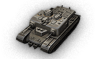
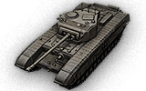
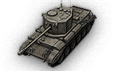
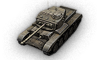
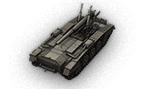
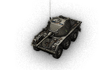
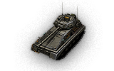

# United Kingdom · Tier VII

[All nations and tiers](../buffs_nerfs.md) · EU v20410 → RU v14600ru · 3 November 2026

<label><strong>Find a tank</strong><input type="search" placeholder="Try is7, obj140 or xm57" aria-label="Find a tank" style="display:block;width:100%;padding:.7rem;border:1px solid #888;border-radius:4px;margin:.5rem 0;color:inherit;background:transparent"></label>

AT 7 · Tier VII

at7

<a href="https://tanks.gg/v20410/tank/at-7">EU stats</a> · <a href="https://tanks.gg/v14600ru/tank/at-7">RU stats</a>
<figure style="display:inline-block"><figcaption>AT 7</figcaption></figure>
<em>Firepower</em> 
<strong>Module damage</strong> <small>EU</small> 113  <small>RU</small> <strong>118</strong> 

<em>Gun handling</em> 
<strong>Aim time (s)</strong> <small>EU</small> 1.63  <small>RU</small> <strong>2.21</strong> 
<strong>Dispersion · turret traverse</strong> <small>EU</small> 0.10  <small>RU</small> <strong>0.16</strong> 
<strong>Elevation (°)</strong> <small>EU</small> 15  <small>RU</small> <strong>7.50</strong> 
<strong>Depression (°)</strong> <small>EU</small> 8  <small>RU</small> <strong>5</strong> 

<em>Mobility</em> 
<strong>Forward speed on soft terrain (km/h)</strong> <small>EU</small> 16.76  <small>RU</small> <strong>16.10</strong> 
<strong>Engine power (hp)</strong> <small>EU</small> 550  <small>RU</small> <strong>528.64</strong> 
<strong>Power/weight (hp/t)</strong> <small>EU</small> 12.33  <small>RU</small> <strong>11.85</strong> 
<strong>Tank traverse (°/s)</strong> <small>EU</small> 31.29  <small>RU</small> <strong>22.95</strong> 
<strong>Tank traverse on hard terrain (°/s)</strong> <small>EU</small> 32.16  <small>RU</small> <strong>26.90</strong> 
<strong>Tank traverse on medium terrain (°/s)</strong> <small>EU</small> 28.14  <small>RU</small> <strong>23.54</strong> 
<strong>Tank traverse on soft terrain (°/s)</strong> <small>EU</small> 16.08  <small>RU</small> <strong>13.45</strong> 

<em>Armor &amp; health</em> 
<strong>Health</strong> <small>EU</small> 1 300  <small>RU</small> <strong>1 250</strong> 

<em>Miscellaneous</em> 
<strong>View range (m)</strong> <small>EU</small> 360  <small>RU</small> <strong>350</strong> 

Black Prince · Tier VII

blackprince

<a href="https://tanks.gg/v20410/tank/black-prince">EU stats</a> · <a href="https://tanks.gg/v14600ru/tank/black-prince">RU stats</a>
<figure style="display:inline-block"><figcaption>Black Prince</figcaption></figure>
<em>Firepower</em> 
<strong>DPM (HP/min)</strong> <small>EU</small> 2 086  <small>RU</small> <strong>1 877.40</strong> 
<strong>Rate of fire (rounds/min)</strong> <small>EU</small> 13.91  <small>RU</small> <strong>12.52</strong> 
<strong>Reload time (s)</strong> <small>EU</small> 4.31  <small>RU</small> <strong>4.79</strong> 

<em>Gun handling</em> 
<strong>Aim time (s)</strong> <small>EU</small> 1.92  <small>RU</small> <strong>2.21</strong> 
<strong>Dispersion · moving</strong> <small>EU</small> 0.14  <small>RU</small> <strong>0.16</strong> 
<strong>Dispersion · tank traverse</strong> <small>EU</small> 0.14  <small>RU</small> <strong>0.16</strong> 
<strong>Dispersion · turret traverse</strong> <small>EU</small> 0.10  <small>RU</small> <strong>0.20</strong> 

<em>Mobility</em> 
<strong>Forward speed (km/h)</strong> <small>EU</small> 30  <small>RU</small> <strong>20</strong> 
<strong>Forward speed on hard terrain (km/h)</strong> <small>EU</small> 30  <small>RU</small> <strong>20</strong> 
<strong>Forward speed on medium terrain (km/h)</strong> <small>EU</small> 30  <small>RU</small> <strong>20</strong> 
<strong>Forward speed on soft terrain (km/h)</strong> <small>EU</small> 21.51  <small>RU</small> <strong>20</strong> 
<strong>Reverse speed (km/h)</strong> <small>EU</small> 15  <small>RU</small> <strong>12</strong> 
<strong>Engine power (hp)</strong> <small>EU</small> 650  <small>RU</small> <strong>634.37</strong> 
<strong>Power/weight (hp/t)</strong> <small>EU</small> 13  <small>RU</small> <strong>12.68</strong> 
<strong>Tank traverse on hard terrain (°/s)</strong> <small>EU</small> 22.89  <small>RU</small> <strong>36.22</strong> 
<strong>Tank traverse on medium terrain (°/s)</strong> <small>EU</small> 19.62  <small>RU</small> <strong>31.04</strong> 
<strong>Tank traverse on soft terrain (°/s)</strong> <small>EU</small> 11.94  <small>RU</small> <strong>18.90</strong> 

<em>Armor &amp; health</em> 
<strong>Health</strong> <small>EU</small> 1 500  <small>RU</small> <strong>1 450</strong> 

Challenger · Tier VII

challenger

<a href="https://tanks.gg/v20410/tank/challenger">EU stats</a> · <a href="https://tanks.gg/v14600ru/tank/challenger">RU stats</a>
<figure style="display:inline-block"><figcaption>Challenger</figcaption></figure>
<em>Firepower</em> 
<strong>Module damage</strong> <small>EU</small> 127  <small>RU</small> <strong>135</strong> 

<em>Mobility</em> 
<strong>Forward speed on soft terrain (km/h)</strong> <small>EU</small> 46.58  <small>RU</small> <strong>45.73</strong> 
<strong>Engine power (hp)</strong> <small>EU</small> 700  <small>RU</small> <strong>687.23</strong> 
<strong>Power/weight (hp/t)</strong> <small>EU</small> 20.81  <small>RU</small> <strong>20.43</strong> 
<strong>Tank traverse (°/s)</strong> <small>EU</small> 35.46  <small>RU</small> <strong>31.29</strong> 
<strong>Tank traverse on hard terrain (°/s)</strong> <small>EU</small> 35.07  <small>RU</small> <strong>31.61</strong> 
<strong>Tank traverse on medium terrain (°/s)</strong> <small>EU</small> 31.88  <small>RU</small> <strong>28.73</strong> 
<strong>Tank traverse on soft terrain (°/s)</strong> <small>EU</small> 20.63  <small>RU</small> <strong>18.59</strong> 

<em>Armor &amp; health</em> 
<strong>Health</strong> <small>EU</small> 950  <small>RU</small> <strong>900</strong> 

Comet · Tier VII

comet

<a href="https://tanks.gg/v20410/tank/comet">EU stats</a> · <a href="https://tanks.gg/v14600ru/tank/comet">RU stats</a>
<figure style="display:inline-block"><figcaption>Comet</figcaption></figure>
<strong>Penetration (mm)</strong> <b>EU</b>  AP <strong>164</strong> /  APCR <strong>221</strong> /  HE <strong>38</strong> → <b>RU</b>  AP <strong>156</strong> /  APCR <strong>208</strong> /  HE <strong>38</strong>

<em>Firepower</em> 
<strong>Shell velocity (m/s)</strong> <small>EU</small> 884  <small>RU</small> <strong>785</strong> 

<em>Gun handling</em> 
<strong>Aim time (s)</strong> <small>EU</small> 2.21  <small>RU</small> <strong>1.82</strong> 
<strong>Dispersion (m/100 m)</strong> <small>EU</small> 0.33  <small>RU</small> <strong>0.31</strong> 
<strong>Dispersion · damaged</strong> <small>EU</small> 0.65  <small>RU</small> <strong>0.61</strong> 

<em>Mobility</em> 
<strong>Forward speed on soft terrain (km/h)</strong> <small>EU</small> 42.88  <small>RU</small> <strong>42.10</strong> 
<strong>Engine power (hp)</strong> <small>EU</small> 700  <small>RU</small> <strong>687.23</strong> 
<strong>Power/weight (hp/t)</strong> <small>EU</small> 21.41  <small>RU</small> <strong>21.02</strong> 
<strong>Tank traverse (°/s)</strong> <small>EU</small> 41.72  <small>RU</small> <strong>37.55</strong> 
<strong>Tank traverse on hard terrain (°/s)</strong> <small>EU</small> 41.30  <small>RU</small> <strong>37.96</strong> 
<strong>Tank traverse on medium terrain (°/s)</strong> <small>EU</small> 37.54  <small>RU</small> <strong>34.51</strong> 
<strong>Tank traverse on soft terrain (°/s)</strong> <small>EU</small> 21.74  <small>RU</small> <strong>19.98</strong> 

<em>Armor &amp; health</em> 
<strong>Health</strong> <small>EU</small> 1 250  <small>RU</small> <strong>1 150</strong> 

<em>Miscellaneous</em> 
<strong>View range (m)</strong> <small>EU</small> 380  <small>RU</small> <strong>390</strong> 

Crusader 5.5-in. SP · Tier VII

crusader55insp

<a href="https://tanks.gg/v20410/tank/crusader-sp">EU stats</a> · <a href="https://tanks.gg/v14600ru/tank/crusader-sp">RU stats</a>
<figure style="display:inline-block"><figcaption>Crusader 5.5-in. SP</figcaption></figure>
<strong>Penetration (mm)</strong> <b>EU</b>  HE <strong>35</strong> /  HE <strong>44</strong> /  AP <strong>212</strong> → <b>RU</b>  HE <strong>35</strong> /  AP <strong>212</strong>

<strong>Damage (HP)</strong> <b>EU</b>  HE <strong>550</strong> /  HE <strong>650</strong> /  AP <strong>400</strong> → <b>RU</b>  HE <strong>650</strong> /  AP <strong>400</strong>

<em>Firepower</em> 
<strong>DPM (HP/min)</strong> <small>EU</small> 1 186.86  <small>RU</small> <strong>1 564.50</strong> 
<strong>Rate of fire (rounds/min)</strong> <small>EU</small> 2.16  <small>RU</small> <strong>2.41</strong> 
<strong>Reload time (s)</strong> <small>EU</small> 27.80  <small>RU</small> <strong>24.93</strong> 
<strong>Explosion radius</strong> <small>EU</small> 6.80  <small>RU</small> <strong>5.20</strong> 
<strong>Stun duration · maximum (s)</strong> <small>EU</small> 22 → <small>RU</small> <strong>—</strong> 
<strong>Stun duration · minimum (s)</strong> <small>EU</small> 12.10 → <small>RU</small> <strong>—</strong> 
<strong>Shell velocity (m/s)</strong> <small>EU</small> 440  <small>RU</small> <strong>320</strong> 
<strong>Max range (m)</strong> <small>EU</small> 1 326.03  <small>RU</small> <strong>1 003.92</strong> 
<strong>Potential damage</strong> <small>EU</small> 17 600  <small>RU</small> <strong>20 800</strong> 

<em>Armor &amp; health</em> 
<strong>Health · engine</strong> <small>EU</small> 240  <small>RU</small> <strong>136</strong> 
<strong>Health · track</strong> <small>EU</small> 180  <small>RU</small> <strong>110</strong> 
<strong>Health · ammo rack</strong> <small>EU</small> 190  <small>RU</small> <strong>110</strong> 
<strong>Track repair time (s)</strong> <small>EU</small> 11.70  <small>RU</small> <strong>12.19</strong> 

<em>Miscellaneous</em> 
<strong>Shell cost</strong> <small>EU</small> 700  <small>RU</small> <strong>750</strong> 

FSV Scheme A · Tier VII

fsvschemea

<a href="https://tanks.gg/v20410/tank/fsv-sch-a">EU stats</a> · <a href="https://tanks.gg/v14600ru/tank/fsv-sch-a">RU stats</a>
<figure style="display:inline-block"><figcaption>FSV Scheme A</figcaption></figure>
<em>Firepower</em> 
<strong>DPM (HP/min)</strong> <small>EU</small> 1 997.23  <small>RU</small> <strong>1 956.06</strong> 
<strong>Rate of fire (rounds/min)</strong> <small>EU</small> 13.31  <small>RU</small> <strong>13.04</strong> 
<strong>Reload time (s)</strong> <small>EU</small> 4.51  <small>RU</small> <strong>4.60</strong> 

<em>Gun handling</em> 
<strong>Aim time (s)</strong> <small>EU</small> 1.73  <small>RU</small> <strong>2.21</strong> 
<strong>Dispersion (m/100 m)</strong> <small>EU</small> 0.32  <small>RU</small> <strong>0.35</strong> 
<strong>Dispersion · damaged</strong> <small>EU</small> 0.63  <small>RU</small> <strong>0.71</strong> 
<strong>Dispersion · turret traverse</strong> <small>EU</small> 0.06  <small>RU</small> <strong>0.10</strong> 

<em>Mobility</em> 
<strong>Forward speed (km/h)</strong> <small>EU</small> 60  <small>RU</small> <strong>55</strong> 
<strong>Forward speed on hard terrain (km/h)</strong> <small>EU</small> 60  <small>RU</small> <strong>55</strong> 
<strong>Forward speed on medium terrain (km/h)</strong> <small>EU</small> 60  <small>RU</small> <strong>55</strong> 
<strong>Forward speed on soft terrain (km/h)</strong> <small>EU</small> 48.96  <small>RU</small> <strong>55</strong> 
<strong>Terrain resist (hard)</strong> <small>EU</small> 0.96  <small>RU</small> <strong>0.12</strong> 
<strong>Terrain resist (med)</strong> <small>EU</small> 1.05  <small>RU</small> <strong>0.12</strong> 
<strong>Terrain resist (soft)</strong> <small>EU</small> 1.82  <small>RU</small> <strong>0.12</strong> 
<strong>Tank traverse (°/s)</strong> <small>EU</small> 31.29  <small>RU</small> <strong>62.58</strong> 
<strong>Tank traverse on hard terrain (°/s)</strong> <small>EU</small> 30.64  <small>RU</small> <strong>60.66</strong> 
<strong>Tank traverse on medium terrain (°/s)</strong> <small>EU</small> 27.86  <small>RU</small> <strong>60.66</strong> 
<strong>Tank traverse on soft terrain (°/s)</strong> <small>EU</small> 16.13  <small>RU</small> <strong>60.66</strong> 

<em>Armor &amp; health</em> 
<strong>Health</strong> <small>EU</small> 1 100  <small>RU</small> <strong>1 000</strong> 

GSR 3301 Setter · Tier VII

gsr3301setter

<a href="https://tanks.gg/v20410/tank/setter">EU stats</a> · <a href="https://tanks.gg/v14600ru/tank/setter">RU stats</a>
<figure style="display:inline-block"><figcaption>GSR 3301 Setter</figcaption></figure>
<em>Firepower</em> 
<strong>DPM (HP/min)</strong> <small>EU</small> 1 408.05  <small>RU</small> <strong>1 379.03</strong> 
<strong>Rate of fire (rounds/min)</strong> <small>EU</small> 10.43  <small>RU</small> <strong>10.22</strong> 
<strong>Reload time (s)</strong> <small>EU</small> 5.75  <small>RU</small> <strong>5.87</strong> 
<strong>Ammo capacity</strong> <small>EU</small> 48  <small>RU</small> <strong>35</strong> 
<strong>Potential damage</strong> <small>EU</small> 6 480  <small>RU</small> <strong>4 725</strong> 

<em>Gun handling</em> 
<strong>Dispersion (m/100 m)</strong> <small>EU</small> 0.35  <small>RU</small> <strong>0.36</strong> 
<strong>Dispersion · damaged</strong> <small>EU</small> 0.69  <small>RU</small> <strong>0.73</strong> 
<strong>Dispersion · moving</strong> <small>EU</small> 0.13  <small>RU</small> <strong>0.16</strong> 
<strong>Dispersion · tank traverse</strong> <small>EU</small> 0.13  <small>RU</small> <strong>0.16</strong> 
<strong>Dispersion · turret traverse</strong> <small>EU</small> 0.10  <small>RU</small> <strong>0.12</strong> 

<em>Mobility</em> 
<strong>Forward speed (km/h)</strong> <small>EU</small> 66  <small>RU</small> <strong>58</strong> 
<strong>Forward speed on hard terrain (km/h)</strong> <small>EU</small> 66  <small>RU</small> <strong>58</strong> 
<strong>Forward speed on medium terrain (km/h)</strong> <small>EU</small> 66  <small>RU</small> <strong>58</strong> 
<strong>Forward speed on soft terrain (km/h)</strong> <small>EU</small> 58.89  <small>RU</small> <strong>58</strong> 
<strong>Reverse speed (km/h)</strong> <small>EU</small> 23  <small>RU</small> <strong>22</strong> 

<em>Armor &amp; health</em> 
<strong>Health</strong> <small>EU</small> 1 000  <small>RU</small> <strong>860</strong> 

