# United Kingdom · Tier VIII

[All nations and tiers](../buffs_nerfs.md) · EU v20410 → RU v14600ru · 3 November 2026

<label><strong>Find a tank</strong><input type="search" placeholder="Try is7, obj140 or xm57" aria-label="Find a tank" style="display:block;width:100%;padding:.7rem;border:1px solid #888;border-radius:4px;margin:.5rem 0;color:inherit;background:transparent"></label>

AT 15 · Tier VIII

at15

<a href="https://tanks.gg/v20410/tank/at-15">EU stats</a> · <a href="https://tanks.gg/v14600ru/tank/at-15">RU stats</a>
<figure style="display:inline-block">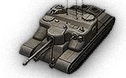<figcaption>AT 15</figcaption></figure>
<strong>Penetration (mm)</strong> <b>EU</b>  AP <strong>220</strong> /  APCR <strong>252</strong> /  HE <strong>47</strong> → <b>RU</b>  AP <strong>230</strong> /  APCR <strong>274</strong> /  HE <strong>47</strong>

<em>Firepower</em> 
<strong>Module damage</strong> <small>EU</small> 127  <small>RU</small> <strong>135</strong> 

<em>Gun handling</em> 
<strong>Dispersion (m/100 m)</strong> <small>EU</small> 0.29  <small>RU</small> <strong>0.30</strong> 
<strong>Dispersion · damaged</strong> <small>EU</small> 0.58  <small>RU</small> <strong>0.59</strong> 
<strong>Dispersion · moving</strong> <small>EU</small> 0.18  <small>RU</small> <strong>0.28</strong> 
<strong>Dispersion · tank traverse</strong> <small>EU</small> 0.18  <small>RU</small> <strong>0.28</strong> 

<em>Mobility</em> 
<strong>Forward speed (km/h)</strong> <small>EU</small> 25  <small>RU</small> <strong>20</strong> 
<strong>Forward speed on hard terrain (km/h)</strong> <small>EU</small> 25  <small>RU</small> <strong>20</strong> 
<strong>Forward speed on medium terrain (km/h)</strong> <small>EU</small> 25  <small>RU</small> <strong>20</strong> 
<strong>Forward speed on soft terrain (km/h)</strong> <small>EU</small> 16.96  <small>RU</small> <strong>16.19</strong> 
<strong>Reverse speed (km/h)</strong> <small>EU</small> 12  <small>RU</small> <strong>10</strong> 
<strong>Engine power (hp)</strong> <small>EU</small> 720  <small>RU</small> <strong>687.23</strong> 
<strong>Power/weight (hp/t)</strong> <small>EU</small> 11.59  <small>RU</small> <strong>11.06</strong> 
<strong>Tank traverse (°/s)</strong> <small>EU</small> 29.20  <small>RU</small> <strong>20.86</strong> 
<strong>Tank traverse on hard terrain (°/s)</strong> <small>EU</small> 28.98  <small>RU</small> <strong>24.86</strong> 
<strong>Tank traverse on medium terrain (°/s)</strong> <small>EU</small> 25.12  <small>RU</small> <strong>21.54</strong> 
<strong>Tank traverse on soft terrain (°/s)</strong> <small>EU</small> 14.49  <small>RU</small> <strong>12.43</strong> 

<em>Armor &amp; health</em> 
<strong>Hull armor · front (mm)</strong> <small>EU</small> 228.60  <small>RU</small> <strong>254</strong> 
<strong>Health</strong> <small>EU</small> 1 500  <small>RU</small> <strong>1 450</strong> 

Caernarvon · Tier VIII

caernarvon

<a href="https://tanks.gg/v20410/tank/caernarvon">EU stats</a> · <a href="https://tanks.gg/v14600ru/tank/caernarvon">RU stats</a>
<figure style="display:inline-block">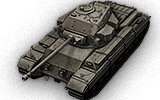<figcaption>Caernarvon</figcaption></figure>
<em>Firepower</em> 
<strong>Module damage</strong> <small>EU</small> 127  <small>RU</small> <strong>135</strong> 

<em>Gun handling</em> 
<strong>Aim time (s)</strong> <small>EU</small> 2.01  <small>RU</small> <strong>2.21</strong> 
<strong>Dispersion · turret traverse</strong> <small>EU</small> 0.12  <small>RU</small> <strong>0.14</strong> 

<em>Mobility</em> 
<strong>Forward speed on soft terrain (km/h)</strong> <small>EU</small> 24.13  <small>RU</small> <strong>22.96</strong> 
<strong>Engine power (hp)</strong> <small>EU</small> 900  <small>RU</small> <strong>856.40</strong> 
<strong>Power/weight (hp/t)</strong> <small>EU</small> 14.58  <small>RU</small> <strong>13.87</strong> 
<strong>Tank traverse (°/s)</strong> <small>EU</small> 31.29  <small>RU</small> <strong>25.03</strong> 
<strong>Tank traverse on hard terrain (°/s)</strong> <small>EU</small> 30.90  <small>RU</small> <strong>28.41</strong> 
<strong>Tank traverse on medium terrain (°/s)</strong> <small>EU</small> 26.15  <small>RU</small> <strong>24.04</strong> 
<strong>Tank traverse on soft terrain (°/s)</strong> <small>EU</small> 14.78  <small>RU</small> <strong>13.59</strong> 

<em>Armor &amp; health</em> 
<strong>Health</strong> <small>EU</small> 1 750  <small>RU</small> <strong>1 600</strong> 

Caernarvon Action X · Tier VIII

caernarvonactionx

<a href="https://tanks.gg/v20410/tank/caernarvon-ax">EU stats</a> · <a href="https://tanks.gg/v14600ru/tank/caernarvon-ax">RU stats</a>
<figure style="display:inline-block">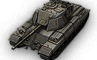<figcaption>Caernarvon Action X</figcaption></figure>
<em>Firepower</em> 
<strong>DPM (HP/min)</strong> <small>EU</small> 2 439.56  <small>RU</small> <strong>2 570.25</strong> 
<strong>Rate of fire (rounds/min)</strong> <small>EU</small> 10.61  <small>RU</small> <strong>11.18</strong> 
<strong>Reload time (s)</strong> <small>EU</small> 5.66  <small>RU</small> <strong>5.37</strong> 

<em>Gun handling</em> 
<strong>Aim time (s)</strong> <small>EU</small> 2.21  <small>RU</small> <strong>1.82</strong> 
<strong>Dispersion · moving</strong> <small>EU</small> 0.16  <small>RU</small> <strong>0.12</strong> 
<strong>Dispersion · tank traverse</strong> <small>EU</small> 0.16  <small>RU</small> <strong>0.12</strong> 
<strong>Dispersion · turret traverse</strong> <small>EU</small> 0.16  <small>RU</small> <strong>0.10</strong> 
<strong>Dispersion · firing</strong> <small>EU</small> 3.50  <small>RU</small> <strong>2.50</strong> 

<em>Mobility</em> 
<strong>Reverse speed (km/h)</strong> <small>EU</small> 12  <small>RU</small> <strong>15</strong> 

Centurion Mk. 5/1 RAAC · Tier VIII

centurionmk51raac

<a href="https://tanks.gg/v20410/tank/centurion-51">EU stats</a> · <a href="https://tanks.gg/v14600ru/tank/centurion-51">RU stats</a>
<figure style="display:inline-block">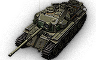<figcaption>Centurion Mk. 5/1 RAAC</figcaption></figure>
<em>Firepower</em> 
<strong>DPM (HP/min)</strong> <small>EU</small> 2 056.20  <small>RU</small> <strong>1 919.12</strong> 
<strong>Rate of fire (rounds/min)</strong> <small>EU</small> 8.94  <small>RU</small> <strong>8.34</strong> 
<strong>Reload time (s)</strong> <small>EU</small> 6.71  <small>RU</small> <strong>7.19</strong> 

Centurion Mk. I · Tier VIII

centurionmki

<a href="https://tanks.gg/v20410/tank/centurion-i">EU stats</a> · <a href="https://tanks.gg/v14600ru/tank/centurion-i">RU stats</a>
<figure style="display:inline-block">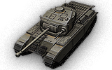<figcaption>Centurion Mk. I</figcaption></figure>
<strong>Penetration (mm)</strong> <b>EU</b>  AP <strong>226</strong> /  APCR <strong>258</strong> /  HE <strong>42</strong> → <b>RU</b>  AP <strong>226</strong> /  APCR <strong>258</strong> /  HE <strong>84</strong>

<em>Firepower</em> 
<strong>DPM (HP/min)</strong> <small>EU</small> 2 248.97  <small>RU</small> <strong>2 214.37</strong> 
<strong>Module damage</strong> <small>EU</small> 113  <small>RU</small> <strong>118</strong> 
<strong>Rate of fire (rounds/min)</strong> <small>EU</small> 9.78  <small>RU</small> <strong>9.63</strong> 
<strong>Reload time (s)</strong> <small>EU</small> 6.14  <small>RU</small> <strong>6.23</strong> 

<em>Gun handling</em> 
<strong>Aim time (s)</strong> <small>EU</small> 2.21  <small>RU</small> <strong>1.82</strong> 
<strong>Dispersion · moving</strong> <small>EU</small> 0.14  <small>RU</small> <strong>0.12</strong> 
<strong>Dispersion · tank traverse</strong> <small>EU</small> 0.14  <small>RU</small> <strong>0.12</strong> 
<strong>Dispersion · turret traverse</strong> <small>EU</small> 0.12  <small>RU</small> <strong>0.10</strong> 

<em>Mobility</em> 
<strong>Forward speed on soft terrain (km/h)</strong> <small>EU</small> 37.91  <small>RU</small> <strong>35.36</strong> 
<strong>Engine power (hp)</strong> <small>EU</small> 850  <small>RU</small> <strong>792.96</strong> 
<strong>Power/weight (hp/t)</strong> <small>EU</small> 18.92  <small>RU</small> <strong>17.65</strong> 
<strong>Tank traverse on hard terrain (°/s)</strong> <small>EU</small> 37.75  <small>RU</small> <strong>42.05</strong> 
<strong>Tank traverse on medium terrain (°/s)</strong> <small>EU</small> 34.32  <small>RU</small> <strong>38.22</strong> 
<strong>Tank traverse on soft terrain (°/s)</strong> <small>EU</small> 19.87  <small>RU</small> <strong>22.13</strong> 

<em>Armor &amp; health</em> 
<strong>Health</strong> <small>EU</small> 1 600  <small>RU</small> <strong>1 450</strong> 

Charioteer · Tier VIII

charioteer

<a href="https://tanks.gg/v20410/tank/charioteer">EU stats</a> · <a href="https://tanks.gg/v14600ru/tank/charioteer">RU stats</a>
<figure style="display:inline-block">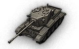<figcaption>Charioteer</figcaption></figure>
<em>Gun handling</em> 
<strong>Aim time (s)</strong> <small>EU</small> 2.30  <small>RU</small> <strong>2.35</strong> 
<strong>Dispersion · damaged</strong> <small>EU</small> 0.67  <small>RU</small> <strong>0.69</strong> 
<strong>Dispersion · moving</strong> <small>EU</small> 0.25  <small>RU</small> <strong>0.28</strong> 
<strong>Dispersion · tank traverse</strong> <small>EU</small> 0.25  <small>RU</small> <strong>0.28</strong> 

<em>Mobility</em> 
<strong>Forward speed on soft terrain (km/h)</strong> <small>EU</small> 48.90  <small>RU</small> <strong>48</strong> 
<strong>Engine power (hp)</strong> <small>EU</small> 700  <small>RU</small> <strong>687.23</strong> 
<strong>Power/weight (hp/t)</strong> <small>EU</small> 23.13  <small>RU</small> <strong>22.70</strong> 
<strong>Turret traverse (°/s)</strong> <small>EU</small> 18.77  <small>RU</small> <strong>18.39</strong> 
<strong>Tank traverse (°/s)</strong> <small>EU</small> 43.81  <small>RU</small> <strong>37.55</strong> 
<strong>Tank traverse on hard terrain (°/s)</strong> <small>EU</small> 44.14  <small>RU</small> <strong>38.59</strong> 
<strong>Tank traverse on medium terrain (°/s)</strong> <small>EU</small> 39.72  <small>RU</small> <strong>34.73</strong> 
<strong>Tank traverse on soft terrain (°/s)</strong> <small>EU</small> 22.07  <small>RU</small> <strong>19.30</strong> 

<em>Armor &amp; health</em> 
<strong>Health</strong> <small>EU</small> 1 200  <small>RU</small> <strong>1 050</strong> 

Chieftain/T95 · Tier VIII

chieftaint95

<a href="https://tanks.gg/v20410/tank/chieftaint95">EU stats</a> · <a href="https://tanks.gg/v14600ru/tank/chieftaint95">RU stats</a>
<figure style="display:inline-block">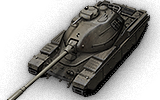<figcaption>Chieftain/T95</figcaption></figure>
<strong>Penetration (mm)</strong> <b>EU</b>  AP <strong>202</strong> /  APCR <strong>238</strong> /  HE <strong>45</strong> → <b>RU</b>  APCR <strong>238</strong> /  HEAT <strong>270</strong> /  HE <strong>45</strong>

<strong>Damage (HP)</strong> <b>EU</b>  AP <strong>240</strong> /  APCR <strong>240</strong> /  HE <strong>320</strong> → <b>RU</b>  APCR <strong>240</strong> /  HEAT <strong>240</strong> /  HE <strong>320</strong>

<em>Firepower</em> 
<strong>Shell velocity (m/s)</strong> <small>EU</small> 1 143  <small>RU</small> <strong>1 570</strong> 
<strong>Normalization</strong> <small>EU</small> 5  <small>RU</small> <strong>2</strong> 

<em>Mobility</em> 
<strong>Forward speed (km/h)</strong> <small>EU</small> 42  <small>RU</small> <strong>45</strong> 
<strong>Forward speed on hard terrain (km/h)</strong> <small>EU</small> 42  <small>RU</small> <strong>45</strong> 
<strong>Forward speed on medium terrain (km/h)</strong> <small>EU</small> 42  <small>RU</small> <strong>45</strong> 
<strong>Reverse speed (km/h)</strong> <small>EU</small> 15  <small>RU</small> <strong>18</strong> 

<em>Miscellaneous</em> 
<strong>Shell cost</strong> <small>EU</small> 350  <small>RU</small> <strong>420</strong> 

Crusher · Tier VIII

crusher

<a href="https://tanks.gg/v20410/tank/crusher">EU stats</a> · <a href="https://tanks.gg/v14600ru/tank/crusher">RU stats</a>
<figure style="display:inline-block">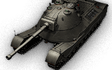<figcaption>EU · Crusher</figcaption></figure><figure style="display:inline-block">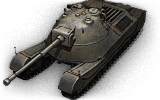<figcaption>RU · Crusher</figcaption></figure>
<strong>Penetration (mm)</strong> <b>EU</b>  AP <strong>215</strong> /  APCR <strong>252</strong> /  HE <strong>57</strong> → <b>RU</b>  APCR <strong>221</strong> /  HEAT <strong>250</strong> /  HE <strong>57</strong>

<strong>Damage (HP)</strong> <b>EU</b>  AP <strong>350</strong> /  APCR <strong>350</strong> /  HE <strong>500</strong> → <b>RU</b>  APCR <strong>380</strong> /  HEAT <strong>380</strong> /  HE <strong>510</strong>

<em>Firepower</em> 
<strong>DPM (HP/min)</strong> <small>EU</small> 2 086  <small>RU</small> <strong>1 917.77</strong> 
<strong>Rate of fire (rounds/min)</strong> <small>EU</small> 5.96  <small>RU</small> <strong>5.05</strong> 
<strong>Reload time (s)</strong> <small>EU</small> 10.07  <small>RU</small> <strong>11.89</strong> 
<strong>Shell velocity (m/s)</strong> <small>EU</small> 850  <small>RU</small> <strong>1 400</strong> 
<strong>Normalization</strong> <small>EU</small> 5  <small>RU</small> <strong>2</strong> 
<strong>Ammo capacity</strong> <small>EU</small> 50  <small>RU</small> <strong>54</strong> 
<strong>Potential damage</strong> <small>EU</small> 17 500  <small>RU</small> <strong>20 520</strong> 

<em>Gun handling</em> 
<strong>Aim time (s)</strong> <small>EU</small> 2.21  <small>RU</small> <strong>2.59</strong> 
<strong>Dispersion (m/100 m)</strong> <small>EU</small> 0.36  <small>RU</small> <strong>0.35</strong> 
<strong>Dispersion · damaged</strong> <small>EU</small> 0.73  <small>RU</small> <strong>0.69</strong> 
<strong>Dispersion · moving</strong> <small>EU</small> 0.16  <small>RU</small> <strong>0.18</strong> 
<strong>Dispersion · tank traverse</strong> <small>EU</small> 0.16  <small>RU</small> <strong>0.18</strong> 
<strong>Dispersion · turret traverse</strong> <small>EU</small> 0.10  <small>RU</small> <strong>0.12</strong> 
<strong>Depression (°)</strong> <small>EU</small> 10  <small>RU</small> <strong>9</strong> 

<em>Mobility</em> 
<strong>Forward speed (km/h)</strong> <small>EU</small> 24  <small>RU</small> <strong>25</strong> 
<strong>Forward speed on hard terrain (km/h)</strong> <small>EU</small> 24  <small>RU</small> <strong>25</strong> 
<strong>Forward speed on medium terrain (km/h)</strong> <small>EU</small> 24  <small>RU</small> <strong>25</strong> 
<strong>Reverse speed (km/h)</strong> <small>EU</small> 12  <small>RU</small> <strong>14</strong> 
<strong>Weight (kg)</strong> <small>EU</small> 72 000 → <small>RU</small> <strong>72 002</strong> 
<strong>Turret traverse (°/s)</strong> <small>EU</small> 23.99  <small>RU</small> <strong>29.20</strong> 
<strong>Tank traverse (°/s)</strong> <small>EU</small> 25.03  <small>RU</small> <strong>29.20</strong> 
<strong>Tank traverse on hard terrain (°/s)</strong> <small>EU</small> 23.78  <small>RU</small> <strong>27.74</strong> 
<strong>Tank traverse on medium terrain (°/s)</strong> <small>EU</small> 20.12  <small>RU</small> <strong>23.48</strong> 
<strong>Tank traverse on soft terrain (°/s)</strong> <small>EU</small> 11.37  <small>RU</small> <strong>13.27</strong> 

<em>Armor &amp; health</em> 
<strong>Hull armor · side (mm)</strong> <small>EU</small> 80  <small>RU</small> <strong>76</strong> 
<strong>Hull armor · rear (mm)</strong> <small>EU</small> 80  <small>RU</small> <strong>76</strong> 
<strong>Turret armor · front (mm)</strong> <small>EU</small> 230  <small>RU</small> <strong>245</strong> 
<strong>Turret armor · side (mm)</strong> <small>EU</small> 130  <small>RU</small> <strong>160</strong> 
<strong>Turret armor · rear (mm)</strong> <small>EU</small> 80  <small>RU</small> <strong>160</strong> 
<strong>Health</strong> <small>EU</small> 1 400  <small>RU</small> <strong>1 500</strong> 

<em>Miscellaneous</em> 
<strong>Stationary camo</strong> <small>EU</small> 3.82  <small>RU</small> <strong>4.16</strong> 
<strong>Stationary camo · after firing</strong> <small>EU</small> 0.80  <small>RU</small> <strong>0.87</strong> 
<strong>Moving camo</strong> <small>EU</small> 1.94  <small>RU</small> <strong>2.05</strong> 
<strong>Moving camo · after firing</strong> <small>EU</small> 0.41  <small>RU</small> <strong>0.43</strong> 
<strong>View range (m)</strong> <small>EU</small> 360  <small>RU</small> <strong>380</strong> 
<strong>Radio range (m)</strong> <small>EU</small> 782.25  <small>RU</small> <strong>730.10</strong> 
<strong>Shell cost</strong> <small>EU</small> 710  <small>RU</small> <strong>1 050</strong> 

FV1066 Senlac · Tier VIII

fv1066senlac

<a href="https://tanks.gg/v20410/tank/senlac">EU stats</a> · <a href="https://tanks.gg/v14600ru/tank/senlac">RU stats</a>
<figure style="display:inline-block">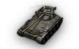<figcaption>FV1066 Senlac</figcaption></figure>
<em>Firepower</em> 
<strong>DPM (HP/min)</strong> <small>EU</small> 2 048.07  <small>RU</small> <strong>2 005.85</strong> 
<strong>Rate of fire (rounds/min)</strong> <small>EU</small> 11.38  <small>RU</small> <strong>11.14</strong> 
<strong>Reload time (s)</strong> <small>EU</small> 5.27  <small>RU</small> <strong>5.38</strong> 

FV207 · Tier VIII

fv207

<a href="https://tanks.gg/v20410/tank/fv207">EU stats</a> · <a href="https://tanks.gg/v14600ru/tank/fv207">RU stats</a>
<figure style="display:inline-block">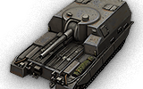<figcaption>FV207</figcaption></figure>
<strong>Penetration (mm)</strong> <b>EU</b>  HE <strong>38</strong> /  HE <strong>48</strong> /  AP <strong>254</strong> → <b>RU</b>  HE <strong>38</strong> /  AP <strong>254</strong>

<strong>Damage (HP)</strong> <b>EU</b>  HE <strong>650</strong> /  HE <strong>800</strong> /  AP <strong>480</strong> → <b>RU</b>  HE <strong>800</strong> /  AP <strong>500</strong>

<em>Firepower</em> 
<strong>DPM (HP/min)</strong> <small>EU</small> 1 422.27  <small>RU</small> <strong>1 788</strong> 
<strong>Rate of fire (rounds/min)</strong> <small>EU</small> 2.19  <small>RU</small> <strong>2.24</strong> 
<strong>Reload time (s)</strong> <small>EU</small> 27.42  <small>RU</small> <strong>26.85</strong> 
<strong>Explosion radius</strong> <small>EU</small> 7.60  <small>RU</small> <strong>6.30</strong> 
<strong>Stun duration · maximum (s)</strong> <small>EU</small> 25 → <small>RU</small> <strong>—</strong> 
<strong>Stun duration · minimum (s)</strong> <small>EU</small> 12.50 → <small>RU</small> <strong>—</strong> 
<strong>Shell velocity (m/s)</strong> <small>EU</small> 480  <small>RU</small> <strong>340</strong> 
<strong>Max range (m)</strong> <small>EU</small> 1 404.88  <small>RU</small> <strong>1 005.22</strong> 
<strong>Potential damage</strong> <small>EU</small> 31 200  <small>RU</small> <strong>38 400</strong> 

<em>Gun handling</em> 
<strong>Aim time (s)</strong> <small>EU</small> 3.84  <small>RU</small> <strong>4.31</strong> 
<strong>Dispersion · turret traverse</strong> <small>EU</small> 0.42  <small>RU</small> <strong>0.44</strong> 

<em>Mobility</em> 
<strong>Tank traverse (°/s)</strong> <small>EU</small> 26.08  <small>RU</small> <strong>20.86</strong> 
<strong>Tank traverse on hard terrain (°/s)</strong> <small>EU</small> 26.16  <small>RU</small> <strong>20.93</strong> 
<strong>Tank traverse on medium terrain (°/s)</strong> <small>EU</small> 22.67  <small>RU</small> <strong>18.14</strong> 
<strong>Tank traverse on soft terrain (°/s)</strong> <small>EU</small> 13.60  <small>RU</small> <strong>10.88</strong> 

<em>Armor &amp; health</em> 
<strong>Health · track</strong> <small>EU</small> 220  <small>RU</small> <strong>140</strong> 
<strong>Health · ammo rack</strong> <small>EU</small> 210  <small>RU</small> <strong>134</strong> 
<strong>Track repair time (s)</strong> <small>EU</small> 11.70  <small>RU</small> <strong>12.81</strong> 

<em>Miscellaneous</em> 
<strong>Moving camo</strong> <small>EU</small> 3.88  <small>RU</small> <strong>3.82</strong> 
<strong>Shell cost</strong> <small>EU</small> 1 220  <small>RU</small> <strong>1 430</strong> 

FV4202 · Tier VIII

fv4202

<a href="https://tanks.gg/v20410/tank/fv4202-p">EU stats</a> · <a href="https://tanks.gg/v14600ru/tank/fv4202-p">RU stats</a>
<figure style="display:inline-block">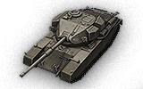<figcaption>FV4202</figcaption></figure>
<em>Firepower</em> 
<strong>DPM (HP/min)</strong> <small>EU</small> 1 919.12  <small>RU</small> <strong>2 086</strong> 
<strong>Rate of fire (rounds/min)</strong> <small>EU</small> 8.34  <small>RU</small> <strong>9.07</strong> 
<strong>Reload time (s)</strong> <small>EU</small> 7.19  <small>RU</small> <strong>6.62</strong> 

<em>Gun handling</em> 
<strong>Aim time (s)</strong> <small>EU</small> 2.21  <small>RU</small> <strong>1.82</strong> 
<strong>Dispersion · moving</strong> <small>EU</small> 0.14  <small>RU</small> <strong>0.12</strong> 
<strong>Dispersion · tank traverse</strong> <small>EU</small> 0.14  <small>RU</small> <strong>0.12</strong> 
<strong>Dispersion · turret traverse</strong> <small>EU</small> 0.16  <small>RU</small> <strong>0.12</strong> 

<em>Mobility</em> 
<strong>Forward speed on soft terrain (km/h)</strong> <small>EU</small> 49.56  <small>RU</small> <strong>50</strong> 
<strong>Engine power (hp)</strong> <small>EU</small> 650  <small>RU</small> <strong>800</strong> 
<strong>Power/weight (hp/t)</strong> <small>EU</small> 15.63  <small>RU</small> <strong>19.23</strong> 
<strong>Turret traverse (°/s)</strong> <small>EU</small> 37.55  <small>RU</small> <strong>50.06</strong> 
<strong>Tank traverse (°/s)</strong> <small>EU</small> 41.72  <small>RU</small> <strong>52.15</strong> 
<strong>Tank traverse on hard terrain (°/s)</strong> <small>EU</small> 39.63  <small>RU</small> <strong>49.54</strong> 
<strong>Tank traverse on medium terrain (°/s)</strong> <small>EU</small> 33.97  <small>RU</small> <strong>42.47</strong> 
<strong>Tank traverse on soft terrain (°/s)</strong> <small>EU</small> 19.82  <small>RU</small> <strong>24.77</strong> 

FV4202 FL · Tier VIII

fv4202fl

<a href="https://tanks.gg/v20410/tank/fv4202-fl">EU stats</a> · <a href="https://tanks.gg/v14600ru/tank/fv4202-fl">RU stats</a>
<figure style="display:inline-block"><figcaption>FV4202 FL</figcaption></figure>
<em>Firepower</em> 
<strong>DPM (HP/min)</strong> <small>EU</small> 1 919.12  <small>RU</small> <strong>2 086</strong> 
<strong>Rate of fire (rounds/min)</strong> <small>EU</small> 8.34  <small>RU</small> <strong>9.07</strong> 
<strong>Reload time (s)</strong> <small>EU</small> 7.19  <small>RU</small> <strong>6.62</strong> 

<em>Gun handling</em> 
<strong>Aim time (s)</strong> <small>EU</small> 2.21  <small>RU</small> <strong>1.82</strong> 
<strong>Dispersion · moving</strong> <small>EU</small> 0.14  <small>RU</small> <strong>0.12</strong> 
<strong>Dispersion · tank traverse</strong> <small>EU</small> 0.14  <small>RU</small> <strong>0.12</strong> 
<strong>Dispersion · turret traverse</strong> <small>EU</small> 0.16  <small>RU</small> <strong>0.12</strong> 

<em>Mobility</em> 
<strong>Forward speed on soft terrain (km/h)</strong> <small>EU</small> 49.56  <small>RU</small> <strong>50</strong> 
<strong>Engine power (hp)</strong> <small>EU</small> 650  <small>RU</small> <strong>800</strong> 
<strong>Power/weight (hp/t)</strong> <small>EU</small> 15.63  <small>RU</small> <strong>19.23</strong> 
<strong>Turret traverse (°/s)</strong> <small>EU</small> 37.55  <small>RU</small> <strong>50.06</strong> 
<strong>Tank traverse (°/s)</strong> <small>EU</small> 41.72  <small>RU</small> <strong>52.15</strong> 
<strong>Tank traverse on hard terrain (°/s)</strong> <small>EU</small> 39.63  <small>RU</small> <strong>49.54</strong> 
<strong>Tank traverse on medium terrain (°/s)</strong> <small>EU</small> 33.97  <small>RU</small> <strong>42.47</strong> 
<strong>Tank traverse on soft terrain (°/s)</strong> <small>EU</small> 19.82  <small>RU</small> <strong>24.77</strong> 

FV601 Saladin · Tier VIII

fv601saladin

<a href="https://tanks.gg/v20410/tank/saladin">EU stats</a> · <a href="https://tanks.gg/v14600ru/tank/saladin">RU stats</a>
<figure style="display:inline-block">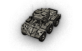<figcaption>EU · FV601 Saladin</figcaption></figure><figure style="display:inline-block"><figcaption>RU · FV601 Saladin</figcaption></figure>
<strong>Damage (HP)</strong> <b>EU</b>  AP <strong>280</strong> /  APCR <strong>280</strong> /  HE <strong>370</strong> → <b>RU</b>  AP <strong>250</strong> /  APCR <strong>250</strong> /  HE <strong>320</strong>

<em>Firepower</em> 
<strong>DPM (HP/min)</strong> <small>EU</small> 2 086  <small>RU</small> <strong>1 915.31</strong> 
<strong>Rate of fire (rounds/min)</strong> <small>EU</small> 7.45  <small>RU</small> <strong>7.66</strong> 
<strong>Reload time (s)</strong> <small>EU</small> 8.05  <small>RU</small> <strong>7.83</strong> 
<strong>Shell velocity (m/s)</strong> <small>EU</small> 1 100  <small>RU</small> <strong>980</strong> 
<strong>Potential damage</strong> <small>EU</small> 14 000  <small>RU</small> <strong>12 500</strong> 

<em>Mobility</em> 
<strong>Forward speed (km/h)</strong> <small>EU</small> 65  <small>RU</small> <strong>60</strong> 
<strong>Forward speed on hard terrain (km/h)</strong> <small>EU</small> 65  <small>RU</small> <strong>60</strong> 
<strong>Forward speed on medium terrain (km/h)</strong> <small>EU</small> 65  <small>RU</small> <strong>60</strong> 
<strong>Forward speed on soft terrain (km/h)</strong> <small>EU</small> 47.80  <small>RU</small> <strong>60</strong> 
<strong>Terrain resist (hard)</strong> <small>EU</small> 0.96  <small>RU</small> <strong>0.12</strong> 
<strong>Terrain resist (med)</strong> <small>EU</small> 1.05  <small>RU</small> <strong>0.12</strong> 
<strong>Terrain resist (soft)</strong> <small>EU</small> 1.82  <small>RU</small> <strong>0.12</strong> 
<strong>Tank traverse (°/s)</strong> <small>EU</small> 31.29  <small>RU</small> <strong>62.58</strong> 
<strong>Tank traverse on hard terrain (°/s)</strong> <small>EU</small> 28.37  <small>RU</small> <strong>56.74</strong> 
<strong>Tank traverse on medium terrain (°/s)</strong> <small>EU</small> 25.79  <small>RU</small> <strong>56.74</strong> 
<strong>Tank traverse on soft terrain (°/s)</strong> <small>EU</small> 14.93  <small>RU</small> <strong>56.74</strong> 

<em>Armor &amp; health</em> 
<strong>Health</strong> <small>EU</small> 1 450  <small>RU</small> <strong>1 200</strong> 

GSOR 1008 · Tier VIII

gsor1008

<a href="https://tanks.gg/v20410/tank/gsor-1008">EU stats</a> · <a href="https://tanks.gg/v14600ru/tank/gsor-1008">RU stats</a>
<figure style="display:inline-block">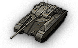<figcaption>GSOR 1008</figcaption></figure>
<em>Firepower</em> 
<strong>DPM (HP/min)</strong> <small>EU</small> 1 562.73  <small>RU</small> <strong>1 534.38</strong> 
<strong>Rate of fire (rounds/min)</strong> <small>EU</small> 4.88  <small>RU</small> <strong>4.79</strong> 
<strong>Reload time (s)</strong> <small>EU</small> 43.14  <small>RU</small> <strong>44.05</strong> 

GSOR 1010 FB · Tier VIII

gsor1010fb

<a href="https://tanks.gg/v20410/tank/gsor-1010">EU stats</a> · <a href="https://tanks.gg/v14600ru/tank/gsor-1010">RU stats</a>
<figure style="display:inline-block">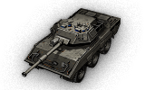<figcaption>GSOR 1010 FB</figcaption></figure>
<em>Firepower</em> 
<strong>DPM (HP/min)</strong> <small>EU</small> 1 846.62  <small>RU</small> <strong>1 808.56</strong> 
<strong>Rate of fire (rounds/min)</strong> <small>EU</small> 5.13  <small>RU</small> <strong>5.02</strong> 
<strong>Reload time (s)</strong> <small>EU</small> 11.70  <small>RU</small> <strong>11.94</strong> 

<em>Mobility</em> 
<strong>Terrain resist (hard)</strong> <small>EU</small> 0.67  <small>RU</small> <strong>0.12</strong> 
<strong>Terrain resist (med)</strong> <small>EU</small> 0.77  <small>RU</small> <strong>0.12</strong> 
<strong>Terrain resist (soft)</strong> <small>EU</small> 1.34  <small>RU</small> <strong>0.12</strong> 
<strong>Tank traverse (°/s)</strong> <small>EU</small> 31.29  <small>RU</small> <strong>62.58</strong> 
<strong>Tank traverse on hard terrain (°/s)</strong> <small>EU</small> 29.73  <small>RU</small> <strong>59.45</strong> 
<strong>Tank traverse on medium terrain (°/s)</strong> <small>EU</small> 26.01  <small>RU</small> <strong>59.45</strong> 
<strong>Tank traverse on soft terrain (°/s)</strong> <small>EU</small> 14.86  <small>RU</small> <strong>59.45</strong> 

LHMTV · Tier VIII

lhmtv

<a href="https://tanks.gg/v20410/tank/lhmtv">EU stats</a> · <a href="https://tanks.gg/v14600ru/tank/lhmtv">RU stats</a>
<figure style="display:inline-block">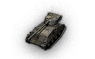<figcaption>LHMTV</figcaption></figure>
<em>Firepower</em> 
<strong>DPM (HP/min)</strong> <small>EU</small> 1 439.34  <small>RU</small> <strong>1 409.67</strong> 
<strong>Module damage</strong> <small>EU</small> 115  <small>RU</small> <strong>118</strong> 
<strong>Rate of fire (rounds/min)</strong> <small>EU</small> 6.26  <small>RU</small> <strong>6.13</strong> 
<strong>Reload time (s)</strong> <small>EU</small> 9.59  <small>RU</small> <strong>9.79</strong> 
<strong>Ammo capacity</strong> <small>EU</small> 33  <small>RU</small> <strong>25</strong> 
<strong>Potential damage</strong> <small>EU</small> 7 590  <small>RU</small> <strong>5 750</strong> 

<em>Mobility</em> 
<strong>Forward speed (km/h)</strong> <small>EU</small> 66  <small>RU</small> <strong>63</strong> 
<strong>Forward speed on hard terrain (km/h)</strong> <small>EU</small> 66  <small>RU</small> <strong>63</strong> 
<strong>Forward speed on medium terrain (km/h)</strong> <small>EU</small> 66  <small>RU</small> <strong>63</strong> 
<strong>Forward speed on soft terrain (km/h)</strong> <small>EU</small> 66  <small>RU</small> <strong>63</strong> 
<strong>Engine power (hp)</strong> <small>EU</small> 175  <small>RU</small> <strong>160</strong> 
<strong>Weight (kg)</strong> <small>EU</small> 4 617 → <small>RU</small> <strong>4 801</strong> 
<strong>Power/weight (hp/t)</strong> <small>EU</small> 37.90  <small>RU</small> <strong>33.33</strong> 
<strong>Tank traverse (°/s)</strong> <small>EU</small> 52.15  <small>RU</small> <strong>43.81</strong> 
<strong>Tank traverse on hard terrain (°/s)</strong> <small>EU</small> 55.64  <small>RU</small> <strong>44.83</strong> 
<strong>Tank traverse on medium terrain (°/s)</strong> <small>EU</small> 48.68  <small>RU</small> <strong>39.23</strong> 
<strong>Tank traverse on soft terrain (°/s)</strong> <small>EU</small> 27.82  <small>RU</small> <strong>22.41</strong> 

<em>Armor &amp; health</em> 
<strong>Track armor</strong> <small>EU</small> 10  <small>RU</small> <strong>15</strong> 
<strong>Health</strong> <small>EU</small> 1 250  <small>RU</small> <strong>1 050</strong> 

Nemesis · EU VIII → RU X

nemesis

<a href="https://tanks.gg/v20410/tank/nemesis">EU stats</a> · <a href="https://tanks.gg/v14600ru/tank/nemesis">RU stats</a>
<figure style="display:inline-block">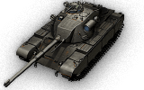<figcaption>EU · Nemesis</figcaption></figure><figure style="display:inline-block">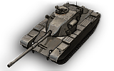<figcaption>RU · Nemesis</figcaption></figure>
<strong>Penetration (mm)</strong> <b>EU</b>  AP <strong>225</strong> /  APCR <strong>280</strong> /  HE <strong>90</strong> → <b>RU</b>  HE <strong>230</strong> /  HEAT <strong>330</strong> /  AP <strong>240</strong>

<strong>Damage (HP)</strong> <b>EU</b>  AP <strong>420</strong> /  APCR <strong>420</strong> /  HE <strong>530</strong> → <b>RU</b>  HE <strong>510</strong> /  HEAT <strong>430</strong> /  AP <strong>430</strong>

<em>General</em> 
<strong>Tier</strong> <small>EU</small> 8 → <small>RU</small> <strong>10</strong> 

<em>Firepower</em> 
<strong>DPM (HP/min)</strong> <small>EU</small> 1 546.09  <small>RU</small> <strong>2 799.63</strong> 
<strong>Rate of fire (rounds/min)</strong> <small>EU</small> 3.68  <small>RU</small> <strong>5.49</strong> 
<strong>Reload time (s)</strong> <small>EU</small> 16.30  <small>RU</small> <strong>10.93</strong> 
<strong>Shell velocity (m/s)</strong> <small>EU</small> 1 000  <small>RU</small> <strong>1 120</strong> 
<strong>Normalization</strong> <small>EU</small> 5  <small>RU</small> <strong>0</strong> 
<strong>Ricochet angle</strong> <small>EU</small> 70  <small>RU</small> <strong>90</strong> 
<strong>Ammo capacity</strong> <small>EU</small> 50  <small>RU</small> <strong>60</strong> 
<strong>Potential damage</strong> <small>EU</small> 21 000  <small>RU</small> <strong>30 600</strong> 
<strong>Explosion radius</strong> <small>EU</small> — → <small>RU</small> <strong>1.91</strong> 

<em>Gun handling</em> 
<strong>Aim time (s)</strong> <small>EU</small> 2.40  <small>RU</small> <strong>2.01</strong> 
<strong>Dispersion (m/100 m)</strong> <small>EU</small> 0.36  <small>RU</small> <strong>0.33</strong> 
<strong>Dispersion · damaged</strong> <small>EU</small> 0.73  <small>RU</small> <strong>0.65</strong> 
<strong>Dispersion · moving</strong> <small>EU</small> 0.21  <small>RU</small> <strong>0.16</strong> 
<strong>Dispersion · tank traverse</strong> <small>EU</small> 0.21  <small>RU</small> <strong>0.16</strong> 
<strong>Dispersion · turret traverse</strong> <small>EU</small> 0.15  <small>RU</small> <strong>0.08</strong> 
<strong>Dispersion · firing</strong> <small>EU</small> 3.50  <small>RU</small> <strong>4</strong> 
<strong>Depression (°)</strong> <small>EU</small> 10  <small>RU</small> <strong>8</strong> 

<em>Mobility</em> 
<strong>Forward speed (km/h)</strong> <small>EU</small> 40  <small>RU</small> <strong>45</strong> 
<strong>Forward speed on hard terrain (km/h)</strong> <small>EU</small> 40  <small>RU</small> <strong>45</strong> 
<strong>Forward speed on medium terrain (km/h)</strong> <small>EU</small> 40  <small>RU</small> <strong>45</strong> 
<strong>Forward speed on soft terrain (km/h)</strong> <small>EU</small> 40  <small>RU</small> <strong>45</strong> 
<strong>Reverse speed (km/h)</strong> <small>EU</small> 16  <small>RU</small> <strong>20</strong> 
<strong>Engine power (hp)</strong> <small>EU</small> 650  <small>RU</small> <strong>940</strong> 
<strong>Power/weight (hp/t)</strong> <small>EU</small> 16.21  <small>RU</small> <strong>23.44</strong> 
<strong>Terrain resist (hard)</strong> <small>EU</small> 0.38  <small>RU</small> <strong>0.96</strong> 
<strong>Terrain resist (med)</strong> <small>EU</small> 0.48  <small>RU</small> <strong>1.05</strong> 
<strong>Terrain resist (soft)</strong> <small>EU</small> 0.96  <small>RU</small> <strong>1.82</strong> 
<strong>Turret traverse (°/s)</strong> <small>EU</small> 31.29  <small>RU</small> <strong>45.89</strong> 
<strong>Tank traverse (°/s)</strong> <small>EU</small> 36.50  <small>RU</small> <strong>57.36</strong> 
<strong>Tank traverse on hard terrain (°/s)</strong> <small>EU</small> 34.68  <small>RU</small> <strong>54.50</strong> 
<strong>Tank traverse on medium terrain (°/s)</strong> <small>EU</small> 27.74  <small>RU</small> <strong>49.54</strong> 
<strong>Tank traverse on soft terrain (°/s)</strong> <small>EU</small> 13.87  <small>RU</small> <strong>28.68</strong> 

<em>Armor &amp; health</em> 
<strong>Hull armor · front (mm)</strong> <small>EU</small> 70  <small>RU</small> <strong>135</strong> 
<strong>Hull armor · side (mm)</strong> <small>EU</small> 50.80  <small>RU</small> <strong>80</strong> 
<strong>Hull armor · rear (mm)</strong> <small>EU</small> 38.10  <small>RU</small> <strong>60</strong> 
<strong>Turret armor · front (mm)</strong> <small>EU</small> 254  <small>RU</small> <strong>300</strong> 
<strong>Turret armor · side (mm)</strong> <small>EU</small> 76.20  <small>RU</small> <strong>60</strong> 
<strong>Turret armor · rear (mm)</strong> <small>EU</small> 50.80  <small>RU</small> <strong>60</strong> 
<strong>Track armor</strong> <small>EU</small> 20  <small>RU</small> <strong>25</strong> 
<strong>Health</strong> <small>EU</small> 1 300  <small>RU</small> <strong>1 950</strong> 
<strong>Health · engine</strong> <small>EU</small> 247  <small>RU</small> <strong>320</strong> 
<strong>Health · track</strong> <small>EU</small> 200  <small>RU</small> <strong>250</strong> 
<strong>Health · ammo rack</strong> <small>EU</small> 220  <small>RU</small> <strong>260</strong> 
<strong>Health · fuel tank</strong> <small>EU</small> 175  <small>RU</small> <strong>200</strong> 
<strong>Track repair time (s)</strong> <small>EU</small> 10.03  <small>RU</small> <strong>12.03</strong> 

<em>Miscellaneous</em> 
<strong>Stationary camo</strong> <small>EU</small> 10.72  <small>RU</small> <strong>13.68</strong> 
<strong>Stationary camo · after firing</strong> <small>EU</small> 2.24  <small>RU</small> <strong>2.86</strong> 
<strong>Moving camo</strong> <small>EU</small> 8.04  <small>RU</small> <strong>10.26</strong> 
<strong>Moving camo · after firing</strong> <small>EU</small> 1.68  <small>RU</small> <strong>2.14</strong> 
<strong>View range (m)</strong> <small>EU</small> 380  <small>RU</small> <strong>410</strong> 
<strong>Radio range (m)</strong> <small>EU</small> 782.25  <small>RU</small> <strong>730.10</strong> 
<strong>Fire chance (%)</strong> <small>EU</small> 15  <small>RU</small> <strong>20</strong> 
<strong>Shell cost</strong> <small>EU</small> 1 065  <small>RU</small> <strong>1 560</strong> 

