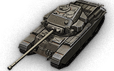
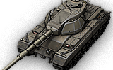
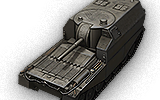
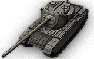
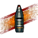
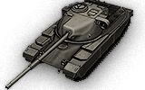
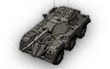
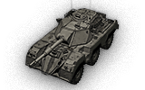
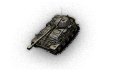
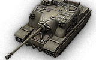

# United Kingdom · Tier IX

[All nations and tiers](../buffs_nerfs.md) · EU v20410 → RU v14600ru · 3 November 2026

<label><strong>Find a tank</strong><input type="search" placeholder="Try is7, obj140 or xm57" aria-label="Find a tank" style="display:block;width:100%;padding:.7rem;border:1px solid #888;border-radius:4px;margin:.5rem 0;color:inherit;background:transparent"></label>

Centurion Mk. 7/1 · Tier IX

centurionmk71

<a href="https://tanks.gg/v20410/tank/centurion-71">EU stats</a> · <a href="https://tanks.gg/v14600ru/tank/centurion-71">RU stats</a>
<figure style="display:inline-block"><figcaption>Centurion Mk. 7/1</figcaption></figure>
<em>Mobility</em> 
<strong>Forward speed on soft terrain (km/h)</strong> <small>EU</small> 39.91  <small>RU</small> <strong>38.54</strong> 
<strong>Engine power (hp)</strong> <small>EU</small> 1 040  <small>RU</small> <strong>1 004.42</strong> 
<strong>Power/weight (hp/t)</strong> <small>EU</small> 19.92  <small>RU</small> <strong>19.24</strong> 
<strong>Tank traverse on hard terrain (°/s)</strong> <small>EU</small> 36.55  <small>RU</small> <strong>45.68</strong> 
<strong>Tank traverse on medium terrain (°/s)</strong> <small>EU</small> 33.23  <small>RU</small> <strong>41.52</strong> 
<strong>Tank traverse on soft terrain (°/s)</strong> <small>EU</small> 19.24  <small>RU</small> <strong>24.04</strong> 

<em>Armor &amp; health</em> 
<strong>Health</strong> <small>EU</small> 1 800  <small>RU</small> <strong>1 720</strong> 

Conqueror · Tier IX

conqueror

<a href="https://tanks.gg/v20410/tank/conqueror">EU stats</a> · <a href="https://tanks.gg/v14600ru/tank/conqueror">RU stats</a>
<figure style="display:inline-block"><figcaption>Conqueror</figcaption></figure>
<em>Mobility</em> 
<strong>Forward speed on soft terrain (km/h)</strong> <small>EU</small> 25.14  <small>RU</small> <strong>23.89</strong> 
<strong>Engine power (hp)</strong> <small>EU</small> 1 000  <small>RU</small> <strong>950</strong> 
<strong>Power/weight (hp/t)</strong> <small>EU</small> 15.19  <small>RU</small> <strong>14.44</strong> 
<strong>Tank traverse (°/s)</strong> <small>EU</small> 34.42  <small>RU</small> <strong>27.12</strong> 
<strong>Tank traverse on hard terrain (°/s)</strong> <small>EU</small> 35.95  <small>RU</small> <strong>35.24</strong> 
<strong>Tank traverse on medium terrain (°/s)</strong> <small>EU</small> 30.42  <small>RU</small> <strong>29.82</strong> 
<strong>Tank traverse on soft terrain (°/s)</strong> <small>EU</small> 17.19  <small>RU</small> <strong>16.85</strong> 

<em>Armor &amp; health</em> 
<strong>Health</strong> <small>EU</small> 2 000  <small>RU</small> <strong>1 950</strong> 

<em>Miscellaneous</em> 
<strong>Moving camo</strong> <small>EU</small> 2.28  <small>RU</small> <strong>2.22</strong> 
<strong>Moving camo · after firing</strong> <small>EU</small> 0.43  <small>RU</small> <strong>0.42</strong> 

Conqueror FL · Tier IX

conquerorfl

<a href="https://tanks.gg/v20410/tank/conqueror-fl">EU stats</a> · <a href="https://tanks.gg/v14600ru/tank/conqueror-fl">RU stats</a>
<figure style="display:inline-block"><figcaption>Conqueror FL</figcaption></figure>
<em>Mobility</em> 
<strong>Forward speed on soft terrain (km/h)</strong> <small>EU</small> 25.14  <small>RU</small> <strong>23.89</strong> 
<strong>Engine power (hp)</strong> <small>EU</small> 1 000  <small>RU</small> <strong>950</strong> 
<strong>Power/weight (hp/t)</strong> <small>EU</small> 15.19  <small>RU</small> <strong>14.44</strong> 
<strong>Tank traverse (°/s)</strong> <small>EU</small> 34.42  <small>RU</small> <strong>27.12</strong> 
<strong>Tank traverse on hard terrain (°/s)</strong> <small>EU</small> 32.70  <small>RU</small> <strong>25.76</strong> 
<strong>Tank traverse on medium terrain (°/s)</strong> <small>EU</small> 27.67  <small>RU</small> <strong>21.80</strong> 
<strong>Tank traverse on soft terrain (°/s)</strong> <small>EU</small> 15.64  <small>RU</small> <strong>12.32</strong> 

<em>Armor &amp; health</em> 
<strong>Health</strong> <small>EU</small> 2 000  <small>RU</small> <strong>1 950</strong> 

<em>Miscellaneous</em> 
<strong>Moving camo</strong> <small>EU</small> 2.28  <small>RU</small> <strong>2.22</strong> 
<strong>Moving camo · after firing</strong> <small>EU</small> 0.43  <small>RU</small> <strong>0.42</strong> 

FV3805 · Tier IX

fv3805

<a href="https://tanks.gg/v20410/tank/fv3805">EU stats</a> · <a href="https://tanks.gg/v14600ru/tank/fv3805">RU stats</a>
<figure style="display:inline-block"><figcaption>FV3805</figcaption></figure>
<strong>Penetration (mm)</strong> <b>EU</b>  HE <strong>46</strong> /  HE <strong>58</strong> /  AP <strong>306</strong> → <b>RU</b>  HE <strong>46</strong> /  AP <strong>306</strong>

<strong>Damage (HP)</strong> <b>EU</b>  HE <strong>850</strong> /  HE <strong>1000</strong> /  AP <strong>560</strong> → <b>RU</b>  HE <strong>1000</strong> /  AP <strong>600</strong>

<em>Firepower</em> 
<strong>DPM (HP/min)</strong> <small>EU</small> 1 437.65  <small>RU</small> <strong>1 840.59</strong> 
<strong>Rate of fire (rounds/min)</strong> <small>EU</small> 1.69  <small>RU</small> <strong>1.84</strong> 
<strong>Reload time (s)</strong> <small>EU</small> 35.47  <small>RU</small> <strong>32.60</strong> 
<strong>Explosion radius</strong> <small>EU</small> 9.50  <small>RU</small> <strong>7.20</strong> 
<strong>Stun duration · maximum (s)</strong> <small>EU</small> 28 → <small>RU</small> <strong>—</strong> 
<strong>Stun duration · minimum (s)</strong> <small>EU</small> 12.60 → <small>RU</small> <strong>—</strong> 
<strong>Shell velocity (m/s)</strong> <small>EU</small> 440  <small>RU</small> <strong>350</strong> 
<strong>Max range (m)</strong> <small>EU</small> 1 353.85  <small>RU</small> <strong>1 004.10</strong> 
<strong>Potential damage</strong> <small>EU</small> 40 800  <small>RU</small> <strong>48 000</strong> 

<em>Gun handling</em> 
<strong>Dispersion · turret traverse</strong> <small>EU</small> 0.47  <small>RU</small> <strong>0.42</strong> 

<em>Armor &amp; health</em> 
<strong>Health · track</strong> <small>EU</small> 240  <small>RU</small> <strong>150</strong> 
<strong>Track repair time (s)</strong> <small>EU</small> 11.70  <small>RU</small> <strong>12.63</strong> 

<em>Miscellaneous</em> 
<strong>Shell cost</strong> <small>EU</small> 1 830  <small>RU</small> <strong>2 080</strong> 

FV4004 Conway · Tier IX

fv4004conway

<a href="https://tanks.gg/v20410/tank/conway">EU stats</a> · <a href="https://tanks.gg/v14600ru/tank/conway">RU stats</a>
<figure style="display:inline-block"><figcaption>FV4004 Conway</figcaption></figure>
<strong>Penetration (mm)</strong> <b>EU</b>  AP <strong>260</strong> /  HE <strong>200</strong> /  HE <strong>70</strong> → <b>RU</b>  AP <strong>280</strong> /  HE <strong>210</strong> /  HE <strong>70</strong>

<strong>Damage (HP)</strong> <b>EU</b>  AP <strong>600</strong> /  HE <strong>770</strong> /  HE <strong>770</strong> → <b>RU</b>  AP <strong>600</strong> /  HE <strong>910</strong> /  HE <strong>910</strong>

<em>Firepower</em> 
<strong>Module damage</strong> <small>EU</small> 189  <small>RU</small> <strong>191</strong> 

<em>Gun handling</em> 
<strong>Dispersion · moving</strong> <small>EU</small> 0.27  <small>RU</small> <strong>0.30</strong> 
<strong>Dispersion · tank traverse</strong> <small>EU</small> 0.27  <small>RU</small> <strong>0.30</strong> 
<strong>Elevation (°)</strong> <small>EU</small> 15  <small>RU</small> <strong>10</strong> 

<em>Mobility</em> 
<strong>Forward speed (km/h)</strong> <small>EU</small> 50  <small>RU</small> <strong>40</strong> 
<strong>Forward speed on hard terrain (km/h)</strong> <small>EU</small> 50  <small>RU</small> <strong>40</strong> 
<strong>Forward speed on medium terrain (km/h)</strong> <small>EU</small> 50  <small>RU</small> <strong>40</strong> 
<strong>Reverse speed (km/h)</strong> <small>EU</small> 20  <small>RU</small> <strong>15</strong> 
<strong>Tank traverse (°/s)</strong> <small>EU</small> 45.89  <small>RU</small> <strong>29.20</strong> 
<strong>Tank traverse on hard terrain (°/s)</strong> <small>EU</small> 49.48  <small>RU</small> <strong>38.94</strong> 
<strong>Tank traverse on medium terrain (°/s)</strong> <small>EU</small> 44.98  <small>RU</small> <strong>35.40</strong> 
<strong>Tank traverse on soft terrain (°/s)</strong> <small>EU</small> 26.04  <small>RU</small> <strong>20.50</strong> 

FV4201 Chieftain Proto · Tier IX

fv4201chieftainproto

<a href="https://tanks.gg/v20410/tank/chieftain-p">EU stats</a> · <a href="https://tanks.gg/v14600ru/tank/chieftain-p">RU stats</a>
<figure style="display:inline-block"><figcaption>FV4201 Chieftain Proto</figcaption></figure>
<em>Firepower</em> 
<strong>DPM (HP/min)</strong> <small>EU</small> 2 086  <small>RU</small> <strong>2 215.22</strong> 
<strong>Rate of fire (rounds/min)</strong> <small>EU</small> 5.21  <small>RU</small> <strong>5.54</strong> 
<strong>Reload time (s)</strong> <small>EU</small> 11.51  <small>RU</small> <strong>10.83</strong> 

<em>Gun handling</em> 
<strong>Aim time (s)</strong> <small>EU</small> 2.59  <small>RU</small> <strong>2.21</strong> 
<strong>Dispersion · moving</strong> <small>EU</small> 0.22  <small>RU</small> <strong>0.16</strong> 
<strong>Dispersion · tank traverse</strong> <small>EU</small> 0.22  <small>RU</small> <strong>0.16</strong> 

GSOR 1006 Scheme 7 · Tier IX

gsor1006scheme7

<a href="https://tanks.gg/v20410/tank/gsor-10067">EU stats</a> · <a href="https://tanks.gg/v14600ru/tank/gsor-10067">RU stats</a>
<figure style="display:inline-block"><figcaption>EU · GSOR 1006 Scheme 7</figcaption></figure><figure style="display:inline-block"><figcaption>RU · GSOR 1006 Scheme 7</figcaption></figure>
<strong>Damage (HP)</strong> <b>EU</b>  AP <strong>420</strong> /  APCR <strong>420</strong> /  HE <strong>510</strong> → <b>RU</b>  AP <strong>390</strong> /  APCR <strong>390</strong> /  HE <strong>480</strong>

<em>Firepower</em> 
<strong>DPM (HP/min)</strong> <small>EU</small> 2 246.46  <small>RU</small> <strong>2 043</strong> 
<strong>Rate of fire (rounds/min)</strong> <small>EU</small> 5.35  <small>RU</small> <strong>5.24</strong> 
<strong>Reload time (s)</strong> <small>EU</small> 11.22  <small>RU</small> <strong>11.45</strong> 
<strong>Potential damage</strong> <small>EU</small> 16 800  <small>RU</small> <strong>15 600</strong> 

<em>Mobility</em> 
<strong>Forward speed on soft terrain (km/h)</strong> <small>EU</small> 48.71  <small>RU</small> <strong>65</strong> 
<strong>Terrain resist (hard)</strong> <small>EU</small> 0.96  <small>RU</small> <strong>0.12</strong> 
<strong>Terrain resist (med)</strong> <small>EU</small> 1.05  <small>RU</small> <strong>0.12</strong> 
<strong>Terrain resist (soft)</strong> <small>EU</small> 1.82  <small>RU</small> <strong>0.12</strong> 
<strong>Tank traverse (°/s)</strong> <small>EU</small> 36.50  <small>RU</small> <strong>67.80</strong> 
<strong>Tank traverse on hard terrain (°/s)</strong> <small>EU</small> 32.85  <small>RU</small> <strong>61.01</strong> 
<strong>Tank traverse on medium terrain (°/s)</strong> <small>EU</small> 29.86  <small>RU</small> <strong>61.01</strong> 
<strong>Tank traverse on soft terrain (°/s)</strong> <small>EU</small> 17.29  <small>RU</small> <strong>61.01</strong> 

<em>Armor &amp; health</em> 
<strong>Health</strong> <small>EU</small> 1 700  <small>RU</small> <strong>1 650</strong> 

GSOR 3301 AVR FS · Tier IX

gsor3301avrfs

<a href="https://tanks.gg/v20410/tank/avr-fs">EU stats</a> · <a href="https://tanks.gg/v14600ru/tank/gsor">RU stats</a>
<figure style="display:inline-block"><figcaption>GSOR 3301 AVR FS</figcaption></figure>
<em>Firepower</em> 
<strong>DPM (HP/min)</strong> <small>EU</small> 1 580.97  <small>RU</small> <strong>1 548.38</strong> 
<strong>Rate of fire (rounds/min)</strong> <small>EU</small> 6.59  <small>RU</small> <strong>6.45</strong> 
<strong>Reload time (s)</strong> <small>EU</small> 9.11  <small>RU</small> <strong>9.30</strong> 
<strong>Ammo capacity</strong> <small>EU</small> 38  <small>RU</small> <strong>25</strong> 
<strong>Potential damage</strong> <small>EU</small> 9 120  <small>RU</small> <strong>6 000</strong> 

<em>Mobility</em> 
<strong>Forward speed (km/h)</strong> <small>EU</small> 68  <small>RU</small> <strong>65</strong> 
<strong>Forward speed on hard terrain (km/h)</strong> <small>EU</small> 68  <small>RU</small> <strong>65</strong> 
<strong>Forward speed on medium terrain (km/h)</strong> <small>EU</small> 68  <small>RU</small> <strong>65</strong> 
<strong>Forward speed on soft terrain (km/h)</strong> <small>EU</small> 68  <small>RU</small> <strong>65</strong> 
<strong>Tank traverse on hard terrain (°/s)</strong> <small>EU</small> 46.01  <small>RU</small> <strong>70.46</strong> 
<strong>Tank traverse on medium terrain (°/s)</strong> <small>EU</small> 40.90  <small>RU</small> <strong>62.63</strong> 
<strong>Tank traverse on soft terrain (°/s)</strong> <small>EU</small> 26.29  <small>RU</small> <strong>40.26</strong> 

<em>Armor &amp; health</em> 
<strong>Track armor</strong> <small>EU</small> 10  <small>RU</small> <strong>15</strong> 
<strong>Health</strong> <small>EU</small> 1 450  <small>RU</small> <strong>1 250</strong> 

Tortoise · Tier IX

tortoise

<a href="https://tanks.gg/v20410/tank/tortoise">EU stats</a> · <a href="https://tanks.gg/v14600ru/tank/tortoise">RU stats</a>
<figure style="display:inline-block"><figcaption>Tortoise</figcaption></figure>
<em>Mobility</em> 
<strong>Tank traverse on hard terrain (°/s)</strong> <small>EU</small> 27.21  <small>RU</small> <strong>26.61</strong> 
<strong>Tank traverse on medium terrain (°/s)</strong> <small>EU</small> 23.58  <small>RU</small> <strong>23.06</strong> 
<strong>Tank traverse on soft terrain (°/s)</strong> <small>EU</small> 13.60  <small>RU</small> <strong>13.31</strong> 

<em>Armor &amp; health</em> 
<strong>Health</strong> <small>EU</small> 1 850  <small>RU</small> <strong>2 000</strong> 

