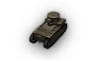

# USA · Tier I

[All nations and tiers](../buffs_nerfs.md) · EU v20410 → RU v14600ru · 3 November 2026

<label><strong>Find a tank</strong><input type="search" placeholder="Try is7, obj140 or xm57" aria-label="Find a tank" style="display:block;width:100%;padding:.7rem;border:1px solid #888;border-radius:4px;margin:.5rem 0;color:inherit;background:transparent"></label>

T1 Cunningham · Tier I

t1cunningham

<a href="https://tanks.gg/v20410/tank/t1">EU stats</a> · <a href="https://tanks.gg/v14600ru/tank/t1">RU stats</a>
<figure style="display:inline-block"><figcaption>T1 Cunningham</figcaption></figure>
<em>Firepower</em> 
<strong>DPM (HP/min)</strong> <small>EU</small> 900  <small>RU</small> <strong>864</strong> 
<strong>Rate of fire (rounds/min)</strong> <small>EU</small> 30  <small>RU</small> <strong>28.80</strong> 
<strong>Reload time (s)</strong> <small>EU</small> 8  <small>RU</small> <strong>9</strong> 
<strong>Clip size</strong> <small>EU</small> 5  <small>RU</small> <strong>6</strong> 
<strong>Clip size · burst size</strong> <small>EU</small> 1  <small>RU</small> <strong>2</strong> 
<strong>Clip damage · damage</strong> <small>EU</small> 150  <small>RU</small> <strong>180</strong> 
<strong>Clip damage · time (s)</strong> <small>EU</small> 2  <small>RU</small> <strong>3.50</strong> 
<strong>Clip damage · burst damage · damage</strong> <small>EU</small> 30  <small>RU</small> <strong>60</strong> 
<strong>Clip damage · burst damage · time (s)</strong> <small>EU</small> 0  <small>RU</small> <strong>0.50</strong> 
<strong>Intra-clip reload</strong> <small>EU</small> 0.50  <small>RU</small> <strong>1</strong> 
<strong>Ammo capacity</strong> <small>EU</small> 230  <small>RU</small> <strong>240</strong> 
<strong>Potential damage</strong> <small>EU</small> 6 900  <small>RU</small> <strong>7 200</strong> 

<em>Gun handling</em> 
<strong>Aim time (s)</strong> <small>EU</small> 2.50  <small>RU</small> <strong>2</strong> 
<strong>Dispersion (m/100 m)</strong> <small>EU</small> 0.51  <small>RU</small> <strong>0.41</strong> 
<strong>Dispersion · damaged</strong> <small>EU</small> 1.02  <small>RU</small> <strong>0.82</strong> 
<strong>Dispersion · moving</strong> <small>EU</small> 0.38  <small>RU</small> <strong>0.10</strong> 
<strong>Dispersion · tank traverse</strong> <small>EU</small> 0.38  <small>RU</small> <strong>0.10</strong> 
<strong>Dispersion · turret traverse</strong> <small>EU</small> 0.14  <small>RU</small> <strong>0.10</strong> 
<strong>Dispersion · firing</strong> <small>EU</small> 4  <small>RU</small> <strong>2</strong> 

<em>Mobility</em> 
<strong>Forward speed on soft terrain (km/h)</strong> <small>EU</small> 35.98  <small>RU</small> <strong>33.48</strong> 
<strong>Engine power (hp)</strong> <small>EU</small> 150  <small>RU</small> <strong>139.56</strong> 
<strong>Power/weight (hp/t)</strong> <small>EU</small> 19.85  <small>RU</small> <strong>18.47</strong> 

<em>Armor &amp; health</em> 
<strong>Health</strong> <small>EU</small> 250  <small>RU</small> <strong>280</strong> 
<strong>Track repair time (s)</strong> <small>EU</small> 6  <small>RU</small> <strong>3</strong> 

<em>Miscellaneous</em> 
<strong>View range (m)</strong> <small>EU</small> 280  <small>RU</small> <strong>300</strong> 

