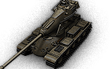
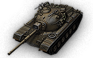
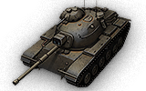
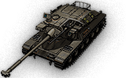
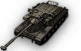
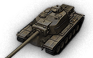
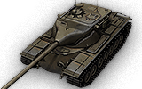
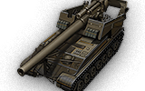
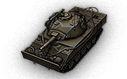
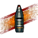

# USA · Tier X

[All nations and tiers](../buffs_nerfs.md) · EU v20410 → RU v14600ru · 3 November 2026

<label><strong>Find a tank</strong><input type="search" placeholder="Try is7, obj140 or xm57" aria-label="Find a tank" style="display:block;width:100%;padding:.7rem;border:1px solid #888;border-radius:4px;margin:.5rem 0;color:inherit;background:transparent"></label>

M-V-Y · Tier X

mvy

<a href="https://tanks.gg/v20410/tank/m-v-y">EU stats</a> · <a href="https://tanks.gg/v14600ru/tank/m-v-y">RU stats</a>
<figure style="display:inline-block"><figcaption>M-V-Y</figcaption></figure>
<strong>Penetration (mm)</strong> <b>EU</b>  AP <strong>260</strong> /  HEAT <strong>310</strong> /  HE <strong>60</strong> → <b>RU</b>  AP <strong>252</strong> /  HEAT <strong>300</strong> /  HE <strong>60</strong>

<em>Firepower</em> 
<strong>DPM (HP/min)</strong> <small>EU</small> 2 597.66  <small>RU</small> <strong>2 503.20</strong> 
<strong>Rate of fire (rounds/min)</strong> <small>EU</small> 5.90  <small>RU</small> <strong>5.69</strong> 
<strong>Reload time (s)</strong> <small>EU</small> 10.16  <small>RU</small> <strong>10.55</strong> 

<em>Gun handling</em> 
<strong>Aim time (s)</strong> <small>EU</small> 2.21  <small>RU</small> <strong>2.40</strong> 
<strong>Dispersion (m/100 m)</strong> <small>EU</small> 0.35  <small>RU</small> <strong>0.36</strong> 
<strong>Dispersion · damaged</strong> <small>EU</small> 0.71  <small>RU</small> <strong>0.73</strong> 
<strong>Dispersion · turret traverse</strong> <small>EU</small> 0.08  <small>RU</small> <strong>0.10</strong> 

<em>Mobility</em> 
<strong>Forward speed (km/h)</strong> <small>EU</small> 40  <small>RU</small> <strong>45</strong> 
<strong>Forward speed on hard terrain (km/h)</strong> <small>EU</small> 40  <small>RU</small> <strong>45</strong> 
<strong>Forward speed on medium terrain (km/h)</strong> <small>EU</small> 40  <small>RU</small> <strong>45</strong> 
<strong>Forward speed on soft terrain (km/h)</strong> <small>EU</small> 29.24  <small>RU</small> <strong>31.97</strong> 
<strong>Reverse speed (km/h)</strong> <small>EU</small> 17  <small>RU</small> <strong>15</strong> 
<strong>Engine power (hp)</strong> <small>EU</small> 750  <small>RU</small> <strong>820</strong> 
<strong>Power/weight (hp/t)</strong> <small>EU</small> 18.44  <small>RU</small> <strong>20.16</strong> 
<strong>Turret traverse (°/s)</strong> <small>EU</small> 38.59  <small>RU</small> <strong>33.38</strong> 

<em>Miscellaneous</em> 
<strong>Moving camo</strong> <small>EU</small> 2  <small>RU</small> <strong>1.94</strong> 
<strong>Moving camo · after firing</strong> <small>EU</small> 0.36  <small>RU</small> <strong>0.35</strong> 

M48A5 Patton · Tier X

m48a5patton

<a href="https://tanks.gg/v20410/tank/m48-patton">EU stats</a> · <a href="https://tanks.gg/v14600ru/tank/m48-patton">RU stats</a>
<figure style="display:inline-block"><figcaption>M48A5 Patton</figcaption></figure>
<em>Gun handling</em> 
<strong>Aim time (s)</strong> <small>EU</small> 1.73  <small>RU</small> <strong>1.82</strong> 
<strong>Dispersion (m/100 m)</strong> <small>EU</small> 0.34  <small>RU</small> <strong>0.35</strong> 
<strong>Dispersion · damaged</strong> <small>EU</small> 0.67  <small>RU</small> <strong>0.69</strong> 
<strong>Dispersion · moving</strong> <small>EU</small> 0.07  <small>RU</small> <strong>0.08</strong> 
<strong>Dispersion · tank traverse</strong> <small>EU</small> 0.07  <small>RU</small> <strong>0.08</strong> 
<strong>Dispersion · turret traverse</strong> <small>EU</small> 0.06  <small>RU</small> <strong>0.08</strong> 
<strong>Dispersion · firing</strong> <small>EU</small> 3  <small>RU</small> <strong>4</strong> 

<em>Mobility</em> 
<strong>Forward speed (km/h)</strong> <small>EU</small> 48  <small>RU</small> <strong>50</strong> 
<strong>Forward speed on hard terrain (km/h)</strong> <small>EU</small> 48  <small>RU</small> <strong>50</strong> 
<strong>Forward speed on medium terrain (km/h)</strong> <small>EU</small> 48  <small>RU</small> <strong>50</strong> 
<strong>Forward speed on soft terrain (km/h)</strong> <small>EU</small> 42.54  <small>RU</small> <strong>39.82</strong> 
<strong>Engine power (hp)</strong> <small>EU</small> 960  <small>RU</small> <strong>898.69</strong> 
<strong>Power/weight (hp/t)</strong> <small>EU</small> 20.12  <small>RU</small> <strong>18.83</strong> 
<strong>Tank traverse (°/s)</strong> <small>EU</small> 57.36  <small>RU</small> <strong>52.15</strong> 
<strong>Tank traverse on hard terrain (°/s)</strong> <small>EU</small> 54.50  <small>RU</small> <strong>49.54</strong> 
<strong>Tank traverse on medium terrain (°/s)</strong> <small>EU</small> 48.44  <small>RU</small> <strong>44.04</strong> 
<strong>Tank traverse on soft terrain (°/s)</strong> <small>EU</small> 24.22  <small>RU</small> <strong>22.02</strong> 

<em>Armor &amp; health</em> 
<strong>Health</strong> <small>EU</small> 2 000  <small>RU</small> <strong>2 200</strong> 

<em>Miscellaneous</em> 
<strong>Stationary camo</strong> <small>EU</small> 8.26  <small>RU</small> <strong>12.83</strong> 
<strong>Stationary camo · after firing</strong> <small>EU</small> 1.73  <small>RU</small> <strong>2.68</strong> 
<strong>Moving camo</strong> <small>EU</small> 6.21  <small>RU</small> <strong>9.58</strong> 
<strong>Moving camo · after firing</strong> <small>EU</small> 1.30  <small>RU</small> <strong>2</strong> 

M60 · Tier X

m60

<a href="https://tanks.gg/v20410/tank/m60">EU stats</a> · <a href="https://tanks.gg/v14600ru/tank/m60">RU stats</a>
<figure style="display:inline-block"><figcaption>M60</figcaption></figure>
<em>Gun handling</em> 
<strong>Dispersion · moving</strong> <small>EU</small> 0.10  <small>RU</small> <strong>0.08</strong> 
<strong>Dispersion · tank traverse</strong> <small>EU</small> 0.10  <small>RU</small> <strong>0.08</strong> 

<em>Mobility</em> 
<strong>Forward speed (km/h)</strong> <small>EU</small> 60  <small>RU</small> <strong>63</strong> 
<strong>Forward speed on hard terrain (km/h)</strong> <small>EU</small> 60  <small>RU</small> <strong>63</strong> 
<strong>Forward speed on medium terrain (km/h)</strong> <small>EU</small> 60  <small>RU</small> <strong>63</strong> 
<strong>Forward speed on soft terrain (km/h)</strong> <small>EU</small> 45.97  <small>RU</small> <strong>50.81</strong> 
<strong>Engine power (hp)</strong> <small>EU</small> 950  <small>RU</small> <strong>1 050</strong> 
<strong>Power/weight (hp/t)</strong> <small>EU</small> 20.53  <small>RU</small> <strong>22.69</strong> 

MBT-B · EU X → RU XI

mbtb

<a href="https://tanks.gg/v20410/tank/mbt-b">EU stats</a> · <a href="https://tanks.gg/v14600ru/tank/mbt-b">RU stats</a>
<figure style="display:inline-block"><figcaption>EU · MBT-B</figcaption></figure><figure style="display:inline-block"><figcaption>RU · MBT-B</figcaption></figure>
<strong>Penetration (mm)</strong> <b>EU</b>  AP <strong>260</strong> /  APCR <strong>305</strong> /  HE <strong>60</strong> → <b>RU</b>  AP <strong>263</strong> /  HEAT <strong>340</strong> /  HE <strong>90</strong>

<strong>Damage (HP)</strong> <b>EU</b>  AP <strong>400</strong> /  APCR <strong>400</strong> /  HE <strong>515</strong> → <b>RU</b>  AP <strong>420</strong> /  HEAT <strong>420</strong> /  HE <strong>515</strong>

<em>General</em> 
<strong>Tier</strong> <small>EU</small> 10 → <small>RU</small> <strong>11</strong> 

<em>Firepower</em> 
<strong>DPM (HP/min)</strong> <small>EU</small> 2 788.22  <small>RU</small> <strong>2 748.04</strong> 
<strong>Module damage</strong> <small>EU</small> 165  <small>RU</small> <strong>160</strong> 
<strong>Rate of fire (rounds/min)</strong> <small>EU</small> 6.97  <small>RU</small> <strong>6.54</strong> 
<strong>Reload time (s)</strong> <small>EU</small> 43.14  <small>RU</small> <strong>30.68</strong> 
<strong>Clip size</strong> <small>EU</small> 6  <small>RU</small> <strong>4</strong> 
<strong>Clip size · burst size</strong> <small>EU</small> 2 → <small>RU</small> <strong>—</strong> 
<strong>Clip damage · damage</strong> <small>EU</small> 2 400  <small>RU</small> <strong>1 680</strong> 
<strong>Clip damage · time (s)</strong> <small>EU</small> 8.50  <small>RU</small> <strong>6</strong> 
<strong>Clip damage · burst damage · damage</strong> <small>EU</small> 800 → <small>RU</small> <strong>—</strong> 
<strong>Clip damage · burst damage · time (s)</strong> <small>EU</small> 0.50 → <small>RU</small> <strong>—</strong> 
<strong>Intra-clip reload</strong> <small>EU</small> 3.50  <small>RU</small> <strong>2</strong> 
<strong>Shell velocity (m/s)</strong> <small>EU</small> 960  <small>RU</small> <strong>1 200</strong> 
<strong>Ammo capacity</strong> <small>EU</small> 60  <small>RU</small> <strong>52</strong> 
<strong>Potential damage</strong> <small>EU</small> 24 000  <small>RU</small> <strong>21 840</strong> 

<em>Gun handling</em> 
<strong>Aim time (s)</strong> <small>EU</small> 2.59  <small>RU</small> <strong>2.49</strong> 
<strong>Dispersion · moving</strong> <small>EU</small> 0.25  <small>RU</small> <strong>0.20</strong> 
<strong>Dispersion · tank traverse</strong> <small>EU</small> 0.25  <small>RU</small> <strong>0.20</strong> 
<strong>Dispersion · turret traverse</strong> <small>EU</small> 0.06  <small>RU</small> <strong>0.14</strong> 
<strong>Dispersion · firing</strong> <small>EU</small> 3.50  <small>RU</small> <strong>5</strong> 

<em>Mobility</em> 
<strong>Forward speed (km/h)</strong> <small>EU</small> 50  <small>RU</small> <strong>60</strong> 
<strong>Forward speed on hard terrain (km/h)</strong> <small>EU</small> 50  <small>RU</small> <strong>58.15</strong> 
<strong>Forward speed on medium terrain (km/h)</strong> <small>EU</small> 48.14  <small>RU</small> <strong>53.67</strong> 
<strong>Forward speed on soft terrain (km/h)</strong> <small>EU</small> 26.08  <small>RU</small> <strong>29.07</strong> 
<strong>Reverse speed (km/h)</strong> <small>EU</small> 15  <small>RU</small> <strong>20</strong> 
<strong>Engine power (hp)</strong> <small>EU</small> 740  <small>RU</small> <strong>1 100</strong> 
<strong>Weight (kg)</strong> <small>EU</small> 45 000 → <small>RU</small> <strong>60 000</strong> 
<strong>Power/weight (hp/t)</strong> <small>EU</small> 16.44  <small>RU</small> <strong>18.33</strong> 
<strong>Turret traverse (°/s)</strong> <small>EU</small> 41.72  <small>RU</small> <strong>37.55</strong> 
<strong>Tank traverse (°/s)</strong> <small>EU</small> 41.72  <small>RU</small> <strong>36.50</strong> 
<strong>Tank traverse on hard terrain (°/s)</strong> <small>EU</small> 39.63  <small>RU</small> <strong>34.68</strong> 
<strong>Tank traverse on medium terrain (°/s)</strong> <small>EU</small> 36.59  <small>RU</small> <strong>32.01</strong> 
<strong>Tank traverse on soft terrain (°/s)</strong> <small>EU</small> 19.82  <small>RU</small> <strong>17.34</strong> 

<em>Armor &amp; health</em> 
<strong>Hull armor · front (mm)</strong> <small>EU</small> 105  <small>RU</small> <strong>200</strong> 
<strong>Hull armor · side (mm)</strong> <small>EU</small> 30  <small>RU</small> <strong>90</strong> 
<strong>Hull armor · rear (mm)</strong> <small>EU</small> 40  <small>RU</small> <strong>55</strong> 
<strong>Turret armor · front (mm)</strong> <small>EU</small> 200  <small>RU</small> <strong>240</strong> 
<strong>Turret armor · side (mm)</strong> <small>EU</small> 90  <small>RU</small> <strong>150</strong> 
<strong>Turret armor · rear (mm)</strong> <small>EU</small> 40  <small>RU</small> <strong>45</strong> 
<strong>Health</strong> <small>EU</small> 2 000  <small>RU</small> <strong>2 600</strong> 
<strong>Health · engine</strong> <small>EU</small> 345  <small>RU</small> <strong>260</strong> 
<strong>Health · track</strong> <small>EU</small> 250  <small>RU</small> <strong>350</strong> 
<strong>Health · ammo rack</strong> <small>EU</small> 250  <small>RU</small> <strong>300</strong> 
<strong>Track repair time (s)</strong> <small>EU</small> 11.79  <small>RU</small> <strong>12.03</strong> 

<em>Miscellaneous</em> 
<strong>View range (m)</strong> <small>EU</small> 400  <small>RU</small> <strong>410</strong> 
<strong>Radio range (m)</strong> <small>EU</small> 750  <small>RU</small> <strong>745</strong> 
<strong>Shell cost</strong> <small>EU</small> 1 040  <small>RU</small> <strong>1 160</strong> 

T110E4 · Tier X

t110e4

<a href="https://tanks.gg/v20410/tank/t110e4">EU stats</a> · <a href="https://tanks.gg/v14600ru/tank/t110e4">RU stats</a>
<figure style="display:inline-block"><figcaption>T110E4</figcaption></figure>
<em>Gun handling</em> 
<strong>Aim time (s)</strong> <small>EU</small> 2.59  <small>RU</small> <strong>2.78</strong> 
<strong>Dispersion · turret traverse</strong> <small>EU</small> 0.20  <small>RU</small> <strong>0.24</strong> 

<em>Mobility</em> 
<strong>Forward speed on medium terrain (km/h)</strong> <small>EU</small> 35  <small>RU</small> <strong>34.37</strong> 
<strong>Forward speed on soft terrain (km/h)</strong> <small>EU</small> 20.91  <small>RU</small> <strong>20.37</strong> 
<strong>Reverse speed (km/h)</strong> <small>EU</small> 12  <small>RU</small> <strong>10</strong> 
<strong>Engine power (hp)</strong> <small>EU</small> 950  <small>RU</small> <strong>925.12</strong> 
<strong>Power/weight (hp/t)</strong> <small>EU</small> 14.84  <small>RU</small> <strong>14.45</strong> 
<strong>Turret traverse (°/s)</strong> <small>EU</small> 20.86  <small>RU</small> <strong>18.77</strong> 

<em>Armor &amp; health</em> 
<strong>Health · engine</strong> <small>EU</small> 345  <small>RU</small> <strong>260</strong> 
<strong>Track repair time (s)</strong> <small>EU</small> 11.79  <small>RU</small> <strong>12.03</strong> 

T57 Heavy · Tier X

t57heavy

<a href="https://tanks.gg/v20410/tank/t57-heavy">EU stats</a> · <a href="https://tanks.gg/v14600ru/tank/t57-heavy">RU stats</a>
<figure style="display:inline-block"><figcaption>T57 Heavy</figcaption></figure>
<em>Firepower</em> 
<strong>Ammo capacity</strong> <small>EU</small> 44  <small>RU</small> <strong>36</strong> 
<strong>Potential damage</strong> <small>EU</small> 17 600  <small>RU</small> <strong>14 400</strong> 

<em>Mobility</em> 
<strong>Forward speed (km/h)</strong> <small>EU</small> 35.40  <small>RU</small> <strong>40</strong> 
<strong>Forward speed on hard terrain (km/h)</strong> <small>EU</small> 35.40  <small>RU</small> <strong>40</strong> 
<strong>Forward speed on medium terrain (km/h)</strong> <small>EU</small> 35.40  <small>RU</small> <strong>40</strong> 
<strong>Forward speed on soft terrain (km/h)</strong> <small>EU</small> 25.35  <small>RU</small> <strong>26.22</strong> 
<strong>Reverse speed (km/h)</strong> <small>EU</small> 14  <small>RU</small> <strong>15</strong> 
<strong>Engine power (hp)</strong> <small>EU</small> 870  <small>RU</small> <strong>900</strong> 
<strong>Power/weight (hp/t)</strong> <small>EU</small> 15.98  <small>RU</small> <strong>16.53</strong> 

<em>Armor &amp; health</em> 
<strong>Turret armor · front (mm)</strong> <small>EU</small> 152.40  <small>RU</small> <strong>228.60</strong> 

T92 HMC · Tier X

t92hmc

<a href="https://tanks.gg/v20410/tank/t92-hmc">EU stats</a> · <a href="https://tanks.gg/v14600ru/tank/t92-hmc">RU stats</a>
<figure style="display:inline-block"><figcaption>T92 HMC</figcaption></figure>
<strong>Penetration (mm)</strong> <b>EU</b>  HE <strong>60</strong> /  HE <strong>75</strong> /  AP <strong>372</strong> → <b>RU</b>  HE <strong>60</strong> /  AP <strong>372</strong>

<strong>Damage (HP)</strong> <b>EU</b>  HE <strong>1100</strong> /  HE <strong>1420</strong> /  AP <strong>750</strong> → <b>RU</b>  HE <strong>1500</strong> /  AP <strong>850</strong>

<em>Firepower</em> 
<strong>DPM (HP/min)</strong> <small>EU</small> 1 404.86  <small>RU</small> <strong>1 915.71</strong> 
<strong>Explosion radius</strong> <small>EU</small> 12.40  <small>RU</small> <strong>10</strong> 
<strong>Stun duration · maximum (s)</strong> <small>EU</small> 35 → <small>RU</small> <strong>—</strong> 
<strong>Stun duration · minimum (s)</strong> <small>EU</small> 14 → <small>RU</small> <strong>—</strong> 
<strong>Potential damage</strong> <small>EU</small> 17 600  <small>RU</small> <strong>24 000</strong> 

<em>Miscellaneous</em> 
<strong>Shell cost</strong> <small>EU</small> 2 500  <small>RU</small> <strong>2 930</strong> 

XM551 Sheridan · Tier X

xm551sheridan

<a href="https://tanks.gg/v20410/tank/sheridan">EU stats</a> · <a href="https://tanks.gg/v14600ru/tank/sheridan">RU stats</a>
<figure style="display:inline-block"><figcaption>XM551 Sheridan</figcaption></figure>
<strong>Penetration (mm)</strong> <b>EU</b>  HEAT <strong>250</strong> /  HE <strong>180</strong> /  HE <strong>76</strong> → <b>RU</b>  HE <strong>76</strong> /  HEAT <strong>152</strong> /  HE <strong>85</strong>

<strong>Damage (HP)</strong> <b>EU</b>  HEAT <strong>600</strong> /  HE <strong>750</strong> /  HE <strong>950</strong> → <b>RU</b>  HE <strong>910</strong> /  HEAT <strong>700</strong> /  HE <strong>910</strong>

<em>Firepower</em> 
<strong>DPM (HP/min)</strong> <small>EU</small> 1 877.40  <small>RU</small> <strong>2 847.39</strong> 
<strong>Ricochet angle</strong> <small>EU</small> 85  <small>RU</small> <strong>90</strong> 
<strong>Spaced armor pen loss</strong> <small>EU</small> 0.50  <small>RU</small> <strong>0</strong> 
<strong>Potential damage</strong> <small>EU</small> 16 800  <small>RU</small> <strong>25 480</strong> 
<strong>Explosion radius</strong> <small>EU</small> — → <small>RU</small> <strong>3.66</strong> 

<em>Gun handling</em> 
<strong>Aim time (s)</strong> <small>EU</small> 2.88  <small>RU</small> <strong>3.16</strong> 
<strong>Dispersion (m/100 m)</strong> <small>EU</small> 0.46  <small>RU</small> <strong>0.49</strong> 
<strong>Dispersion · damaged</strong> <small>EU</small> 0.92  <small>RU</small> <strong>0.98</strong> 
<strong>Dispersion · moving</strong> <small>EU</small> 0.10  <small>RU</small> <strong>0.12</strong> 
<strong>Dispersion · tank traverse</strong> <small>EU</small> 0.10  <small>RU</small> <strong>0.12</strong> 
<strong>Dispersion · turret traverse</strong> <small>EU</small> 0.17  <small>RU</small> <strong>0.35</strong> 

<em>Mobility</em> 
<strong>Reverse speed (km/h)</strong> <small>EU</small> 30  <small>RU</small> <strong>22</strong> 
<strong>Terrain resist (hard)</strong> <small>EU</small> 0.77  <small>RU</small> <strong>0.96</strong> 
<strong>Terrain resist (med)</strong> <small>EU</small> 0.86  <small>RU</small> <strong>1.08</strong> 
<strong>Terrain resist (soft)</strong> <small>EU</small> 1.73  <small>RU</small> <strong>2.16</strong> 
<strong>Turret traverse (°/s)</strong> <small>EU</small> 52.15  <small>RU</small> <strong>44.85</strong> 
<strong>Tank traverse (°/s)</strong> <small>EU</small> 59.45  <small>RU</small> <strong>57.36</strong> 
<strong>Tank traverse on hard terrain (°/s)</strong> <small>EU</small> 58.31  <small>RU</small> <strong>56.27</strong> 
<strong>Tank traverse on medium terrain (°/s)</strong> <small>EU</small> 51.83  <small>RU</small> <strong>50.02</strong> 
<strong>Tank traverse on soft terrain (°/s)</strong> <small>EU</small> 25.92  <small>RU</small> <strong>25.01</strong> 

<em>Armor &amp; health</em> 
<strong>Track armor</strong> <small>EU</small> 15  <small>RU</small> <strong>20</strong> 
<strong>Health</strong> <small>EU</small> 1 950  <small>RU</small> <strong>1 600</strong> 

<em>Miscellaneous</em> 
<strong>Shell cost</strong> <small>EU</small> 1 200  <small>RU</small> <strong>750</strong> 

