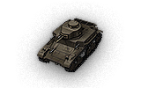
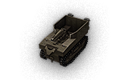
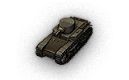
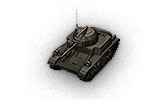
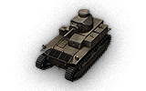
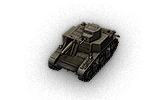
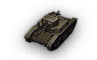

# USA · Tier II

[All nations and tiers](../buffs_nerfs.md) · EU v20410 → RU v14600ru · 3 November 2026

<label><strong>Find a tank</strong><input type="search" placeholder="Try is7, obj140 or xm57" aria-label="Find a tank" style="display:block;width:100%;padding:.7rem;border:1px solid #888;border-radius:4px;margin:.5rem 0;color:inherit;background:transparent"></label>

M2 Light · Tier II

m2light

<a href="https://tanks.gg/v20410/tank/m2-light">EU stats</a> · <a href="https://tanks.gg/v14600ru/tank/m2-light">RU stats</a>
<figure style="display:inline-block"><figcaption>M2 Light</figcaption></figure>
<strong>Penetration (mm)</strong> <b>EU</b>  AP <strong>55</strong> /  APCR <strong>78</strong> /  HE <strong>19</strong> → <b>RU</b>  AP <strong>48</strong> /  APCR <strong>70</strong> /  HE <strong>19</strong>

<em>Gun handling</em> 
<strong>Aim time (s)</strong> <small>EU</small> 1.92  <small>RU</small> <strong>1.53</strong> 
<strong>Dispersion (m/100 m)</strong> <small>EU</small> 0.44  <small>RU</small> <strong>0.38</strong> 
<strong>Dispersion · damaged</strong> <small>EU</small> 0.88  <small>RU</small> <strong>0.77</strong> 
<strong>Dispersion · moving</strong> <small>EU</small> 0.24  <small>RU</small> <strong>0.25</strong> 
<strong>Dispersion · tank traverse</strong> <small>EU</small> 0.24  <small>RU</small> <strong>0.25</strong> 
<strong>Dispersion · turret traverse</strong> <small>EU</small> 0.12  <small>RU</small> <strong>0.16</strong> 
<strong>Dispersion · firing</strong> <small>EU</small> 3  <small>RU</small> <strong>4</strong> 

<em>Mobility</em> 
<strong>Forward speed on soft terrain (km/h)</strong> <small>EU</small> 36.78  <small>RU</small> <strong>35.75</strong> 
<strong>Engine power (hp)</strong> <small>EU</small> 285  <small>RU</small> <strong>277.01</strong> 
<strong>Power/weight (hp/t)</strong> <small>EU</small> 32.86  <small>RU</small> <strong>31.94</strong> 
<strong>Tank traverse (°/s)</strong> <small>EU</small> 52.15  <small>RU</small> <strong>41.72</strong> 
<strong>Tank traverse on hard terrain (°/s)</strong> <small>EU</small> 59.21  <small>RU</small> <strong>41.19</strong> 
<strong>Tank traverse on medium terrain (°/s)</strong> <small>EU</small> 35.53  <small>RU</small> <strong>24.71</strong> 
<strong>Tank traverse on soft terrain (°/s)</strong> <small>EU</small> 15.67  <small>RU</small> <strong>10.90</strong> 

<em>Armor &amp; health</em> 
<strong>Health</strong> <small>EU</small> 320  <small>RU</small> <strong>350</strong> 
<strong>Track repair time (s)</strong> <small>EU</small> 12.03  <small>RU</small> <strong>3</strong> 

T1 HMC · Tier II

t1hmc

<a href="https://tanks.gg/v20410/tank/t1-hmc">EU stats</a> · <a href="https://tanks.gg/v14600ru/tank/t1-hmc">RU stats</a>
<figure style="display:inline-block"><figcaption>T1 HMC</figcaption></figure>
<em>Gun handling</em> 
<strong>Aim time (s)</strong> <small>EU</small> 5.27  <small>RU</small> <strong>4.89</strong> 
<strong>Dispersion (m/100 m)</strong> <small>EU</small> 0.77  <small>RU</small> <strong>0.69</strong> 
<strong>Dispersion · damaged</strong> <small>EU</small> 1.53  <small>RU</small> <strong>1.37</strong> 
<strong>Dispersion · moving</strong> <small>EU</small> 0.50  <small>RU</small> <strong>0.26</strong> 
<strong>Dispersion · tank traverse</strong> <small>EU</small> 0.50  <small>RU</small> <strong>0.26</strong> 
<strong>Dispersion · turret traverse</strong> <small>EU</small> 0.48  <small>RU</small> <strong>0.30</strong> 

<em>Mobility</em> 
<strong>Turret traverse (°/s)</strong> <small>EU</small> 15.65  <small>RU</small> <strong>15.32</strong> 

<em>Armor &amp; health</em> 
<strong>Health</strong> <small>EU</small> 160  <small>RU</small> <strong>200</strong> 
<strong>Track repair time (s)</strong> <small>EU</small> 13.16  <small>RU</small> <strong>3</strong> 

T1E6 · Tier II

t1e6

<a href="https://tanks.gg/v20410/tank/t1e6">EU stats</a> · <a href="https://tanks.gg/v14600ru/tank/t1e6">RU stats</a>
<figure style="display:inline-block"><figcaption>T1E6</figcaption></figure>
<em>Gun handling</em> 
<strong>Aim time (s)</strong> <small>EU</small> 1.90  <small>RU</small> <strong>1</strong> 
<strong>Dispersion (m/100 m)</strong> <small>EU</small> 0.51  <small>RU</small> <strong>0.48</strong> 
<strong>Dispersion · damaged</strong> <small>EU</small> 1.02  <small>RU</small> <strong>0.96</strong> 
<strong>Dispersion · moving</strong> <small>EU</small> 0.28  <small>RU</small> <strong>0.24</strong> 
<strong>Dispersion · tank traverse</strong> <small>EU</small> 0.28  <small>RU</small> <strong>0.24</strong> 
<strong>Dispersion · turret traverse</strong> <small>EU</small> 0.12  <small>RU</small> <strong>0.08</strong> 
<strong>Dispersion · firing</strong> <small>EU</small> 3  <small>RU</small> <strong>2</strong> 

<em>Armor &amp; health</em> 
<strong>Health</strong> <small>EU</small> 320  <small>RU</small> <strong>360</strong> 
<strong>Track repair time (s)</strong> <small>EU</small> 12.03  <small>RU</small> <strong>3</strong> 

<em>Miscellaneous</em> 
<strong>View range (m)</strong> <small>EU</small> 260  <small>RU</small> <strong>300</strong> 

T2 Light Tank · Tier II

t2lighttank

<a href="https://tanks.gg/v20410/tank/t2-light">EU stats</a> · <a href="https://tanks.gg/v14600ru/tank/t2-light">RU stats</a>
<figure style="display:inline-block"><figcaption>T2 Light Tank</figcaption></figure>
<em>Gun handling</em> 
<strong>Aim time (s)</strong> <small>EU</small> 1.71  <small>RU</small> <strong>1</strong> 
<strong>Dispersion · firing</strong> <small>EU</small> 1.30  <small>RU</small> <strong>1</strong> 

<em>Armor &amp; health</em> 
<strong>Health</strong> <small>EU</small> 300  <small>RU</small> <strong>340</strong> 
<strong>Track repair time (s)</strong> <small>EU</small> 12.03  <small>RU</small> <strong>3</strong> 

<em>Miscellaneous</em> 
<strong>View range (m)</strong> <small>EU</small> 260  <small>RU</small> <strong>300</strong> 

T2 Medium Tank · Tier II

t2mediumtank

<a href="https://tanks.gg/v20410/tank/t2-medium">EU stats</a> · <a href="https://tanks.gg/v14600ru/tank/t2-medium">RU stats</a>
<figure style="display:inline-block"><figcaption>T2 Medium Tank</figcaption></figure>
<em>Firepower</em> 
<strong>DPM (HP/min)</strong> <small>EU</small> 1 285.86  <small>RU</small> <strong>1 315.90</strong> 
<strong>Rate of fire (rounds/min)</strong> <small>EU</small> 107.16  <small>RU</small> <strong>109.66</strong> 
<strong>Reload time (s)</strong> <small>EU</small> 7  <small>RU</small> <strong>6.81</strong> 

<em>Gun handling</em> 
<strong>Aim time (s)</strong> <small>EU</small> 1.63  <small>RU</small> <strong>0.96</strong> 
<strong>Dispersion · moving</strong> <small>EU</small> 0.25  <small>RU</small> <strong>0.21</strong> 
<strong>Dispersion · tank traverse</strong> <small>EU</small> 0.25  <small>RU</small> <strong>0.21</strong> 
<strong>Dispersion · firing</strong> <small>EU</small> 1.30  <small>RU</small> <strong>1</strong> 

<em>Armor &amp; health</em> 
<strong>Health</strong> <small>EU</small> 340  <small>RU</small> <strong>460</strong> 
<strong>Track repair time (s)</strong> <small>EU</small> 12.03  <small>RU</small> <strong>3</strong> 

T3 HMC · Tier II

t3hmc

<a href="https://tanks.gg/v20410/tank/t3-hmc">EU stats</a> · <a href="https://tanks.gg/v14600ru/tank/t3-hmc">RU stats</a>
<figure style="display:inline-block"><figcaption>T3 HMC</figcaption></figure>
<em>Firepower</em> 
<strong>DPM (HP/min)</strong> <small>EU</small> 1 080  <small>RU</small> <strong>1 350</strong> 
<strong>Rate of fire (rounds/min)</strong> <small>EU</small> 24  <small>RU</small> <strong>30</strong> 
<strong>Reload time (s)</strong> <small>EU</small> 2.50  <small>RU</small> <strong>2</strong> 

<em>Gun handling</em> 
<strong>Aim time (s)</strong> <small>EU</small> 1.70  <small>RU</small> <strong>1.50</strong> 
<strong>Dispersion · moving</strong> <small>EU</small> 0.38  <small>RU</small> <strong>0.24</strong> 
<strong>Dispersion · tank traverse</strong> <small>EU</small> 0.38  <small>RU</small> <strong>0.24</strong> 
<strong>Dispersion · firing</strong> <small>EU</small> 4  <small>RU</small> <strong>3</strong> 

<em>Armor &amp; health</em> 
<strong>Health</strong> <small>EU</small> 220  <small>RU</small> <strong>400</strong> 
<strong>Track repair time (s)</strong> <small>EU</small> 12.03  <small>RU</small> <strong>3</strong> 

<em>Miscellaneous</em> 
<strong>View range (m)</strong> <small>EU</small> 270  <small>RU</small> <strong>300</strong> 

T7 Combat Car · Tier II

t7combatcar

<a href="https://tanks.gg/v20410/tank/t7-car">EU stats</a> · <a href="https://tanks.gg/v14600ru/tank/t7-car">RU stats</a>
<figure style="display:inline-block"><figcaption>T7 Combat Car</figcaption></figure>
<strong>Penetration (mm)</strong> <b>EU</b>  AP <strong>27</strong> → <b>RU</b>  AP <strong>31</strong>

<em>Gun handling</em> 
<strong>Aim time (s)</strong> <small>EU</small> 1.70  <small>RU</small> <strong>1</strong> 
<strong>Dispersion (m/100 m)</strong> <small>EU</small> 0.53  <small>RU</small> <strong>0.50</strong> 
<strong>Dispersion · damaged</strong> <small>EU</small> 1.06  <small>RU</small> <strong>1</strong> 
<strong>Dispersion · firing</strong> <small>EU</small> 1.10  <small>RU</small> <strong>0.50</strong> 

<em>Mobility</em> 
<strong>Turret traverse (°/s)</strong> <small>EU</small> 24  <small>RU</small> <strong>44</strong> 
<strong>Tank traverse (°/s)</strong> <small>EU</small> 45.89  <small>RU</small> <strong>52.15</strong> 
<strong>Tank traverse on hard terrain (°/s)</strong> <small>EU</small> 45.89  <small>RU</small> <strong>52.15</strong> 
<strong>Tank traverse on medium terrain (°/s)</strong> <small>EU</small> 36.71  <small>RU</small> <strong>41.72</strong> 
<strong>Tank traverse on soft terrain (°/s)</strong> <small>EU</small> 16.20  <small>RU</small> <strong>18.41</strong> 

<em>Armor &amp; health</em> 
<strong>Health</strong> <small>EU</small> 300  <small>RU</small> <strong>350</strong> 
<strong>Track repair time (s)</strong> <small>EU</small> 12.03  <small>RU</small> <strong>3</strong> 

<em>Miscellaneous</em> 
<strong>View range (m)</strong> <small>EU</small> 280  <small>RU</small> <strong>300</strong> 

