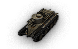
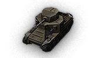
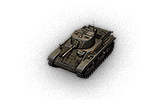
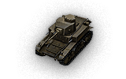
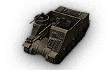
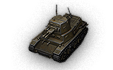
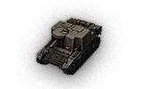
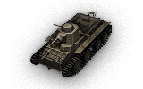
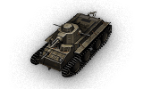
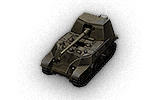

# USA · Tier III

[All nations and tiers](../buffs_nerfs.md) · EU v20410 → RU v14600ru · 3 November 2026

<label><strong>Find a tank</strong><input type="search" placeholder="Try is7, obj140 or xm57" aria-label="Find a tank" style="display:block;width:100%;padding:.7rem;border:1px solid #888;border-radius:4px;margin:.5rem 0;color:inherit;background:transparent"></label>

Convert. Medium Tank T3 · Tier III

convertmediumtankt3

<a href="https://tanks.gg/v20410/tank/t3-convert">EU stats</a> · <a href="https://tanks.gg/v14600ru/tank/t3-convert">RU stats</a>
<figure style="display:inline-block"><figcaption>Convert. Medium Tank T3</figcaption></figure>
<em>Firepower</em> 
<strong>DPM (HP/min)</strong> <small>EU</small> 1 021.28  <small>RU</small> <strong>1 142.86</strong> 
<strong>Rate of fire (rounds/min)</strong> <small>EU</small> 25.53  <small>RU</small> <strong>28.57</strong> 
<strong>Reload time (s)</strong> <small>EU</small> 15  <small>RU</small> <strong>13</strong> 

<em>Gun handling</em> 
<strong>Aim time (s)</strong> <small>EU</small> 2.50  <small>RU</small> <strong>1.50</strong> 
<strong>Dispersion (m/100 m)</strong> <small>EU</small> 0.51  <small>RU</small> <strong>0.50</strong> 
<strong>Dispersion · damaged</strong> <small>EU</small> 1.02  <small>RU</small> <strong>1</strong> 
<strong>Dispersion · turret traverse</strong> <small>EU</small> 0.14  <small>RU</small> <strong>0.10</strong> 
<strong>Dispersion · firing</strong> <small>EU</small> 4  <small>RU</small> <strong>1.50</strong> 

<em>Armor &amp; health</em> 
<strong>Health</strong> <small>EU</small> 450  <small>RU</small> <strong>540</strong> 
<strong>Track repair time (s)</strong> <small>EU</small> 10.03  <small>RU</small> <strong>4</strong> 

M2 Medium Tank · Tier III

m2mediumtank

<a href="https://tanks.gg/v20410/tank/m2-medium">EU stats</a> · <a href="https://tanks.gg/v14600ru/tank/m2-medium">RU stats</a>
<figure style="display:inline-block"><figcaption>M2 Medium Tank</figcaption></figure>
<em>Gun handling</em> 
<strong>Aim time (s)</strong> <small>EU</small> 2.21  <small>RU</small> <strong>1.92</strong> 
<strong>Dispersion (m/100 m)</strong> <small>EU</small> 0.53  <small>RU</small> <strong>0.48</strong> 
<strong>Dispersion · damaged</strong> <small>EU</small> 1.05  <small>RU</small> <strong>0.96</strong> 

<em>Armor &amp; health</em> 
<strong>Health</strong> <small>EU</small> 375  <small>RU</small> <strong>530</strong> 
<strong>Track repair time (s)</strong> <small>EU</small> 12.03  <small>RU</small> <strong>4</strong> 

M22 Locust · Tier III

m22locust

<a href="https://tanks.gg/v20410/tank/locust">EU stats</a> · <a href="https://tanks.gg/v14600ru/tank/locust">RU stats</a>
<figure style="display:inline-block"><figcaption>M22 Locust</figcaption></figure>
<em>Firepower</em> 
<strong>DPM (HP/min)</strong> <small>EU</small> 1 093.10  <small>RU</small> <strong>1 137.82</strong> 
<strong>Rate of fire (rounds/min)</strong> <small>EU</small> 27.33  <small>RU</small> <strong>28.45</strong> 
<strong>Reload time (s)</strong> <small>EU</small> 2.20  <small>RU</small> <strong>2.11</strong> 

<em>Gun handling</em> 
<strong>Dispersion · firing</strong> <small>EU</small> 3  <small>RU</small> <strong>2</strong> 

<em>Armor &amp; health</em> 
<strong>Health</strong> <small>EU</small> 445  <small>RU</small> <strong>460</strong> 
<strong>Track repair time (s)</strong> <small>EU</small> 10.03  <small>RU</small> <strong>4</strong> 

M3 Stuart · Tier III

m3stuart

<a href="https://tanks.gg/v20410/tank/m3-stuart">EU stats</a> · <a href="https://tanks.gg/v14600ru/tank/m3-stuart">RU stats</a>
<figure style="display:inline-block"><figcaption>M3 Stuart</figcaption></figure>
<strong>Penetration (mm)</strong> <b>EU</b>  AP <strong>69</strong> /  APCR <strong>93</strong> /  HE <strong>19</strong> → <b>RU</b>  AP <strong>56</strong> /  APCR <strong>84</strong> /  HE <strong>19</strong>

<em>Firepower</em> 
<strong>DPM (HP/min)</strong> <small>EU</small> 1 263.16  <small>RU</small> <strong>1 200</strong> 
<strong>Rate of fire (rounds/min)</strong> <small>EU</small> 31.58  <small>RU</small> <strong>30</strong> 
<strong>Reload time (s)</strong> <small>EU</small> 1.90  <small>RU</small> <strong>2</strong> 

<em>Gun handling</em> 
<strong>Dispersion · moving</strong> <small>EU</small> 0.16  <small>RU</small> <strong>0.20</strong> 
<strong>Dispersion · tank traverse</strong> <small>EU</small> 0.16  <small>RU</small> <strong>0.20</strong> 

<em>Mobility</em> 
<strong>Forward speed on soft terrain (km/h)</strong> <small>EU</small> 61  <small>RU</small> <strong>58.17</strong> 
<strong>Engine power (hp)</strong> <small>EU</small> 380  <small>RU</small> <strong>370.05</strong> 
<strong>Weight (kg)</strong> <small>EU</small> 12 468 → <small>RU</small> <strong>12 742</strong> 
<strong>Power/weight (hp/t)</strong> <small>EU</small> 30.48  <small>RU</small> <strong>29.04</strong> 
<strong>Tank traverse (°/s)</strong> <small>EU</small> 69.88  <small>RU</small> <strong>46.93</strong> 
<strong>Tank traverse on hard terrain (°/s)</strong> <small>EU</small> 76.86  <small>RU</small> <strong>59.26</strong> 
<strong>Tank traverse on medium terrain (°/s)</strong> <small>EU</small> 69.87  <small>RU</small> <strong>53.88</strong> 
<strong>Tank traverse on soft terrain (°/s)</strong> <small>EU</small> 40.45  <small>RU</small> <strong>31.19</strong> 

<em>Armor &amp; health</em> 
<strong>Health</strong> <small>EU</small> 440  <small>RU</small> <strong>460</strong> 
<strong>Track repair time (s)</strong> <small>EU</small> 6.02  <small>RU</small> <strong>4</strong> 

<em>Miscellaneous</em> 
<strong>Radio range (m)</strong> <small>EU</small> 338.98  <small>RU</small> <strong>641.44</strong> 

M7 Priest · Tier III

m7priest

<a href="https://tanks.gg/v20410/tank/m7-priest">EU stats</a> · <a href="https://tanks.gg/v14600ru/tank/m7-priest">RU stats</a>
<figure style="display:inline-block"><figcaption>M7 Priest</figcaption></figure>
<em>Armor &amp; health</em> 
<strong>Track repair time (s)</strong> <small>EU</small> 13.40  <small>RU</small> <strong>4</strong> 

<em>Miscellaneous</em> 
<strong>View range (m)</strong> <small>EU</small> 260  <small>RU</small> <strong>300</strong> 

MTLS-1G14 · Tier III

mtls1g14

<a href="https://tanks.gg/v20410/tank/mtls-1g14">EU stats</a> · <a href="https://tanks.gg/v14600ru/tank/mtls-1g14">RU stats</a>
<figure style="display:inline-block"><figcaption>MTLS-1G14</figcaption></figure>
<em>Armor &amp; health</em> 
<strong>Health</strong> <small>EU</small> 410  <small>RU</small> <strong>450</strong> 
<strong>Track repair time (s)</strong> <small>EU</small> 12.03  <small>RU</small> <strong>4</strong> 

<em>Miscellaneous</em> 
<strong>View range (m)</strong> <small>EU</small> 280  <small>RU</small> <strong>300</strong> 

T18 HMC · Tier III

t18hmc

<a href="https://tanks.gg/v20410/tank/t18-hmc">EU stats</a> · <a href="https://tanks.gg/v14600ru/tank/t18-hmc">RU stats</a>
<figure style="display:inline-block"><figcaption>T18 HMC</figcaption></figure>
<em>Gun handling</em> 
<strong>Aim time (s)</strong> <small>EU</small> 4.60  <small>RU</small> <strong>3.36</strong> 
<strong>Dispersion · moving</strong> <small>EU</small> 0.36  <small>RU</small> <strong>0.30</strong> 
<strong>Dispersion · tank traverse</strong> <small>EU</small> 0.36  <small>RU</small> <strong>0.30</strong> 
<strong>Dispersion · turret traverse</strong> <small>EU</small> 0.35  <small>RU</small> <strong>0.30</strong> 

<em>Mobility</em> 
<strong>Reverse speed (km/h)</strong> <small>EU</small> 6  <small>RU</small> <strong>14</strong> 

<em>Armor &amp; health</em> 
<strong>Health</strong> <small>EU</small> 195  <small>RU</small> <strong>250</strong> 
<strong>Track repair time (s)</strong> <small>EU</small> 15.79  <small>RU</small> <strong>4</strong> 

<em>Miscellaneous</em> 
<strong>View range (m)</strong> <small>EU</small> 250  <small>RU</small> <strong>300</strong> 

T3E2 Medium Tank · Tier III

t3e2mediumtank

<a href="https://tanks.gg/v20410/tank/t3e2-medium">EU stats</a> · <a href="https://tanks.gg/v14600ru/tank/t3e2-conv">RU stats</a>
<figure style="display:inline-block"><figcaption>EU · T3E2 Medium Tank</figcaption></figure><figure style="display:inline-block"><figcaption>RU · Conv. Medium Tank T3E2</figcaption></figure>
<strong>Penetration (mm)</strong> <b>EU</b>  AP <strong>45</strong> /  APCR <strong>64</strong> /  HE <strong>19</strong> → <b>RU</b>  AP <strong>65</strong> /  APCR <strong>86</strong> /  HE <strong>19</strong>

<strong>Damage (HP)</strong> <b>EU</b>  AP <strong>35</strong> /  APCR <strong>35</strong> /  HE <strong>42</strong> → <b>RU</b>  AP <strong>50</strong> /  APCR <strong>50</strong> /  HE <strong>80</strong>

<em>Firepower</em> 
<strong>DPM (HP/min)</strong> <small>EU</small> 1 166.67  <small>RU</small> <strong>1 304.35</strong> 
<strong>Rate of fire (rounds/min)</strong> <small>EU</small> 33.33  <small>RU</small> <strong>26.09</strong> 
<strong>Reload time (s)</strong> <small>EU</small> 1.80  <small>RU</small> <strong>2.30</strong> 
<strong>Shell velocity (m/s)</strong> <small>EU</small> 600  <small>RU</small> <strong>730</strong> 
<strong>Ammo capacity</strong> <small>EU</small> 240  <small>RU</small> <strong>125</strong> 
<strong>Potential damage</strong> <small>EU</small> 8 400  <small>RU</small> <strong>6 250</strong> 

<em>Gun handling</em> 
<strong>Aim time (s)</strong> <small>EU</small> 1.44  <small>RU</small> <strong>1.73</strong> 
<strong>Dispersion (m/100 m)</strong> <small>EU</small> 0.43  <small>RU</small> <strong>0.36</strong> 
<strong>Dispersion · damaged</strong> <small>EU</small> 0.86  <small>RU</small> <strong>0.73</strong> 
<strong>Dispersion · turret traverse</strong> <small>EU</small> 0.12  <small>RU</small> <strong>0.14</strong> 
<strong>Dispersion · firing</strong> <small>EU</small> 3  <small>RU</small> <strong>4</strong> 

<em>Mobility</em> 
<strong>Forward speed (km/h)</strong> <small>EU</small> 56.30  <small>RU</small> <strong>56</strong> 
<strong>Forward speed on hard terrain (km/h)</strong> <small>EU</small> 56.30  <small>RU</small> <strong>56</strong> 
<strong>Forward speed on medium terrain (km/h)</strong> <small>EU</small> 56.30  <small>RU</small> <strong>56</strong> 
<strong>Forward speed on soft terrain (km/h)</strong> <small>EU</small> 56.30  <small>RU</small> <strong>56</strong> 
<strong>Engine power (hp)</strong> <small>EU</small> 435  <small>RU</small> <strong>459.92</strong> 
<strong>Power/weight (hp/t)</strong> <small>EU</small> 36.25  <small>RU</small> <strong>38.33</strong> 
<strong>Turret traverse (°/s)</strong> <small>EU</small> 37.55  <small>RU</small> <strong>41.72</strong> 
<strong>Tank traverse (°/s)</strong> <small>EU</small> 37.55  <small>RU</small> <strong>41.72</strong> 
<strong>Tank traverse on hard terrain (°/s)</strong> <small>EU</small> 37.55  <small>RU</small> <strong>41.72</strong> 
<strong>Tank traverse on medium terrain (°/s)</strong> <small>EU</small> 30.04  <small>RU</small> <strong>33.38</strong> 
<strong>Tank traverse on soft terrain (°/s)</strong> <small>EU</small> 13.06  <small>RU</small> <strong>14.51</strong> 

<em>Armor &amp; health</em> 
<strong>Health</strong> <small>EU</small> 470  <small>RU</small> <strong>550</strong> 
<strong>Track repair time (s)</strong> <small>EU</small> 10.03  <small>RU</small> <strong>4</strong> 

<em>Miscellaneous</em> 
<strong>View range (m)</strong> <small>EU</small> 310  <small>RU</small> <strong>300</strong> 
<strong>Shell cost</strong> <small>EU</small> 9  <small>RU</small> <strong>18</strong> 

T56 GMC · Tier III

t56gmc

<a href="https://tanks.gg/v20410/tank/t56-gmc">EU stats</a> · <a href="https://tanks.gg/v14600ru/tank/t56-gmc">RU stats</a>
<figure style="display:inline-block"><figcaption>T56 GMC</figcaption></figure>
<em>Gun handling</em> 
<strong>Aim time (s)</strong> <small>EU</small> 1.92  <small>RU</small> <strong>1.57</strong> 
<strong>Dispersion (m/100 m)</strong> <small>EU</small> 0.38  <small>RU</small> <strong>0.39</strong> 
<strong>Dispersion · damaged</strong> <small>EU</small> 0.77  <small>RU</small> <strong>0.78</strong> 
<strong>Dispersion · moving</strong> <small>EU</small> 0.28  <small>RU</small> <strong>0.24</strong> 
<strong>Dispersion · tank traverse</strong> <small>EU</small> 0.28  <small>RU</small> <strong>0.24</strong> 
<strong>Dispersion · turret traverse</strong> <small>EU</small> 0.14  <small>RU</small> <strong>0.08</strong> 

<em>Mobility</em> 
<strong>Reverse speed (km/h)</strong> <small>EU</small> 14  <small>RU</small> <strong>16</strong> 
<strong>Turret traverse (°/s)</strong> <small>EU</small> 45.89  <small>RU</small> <strong>44.95</strong> 

<em>Armor &amp; health</em> 
<strong>Health</strong> <small>EU</small> 285  <small>RU</small> <strong>490</strong> 
<strong>Track repair time (s)</strong> <small>EU</small> 10.03  <small>RU</small> <strong>4</strong> 

<em>Miscellaneous</em> 
<strong>View range (m)</strong> <small>EU</small> 290  <small>RU</small> <strong>320</strong> 

