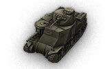
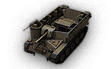
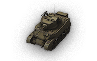
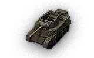
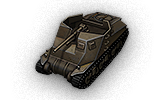
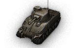
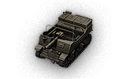

# USA · Tier IV

[All nations and tiers](../buffs_nerfs.md) · EU v20410 → RU v14600ru · 3 November 2026

<label><strong>Find a tank</strong><input type="search" placeholder="Try is7, obj140 or xm57" aria-label="Find a tank" style="display:block;width:100%;padding:.7rem;border:1px solid #888;border-radius:4px;margin:.5rem 0;color:inherit;background:transparent"></label>

M3 Lee · Tier IV

m3lee

<a href="https://tanks.gg/v20410/tank/m3-lee">EU stats</a> · <a href="https://tanks.gg/v14600ru/tank/m3-lee">RU stats</a>
<figure style="display:inline-block"><figcaption>M3 Lee</figcaption></figure>
<em>Gun handling</em> 
<strong>Aim time (s)</strong> <small>EU</small> 2.01  <small>RU</small> <strong>1.63</strong> 
<strong>Dispersion (m/100 m)</strong> <small>EU</small> 0.39  <small>RU</small> <strong>0.35</strong> 
<strong>Dispersion · damaged</strong> <small>EU</small> 0.79  <small>RU</small> <strong>0.69</strong> 
<strong>Dispersion · moving</strong> <small>EU</small> 0.22  <small>RU</small> <strong>0.20</strong> 
<strong>Dispersion · tank traverse</strong> <small>EU</small> 0.22  <small>RU</small> <strong>0.16</strong> 
<strong>Dispersion · turret traverse</strong> <small>EU</small> 0.16  <small>RU</small> <strong>0.06</strong> 
<strong>Dispersion · firing</strong> <small>EU</small> 4  <small>RU</small> <strong>3.50</strong> 

<em>Armor &amp; health</em> 
<strong>Health</strong> <small>EU</small> 475  <small>RU</small> <strong>630</strong> 
<strong>Track repair time (s)</strong> <small>EU</small> 10.03  <small>RU</small> <strong>5</strong> 

M37 · Tier IV

m37

<a href="https://tanks.gg/v20410/tank/m37">EU stats</a> · <a href="https://tanks.gg/v14600ru/tank/m37">RU stats</a>
<figure style="display:inline-block"><figcaption>M37</figcaption></figure>
<em>Armor &amp; health</em> 
<strong>Health</strong> <small>EU</small> 275  <small>RU</small> <strong>300</strong> 
<strong>Track repair time (s)</strong> <small>EU</small> 13.40  <small>RU</small> <strong>5</strong> 

<em>Miscellaneous</em> 
<strong>View range (m)</strong> <small>EU</small> 260  <small>RU</small> <strong>300</strong> 

M5 Stuart · Tier IV

m5stuart

<a href="https://tanks.gg/v20410/tank/m5-stuart">EU stats</a> · <a href="https://tanks.gg/v14600ru/tank/m5-stuart">RU stats</a>
<figure style="display:inline-block"><figcaption>M5 Stuart</figcaption></figure>
<strong>Penetration (mm)</strong> <b>EU</b>  AP <strong>71</strong> /  APCR <strong>95</strong> /  HE <strong>19</strong> → <b>RU</b>  AP <strong>66</strong> /  APCR <strong>98</strong> /  HE <strong>19</strong>

<strong>Damage (HP)</strong> <b>EU</b>  AP <strong>50</strong> /  APCR <strong>50</strong> /  HE <strong>60</strong> → <b>RU</b>  AP <strong>40</strong> /  APCR <strong>40</strong> /  HE <strong>50</strong>

<em>Firepower</em> 
<strong>DPM (HP/min)</strong> <small>EU</small> 1 598.71  <small>RU</small> <strong>1 365.76</strong> 
<strong>Rate of fire (rounds/min)</strong> <small>EU</small> 31.97  <small>RU</small> <strong>34.14</strong> 
<strong>Reload time (s)</strong> <small>EU</small> 7.38  <small>RU</small> <strong>11.51</strong> 
<strong>Clip size</strong> <small>EU</small> 5  <small>RU</small> <strong>10</strong> 
<strong>Clip damage · damage</strong> <small>EU</small> 250  <small>RU</small> <strong>400</strong> 
<strong>Clip damage · time (s)</strong> <small>EU</small> 2  <small>RU</small> <strong>6.07</strong> 
<strong>Intra-clip reload</strong> <small>EU</small> 0.50  <small>RU</small> <strong>0.67</strong> 
<strong>Potential damage</strong> <small>EU</small> 11 000  <small>RU</small> <strong>8 800</strong> 
<strong>Clip size · burst size</strong> <small>EU</small> — → <small>RU</small> <strong>5</strong> 
<strong>Clip damage · burst damage · damage</strong> <small>EU</small> — → <small>RU</small> <strong>200</strong> 
<strong>Clip damage · burst damage · time (s)</strong> <small>EU</small> — → <small>RU</small> <strong>2.70</strong> 

<em>Gun handling</em> 
<strong>Aim time (s)</strong> <small>EU</small> 1.63  <small>RU</small> <strong>1.44</strong> 
<strong>Dispersion (m/100 m)</strong> <small>EU</small> 0.36  <small>RU</small> <strong>0.38</strong> 
<strong>Dispersion · damaged</strong> <small>EU</small> 0.73  <small>RU</small> <strong>0.77</strong> 
<strong>Dispersion · moving</strong> <small>EU</small> 0.15  <small>RU</small> <strong>0.18</strong> 
<strong>Dispersion · tank traverse</strong> <small>EU</small> 0.15  <small>RU</small> <strong>0.18</strong> 

<em>Mobility</em> 
<strong>Forward speed on soft terrain (km/h)</strong> <small>EU</small> 52.55  <small>RU</small> <strong>48.62</strong> 
<strong>Engine power (hp)</strong> <small>EU</small> 400  <small>RU</small> <strong>370.05</strong> 
<strong>Power/weight (hp/t)</strong> <small>EU</small> 26.24  <small>RU</small> <strong>24.27</strong> 
<strong>Tank traverse (°/s)</strong> <small>EU</small> 52.15  <small>RU</small> <strong>43.81</strong> 
<strong>Tank traverse on hard terrain (°/s)</strong> <small>EU</small> 55.56  <small>RU</small> <strong>47.44</strong> 
<strong>Tank traverse on medium terrain (°/s)</strong> <small>EU</small> 50.01  <small>RU</small> <strong>42.70</strong> 
<strong>Tank traverse on soft terrain (°/s)</strong> <small>EU</small> 26.32  <small>RU</small> <strong>22.47</strong> 

<em>Armor &amp; health</em> 
<strong>Track repair time (s)</strong> <small>EU</small> 8.02  <small>RU</small> <strong>5</strong> 

M8A1 · Tier IV

m8a1

<a href="https://tanks.gg/v20410/tank/m8a1">EU stats</a> · <a href="https://tanks.gg/v14600ru/tank/m8a1">RU stats</a>
<figure style="display:inline-block"><figcaption>M8A1</figcaption></figure>
<strong>Penetration (mm)</strong> <b>EU</b>  AP <strong>115</strong> /  APCR <strong>165</strong> /  HE <strong>38</strong> → <b>RU</b>  AP <strong>101</strong> /  APCR <strong>157</strong> /  HE <strong>38</strong>

<em>Firepower</em> 
<strong>DPM (HP/min)</strong> <small>EU</small> 1 765.08  <small>RU</small> <strong>1 639</strong> 
<strong>Rate of fire (rounds/min)</strong> <small>EU</small> 16.05  <small>RU</small> <strong>14.90</strong> 
<strong>Reload time (s)</strong> <small>EU</small> 3.74  <small>RU</small> <strong>4.03</strong> 
<strong>Caliber</strong> <small>EU</small> 75  <small>RU</small> <strong>76</strong> 
<strong>Shell velocity (m/s)</strong> <small>EU</small> 781  <small>RU</small> <strong>792</strong> 

<em>Gun handling</em> 
<strong>Dispersion (m/100 m)</strong> <small>EU</small> 0.37  <small>RU</small> <strong>0.36</strong> 
<strong>Dispersion · damaged</strong> <small>EU</small> 0.75  <small>RU</small> <strong>0.73</strong> 
<strong>Dispersion · moving</strong> <small>EU</small> 0.27  <small>RU</small> <strong>0.23</strong> 
<strong>Dispersion · tank traverse</strong> <small>EU</small> 0.27  <small>RU</small> <strong>0.23</strong> 
<strong>Depression (°)</strong> <small>EU</small> 10  <small>RU</small> <strong>8</strong> 

<em>Mobility</em> 
<strong>Forward speed on soft terrain (km/h)</strong> <small>EU</small> 39.56  <small>RU</small> <strong>38.49</strong> 
<strong>Engine power (hp)</strong> <small>EU</small> 380  <small>RU</small> <strong>370.05</strong> 
<strong>Weight (kg)</strong> <small>EU</small> 16 617 → <small>RU</small> <strong>16 630</strong> 
<strong>Power/weight (hp/t)</strong> <small>EU</small> 22.87  <small>RU</small> <strong>22.25</strong> 
<strong>Tank traverse (°/s)</strong> <small>EU</small> 47.98  <small>RU</small> <strong>41.72</strong> 
<strong>Tank traverse on hard terrain (°/s)</strong> <small>EU</small> 45.44  <small>RU</small> <strong>42.48</strong> 
<strong>Tank traverse on medium terrain (°/s)</strong> <small>EU</small> 37.87  <small>RU</small> <strong>35.40</strong> 
<strong>Tank traverse on soft terrain (°/s)</strong> <small>EU</small> 20.66  <small>RU</small> <strong>19.31</strong> 

<em>Armor &amp; health</em> 
<strong>Health</strong> <small>EU</small> 410  <small>RU</small> <strong>560</strong> 
<strong>Track repair time (s)</strong> <small>EU</small> 10.03  <small>RU</small> <strong>5</strong> 

T40 · Tier IV

t40

<a href="https://tanks.gg/v20410/tank/t40">EU stats</a> · <a href="https://tanks.gg/v14600ru/tank/t40">RU stats</a>
<figure style="display:inline-block"><figcaption>T40</figcaption></figure>
<em>Armor &amp; health</em> 
<strong>Health</strong> <small>EU</small> 380  <small>RU</small> <strong>550</strong> 
<strong>Track repair time (s)</strong> <small>EU</small> 10.03  <small>RU</small> <strong>5</strong> 

T6 Medium · Tier IV

t6medium

<a href="https://tanks.gg/v20410/tank/t6">EU stats</a> · <a href="https://tanks.gg/v14600ru/tank/t6-medium">RU stats</a>
<figure style="display:inline-block"><figcaption>EU · T6 Medium</figcaption></figure><figure style="display:inline-block"><figcaption>RU · T6 Medium</figcaption></figure>
<strong>Penetration (mm)</strong> <b>EU</b>  AP <strong>104</strong> /  APCR <strong>139</strong> /  HE <strong>38</strong> → <b>RU</b>  HE <strong>53</strong> /  HEAT <strong>102</strong>

<strong>Damage (HP)</strong> <b>EU</b>  AP <strong>110</strong> /  APCR <strong>110</strong> /  HE <strong>175</strong> → <b>RU</b>  HE <strong>410</strong> /  HEAT <strong>350</strong>

<em>Firepower</em> 
<strong>DPM (HP/min)</strong> <small>EU</small> 1 720.95  <small>RU</small> <strong>1 900.58</strong> 
<strong>Module damage</strong> <small>EU</small> 100  <small>RU</small> <strong>150</strong> 
<strong>Rate of fire (rounds/min)</strong> <small>EU</small> 15.65  <small>RU</small> <strong>4.64</strong> 
<strong>Reload time (s)</strong> <small>EU</small> 3.84  <small>RU</small> <strong>12.94</strong> 
<strong>Caliber</strong> <small>EU</small> 75  <small>RU</small> <strong>105</strong> 
<strong>Shell velocity (m/s)</strong> <small>EU</small> 619  <small>RU</small> <strong>472</strong> 
<strong>Normalization</strong> <small>EU</small> 5  <small>RU</small> <strong>0</strong> 
<strong>Ricochet angle</strong> <small>EU</small> 70  <small>RU</small> <strong>90</strong> 
<strong>Ammo capacity</strong> <small>EU</small> 75  <small>RU</small> <strong>70</strong> 
<strong>Potential damage</strong> <small>EU</small> 8 250  <small>RU</small> <strong>28 700</strong> 
<strong>Explosion radius</strong> <small>EU</small> — → <small>RU</small> <strong>1.91</strong> 

<em>Gun handling</em> 
<strong>Aim time (s)</strong> <small>EU</small> 1.73  <small>RU</small> <strong>3.16</strong> 
<strong>Dispersion (m/100 m)</strong> <small>EU</small> 0.38  <small>RU</small> <strong>0.53</strong> 
<strong>Dispersion · damaged</strong> <small>EU</small> 0.77  <small>RU</small> <strong>1.05</strong> 
<strong>Dispersion · moving</strong> <small>EU</small> 0.27  <small>RU</small> <strong>0.23</strong> 
<strong>Dispersion · tank traverse</strong> <small>EU</small> 0.27  <small>RU</small> <strong>0.23</strong> 
<strong>Dispersion · turret traverse</strong> <small>EU</small> 0.16  <small>RU</small> <strong>0.14</strong> 

<em>Mobility</em> 
<strong>Forward speed on soft terrain (km/h)</strong> <small>EU</small> 37.32  <small>RU</small> <strong>34.76</strong> 
<strong>Engine power (hp)</strong> <small>EU</small> 500  <small>RU</small> <strong>486.35</strong> 
<strong>Weight (kg)</strong> <small>EU</small> 26 147 → <small>RU</small> <strong>27 310</strong> 
<strong>Power/weight (hp/t)</strong> <small>EU</small> 19.12  <small>RU</small> <strong>17.81</strong> 
<strong>Tank traverse (°/s)</strong> <small>EU</small> 49.02  <small>RU</small> <strong>35.46</strong> 
<strong>Tank traverse on hard terrain (°/s)</strong> <small>EU</small> 53.14  <small>RU</small> <strong>43.54</strong> 
<strong>Tank traverse on medium terrain (°/s)</strong> <small>EU</small> 39.37  <small>RU</small> <strong>32.25</strong> 
<strong>Tank traverse on soft terrain (°/s)</strong> <small>EU</small> 27.25  <small>RU</small> <strong>22.33</strong> 

<em>Armor &amp; health</em> 
<strong>Health</strong> <small>EU</small> 570  <small>RU</small> <strong>620</strong> 
<strong>Track repair time (s)</strong> <small>EU</small> 10.03  <small>RU</small> <strong>5</strong> 

<em>Miscellaneous</em> 
<strong>Stationary camo · after firing</strong> <small>EU</small> 2.78  <small>RU</small> <strong>2.35</strong> 
<strong>Moving camo · after firing</strong> <small>EU</small> 2.08  <small>RU</small> <strong>1.76</strong> 
<strong>Shell cost</strong> <small>EU</small> 56  <small>RU</small> <strong>166</strong> 

T82 HMC · Tier IV

t82hmc

<a href="https://tanks.gg/v20410/tank/t82-hmc">EU stats</a> · <a href="https://tanks.gg/v14600ru/tank/t82-hmc">RU stats</a>
<figure style="display:inline-block"><figcaption>T82 HMC</figcaption></figure>
<em>Gun handling</em> 
<strong>Aim time (s)</strong> <small>EU</small> 4.79  <small>RU</small> <strong>4.89</strong> 
<strong>Dispersion (m/100 m)</strong> <small>EU</small> 0.75  <small>RU</small> <strong>0.76</strong> 
<strong>Dispersion · damaged</strong> <small>EU</small> 1.50  <small>RU</small> <strong>1.53</strong> 

<em>Mobility</em> 
<strong>Turret traverse (°/s)</strong> <small>EU</small> 45.89  <small>RU</small> <strong>44.95</strong> 

<em>Armor &amp; health</em> 
<strong>Health</strong> <small>EU</small> 200  <small>RU</small> <strong>310</strong> 
<strong>Track repair time (s)</strong> <small>EU</small> 13.40  <small>RU</small> <strong>5</strong> 

<em>Miscellaneous</em> 
<strong>View range (m)</strong> <small>EU</small> 255  <small>RU</small> <strong>300</strong> 

