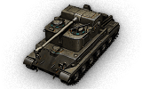
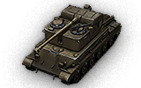
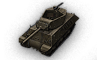
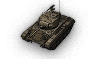
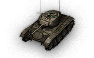
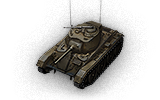
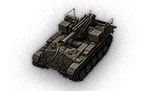
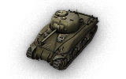
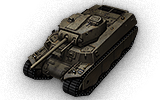

# USA · Tier V

[All nations and tiers](../buffs_nerfs.md) · EU v20410 → RU v14600ru · 3 November 2026

<label><strong>Find a tank</strong><input type="search" placeholder="Try is7, obj140 or xm57" aria-label="Find a tank" style="display:block;width:100%;padding:.7rem;border:1px solid #888;border-radius:4px;margin:.5rem 0;color:inherit;background:transparent"></label>

ARMT · EU V → RU VII

armt

<a href="https://tanks.gg/v20410/tank/armt">EU stats</a> · <a href="https://tanks.gg/v14600ru/tank/armt">RU stats</a>
<figure style="display:inline-block"><figcaption>EU · ARMT</figcaption></figure><figure style="display:inline-block"><figcaption>RU · ARMT</figcaption></figure>
<strong>Penetration (mm)</strong> <b>EU</b>  AP <strong>128</strong> /  APCR <strong>177</strong> /  HE <strong>38</strong> → <b>RU</b>  AP <strong>124</strong> /  HEAT <strong>170</strong> /  HE <strong>38</strong>

<strong>Damage (HP)</strong> <b>EU</b>  AP <strong>115</strong> /  APCR <strong>115</strong> /  HE <strong>185</strong> → <b>RU</b>  AP <strong>90</strong> /  HEAT <strong>90</strong> /  HE <strong>170</strong>

<em>General</em> 
<strong>Tier</strong> <small>EU</small> 5 → <small>RU</small> <strong>7</strong> 

<em>Firepower</em> 
<strong>DPM (HP/min)</strong> <small>EU</small> 891.60  <small>RU</small> <strong>1 859.90</strong> 
<strong>Rate of fire (rounds/min)</strong> <small>EU</small> 7.75  <small>RU</small> <strong>20.67</strong> 
<strong>Reload time (s)</strong> <small>EU</small> 18.22  <small>RU</small> <strong>38.35</strong> 
<strong>Clip size</strong> <small>EU</small> 3  <small>RU</small> <strong>21</strong> 
<strong>Clip damage · damage</strong> <small>EU</small> 345  <small>RU</small> <strong>1 890</strong> 
<strong>Clip damage · time (s)</strong> <small>EU</small> 5  <small>RU</small> <strong>22.62</strong> 
<strong>Intra-clip reload</strong> <small>EU</small> 2.50  <small>RU</small> <strong>3</strong> 
<strong>Shell velocity (m/s)</strong> <small>EU</small> 900  <small>RU</small> <strong>1 050</strong> 
<strong>Ammo capacity</strong> <small>EU</small> 105  <small>RU</small> <strong>210</strong> 
<strong>Potential damage</strong> <small>EU</small> 12 075  <small>RU</small> <strong>18 900</strong> 
<strong>Clip size · burst size</strong> <small>EU</small> — → <small>RU</small> <strong>3</strong> 
<strong>Clip damage · burst damage · damage</strong> <small>EU</small> — → <small>RU</small> <strong>270</strong> 
<strong>Clip damage · burst damage · time (s)</strong> <small>EU</small> — → <small>RU</small> <strong>0.66</strong> 

<em>Gun handling</em> 
<strong>Aim time (s)</strong> <small>EU</small> 2.01  <small>RU</small> <strong>1.44</strong> 
<strong>Dispersion (m/100 m)</strong> <small>EU</small> 0.40  <small>RU</small> <strong>0.36</strong> 
<strong>Dispersion · damaged</strong> <small>EU</small> 0.81  <small>RU</small> <strong>0.73</strong> 
<strong>Dispersion · moving</strong> <small>EU</small> 0.23  <small>RU</small> <strong>0.18</strong> 
<strong>Dispersion · tank traverse</strong> <small>EU</small> 0.23  <small>RU</small> <strong>0.18</strong> 
<strong>Dispersion · turret traverse</strong> <small>EU</small> 0.15  <small>RU</small> <strong>0.08</strong> 
<strong>Dispersion · firing</strong> <small>EU</small> 3  <small>RU</small> <strong>2.50</strong> 

<em>Mobility</em> 
<strong>Forward speed (km/h)</strong> <small>EU</small> 45  <small>RU</small> <strong>70</strong> 
<strong>Forward speed on hard terrain (km/h)</strong> <small>EU</small> 45  <small>RU</small> <strong>70</strong> 
<strong>Forward speed on medium terrain (km/h)</strong> <small>EU</small> 45  <small>RU</small> <strong>70</strong> 
<strong>Forward speed on soft terrain (km/h)</strong> <small>EU</small> 32.40  <small>RU</small> <strong>63.43</strong> 
<strong>Reverse speed (km/h)</strong> <small>EU</small> 18  <small>RU</small> <strong>25</strong> 
<strong>Engine power (hp)</strong> <small>EU</small> 550  <small>RU</small> <strong>850</strong> 
<strong>Power/weight (hp/t)</strong> <small>EU</small> 16.18  <small>RU</small> <strong>25</strong> 
<strong>Terrain resist (hard)</strong> <small>EU</small> 0.96  <small>RU</small> <strong>0.67</strong> 
<strong>Terrain resist (med)</strong> <small>EU</small> 1.05  <small>RU</small> <strong>0.77</strong> 
<strong>Terrain resist (soft)</strong> <small>EU</small> 1.82  <small>RU</small> <strong>1.44</strong> 
<strong>Turret traverse (°/s)</strong> <small>EU</small> 40.68  <small>RU</small> <strong>47.98</strong> 
<strong>Tank traverse (°/s)</strong> <small>EU</small> 41.72  <small>RU</small> <strong>52.15</strong> 
<strong>Tank traverse on hard terrain (°/s)</strong> <small>EU</small> 41.72  <small>RU</small> <strong>49.54</strong> 
<strong>Tank traverse on medium terrain (°/s)</strong> <small>EU</small> 37.93  <small>RU</small> <strong>43.35</strong> 
<strong>Tank traverse on soft terrain (°/s)</strong> <small>EU</small> 21.96  <small>RU</small> <strong>23.12</strong> 

<em>Armor &amp; health</em> 
<strong>Hull armor · front (mm)</strong> <small>EU</small> 50.80  <small>RU</small> <strong>51</strong> 
<strong>Hull armor · side (mm)</strong> <small>EU</small> 50.80  <small>RU</small> <strong>38</strong> 
<strong>Hull armor · rear (mm)</strong> <small>EU</small> 25.40  <small>RU</small> <strong>25</strong> 
<strong>Turret armor · front (mm)</strong> <small>EU</small> 76.20  <small>RU</small> <strong>76</strong> 
<strong>Turret armor · side (mm)</strong> <small>EU</small> 50.80  <small>RU</small> <strong>51</strong> 
<strong>Turret armor · rear (mm)</strong> <small>EU</small> 25.40  <small>RU</small> <strong>76</strong> 
<strong>Health</strong> <small>EU</small> 600  <small>RU</small> <strong>900</strong> 
<strong>Health · track</strong> <small>EU</small> 110  <small>RU</small> <strong>140</strong> 
<strong>Health · ammo rack</strong> <small>EU</small> 180  <small>RU</small> <strong>200</strong> 
<strong>Track repair time (s)</strong> <small>EU</small> 12.03  <small>RU</small> <strong>10.03</strong> 

<em>Miscellaneous</em> 
<strong>Stationary camo</strong> <small>EU</small> 10.32  <small>RU</small> <strong>10.03</strong> 
<strong>Stationary camo · after firing</strong> <small>EU</small> 2.68  <small>RU</small> <strong>2.61</strong> 
<strong>Moving camo</strong> <small>EU</small> 7.70  <small>RU</small> <strong>10.03</strong> 
<strong>Moving camo · after firing</strong> <small>EU</small> 2  <small>RU</small> <strong>2.61</strong> 
<strong>View range (m)</strong> <small>EU</small> 370  <small>RU</small> <strong>390</strong> 
<strong>Radio range (m)</strong> <small>EU</small> 410  <small>RU</small> <strong>745</strong> 

M10 Wolverine · Tier V

m10wolverine

<a href="https://tanks.gg/v20410/tank/wolverine">EU stats</a> · <a href="https://tanks.gg/v14600ru/tank/wolverine">RU stats</a>
<figure style="display:inline-block"><figcaption>M10 Wolverine</figcaption></figure>
<em>Gun handling</em> 
<strong>Dispersion · turret traverse</strong> <small>EU</small> 0.14  <small>RU</small> <strong>0.12</strong> 

<em>Mobility</em> 
<strong>Forward speed on soft terrain (km/h)</strong> <small>EU</small> 31.51  <small>RU</small> <strong>30.29</strong> 
<strong>Engine power (hp)</strong> <small>EU</small> 550  <small>RU</small> <strong>528.64</strong> 
<strong>Power/weight (hp/t)</strong> <small>EU</small> 19.04  <small>RU</small> <strong>18.30</strong> 
<strong>Tank traverse (°/s)</strong> <small>EU</small> 49.02  <small>RU</small> <strong>31.29</strong> 
<strong>Tank traverse on hard terrain (°/s)</strong> <small>EU</small> 50.46  <small>RU</small> <strong>40.93</strong> 
<strong>Tank traverse on medium terrain (°/s)</strong> <small>EU</small> 42.70  <small>RU</small> <strong>34.63</strong> 
<strong>Tank traverse on soft terrain (°/s)</strong> <small>EU</small> 24.14  <small>RU</small> <strong>19.58</strong> 

<em>Armor &amp; health</em> 
<strong>Health</strong> <small>EU</small> 500  <small>RU</small> <strong>470</strong> 

M24 Chaffee · Tier V

m24chaffee

<a href="https://tanks.gg/v20410/tank/chaffee">EU stats</a> · <a href="https://tanks.gg/v14600ru/tank/chaffee">RU stats</a>
<figure style="display:inline-block"><figcaption>M24 Chaffee</figcaption></figure>
<strong>Penetration (mm)</strong> <b>EU</b>  AP <strong>118</strong> /  APCR <strong>159</strong> /  HE <strong>38</strong> → <b>RU</b>  AP <strong>96</strong> /  APCR <strong>143</strong> /  HE <strong>38</strong>

<strong>Damage (HP)</strong> <b>EU</b>  AP <strong>115</strong> /  APCR <strong>115</strong> /  HE <strong>175</strong> → <b>RU</b>  AP <strong>110</strong> /  APCR <strong>110</strong> /  HE <strong>175</strong>

<em>Firepower</em> 
<strong>DPM (HP/min)</strong> <small>EU</small> 1 755.29  <small>RU</small> <strong>1 564.50</strong> 
<strong>Rate of fire (rounds/min)</strong> <small>EU</small> 15.26  <small>RU</small> <strong>14.22</strong> 
<strong>Reload time (s)</strong> <small>EU</small> 3.93  <small>RU</small> <strong>4.22</strong> 
<strong>Shell velocity (m/s)</strong> <small>EU</small> 890  <small>RU</small> <strong>619</strong> 
<strong>Potential damage</strong> <small>EU</small> 6 900  <small>RU</small> <strong>6 600</strong> 

<em>Gun handling</em> 
<strong>Dispersion (m/100 m)</strong> <small>EU</small> 0.37  <small>RU</small> <strong>0.42</strong> 
<strong>Dispersion · damaged</strong> <small>EU</small> 0.75  <small>RU</small> <strong>0.84</strong> 

<em>Mobility</em> 
<strong>Forward speed (km/h)</strong> <small>EU</small> 65  <small>RU</small> <strong>62</strong> 
<strong>Forward speed on hard terrain (km/h)</strong> <small>EU</small> 65  <small>RU</small> <strong>62</strong> 
<strong>Forward speed on medium terrain (km/h)</strong> <small>EU</small> 65  <small>RU</small> <strong>62</strong> 
<strong>Tank traverse on hard terrain (°/s)</strong> <small>EU</small> 44.58  <small>RU</small> <strong>54.08</strong> 
<strong>Tank traverse on medium terrain (°/s)</strong> <small>EU</small> 35.66  <small>RU</small> <strong>43.26</strong> 
<strong>Tank traverse on soft terrain (°/s)</strong> <small>EU</small> 20.98  <small>RU</small> <strong>25.45</strong> 

<em>Armor &amp; health</em> 
<strong>Health</strong> <small>EU</small> 610  <small>RU</small> <strong>550</strong> 

M24 Chaffee No. 594 · Tier V

m24chaffeeno594

<a href="https://tanks.gg/v20410/tank/chaffee-594">EU stats</a> · <a href="https://tanks.gg/v14600ru/tank/m24-no594">RU stats</a>
<figure style="display:inline-block"><figcaption>EU · M24 Chaffee No. 594</figcaption></figure><figure style="display:inline-block"><figcaption>RU · M24 No.594</figcaption></figure>
<strong>Penetration (mm)</strong> <b>EU</b>  AP <strong>118</strong> /  APCR <strong>159</strong> /  HE <strong>38</strong> → <b>RU</b>  AP <strong>116</strong> /  APCR <strong>153</strong> /  HE <strong>38</strong>

<strong>Damage (HP)</strong> <b>EU</b>  AP <strong>110</strong> /  APCR <strong>110</strong> /  HE <strong>175</strong> → <b>RU</b>  AP <strong>95</strong> /  APCR <strong>95</strong> /  HE <strong>150</strong>

<em>Firepower</em> 
<strong>DPM (HP/min)</strong> <small>EU</small> 1 678.98  <small>RU</small> <strong>1 524.38</strong> 
<strong>Rate of fire (rounds/min)</strong> <small>EU</small> 15.26  <small>RU</small> <strong>16.05</strong> 
<strong>Reload time (s)</strong> <small>EU</small> 3.93  <small>RU</small> <strong>3.74</strong> 
<strong>Shell velocity (m/s)</strong> <small>EU</small> 619  <small>RU</small> <strong>792</strong> 
<strong>Potential damage</strong> <small>EU</small> 6 600  <small>RU</small> <strong>5 700</strong> 

<em>Gun handling</em> 
<strong>Aim time (s)</strong> <small>EU</small> 1.44  <small>RU</small> <strong>1.53</strong> 
<strong>Dispersion · moving</strong> <small>EU</small> 0.13  <small>RU</small> <strong>0.12</strong> 
<strong>Dispersion · tank traverse</strong> <small>EU</small> 0.13  <small>RU</small> <strong>0.12</strong> 

<em>Mobility</em> 
<strong>Forward speed on soft terrain (km/h)</strong> <small>EU</small> 41.24  <small>RU</small> <strong>49.97</strong> 
<strong>Engine power (hp)</strong> <small>EU</small> 350  <small>RU</small> <strong>401.77</strong> 
<strong>Weight (kg)</strong> <small>EU</small> 19 000 → <small>RU</small> <strong>18 000</strong> 
<strong>Power/weight (hp/t)</strong> <small>EU</small> 18.42  <small>RU</small> <strong>22.32</strong> 
<strong>Tank traverse (°/s)</strong> <small>EU</small> 52.15  <small>RU</small> <strong>41.72</strong> 
<strong>Tank traverse on hard terrain (°/s)</strong> <small>EU</small> 52.15  <small>RU</small> <strong>39.63</strong> 
<strong>Tank traverse on medium terrain (°/s)</strong> <small>EU</small> 41.72  <small>RU</small> <strong>31.71</strong> 
<strong>Tank traverse on soft terrain (°/s)</strong> <small>EU</small> 24.54  <small>RU</small> <strong>18.65</strong> 

<em>Armor &amp; health</em> 
<strong>Health</strong> <small>EU</small> 550  <small>RU</small> <strong>580</strong> 
<strong>Health · engine</strong> <small>EU</small> 123  <small>RU</small> <strong>104</strong> 

<em>Miscellaneous</em> 
<strong>Stationary camo</strong> <small>EU</small> 15.68  <small>RU</small> <strong>11.40</strong> 
<strong>Stationary camo · after firing</strong> <small>EU</small> 4.08  <small>RU</small> <strong>2.96</strong> 
<strong>Moving camo</strong> <small>EU</small> 15.68  <small>RU</small> <strong>11.40</strong> 
<strong>Moving camo · after firing</strong> <small>EU</small> 4.08  <small>RU</small> <strong>2.96</strong> 
<strong>Radio range (m)</strong> <small>EU</small> 594.51  <small>RU</small> <strong>777.04</strong> 

M41 · Tier V

m41

<a href="https://tanks.gg/v20410/tank/m41">EU stats</a> · <a href="https://tanks.gg/v14600ru/tank/m41-hmc">RU stats</a>
<figure style="display:inline-block"><figcaption>M41</figcaption></figure>
<strong>Penetration (mm)</strong> <b>EU</b>  HE <strong>38</strong> /  HE <strong>48</strong> /  HEAT <strong>150</strong> → <b>RU</b>  HE <strong>39</strong> /  HEAT <strong>150</strong>

<strong>Damage (HP)</strong> <b>EU</b>  HE <strong>500</strong> /  HE <strong>600</strong> /  HEAT <strong>360</strong> → <b>RU</b>  HE <strong>750</strong> /  HEAT <strong>450</strong>

<em>Firepower</em> 
<strong>DPM (HP/min)</strong> <small>EU</small> 1 078.97  <small>RU</small> <strong>1 618.45</strong> 
<strong>Explosion radius</strong> <small>EU</small> 6.70  <small>RU</small> <strong>5.50</strong> 
<strong>Stun duration · maximum (s)</strong> <small>EU</small> 10.40 → <small>RU</small> <strong>—</strong> 
<strong>Stun duration · minimum (s)</strong> <small>EU</small> 6.24 → <small>RU</small> <strong>—</strong> 
<strong>Max range (m)</strong> <small>EU</small> 1 293.01  <small>RU</small> <strong>1 411.45</strong> 
<strong>Potential damage</strong> <small>EU</small> 13 500  <small>RU</small> <strong>20 250</strong> 

<em>Gun handling</em> 
<strong>Aim time (s)</strong> <small>EU</small> 6.71  <small>RU</small> <strong>5.94</strong> 
<strong>Dispersion (m/100 m)</strong> <small>EU</small> 0.79  <small>RU</small> <strong>0.76</strong> 
<strong>Dispersion · damaged</strong> <small>EU</small> 1.57  <small>RU</small> <strong>1.51</strong> 

<em>Armor &amp; health</em> 
<strong>Health · track</strong> <small>EU</small> 115  <small>RU</small> <strong>70</strong> 
<strong>Health · ammo rack</strong> <small>EU</small> 150  <small>RU</small> <strong>90</strong> 
<strong>Track repair time (s)</strong> <small>EU</small> 11.80  <small>RU</small> <strong>14.74</strong> 

<em>Miscellaneous</em> 
<strong>Shell cost</strong> <small>EU</small> 505  <small>RU</small> <strong>610</strong> 

M4A1 Sherman · Tier V

m4a1sherman

<a href="https://tanks.gg/v20410/tank/m4-sherman">EU stats</a> · <a href="https://tanks.gg/v14600ru/tank/m4a1">RU stats</a>
<figure style="display:inline-block"><figcaption>M4A1 Sherman</figcaption></figure>
<strong>Penetration (mm)</strong> <b>EU</b>  HE <strong>53</strong> /  HEAT <strong>102</strong> → <b>RU</b>  AP <strong>128</strong> /  APCR <strong>177</strong> /  HE <strong>38</strong>

<strong>Damage (HP)</strong> <b>EU</b>  HE <strong>410</strong> /  HEAT <strong>350</strong> → <b>RU</b>  AP <strong>115</strong> /  APCR <strong>115</strong> /  HE <strong>185</strong>

<em>Firepower</em> 
<strong>DPM (HP/min)</strong> <small>EU</small> 2 850.87  <small>RU</small> <strong>1 499.31</strong> 
<strong>Module damage</strong> <small>EU</small> 150  <small>RU</small> <strong>105</strong> 
<strong>Rate of fire (rounds/min)</strong> <small>EU</small> 6.95  <small>RU</small> <strong>13.04</strong> 
<strong>Reload time (s)</strong> <small>EU</small> 8.63  <small>RU</small> <strong>4.60</strong> 
<strong>Explosion radius</strong> <small>EU</small> 1.91 → <small>RU</small> <strong>—</strong> 
<strong>Caliber</strong> <small>EU</small> 105  <small>RU</small> <strong>76</strong> 
<strong>Shell velocity (m/s)</strong> <small>EU</small> 472  <small>RU</small> <strong>792</strong> 
<strong>Normalization</strong> <small>EU</small> 0  <small>RU</small> <strong>5</strong> 
<strong>Ricochet angle</strong> <small>EU</small> 90  <small>RU</small> <strong>70</strong> 
<strong>Ammo capacity</strong> <small>EU</small> 70  <small>RU</small> <strong>110</strong> 
<strong>Potential damage</strong> <small>EU</small> 28 700  <small>RU</small> <strong>12 650</strong> 

<em>Gun handling</em> 
<strong>Aim time (s)</strong> <small>EU</small> 2.40  <small>RU</small> <strong>2.21</strong> 
<strong>Dispersion (m/100 m)</strong> <small>EU</small> 0.53  <small>RU</small> <strong>0.41</strong> 
<strong>Dispersion · damaged</strong> <small>EU</small> 1.05  <small>RU</small> <strong>0.82</strong> 
<strong>Dispersion · moving</strong> <small>EU</small> 0.18  <small>RU</small> <strong>0.24</strong> 
<strong>Dispersion · tank traverse</strong> <small>EU</small> 0.18  <small>RU</small> <strong>0.24</strong> 
<strong>Dispersion · turret traverse</strong> <small>EU</small> 0.16  <small>RU</small> <strong>0.18</strong> 

<em>Mobility</em> 
<strong>Forward speed on soft terrain (km/h)</strong> <small>EU</small> 35.98  <small>RU</small> <strong>36.20</strong> 
<strong>Engine power (hp)</strong> <small>EU</small> 500  <small>RU</small> <strong>486.35</strong> 
<strong>Weight (kg)</strong> <small>EU</small> 31 110 → <small>RU</small> <strong>30 077</strong> 
<strong>Power/weight (hp/t)</strong> <small>EU</small> 16.07  <small>RU</small> <strong>16.17</strong> 
<strong>Tank traverse (°/s)</strong> <small>EU</small> 52.15  <small>RU</small> <strong>38.59</strong> 
<strong>Tank traverse on hard terrain (°/s)</strong> <small>EU</small> 55.34  <small>RU</small> <strong>50.09</strong> 
<strong>Tank traverse on medium terrain (°/s)</strong> <small>EU</small> 50.31  <small>RU</small> <strong>45.53</strong> 
<strong>Tank traverse on soft terrain (°/s)</strong> <small>EU</small> 32.55  <small>RU</small> <strong>29.46</strong> 

<em>Armor &amp; health</em> 
<strong>Health</strong> <small>EU</small> 650  <small>RU</small> <strong>600</strong> 

<em>Miscellaneous</em> 
<strong>Stationary camo · after firing</strong> <small>EU</small> 2.77  <small>RU</small> <strong>3.27</strong> 
<strong>Moving camo · after firing</strong> <small>EU</small> 2.07  <small>RU</small> <strong>2.44</strong> 
<strong>Shell cost</strong> <small>EU</small> 166  <small>RU</small> <strong>96</strong> 

T1 Heavy · Tier V

t1heavy

<a href="https://tanks.gg/v20410/tank/t1-heavy">EU stats</a> · <a href="https://tanks.gg/v14600ru/tank/t1-heavy">RU stats</a>
<figure style="display:inline-block"><figcaption>T1 Heavy</figcaption></figure>
<em>Gun handling</em> 
<strong>Dispersion · moving</strong> <small>EU</small> 0.22  <small>RU</small> <strong>0.24</strong> 
<strong>Dispersion · tank traverse</strong> <small>EU</small> 0.22  <small>RU</small> <strong>0.24</strong> 

<em>Mobility</em> 
<strong>Forward speed (km/h)</strong> <small>EU</small> 35  <small>RU</small> <strong>35.40</strong> 
<strong>Forward speed on hard terrain (km/h)</strong> <small>EU</small> 35  <small>RU</small> <strong>35.40</strong> 
<strong>Forward speed on medium terrain (km/h)</strong> <small>EU</small> 35  <small>RU</small> <strong>35.40</strong> 
<strong>Forward speed on soft terrain (km/h)</strong> <small>EU</small> 27.83  <small>RU</small> <strong>31.38</strong> 
<strong>Engine power (hp)</strong> <small>EU</small> 900  <small>RU</small> <strong>1 014.99</strong> 
<strong>Power/weight (hp/t)</strong> <small>EU</small> 15.35  <small>RU</small> <strong>17.32</strong> 
<strong>Tank traverse (°/s)</strong> <small>EU</small> 37.55  <small>RU</small> <strong>26.08</strong> 
<strong>Tank traverse on hard terrain (°/s)</strong> <small>EU</small> 41.44  <small>RU</small> <strong>35.08</strong> 
<strong>Tank traverse on medium terrain (°/s)</strong> <small>EU</small> 32.56  <small>RU</small> <strong>27.56</strong> 
<strong>Tank traverse on soft terrain (°/s)</strong> <small>EU</small> 21.70  <small>RU</small> <strong>18.37</strong> 

