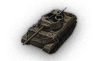
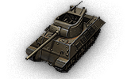
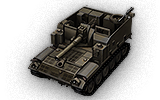
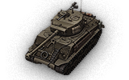
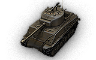
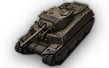
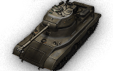
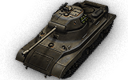
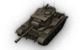

# USA · Tier VI

[All nations and tiers](../buffs_nerfs.md) · EU v20410 → RU v14600ru · 3 November 2026

<label><strong>Find a tank</strong><input type="search" placeholder="Try is7, obj140 or xm57" aria-label="Find a tank" style="display:block;width:100%;padding:.7rem;border:1px solid #888;border-radius:4px;margin:.5rem 0;color:inherit;background:transparent"></label>

M18 Hellcat · Tier VI

m18hellcat

<a href="https://tanks.gg/v20410/tank/hellcat">EU stats</a> · <a href="https://tanks.gg/v14600ru/tank/hellcat">RU stats</a>
<figure style="display:inline-block"><figcaption>M18 Hellcat</figcaption></figure>
<em>Mobility</em> 
<strong>Forward speed on medium terrain (km/h)</strong> <small>EU</small> 67.11  <small>RU</small> <strong>65.27</strong> 
<strong>Forward speed on soft terrain (km/h)</strong> <small>EU</small> 40.85  <small>RU</small> <strong>39.73</strong> 
<strong>Engine power (hp)</strong> <small>EU</small> 500  <small>RU</small> <strong>486.35</strong> 
<strong>Power/weight (hp/t)</strong> <small>EU</small> 24.69  <small>RU</small> <strong>24.01</strong> 
<strong>Tank traverse (°/s)</strong> <small>EU</small> 38.59  <small>RU</small> <strong>31.29</strong> 
<strong>Tank traverse on hard terrain (°/s)</strong> <small>EU</small> 35.32  <small>RU</small> <strong>33.60</strong> 
<strong>Tank traverse on medium terrain (°/s)</strong> <small>EU</small> 27.75  <small>RU</small> <strong>26.40</strong> 
<strong>Tank traverse on soft terrain (°/s)</strong> <small>EU</small> 16.89  <small>RU</small> <strong>16.07</strong> 

<em>Armor &amp; health</em> 
<strong>Health</strong> <small>EU</small> 650  <small>RU</small> <strong>640</strong> 
<strong>Health · engine</strong> <small>EU</small> 205  <small>RU</small> <strong>136</strong> 
<strong>Health · track</strong> <small>EU</small> 145  <small>RU</small> <strong>120</strong> 
<strong>Track repair time (s)</strong> <small>EU</small> 11.62  <small>RU</small> <strong>12.03</strong> 

M36 Jackson · Tier VI

m36jackson

<a href="https://tanks.gg/v20410/tank/jackson">EU stats</a> · <a href="https://tanks.gg/v14600ru/tank/jackson">RU stats</a>
<figure style="display:inline-block"><figcaption>M36 Jackson</figcaption></figure>
<em>Gun handling</em> 
<strong>Dispersion · turret traverse</strong> <small>EU</small> 0.14  <small>RU</small> <strong>0.16</strong> 

<em>Mobility</em> 
<strong>Forward speed on soft terrain (km/h)</strong> <small>EU</small> 26.60  <small>RU</small> <strong>25.26</strong> 
<strong>Reverse speed (km/h)</strong> <small>EU</small> 12  <small>RU</small> <strong>11</strong> 
<strong>Engine power (hp)</strong> <small>EU</small> 470  <small>RU</small> <strong>444.06</strong> 
<strong>Weight (kg)</strong> <small>EU</small> 29 243 → <small>RU</small> <strong>29 084</strong> 
<strong>Power/weight (hp/t)</strong> <small>EU</small> 16.07  <small>RU</small> <strong>15.27</strong> 
<strong>Tank traverse (°/s)</strong> <small>EU</small> 43.81  <small>RU</small> <strong>31.29</strong> 
<strong>Tank traverse on hard terrain (°/s)</strong> <small>EU</small> 44.06  <small>RU</small> <strong>34.68</strong> 
<strong>Tank traverse on medium terrain (°/s)</strong> <small>EU</small> 37.28  <small>RU</small> <strong>29.35</strong> 
<strong>Tank traverse on soft terrain (°/s)</strong> <small>EU</small> 21.07  <small>RU</small> <strong>16.59</strong> 

<em>Armor &amp; health</em> 
<strong>Health · engine</strong> <small>EU</small> 234  <small>RU</small> <strong>176</strong> 

<em>Miscellaneous</em> 
<strong>Fire chance (%)</strong> <small>EU</small> 20  <small>RU</small> <strong>15</strong> 

M44 · Tier VI

m44

<a href="https://tanks.gg/v20410/tank/m44">EU stats</a> · <a href="https://tanks.gg/v14600ru/tank/m44">RU stats</a>
<figure style="display:inline-block"><figcaption>M44</figcaption></figure>
<strong>Penetration (mm)</strong> <b>EU</b>  HE <strong>39</strong> /  HE <strong>49</strong> /  HEAT <strong>182</strong> → <b>RU</b>  HE <strong>39</strong> /  HEAT <strong>182</strong>

<strong>Damage (HP)</strong> <b>EU</b>  HE <strong>500</strong> /  HE <strong>600</strong> /  HEAT <strong>360</strong> → <b>RU</b>  HE <strong>750</strong> /  HEAT <strong>450</strong>

<em>Firepower</em> 
<strong>DPM (HP/min)</strong> <small>EU</small> 1 158.89  <small>RU</small> <strong>1 877.40</strong> 
<strong>Rate of fire (rounds/min)</strong> <small>EU</small> 2.32  <small>RU</small> <strong>2.50</strong> 
<strong>Reload time (s)</strong> <small>EU</small> 25.89  <small>RU</small> <strong>23.97</strong> 
<strong>Explosion radius</strong> <small>EU</small> 6.70  <small>RU</small> <strong>5.50</strong> 
<strong>Stun duration · maximum (s)</strong> <small>EU</small> 10.40 → <small>RU</small> <strong>—</strong> 
<strong>Stun duration · minimum (s)</strong> <small>EU</small> 6.24 → <small>RU</small> <strong>—</strong> 
<strong>Max range (m)</strong> <small>EU</small> 1 293.01  <small>RU</small> <strong>1 411.45</strong> 
<strong>Potential damage</strong> <small>EU</small> 18 000  <small>RU</small> <strong>27 000</strong> 

<em>Gun handling</em> 
<strong>Aim time (s)</strong> <small>EU</small> 5.94  <small>RU</small> <strong>5.56</strong> 
<strong>Dispersion (m/100 m)</strong> <small>EU</small> 0.77  <small>RU</small> <strong>0.75</strong> 
<strong>Dispersion · damaged</strong> <small>EU</small> 1.53  <small>RU</small> <strong>1.50</strong> 

<em>Armor &amp; health</em> 
<strong>Health · track</strong> <small>EU</small> 145  <small>RU</small> <strong>90</strong> 
<strong>Health · ammo rack</strong> <small>EU</small> 170  <small>RU</small> <strong>100</strong> 
<strong>Track repair time (s)</strong> <small>EU</small> 11.62  <small>RU</small> <strong>12.63</strong> 

<em>Miscellaneous</em> 
<strong>Shell cost</strong> <small>EU</small> 505  <small>RU</small> <strong>610</strong> 

M4A3E8 Fury · Tier VI

m4a3e8fury

<a href="https://tanks.gg/v20410/tank/fury">EU stats</a> · <a href="https://tanks.gg/v14600ru/tank/fury">RU stats</a>
<figure style="display:inline-block"><figcaption>M4A3E8 Fury</figcaption></figure>
<em>Gun handling</em> 
<strong>Aim time (s)</strong> <small>EU</small> 1.73  <small>RU</small> <strong>2.21</strong> 
<strong>Dispersion (m/100 m)</strong> <small>EU</small> 0.36  <small>RU</small> <strong>0.38</strong> 
<strong>Dispersion · damaged</strong> <small>EU</small> 0.73  <small>RU</small> <strong>0.77</strong> 
<strong>Dispersion · moving</strong> <small>EU</small> 0.16  <small>RU</small> <strong>0.19</strong> 
<strong>Dispersion · tank traverse</strong> <small>EU</small> 0.16  <small>RU</small> <strong>0.19</strong> 
<strong>Dispersion · turret traverse</strong> <small>EU</small> 0.08  <small>RU</small> <strong>0.12</strong> 
<strong>Dispersion · firing</strong> <small>EU</small> 3  <small>RU</small> <strong>3.50</strong> 

M4A3E8 Sherman · Tier VI

m4a3e8sherman

<a href="https://tanks.gg/v20410/tank/e8-sherman">EU stats</a> · <a href="https://tanks.gg/v14600ru/tank/m4a3e8">RU stats</a>
<figure style="display:inline-block"><figcaption>M4A3E8 Sherman</figcaption></figure>
<strong>Penetration (mm)</strong> <b>EU</b>  AP <strong>143</strong> /  APCR <strong>185</strong> /  HE <strong>38</strong> → <b>RU</b>  AP <strong>128</strong> /  APCR <strong>177</strong> /  HE <strong>38</strong>

<em>Gun handling</em> 
<strong>Dispersion · firing</strong> <small>EU</small> 3  <small>RU</small> <strong>3.50</strong> 

<em>Mobility</em> 
<strong>Forward speed on soft terrain (km/h)</strong> <small>EU</small> 41.49  <small>RU</small> <strong>40.73</strong> 
<strong>Engine power (hp)</strong> <small>EU</small> 560  <small>RU</small> <strong>549.79</strong> 
<strong>Power/weight (hp/t)</strong> <small>EU</small> 18.53  <small>RU</small> <strong>18.19</strong> 
<strong>Tank traverse (°/s)</strong> <small>EU</small> 56.32  <small>RU</small> <strong>41.72</strong> 
<strong>Tank traverse on hard terrain (°/s)</strong> <small>EU</small> 61.76  <small>RU</small> <strong>53.85</strong> 
<strong>Tank traverse on medium terrain (°/s)</strong> <small>EU</small> 56.14  <small>RU</small> <strong>48.95</strong> 
<strong>Tank traverse on soft terrain (°/s)</strong> <small>EU</small> 36.33  <small>RU</small> <strong>31.68</strong> 

<em>Armor &amp; health</em> 
<strong>Health</strong> <small>EU</small> 1 000  <small>RU</small> <strong>900</strong> 

M6 · Tier VI

m6

<a href="https://tanks.gg/v20410/tank/m6">EU stats</a> · <a href="https://tanks.gg/v14600ru/tank/m6">RU stats</a>
<figure style="display:inline-block"><figcaption>M6</figcaption></figure>
<strong>Penetration (mm)</strong> <b>EU</b>  AP <strong>160</strong> /  APCR <strong>204</strong> /  HE <strong>45</strong> → <b>RU</b>  AP <strong>160</strong> /  APCR <strong>243</strong> /  HE <strong>45</strong>

<em>Gun handling</em> 
<strong>Aim time (s)</strong> <small>EU</small> 2.11  <small>RU</small> <strong>1.92</strong> 
<strong>Dispersion (m/100 m)</strong> <small>EU</small> 0.38  <small>RU</small> <strong>0.40</strong> 
<strong>Dispersion · damaged</strong> <small>EU</small> 0.77  <small>RU</small> <strong>0.81</strong> 
<strong>Dispersion · moving</strong> <small>EU</small> 0.20  <small>RU</small> <strong>0.23</strong> 
<strong>Dispersion · tank traverse</strong> <small>EU</small> 0.20  <small>RU</small> <strong>0.23</strong> 
<strong>Dispersion · turret traverse</strong> <small>EU</small> 0.14  <small>RU</small> <strong>0.16</strong> 

<em>Mobility</em> 
<strong>Forward speed on soft terrain (km/h)</strong> <small>EU</small> 25.50  <small>RU</small> <strong>28.75</strong> 
<strong>Engine power (hp)</strong> <small>EU</small> 900  <small>RU</small> <strong>1 014.99</strong> 
<strong>Power/weight (hp/t)</strong> <small>EU</small> 15.41  <small>RU</small> <strong>17.38</strong> 
<strong>Tank traverse (°/s)</strong> <small>EU</small> 33.38  <small>RU</small> <strong>26.08</strong> 
<strong>Tank traverse on hard terrain (°/s)</strong> <small>EU</small> 36.91  <small>RU</small> <strong>29.82</strong> 
<strong>Tank traverse on medium terrain (°/s)</strong> <small>EU</small> 29  <small>RU</small> <strong>23.43</strong> 
<strong>Tank traverse on soft terrain (°/s)</strong> <small>EU</small> 17.65  <small>RU</small> <strong>14.26</strong> 

<em>Armor &amp; health</em> 
<strong>Health</strong> <small>EU</small> 1 100  <small>RU</small> <strong>1 070</strong> 

Pawlack Tank · Tier VI

pawlacktank

<a href="https://tanks.gg/v20410/tank/pawlack-tank">EU stats</a> · <a href="https://tanks.gg/v14600ru/tank/pawlack-tank">RU stats</a>
<figure style="display:inline-block"><figcaption>EU · Pawlack Tank</figcaption></figure><figure style="display:inline-block"><figcaption>RU · Pawlack Tank</figcaption></figure>
<strong>Penetration (mm)</strong> <b>EU</b>  AP <strong>160</strong> /  APCR <strong>205</strong> /  HE <strong>45</strong> → <b>RU</b>  AP <strong>175</strong> /  APCR <strong>205</strong> /  HE <strong>45</strong>

<em>Gun handling</em> 
<strong>Aim time (s)</strong> <small>EU</small> 2.30  <small>RU</small> <strong>2.01</strong> 
<strong>Dispersion · moving</strong> <small>EU</small> 0.24  <small>RU</small> <strong>0.20</strong> 
<strong>Dispersion · tank traverse</strong> <small>EU</small> 0.24  <small>RU</small> <strong>0.20</strong> 
<strong>Depression (°)</strong> <small>EU</small> 8  <small>RU</small> <strong>5</strong> 

<em>Mobility</em> 
<strong>Tank traverse (°/s)</strong> <small>EU</small> 38.59  <small>RU</small> <strong>33.38</strong> 
<strong>Tank traverse on hard terrain (°/s)</strong> <small>EU</small> 38.64  <small>RU</small> <strong>34.17</strong> 
<strong>Tank traverse on medium terrain (°/s)</strong> <small>EU</small> 35.67  <small>RU</small> <strong>31.54</strong> 
<strong>Tank traverse on soft terrain (°/s)</strong> <small>EU</small> 19.32  <small>RU</small> <strong>17.08</strong> 

<em>Armor &amp; health</em> 
<strong>Hull armor · front (mm)</strong> <small>EU</small> 146.10  <small>RU</small> <strong>127</strong> 
<strong>Health</strong> <small>EU</small> 1 050  <small>RU</small> <strong>950</strong> 

T37 · Tier VI

t37

<a href="https://tanks.gg/v20410/tank/t37">EU stats</a> · <a href="https://tanks.gg/v14600ru/tank/t37">RU stats</a>
<figure style="display:inline-block"><figcaption>T37</figcaption></figure>
<strong>Penetration (mm)</strong> <b>EU</b>  AP <strong>151</strong> /  APCR <strong>180</strong> /  HE <strong>38</strong> → <b>RU</b>  AP <strong>126</strong> /  APCR <strong>160</strong> /  HE <strong>38</strong>

<strong>Damage (HP)</strong> <b>EU</b>  AP <strong>120</strong> /  APCR <strong>120</strong> /  HE <strong>175</strong> → <b>RU</b>  AP <strong>115</strong> /  APCR <strong>115</strong> /  HE <strong>185</strong>

<em>Firepower</em> 
<strong>DPM (HP/min)</strong> <small>EU</small> 1 976.21  <small>RU</small> <strong>1 945.05</strong> 
<strong>Rate of fire (rounds/min)</strong> <small>EU</small> 16.47  <small>RU</small> <strong>16.91</strong> 
<strong>Reload time (s)</strong> <small>EU</small> 3.64  <small>RU</small> <strong>3.55</strong> 
<strong>Ammo capacity</strong> <small>EU</small> 60  <small>RU</small> <strong>50</strong> 
<strong>Potential damage</strong> <small>EU</small> 7 200  <small>RU</small> <strong>5 750</strong> 

<em>Gun handling</em> 
<strong>Dispersion (m/100 m)</strong> <small>EU</small> 0.38  <small>RU</small> <strong>0.43</strong> 
<strong>Dispersion · damaged</strong> <small>EU</small> 0.77  <small>RU</small> <strong>0.86</strong> 
<strong>Dispersion · moving</strong> <small>EU</small> 0.11  <small>RU</small> <strong>0.12</strong> 
<strong>Dispersion · tank traverse</strong> <small>EU</small> 0.11  <small>RU</small> <strong>0.12</strong> 

<em>Mobility</em> 
<strong>Forward speed (km/h)</strong> <small>EU</small> 60  <small>RU</small> <strong>65</strong> 
<strong>Forward speed on hard terrain (km/h)</strong> <small>EU</small> 60  <small>RU</small> <strong>65</strong> 
<strong>Forward speed on medium terrain (km/h)</strong> <small>EU</small> 60  <small>RU</small> <strong>65</strong> 
<strong>Forward speed on soft terrain (km/h)</strong> <small>EU</small> 60  <small>RU</small> <strong>65</strong> 
<strong>Reverse speed (km/h)</strong> <small>EU</small> 25  <small>RU</small> <strong>22</strong> 
<strong>Engine power (hp)</strong> <small>EU</small> 650  <small>RU</small> <strong>600</strong> 
<strong>Power/weight (hp/t)</strong> <small>EU</small> 27.80  <small>RU</small> <strong>25.66</strong> 
<strong>Tank traverse (°/s)</strong> <small>EU</small> 62.58  <small>RU</small> <strong>50.06</strong> 
<strong>Tank traverse on hard terrain (°/s)</strong> <small>EU</small> 60.22  <small>RU</small> <strong>56.87</strong> 
<strong>Tank traverse on medium terrain (°/s)</strong> <small>EU</small> 53.52  <small>RU</small> <strong>50.55</strong> 
<strong>Tank traverse on soft terrain (°/s)</strong> <small>EU</small> 32.11  <small>RU</small> <strong>30.33</strong> 

<em>Armor &amp; health</em> 
<strong>Health</strong> <small>EU</small> 900  <small>RU</small> <strong>680</strong> 

<em>Miscellaneous</em> 
<strong>View range (m)</strong> <small>EU</small> 380  <small>RU</small> <strong>370</strong> 

