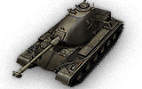
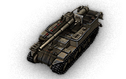
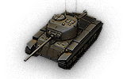
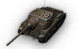
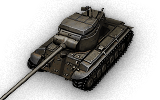
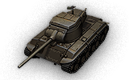
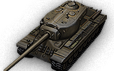
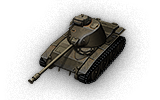
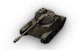

# USA · Tier VII

[All nations and tiers](../buffs_nerfs.md) · EU v20410 → RU v14600ru · 3 November 2026

<label><strong>Find a tank</strong><input type="search" placeholder="Try is7, obj140 or xm57" aria-label="Find a tank" style="display:block;width:100%;padding:.7rem;border:1px solid #888;border-radius:4px;margin:.5rem 0;color:inherit;background:transparent"></label>

M-II-Y · Tier VII

miiy

<a href="https://tanks.gg/v20410/tank/m-ii-y">EU stats</a> · <a href="https://tanks.gg/v14600ru/tank/m-ii-y">RU stats</a>
<figure style="display:inline-block"><figcaption>M-II-Y</figcaption></figure>
<em>Firepower</em> 
<strong>DPM (HP/min)</strong> <small>EU</small> 1 877.40  <small>RU</small> <strong>1 706.73</strong> 
<strong>Rate of fire (rounds/min)</strong> <small>EU</small> 7.82  <small>RU</small> <strong>7.11</strong> 
<strong>Reload time (s)</strong> <small>EU</small> 7.67  <small>RU</small> <strong>8.44</strong> 

<em>Gun handling</em> 
<strong>Dispersion (m/100 m)</strong> <small>EU</small> 0.37  <small>RU</small> <strong>0.39</strong> 
<strong>Dispersion · damaged</strong> <small>EU</small> 0.75  <small>RU</small> <strong>0.79</strong> 

<em>Mobility</em> 
<strong>Turret traverse (°/s)</strong> <small>EU</small> 29.20  <small>RU</small> <strong>26.08</strong> 
<strong>Tank traverse (°/s)</strong> <small>EU</small> 33.38  <small>RU</small> <strong>29.20</strong> 
<strong>Tank traverse on hard terrain (°/s)</strong> <small>EU</small> 33.46  <small>RU</small> <strong>29.28</strong> 
<strong>Tank traverse on medium terrain (°/s)</strong> <small>EU</small> 30.88  <small>RU</small> <strong>27.02</strong> 
<strong>Tank traverse on soft terrain (°/s)</strong> <small>EU</small> 16.73  <small>RU</small> <strong>14.64</strong> 

<em>Armor &amp; health</em> 
<strong>Health</strong> <small>EU</small> 1 350  <small>RU</small> <strong>1 250</strong> 

M12 · Tier VII

m12

<a href="https://tanks.gg/v20410/tank/m12">EU stats</a> · <a href="https://tanks.gg/v14600ru/tank/m12">RU stats</a>
<figure style="display:inline-block"><figcaption>M12</figcaption></figure>
<strong>Penetration (mm)</strong> <b>EU</b>  HE <strong>39</strong> /  HE <strong>49</strong> /  AP <strong>218</strong> → <b>RU</b>  HE <strong>39</strong> /  AP <strong>218</strong>

<strong>Damage (HP)</strong> <b>EU</b>  HE <strong>600</strong> /  HE <strong>750</strong> /  AP <strong>420</strong> → <b>RU</b>  HE <strong>850</strong> /  AP <strong>450</strong>

<em>Firepower</em> 
<strong>DPM (HP/min)</strong> <small>EU</small> 1 355.52  <small>RU</small> <strong>1 920.32</strong> 
<strong>Explosion radius</strong> <small>EU</small> 7.20  <small>RU</small> <strong>6.20</strong> 
<strong>Stun duration · maximum (s)</strong> <small>EU</small> 23 → <small>RU</small> <strong>—</strong> 
<strong>Stun duration · minimum (s)</strong> <small>EU</small> 11.50 → <small>RU</small> <strong>—</strong> 
<strong>Shell velocity (m/s)</strong> <small>EU</small> 490  <small>RU</small> <strong>430</strong> 
<strong>Max range (m)</strong> <small>EU</small> 1 412.35  <small>RU</small> <strong>1 411.45</strong> 
<strong>Potential damage</strong> <small>EU</small> 12 000  <small>RU</small> <strong>17 000</strong> 

<em>Gun handling</em> 
<strong>Aim time (s)</strong> <small>EU</small> 5.27  <small>RU</small> <strong>4.99</strong> 

<em>Armor &amp; health</em> 
<strong>Health · track</strong> <small>EU</small> 180  <small>RU</small> <strong>110</strong> 
<strong>Health · ammo rack</strong> <small>EU</small> 190  <small>RU</small> <strong>110</strong> 
<strong>Track repair time (s)</strong> <small>EU</small> 11.70  <small>RU</small> <strong>12.19</strong> 

<em>Miscellaneous</em> 
<strong>Shell cost</strong> <small>EU</small> 1 120  <small>RU</small> <strong>1 320</strong> 

T20 · Tier VII

t20

<a href="https://tanks.gg/v20410/tank/t20">EU stats</a> · <a href="https://tanks.gg/v14600ru/tank/t20">RU stats</a>
<figure style="display:inline-block"><figcaption>T20</figcaption></figure>
<em>Mobility</em> 
<strong>Forward speed on soft terrain (km/h)</strong> <small>EU</small> 44.37  <small>RU</small> <strong>43.07</strong> 
<strong>Engine power (hp)</strong> <small>EU</small> 610  <small>RU</small> <strong>592.08</strong> 
<strong>Power/weight (hp/t)</strong> <small>EU</small> 19.82  <small>RU</small> <strong>19.24</strong> 
<strong>Tank traverse (°/s)</strong> <small>EU</small> 43.81  <small>RU</small> <strong>38.59</strong> 
<strong>Tank traverse on hard terrain (°/s)</strong> <small>EU</small> 44.05  <small>RU</small> <strong>39</strong> 
<strong>Tank traverse on medium terrain (°/s)</strong> <small>EU</small> 40.04  <small>RU</small> <strong>35.46</strong> 
<strong>Tank traverse on soft terrain (°/s)</strong> <small>EU</small> 25.91  <small>RU</small> <strong>22.94</strong> 

<em>Armor &amp; health</em> 
<strong>Health</strong> <small>EU</small> 1 200  <small>RU</small> <strong>1 100</strong> 

T25 AT · Tier VII

t25at

<a href="https://tanks.gg/v20410/tank/t25-at">EU stats</a> · <a href="https://tanks.gg/v14600ru/tank/t25-at">RU stats</a>
<figure style="display:inline-block"><figcaption>T25 AT</figcaption></figure>
<strong>Penetration (mm)</strong> <b>EU</b>  AP <strong>198</strong> /  APCR <strong>267</strong> /  HE <strong>53</strong> → <b>RU</b>  AP <strong>198</strong> /  APCR <strong>245</strong> /  HE <strong>53</strong>

<em>Mobility</em> 
<strong>Forward speed on medium terrain (km/h)</strong> <small>EU</small> 54.23  <small>RU</small> <strong>51.75</strong> 
<strong>Forward speed on soft terrain (km/h)</strong> <small>EU</small> 33.01  <small>RU</small> <strong>31.50</strong> 
<strong>Engine power (hp)</strong> <small>EU</small> 780  <small>RU</small> <strong>744.33</strong> 
<strong>Power/weight (hp/t)</strong> <small>EU</small> 19.95  <small>RU</small> <strong>19.03</strong> 
<strong>Tank traverse (°/s)</strong> <small>EU</small> 46.93  <small>RU</small> <strong>31.29</strong> 
<strong>Tank traverse on hard terrain (°/s)</strong> <small>EU</small> 49.24  <small>RU</small> <strong>37.03</strong> 
<strong>Tank traverse on medium terrain (°/s)</strong> <small>EU</small> 42.21  <small>RU</small> <strong>31.74</strong> 
<strong>Tank traverse on soft terrain (°/s)</strong> <small>EU</small> 25.69  <small>RU</small> <strong>19.32</strong> 

<em>Armor &amp; health</em> 
<strong>Health</strong> <small>EU</small> 900  <small>RU</small> <strong>840</strong> 

T25/2 · Tier VII

t252

<a href="https://tanks.gg/v20410/tank/t252">EU stats</a> · <a href="https://tanks.gg/v14600ru/tank/t252">RU stats</a>
<figure style="display:inline-block"><figcaption>EU · T25/2</figcaption></figure><figure style="display:inline-block"><figcaption>RU · T25/2</figcaption></figure>
<strong>Penetration (mm)</strong> <b>EU</b>  AP <strong>192</strong> /  APCR <strong>258</strong> /  HE <strong>45</strong> → <b>RU</b>  AP <strong>170</strong> /  APCR <strong>258</strong> /  HE <strong>45</strong>

<strong>Damage (HP)</strong> <b>EU</b>  AP <strong>280</strong> /  APCR <strong>280</strong> /  HE <strong>360</strong> → <b>RU</b>  AP <strong>240</strong> /  APCR <strong>240</strong> /  HE <strong>320</strong>

<em>Firepower</em> 
<strong>DPM (HP/min)</strong> <small>EU</small> 1 946.93  <small>RU</small> <strong>1 950.55</strong> 
<strong>Rate of fire (rounds/min)</strong> <small>EU</small> 6.95  <small>RU</small> <strong>8.13</strong> 
<strong>Reload time (s)</strong> <small>EU</small> 8.63  <small>RU</small> <strong>7.38</strong> 
<strong>Potential damage</strong> <small>EU</small> 13 160  <small>RU</small> <strong>11 280</strong> 

<em>Gun handling</em> 
<strong>Aim time (s)</strong> <small>EU</small> 1.82  <small>RU</small> <strong>1.63</strong> 

<em>Mobility</em> 
<strong>Forward speed on hard terrain (km/h)</strong> <small>EU</small> 56  <small>RU</small> <strong>53.40</strong> 
<strong>Forward speed on medium terrain (km/h)</strong> <small>EU</small> 49.20  <small>RU</small> <strong>45.78</strong> 
<strong>Forward speed on soft terrain (km/h)</strong> <small>EU</small> 29.95  <small>RU</small> <strong>27.86</strong> 
<strong>Engine power (hp)</strong> <small>EU</small> 800  <small>RU</small> <strong>744.33</strong> 
<strong>Power/weight (hp/t)</strong> <small>EU</small> 18.10  <small>RU</small> <strong>16.84</strong> 
<strong>Tank traverse (°/s)</strong> <small>EU</small> 43.81  <small>RU</small> <strong>31.29</strong> 
<strong>Tank traverse on hard terrain (°/s)</strong> <small>EU</small> 46.81  <small>RU</small> <strong>36.77</strong> 
<strong>Tank traverse on medium terrain (°/s)</strong> <small>EU</small> 40.12  <small>RU</small> <strong>31.52</strong> 
<strong>Tank traverse on soft terrain (°/s)</strong> <small>EU</small> 24.42  <small>RU</small> <strong>19.18</strong> 

<em>Armor &amp; health</em> 
<strong>Health</strong> <small>EU</small> 900  <small>RU</small> <strong>850</strong> 
<strong>Health · engine</strong> <small>EU</small> 240  <small>RU</small> <strong>260</strong> 
<strong>Health · track</strong> <small>EU</small> 180  <small>RU</small> <strong>140</strong> 
<strong>Track repair time (s)</strong> <small>EU</small> 11.70  <small>RU</small> <strong>10.03</strong> 

T29 · Tier VII

t29

<a href="https://tanks.gg/v20410/tank/t29">EU stats</a> · <a href="https://tanks.gg/v14600ru/tank/t29">RU stats</a>
<figure style="display:inline-block"><figcaption>T29</figcaption></figure>
<em>Gun handling</em> 
<strong>Aim time (s)</strong> <small>EU</small> 2.40  <small>RU</small> <strong>2.59</strong> 

<em>Mobility</em> 
<strong>Forward speed on medium terrain (km/h)</strong> <small>EU</small> 33.44  <small>RU</small> <strong>33.27</strong> 
<strong>Forward speed on soft terrain (km/h)</strong> <small>EU</small> 19.29  <small>RU</small> <strong>19.20</strong> 
<strong>Engine power (hp)</strong> <small>EU</small> 850  <small>RU</small> <strong>845.82</strong> 
<strong>Weight (kg)</strong> <small>EU</small> 64 486 → <small>RU</small> <strong>64 499</strong> 
<strong>Power/weight (hp/t)</strong> <small>EU</small> 13.18  <small>RU</small> <strong>13.11</strong> 
<strong>Tank traverse (°/s)</strong> <small>EU</small> 26.08  <small>RU</small> <strong>23.99</strong> 
<strong>Tank traverse on hard terrain (°/s)</strong> <small>EU</small> 26.73  <small>RU</small> <strong>24.73</strong> 
<strong>Tank traverse on medium terrain (°/s)</strong> <small>EU</small> 19.60  <small>RU</small> <strong>18.14</strong> 
<strong>Tank traverse on soft terrain (°/s)</strong> <small>EU</small> 11.31  <small>RU</small> <strong>10.46</strong> 

<em>Armor &amp; health</em> 
<strong>Health</strong> <small>EU</small> 1 300  <small>RU</small> <strong>1 250</strong> 
<strong>Health · engine</strong> <small>EU</small> 338  <small>RU</small> <strong>260</strong> 

T71 CMCD · Tier VII

t71cmcd

<a href="https://tanks.gg/v20410/tank/t71-cmcd">EU stats</a> · <a href="https://tanks.gg/v14600ru/tank/t71-cmcd">RU stats</a>
<figure style="display:inline-block"><figcaption>T71 CMCD</figcaption></figure>
<strong>Penetration (mm)</strong> <b>EU</b>  APCR <strong>175</strong> /  HEAT <strong>210</strong> /  HE <strong>38</strong> → <b>RU</b>  APCR <strong>145</strong> /  HEAT <strong>210</strong> /  HE <strong>38</strong>

<strong>Damage (HP)</strong> <b>EU</b>  APCR <strong>135</strong> /  HEAT <strong>135</strong> /  HE <strong>185</strong> → <b>RU</b>  APCR <strong>150</strong> /  HEAT <strong>150</strong> /  HE <strong>185</strong>

<em>Firepower</em> 
<strong>DPM (HP/min)</strong> <small>EU</small> 2 346.75  <small>RU</small> <strong>2 086</strong> 
<strong>Rate of fire (rounds/min)</strong> <small>EU</small> 17.38  <small>RU</small> <strong>13.91</strong> 
<strong>Reload time (s)</strong> <small>EU</small> 3.45  <small>RU</small> <strong>4.31</strong> 
<strong>Ammo capacity</strong> <small>EU</small> 65  <small>RU</small> <strong>60</strong> 
<strong>Potential damage</strong> <small>EU</small> 8 775  <small>RU</small> <strong>9 000</strong> 

<em>Gun handling</em> 
<strong>Aim time (s)</strong> <small>EU</small> 1.53  <small>RU</small> <strong>1.82</strong> 
<strong>Dispersion (m/100 m)</strong> <small>EU</small> 0.38  <small>RU</small> <strong>0.36</strong> 
<strong>Dispersion · damaged</strong> <small>EU</small> 0.77  <small>RU</small> <strong>0.73</strong> 
<strong>Dispersion · moving</strong> <small>EU</small> 0.10  <small>RU</small> <strong>0.14</strong> 
<strong>Dispersion · tank traverse</strong> <small>EU</small> 0.10  <small>RU</small> <strong>0.14</strong> 
<strong>Dispersion · turret traverse</strong> <small>EU</small> 0.07  <small>RU</small> <strong>0.10</strong> 

<em>Mobility</em> 
<strong>Forward speed (km/h)</strong> <small>EU</small> 65  <small>RU</small> <strong>64</strong> 
<strong>Forward speed on hard terrain (km/h)</strong> <small>EU</small> 65  <small>RU</small> <strong>64</strong> 
<strong>Forward speed on medium terrain (km/h)</strong> <small>EU</small> 65  <small>RU</small> <strong>64</strong> 
<strong>Forward speed on soft terrain (km/h)</strong> <small>EU</small> 65  <small>RU</small> <strong>64</strong> 
<strong>Engine power (hp)</strong> <small>EU</small> 500  <small>RU</small> <strong>420</strong> 
<strong>Power/weight (hp/t)</strong> <small>EU</small> 29.45  <small>RU</small> <strong>24.74</strong> 
<strong>Tank traverse on hard terrain (°/s)</strong> <small>EU</small> 73.90  <small>RU</small> <strong>81.58</strong> 
<strong>Tank traverse on medium terrain (°/s)</strong> <small>EU</small> 55.42  <small>RU</small> <strong>61.19</strong> 
<strong>Tank traverse on soft terrain (°/s)</strong> <small>EU</small> 20.15  <small>RU</small> <strong>22.25</strong> 

<em>Armor &amp; health</em> 
<strong>Health</strong> <small>EU</small> 1 200  <small>RU</small> <strong>840</strong> 

<em>Miscellaneous</em> 
<strong>View range (m)</strong> <small>EU</small> 380  <small>RU</small> <strong>390</strong> 

T71 DA · Tier VII

t71da

<a href="https://tanks.gg/v20410/tank/t71-da">EU stats</a> · <a href="https://tanks.gg/v14600ru/tank/t71-da">RU stats</a>
<figure style="display:inline-block"><figcaption>T71 DA</figcaption></figure>
<em>Firepower</em> 
<strong>DPM (HP/min)</strong> <small>EU</small> 1 850.87  <small>RU</small> <strong>1 825.62</strong> 
<strong>Rate of fire (rounds/min)</strong> <small>EU</small> 12.34  <small>RU</small> <strong>12.17</strong> 
<strong>Reload time (s)</strong> <small>EU</small> 19.18  <small>RU</small> <strong>19.58</strong> 

