# USA · Tier VIII

[All nations and tiers](../buffs_nerfs.md) · EU v20410 → RU v14600ru · 3 November 2026

<label><strong>Find a tank</strong><input type="search" placeholder="Try is7, obj140 or xm57" aria-label="Find a tank" style="display:block;width:100%;padding:.7rem;border:1px solid #888;border-radius:4px;margin:.5rem 0;color:inherit;background:transparent"></label>

ASTRON Rex 105 mm · Tier VIII

astronrex105mm

<a href="https://tanks.gg/v20410/tank/astron-rex">EU stats</a> · <a href="https://tanks.gg/v14600ru/tank/astron-rex">RU stats</a>
<figure style="display:inline-block">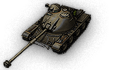<figcaption>ASTRON Rex 105 mm</figcaption></figure>
<em>Firepower</em> 
<strong>DPM (HP/min)</strong> <small>EU</small> 1 975.38  <small>RU</small> <strong>1 947.88</strong> 
<strong>Rate of fire (rounds/min)</strong> <small>EU</small> 6.17  <small>RU</small> <strong>6.09</strong> 
<strong>Reload time (s)</strong> <small>EU</small> 32.60  <small>RU</small> <strong>33.28</strong> 

M-III-Y · Tier VIII

miiiy

<a href="https://tanks.gg/v20410/tank/m-iii-y">EU stats</a> · <a href="https://tanks.gg/v14600ru/tank/m-iii-y">RU stats</a>
<figure style="display:inline-block">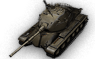<figcaption>EU · M-III-Y</figcaption></figure><figure style="display:inline-block">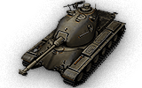<figcaption>RU · M-III-Y</figcaption></figure>
<strong>Penetration (mm)</strong> <b>EU</b>  AP <strong>215</strong> /  APCR <strong>251</strong> /  HE <strong>53</strong> → <b>RU</b>  AP <strong>208</strong> /  APCR <strong>245</strong> /  HE <strong>53</strong>

<em>Gun handling</em> 
<strong>Aim time (s)</strong> <small>EU</small> 1.92  <small>RU</small> <strong>2.21</strong> 
<strong>Dispersion (m/100 m)</strong> <small>EU</small> 0.35  <small>RU</small> <strong>0.37</strong> 
<strong>Dispersion · damaged</strong> <small>EU</small> 0.71  <small>RU</small> <strong>0.75</strong> 
<strong>Dispersion · moving</strong> <small>EU</small> 0.20  <small>RU</small> <strong>0.18</strong> 
<strong>Dispersion · tank traverse</strong> <small>EU</small> 0.20  <small>RU</small> <strong>0.18</strong> 

<em>Mobility</em> 
<strong>Forward speed (km/h)</strong> <small>EU</small> 40  <small>RU</small> <strong>45</strong> 
<strong>Forward speed on hard terrain (km/h)</strong> <small>EU</small> 40  <small>RU</small> <strong>45</strong> 
<strong>Forward speed on medium terrain (km/h)</strong> <small>EU</small> 40  <small>RU</small> <strong>45</strong> 
<strong>Forward speed on soft terrain (km/h)</strong> <small>EU</small> 23.79  <small>RU</small> <strong>26.43</strong> 
<strong>Reverse speed (km/h)</strong> <small>EU</small> 17  <small>RU</small> <strong>15</strong> 
<strong>Engine power (hp)</strong> <small>EU</small> 675  <small>RU</small> <strong>750</strong> 
<strong>Power/weight (hp/t)</strong> <small>EU</small> 15  <small>RU</small> <strong>16.67</strong> 
<strong>Turret traverse (°/s)</strong> <small>EU</small> 31.29  <small>RU</small> <strong>26.08</strong> 
<strong>Tank traverse (°/s)</strong> <small>EU</small> 34.42  <small>RU</small> <strong>29.20</strong> 
<strong>Tank traverse on hard terrain (°/s)</strong> <small>EU</small> 36.26  <small>RU</small> <strong>33.87</strong> 
<strong>Tank traverse on medium terrain (°/s)</strong> <small>EU</small> 33.47  <small>RU</small> <strong>31.27</strong> 
<strong>Tank traverse on soft terrain (°/s)</strong> <small>EU</small> 18.13  <small>RU</small> <strong>16.94</strong> 

<em>Armor &amp; health</em> 
<strong>Health</strong> <small>EU</small> 1 650  <small>RU</small> <strong>1 450</strong> 

M26 Pershing · Tier VIII

m26pershing

<a href="https://tanks.gg/v20410/tank/pershing">EU stats</a> · <a href="https://tanks.gg/v14600ru/tank/pershing">RU stats</a>
<figure style="display:inline-block">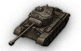<figcaption>M26 Pershing</figcaption></figure>
<strong>Damage (HP)</strong> <b>EU</b>  AP <strong>280</strong> /  APCR <strong>280</strong> /  HE <strong>380</strong> → <b>RU</b>  AP <strong>240</strong> /  APCR <strong>240</strong> /  HE <strong>320</strong>

<em>Firepower</em> 
<strong>DPM (HP/min)</strong> <small>EU</small> 2 305.58  <small>RU</small> <strong>2 422.45</strong> 
<strong>Rate of fire (rounds/min)</strong> <small>EU</small> 8.23  <small>RU</small> <strong>10.09</strong> 
<strong>Reload time (s)</strong> <small>EU</small> 7.29  <small>RU</small> <strong>5.94</strong> 
<strong>Potential damage</strong> <small>EU</small> 19 600  <small>RU</small> <strong>16 800</strong> 

<em>Gun handling</em> 
<strong>Dispersion · turret traverse</strong> <small>EU</small> 0.10  <small>RU</small> <strong>0.11</strong> 
<strong>Dispersion · firing</strong> <small>EU</small> 3  <small>RU</small> <strong>3.20</strong> 

<em>Mobility</em> 
<strong>Forward speed on soft terrain (km/h)</strong> <small>EU</small> 32.51  <small>RU</small> <strong>31.43</strong> 
<strong>Engine power (hp)</strong> <small>EU</small> 770  <small>RU</small> <strong>744.33</strong> 
<strong>Power/weight (hp/t)</strong> <small>EU</small> 17.94  <small>RU</small> <strong>17.34</strong> 
<strong>Tank traverse (°/s)</strong> <small>EU</small> 52.15  <small>RU</small> <strong>39.63</strong> 
<strong>Tank traverse on hard terrain (°/s)</strong> <small>EU</small> 52.08  <small>RU</small> <strong>44.73</strong> 
<strong>Tank traverse on medium terrain (°/s)</strong> <small>EU</small> 44.07  <small>RU</small> <strong>37.85</strong> 
<strong>Tank traverse on soft terrain (°/s)</strong> <small>EU</small> 27.28  <small>RU</small> <strong>23.43</strong> 

<em>Armor &amp; health</em> 
<strong>Health</strong> <small>EU</small> 1 600  <small>RU</small> <strong>1 440</strong> 

M40/M43 · Tier VIII

m40m43

<a href="https://tanks.gg/v20410/tank/m40m43">EU stats</a> · <a href="https://tanks.gg/v14600ru/tank/m40m43">RU stats</a>
<figure style="display:inline-block">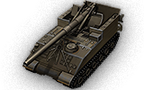<figcaption>M40/M43</figcaption></figure>
<strong>Penetration (mm)</strong> <b>EU</b>  HE <strong>52</strong> /  HE <strong>65</strong> /  AP <strong>272</strong> → <b>RU</b>  HE <strong>51</strong> /  AP <strong>272</strong>

<strong>Damage (HP)</strong> <b>EU</b>  HE <strong>900</strong> /  HE <strong>1100</strong> /  AP <strong>600</strong> → <b>RU</b>  HE <strong>1250</strong> /  AP <strong>700</strong>

<em>Firepower</em> 
<strong>DPM (HP/min)</strong> <small>EU</small> 1 224.39  <small>RU</small> <strong>1 700.54</strong> 
<strong>Explosion radius</strong> <small>EU</small> 10.50  <small>RU</small> <strong>8.50</strong> 
<strong>Stun duration · maximum (s)</strong> <small>EU</small> 28 → <small>RU</small> <strong>—</strong> 
<strong>Stun duration · minimum (s)</strong> <small>EU</small> 12.60 → <small>RU</small> <strong>—</strong> 
<strong>Max range (m)</strong> <small>EU</small> 1 335.17  <small>RU</small> <strong>1 413.14</strong> 
<strong>Potential damage</strong> <small>EU</small> 14 400  <small>RU</small> <strong>20 000</strong> 

<em>Mobility</em> 
<strong>Tank traverse on hard terrain (°/s)</strong> <small>EU</small> 23.41  <small>RU</small> <strong>26.89</strong> 
<strong>Tank traverse on medium terrain (°/s)</strong> <small>EU</small> 20.29  <small>RU</small> <strong>23.31</strong> 
<strong>Tank traverse on soft terrain (°/s)</strong> <small>EU</small> 12.17  <small>RU</small> <strong>13.98</strong> 

<em>Armor &amp; health</em> 
<strong>Health · track</strong> <small>EU</small> 220  <small>RU</small> <strong>130</strong> 
<strong>Health · ammo rack</strong> <small>EU</small> 210  <small>RU</small> <strong>134</strong> 
<strong>Track repair time (s)</strong> <small>EU</small> 11.70  <small>RU</small> <strong>12.44</strong> 

<em>Miscellaneous</em> 
<strong>Shell cost</strong> <small>EU</small> 1 870  <small>RU</small> <strong>2 310</strong> 

M41 Walker Bulldog · Tier VIII

m41walkerbulldog

<a href="https://tanks.gg/v20410/tank/bulldog">EU stats</a> · <a href="https://tanks.gg/v14600ru/tank/m41-bulldog">RU stats</a>
<figure style="display:inline-block">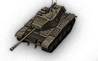<figcaption>M41 Walker Bulldog</figcaption></figure>
<strong>Penetration (mm)</strong> <b>EU</b>  APCR <strong>203</strong> /  HEAT <strong>250</strong> /  HE <strong>38</strong> → <b>RU</b>  APCR <strong>180</strong> /  HEAT <strong>215</strong> /  HE <strong>38</strong>

<strong>Damage (HP)</strong> <b>EU</b>  APCR <strong>150</strong> /  HEAT <strong>150</strong> /  HE <strong>230</strong> → <b>RU</b>  APCR <strong>170</strong> /  HEAT <strong>170</strong> /  HE <strong>260</strong>

<em>Firepower</em> 
<strong>DPM (HP/min)</strong> <small>EU</small> 2 607.50  <small>RU</small> <strong>2 364.13</strong> 
<strong>Rate of fire (rounds/min)</strong> <small>EU</small> 17.38  <small>RU</small> <strong>13.91</strong> 
<strong>Reload time (s)</strong> <small>EU</small> 3.45  <small>RU</small> <strong>4.31</strong> 
<strong>Ammo capacity</strong> <small>EU</small> 80  <small>RU</small> <strong>65</strong> 
<strong>Potential damage</strong> <small>EU</small> 12 000  <small>RU</small> <strong>11 050</strong> 

<em>Gun handling</em> 
<strong>Aim time (s)</strong> <small>EU</small> 1.44  <small>RU</small> <strong>1.63</strong> 
<strong>Dispersion (m/100 m)</strong> <small>EU</small> 0.38  <small>RU</small> <strong>0.34</strong> 
<strong>Dispersion · damaged</strong> <small>EU</small> 0.77  <small>RU</small> <strong>0.67</strong> 
<strong>Dispersion · moving</strong> <small>EU</small> 0.09  <small>RU</small> <strong>0.12</strong> 
<strong>Dispersion · tank traverse</strong> <small>EU</small> 0.09  <small>RU</small> <strong>0.12</strong> 
<strong>Dispersion · turret traverse</strong> <small>EU</small> 0.06  <small>RU</small> <strong>0.08</strong> 

<em>Mobility</em> 
<strong>Forward speed (km/h)</strong> <small>EU</small> 65  <small>RU</small> <strong>68</strong> 
<strong>Forward speed on hard terrain (km/h)</strong> <small>EU</small> 65  <small>RU</small> <strong>68</strong> 
<strong>Forward speed on medium terrain (km/h)</strong> <small>EU</small> 65  <small>RU</small> <strong>68</strong> 
<strong>Forward speed on soft terrain (km/h)</strong> <small>EU</small> 65  <small>RU</small> <strong>68</strong> 
<strong>Reverse speed (km/h)</strong> <small>EU</small> 25  <small>RU</small> <strong>24</strong> 
<strong>Engine power (hp)</strong> <small>EU</small> 900  <small>RU</small> <strong>800</strong> 
<strong>Power/weight (hp/t)</strong> <small>EU</small> 38.30  <small>RU</small> <strong>34.05</strong> 
<strong>Tank traverse (°/s)</strong> <small>EU</small> 69.88  <small>RU</small> <strong>58.41</strong> 
<strong>Tank traverse on hard terrain (°/s)</strong> <small>EU</small> 71.15  <small>RU</small> <strong>73.13</strong> 
<strong>Tank traverse on medium terrain (°/s)</strong> <small>EU</small> 59.29  <small>RU</small> <strong>60.94</strong> 
<strong>Tank traverse on soft terrain (°/s)</strong> <small>EU</small> 32.34  <small>RU</small> <strong>33.24</strong> 

<em>Armor &amp; health</em> 
<strong>Track armor</strong> <small>EU</small> 10  <small>RU</small> <strong>20</strong> 
<strong>Health</strong> <small>EU</small> 1 500  <small>RU</small> <strong>1 000</strong> 

M41 Walker Bulldog FL · Tier VIII

m41walkerbulldogfl

<a href="https://tanks.gg/v20410/tank/bulldog-fl">EU stats</a> · <a href="https://tanks.gg/v14600ru/tank/bulldog-fl">RU stats</a>
<figure style="display:inline-block"><figcaption>M41 Walker Bulldog FL</figcaption></figure>
<strong>Penetration (mm)</strong> <b>EU</b>  APCR <strong>203</strong> /  HEAT <strong>250</strong> /  HE <strong>38</strong> → <b>RU</b>  APCR <strong>180</strong> /  HEAT <strong>215</strong> /  HE <strong>38</strong>

<strong>Damage (HP)</strong> <b>EU</b>  APCR <strong>150</strong> /  HEAT <strong>150</strong> /  HE <strong>230</strong> → <b>RU</b>  APCR <strong>170</strong> /  HEAT <strong>170</strong> /  HE <strong>260</strong>

<em>Firepower</em> 
<strong>DPM (HP/min)</strong> <small>EU</small> 2 607.50  <small>RU</small> <strong>2 364.13</strong> 
<strong>Rate of fire (rounds/min)</strong> <small>EU</small> 17.38  <small>RU</small> <strong>13.91</strong> 
<strong>Reload time (s)</strong> <small>EU</small> 3.45  <small>RU</small> <strong>4.31</strong> 
<strong>Ammo capacity</strong> <small>EU</small> 80  <small>RU</small> <strong>65</strong> 
<strong>Potential damage</strong> <small>EU</small> 12 000  <small>RU</small> <strong>11 050</strong> 

<em>Gun handling</em> 
<strong>Aim time (s)</strong> <small>EU</small> 1.44  <small>RU</small> <strong>1.63</strong> 
<strong>Dispersion (m/100 m)</strong> <small>EU</small> 0.35  <small>RU</small> <strong>0.34</strong> 
<strong>Dispersion · damaged</strong> <small>EU</small> 0.71  <small>RU</small> <strong>0.67</strong> 
<strong>Dispersion · moving</strong> <small>EU</small> 0.09  <small>RU</small> <strong>0.12</strong> 
<strong>Dispersion · tank traverse</strong> <small>EU</small> 0.09  <small>RU</small> <strong>0.12</strong> 
<strong>Dispersion · turret traverse</strong> <small>EU</small> 0.06  <small>RU</small> <strong>0.08</strong> 

<em>Mobility</em> 
<strong>Forward speed (km/h)</strong> <small>EU</small> 65  <small>RU</small> <strong>68</strong> 
<strong>Forward speed on hard terrain (km/h)</strong> <small>EU</small> 65  <small>RU</small> <strong>68</strong> 
<strong>Forward speed on medium terrain (km/h)</strong> <small>EU</small> 65  <small>RU</small> <strong>68</strong> 
<strong>Forward speed on soft terrain (km/h)</strong> <small>EU</small> 65  <small>RU</small> <strong>68</strong> 
<strong>Reverse speed (km/h)</strong> <small>EU</small> 25  <small>RU</small> <strong>24</strong> 
<strong>Engine power (hp)</strong> <small>EU</small> 900  <small>RU</small> <strong>800</strong> 
<strong>Power/weight (hp/t)</strong> <small>EU</small> 38.30  <small>RU</small> <strong>34.05</strong> 
<strong>Tank traverse (°/s)</strong> <small>EU</small> 69.88  <small>RU</small> <strong>58.41</strong> 
<strong>Tank traverse on hard terrain (°/s)</strong> <small>EU</small> 66.39  <small>RU</small> <strong>55.49</strong> 
<strong>Tank traverse on medium terrain (°/s)</strong> <small>EU</small> 55.32  <small>RU</small> <strong>46.24</strong> 
<strong>Tank traverse on soft terrain (°/s)</strong> <small>EU</small> 30.18  <small>RU</small> <strong>25.22</strong> 

<em>Armor &amp; health</em> 
<strong>Track armor</strong> <small>EU</small> 10  <small>RU</small> <strong>20</strong> 
<strong>Health</strong> <small>EU</small> 1 500  <small>RU</small> <strong>1 000</strong> 

M46 Patton KR · Tier VIII

m46pattonkr

<a href="https://tanks.gg/v20410/tank/m46-kr">EU stats</a> · <a href="https://tanks.gg/v14600ru/tank/m46-kr">RU stats</a>
<figure style="display:inline-block">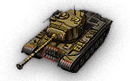<figcaption>M46 Patton KR</figcaption></figure>
<strong>Penetration (mm)</strong> <b>EU</b>  AP <strong>192</strong> /  APCR <strong>243</strong> /  HE <strong>45</strong> → <b>RU</b>  AP <strong>216</strong> /  APCR <strong>260</strong> /  HE <strong>45</strong>

<em>Firepower</em> 
<strong>DPM (HP/min)</strong> <small>EU</small> 2 029.62  <small>RU</small> <strong>2 346.75</strong> 
<strong>Rate of fire (rounds/min)</strong> <small>EU</small> 8.46  <small>RU</small> <strong>9.78</strong> 
<strong>Reload time (s)</strong> <small>EU</small> 7.09  <small>RU</small> <strong>6.14</strong> 

<em>Gun handling</em> 
<strong>Aim time (s)</strong> <small>EU</small> 2.11  <small>RU</small> <strong>1.82</strong> 
<strong>Dispersion · moving</strong> <small>EU</small> 0.12  <small>RU</small> <strong>0.10</strong> 
<strong>Dispersion · tank traverse</strong> <small>EU</small> 0.12  <small>RU</small> <strong>0.10</strong> 

<em>Miscellaneous</em> 
<strong>View range (m)</strong> <small>EU</small> 390  <small>RU</small> <strong>400</strong> 

T-832 · Tier VIII

t832

<a href="https://tanks.gg/v20410/tank/t-832">EU stats</a> · <a href="https://tanks.gg/v14600ru/tank/t-832">RU stats</a>
<figure>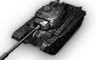</figure>
<em>Firepower</em> 
<strong>DPM (HP/min)</strong> <small>EU</small> 1 889.21  <small>RU</small> <strong>1 820.51</strong> 
<strong>Rate of fire (rounds/min)</strong> <small>EU</small> 5.90  <small>RU</small> <strong>5.69</strong> 
<strong>Reload time (s)</strong> <small>EU</small> 10.16  <small>RU</small> <strong>10.55</strong> 

T25 Pilot Number 1 · Tier VIII

t25pilotnumber1

<a href="https://tanks.gg/v20410/tank/t25-pilot-1">EU stats</a> · <a href="https://tanks.gg/v14600ru/tank/t25-pilot-1">RU stats</a>
<figure style="display:inline-block">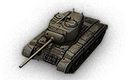<figcaption>T25 Pilot Number 1</figcaption></figure>
<strong>Penetration (mm)</strong> <b>EU</b>  AP <strong>208</strong> /  APCR <strong>268</strong> /  HE <strong>45</strong> → <b>RU</b>  APCR <strong>243</strong> /  HEAT <strong>280</strong> /  HE <strong>45</strong>

<strong>Damage (HP)</strong> <b>EU</b>  AP <strong>240</strong> /  APCR <strong>240</strong> /  HE <strong>320</strong> → <b>RU</b>  APCR <strong>240</strong> /  HEAT <strong>240</strong> /  HE <strong>320</strong>

<em>Firepower</em> 
<strong>DPM (HP/min)</strong> <small>EU</small> 1 925.54  <small>RU</small> <strong>2 176.70</strong> 
<strong>Rate of fire (rounds/min)</strong> <small>EU</small> 8.02  <small>RU</small> <strong>9.07</strong> 
<strong>Reload time (s)</strong> <small>EU</small> 7.48  <small>RU</small> <strong>6.62</strong> 
<strong>Shell velocity (m/s)</strong> <small>EU</small> 920  <small>RU</small> <strong>1 100</strong> 
<strong>Normalization</strong> <small>EU</small> 5  <small>RU</small> <strong>2</strong> 

<em>Mobility</em> 
<strong>Forward speed on soft terrain (km/h)</strong> <small>EU</small> 36.02  <small>RU</small> <strong>44.85</strong> 
<strong>Engine power (hp)</strong> <small>EU</small> 530  <small>RU</small> <strong>660</strong> 
<strong>Power/weight (hp/t)</strong> <small>EU</small> 14.20  <small>RU</small> <strong>17.68</strong> 

<em>Miscellaneous</em> 
<strong>View range (m)</strong> <small>EU</small> 390  <small>RU</small> <strong>400</strong> 
<strong>Shell cost</strong> <small>EU</small> 255  <small>RU</small> <strong>225</strong> 

T28 · Tier VIII

t28

<a href="https://tanks.gg/v20410/tank/t28">EU stats</a> · <a href="https://tanks.gg/v14600ru/tank/t28">RU stats</a>
<figure style="display:inline-block">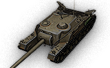<figcaption>T28</figcaption></figure>
<em>Mobility</em> 
<strong>Tank traverse on hard terrain (°/s)</strong> <small>EU</small> 26.33  <small>RU</small> <strong>27.35</strong> 
<strong>Tank traverse on medium terrain (°/s)</strong> <small>EU</small> 20.68  <small>RU</small> <strong>21.49</strong> 
<strong>Tank traverse on soft terrain (°/s)</strong> <small>EU</small> 9.99  <small>RU</small> <strong>10.37</strong> 

<em>Armor &amp; health</em> 
<strong>Hull armor · front (mm)</strong> <small>EU</small> 270  <small>RU</small> <strong>254</strong> 
<strong>Health</strong> <small>EU</small> 1 600  <small>RU</small> <strong>1 500</strong> 

<em>Miscellaneous</em> 
<strong>View range (m)</strong> <small>EU</small> 360  <small>RU</small> <strong>370</strong> 

T28 Prototype · Tier VIII

t28prototype

<a href="https://tanks.gg/v20410/tank/t28-prototype">EU stats</a> · <a href="https://tanks.gg/v14600ru/tank/t28-prot">RU stats</a>
<figure style="display:inline-block">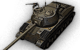<figcaption>T28 Prototype</figcaption></figure>
<em>Firepower</em> 
<strong>DPM (HP/min)</strong> <small>EU</small> 2 554.29  <small>RU</small> <strong>2 478.42</strong> 
<strong>Rate of fire (rounds/min)</strong> <small>EU</small> 6.39  <small>RU</small> <strong>6.20</strong> 
<strong>Reload time (s)</strong> <small>EU</small> 9.40  <small>RU</small> <strong>9.68</strong> 

<em>Gun handling</em> 
<strong>Dispersion · turret traverse</strong> <small>EU</small> 0.12  <small>RU</small> <strong>0.16</strong> 

<em>Mobility</em> 
<strong>Forward speed (km/h)</strong> <small>EU</small> 32  <small>RU</small> <strong>28</strong> 
<strong>Forward speed on hard terrain (km/h)</strong> <small>EU</small> 32  <small>RU</small> <strong>28</strong> 
<strong>Forward speed on medium terrain (km/h)</strong> <small>EU</small> 32  <small>RU</small> <strong>28</strong> 
<strong>Forward speed on soft terrain (km/h)</strong> <small>EU</small> 16.42  <small>RU</small> <strong>17.01</strong> 
<strong>Reverse speed (km/h)</strong> <small>EU</small> 12  <small>RU</small> <strong>10</strong> 
<strong>Engine power (hp)</strong> <small>EU</small> 830  <small>RU</small> <strong>860</strong> 
<strong>Power/weight (hp/t)</strong> <small>EU</small> 12.51  <small>RU</small> <strong>12.96</strong> 
<strong>Tank traverse (°/s)</strong> <small>EU</small> 25.03  <small>RU</small> <strong>20.86</strong> 
<strong>Tank traverse on hard terrain (°/s)</strong> <small>EU</small> 25.82  <small>RU</small> <strong>22.78</strong> 
<strong>Tank traverse on medium terrain (°/s)</strong> <small>EU</small> 20.29  <small>RU</small> <strong>17.90</strong> 
<strong>Tank traverse on soft terrain (°/s)</strong> <small>EU</small> 9.79  <small>RU</small> <strong>8.64</strong> 

<em>Armor &amp; health</em> 
<strong>Turret armor · front (mm)</strong> <small>EU</small> 203.20  <small>RU</small> <strong>254</strong> 
<strong>Health</strong> <small>EU</small> 1 400  <small>RU</small> <strong>1 300</strong> 
<strong>Health · engine</strong> <small>EU</small> 275  <small>RU</small> <strong>280</strong> 
<strong>Health · track</strong> <small>EU</small> 220  <small>RU</small> <strong>200</strong> 
<strong>Track repair time (s)</strong> <small>EU</small> 11.70  <small>RU</small> <strong>12.03</strong> 

T32 · Tier VIII

t32

<a href="https://tanks.gg/v20410/tank/t32">EU stats</a> · <a href="https://tanks.gg/v14600ru/tank/t32">RU stats</a>
<figure style="display:inline-block"><figcaption>T32</figcaption></figure>
<em>Mobility</em> 
<strong>Forward speed on soft terrain (km/h)</strong> <small>EU</small> 21.19  <small>RU</small> <strong>20.72</strong> 
<strong>Engine power (hp)</strong> <small>EU</small> 865  <small>RU</small> <strong>845.82</strong> 
<strong>Power/weight (hp/t)</strong> <small>EU</small> 15.03  <small>RU</small> <strong>14.70</strong> 
<strong>Tank traverse on hard terrain (°/s)</strong> <small>EU</small> 30.17  <small>RU</small> <strong>30.24</strong> 
<strong>Tank traverse on medium terrain (°/s)</strong> <small>EU</small> 22.12  <small>RU</small> <strong>22.18</strong> 
<strong>Tank traverse on soft terrain (°/s)</strong> <small>EU</small> 12.29  <small>RU</small> <strong>12.32</strong> 

<em>Armor &amp; health</em> 
<strong>Health</strong> <small>EU</small> 1 650  <small>RU</small> <strong>1 550</strong> 

T32 FL · Tier VIII

t32fl

<a href="https://tanks.gg/v20410/tank/t32-fl">EU stats</a> · <a href="https://tanks.gg/v14600ru/tank/t32-fl">RU stats</a>
<figure style="display:inline-block">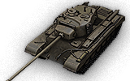<figcaption>T32 FL</figcaption></figure>
<em>Mobility</em> 
<strong>Forward speed on soft terrain (km/h)</strong> <small>EU</small> 21.19  <small>RU</small> <strong>20.72</strong> 
<strong>Engine power (hp)</strong> <small>EU</small> 865  <small>RU</small> <strong>845.82</strong> 
<strong>Power/weight (hp/t)</strong> <small>EU</small> 15.03  <small>RU</small> <strong>14.70</strong> 

<em>Armor &amp; health</em> 
<strong>Health</strong> <small>EU</small> 1 650  <small>RU</small> <strong>1 550</strong> 

T34 · Tier VIII

t34

<a href="https://tanks.gg/v20410/tank/t34">EU stats</a> · <a href="https://tanks.gg/v14600ru/tank/t34">RU stats</a>
<figure style="display:inline-block">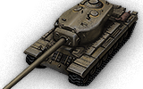<figcaption>T34</figcaption></figure>
<em>Firepower</em> 
<strong>DPM (HP/min)</strong> <small>EU</small> 1 668.80  <small>RU</small> <strong>1 800.86</strong> 
<strong>Rate of fire (rounds/min)</strong> <small>EU</small> 4.17  <small>RU</small> <strong>4.50</strong> 
<strong>Reload time (s)</strong> <small>EU</small> 14.38  <small>RU</small> <strong>13.33</strong> 

<em>Gun handling</em> 
<strong>Aim time (s)</strong> <small>EU</small> 3.07  <small>RU</small> <strong>2.59</strong> 
<strong>Dispersion · moving</strong> <small>EU</small> 0.25  <small>RU</small> <strong>0.20</strong> 
<strong>Dispersion · tank traverse</strong> <small>EU</small> 0.25  <small>RU</small> <strong>0.20</strong> 

T34 B · Tier VIII

t34b

<a href="https://tanks.gg/v20410/tank/t34-b">EU stats</a> · <a href="https://tanks.gg/v14600ru/tank/t34-b">RU stats</a>
<figure style="display:inline-block">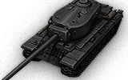<figcaption>T34 B</figcaption></figure>
<em>Firepower</em> 
<strong>DPM (HP/min)</strong> <small>EU</small> 1 668.80  <small>RU</small> <strong>1 800.86</strong> 
<strong>Rate of fire (rounds/min)</strong> <small>EU</small> 4.17  <small>RU</small> <strong>4.50</strong> 
<strong>Reload time (s)</strong> <small>EU</small> 14.38  <small>RU</small> <strong>13.33</strong> 

<em>Gun handling</em> 
<strong>Aim time (s)</strong> <small>EU</small> 3.07  <small>RU</small> <strong>2.59</strong> 
<strong>Dispersion · moving</strong> <small>EU</small> 0.25  <small>RU</small> <strong>0.20</strong> 
<strong>Dispersion · tank traverse</strong> <small>EU</small> 0.25  <small>RU</small> <strong>0.20</strong> 

T34 FL · Tier VIII

t34fl

<a href="https://tanks.gg/v20410/tank/t34-fl">EU stats</a> · <a href="https://tanks.gg/v14600ru/tank/t34-fl">RU stats</a>
<figure style="display:inline-block"><figcaption>T34 FL</figcaption></figure>
<em>Firepower</em> 
<strong>DPM (HP/min)</strong> <small>EU</small> 1 668.80  <small>RU</small> <strong>1 800.86</strong> 
<strong>Rate of fire (rounds/min)</strong> <small>EU</small> 4.17  <small>RU</small> <strong>4.50</strong> 
<strong>Reload time (s)</strong> <small>EU</small> 14.38  <small>RU</small> <strong>13.33</strong> 

<em>Gun handling</em> 
<strong>Aim time (s)</strong> <small>EU</small> 3.07  <small>RU</small> <strong>2.59</strong> 
<strong>Dispersion · moving</strong> <small>EU</small> 0.25  <small>RU</small> <strong>0.20</strong> 
<strong>Dispersion · tank traverse</strong> <small>EU</small> 0.25  <small>RU</small> <strong>0.20</strong> 

T42 · Tier VIII

t42

<a href="https://tanks.gg/v20410/tank/t42">EU stats</a> · <a href="https://tanks.gg/v14600ru/tank/t42">RU stats</a>
<figure style="display:inline-block">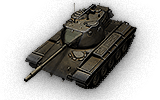<figcaption>T42</figcaption></figure>
<strong>Penetration (mm)</strong> <b>EU</b>  AP <strong>190</strong> /  APCR <strong>268</strong> /  HE <strong>45</strong> → <b>RU</b>  AP <strong>216</strong> /  APCR <strong>268</strong> /  HE <strong>45</strong>

<em>Firepower</em> 
<strong>Shell velocity (m/s)</strong> <small>EU</small> 814  <small>RU</small> <strong>1 021</strong> 

<em>Gun handling</em> 
<strong>Dispersion · moving</strong> <small>EU</small> 0.20  <small>RU</small> <strong>0.15</strong> 
<strong>Dispersion · tank traverse</strong> <small>EU</small> 0.20  <small>RU</small> <strong>0.15</strong> 

T69 · Tier VIII

t69

<a href="https://tanks.gg/v20410/tank/t69">EU stats</a> · <a href="https://tanks.gg/v14600ru/tank/t69">RU stats</a>
<figure style="display:inline-block">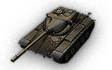<figcaption>T69</figcaption></figure>
<strong>Penetration (mm)</strong> <b>EU</b>  AP <strong>212</strong> /  HEAT <strong>280</strong> /  HE <strong>45</strong> → <b>RU</b>  AP <strong>200</strong> /  HEAT <strong>280</strong> /  HE <strong>45</strong>

<em>Firepower</em> 
<strong>DPM (HP/min)</strong> <small>EU</small> 1 985.48  <small>RU</small> <strong>2 204.01</strong> 
<strong>Rate of fire (rounds/min)</strong> <small>EU</small> 8.27  <small>RU</small> <strong>9.18</strong> 
<strong>Reload time (s)</strong> <small>EU</small> 23.01  <small>RU</small> <strong>20.13</strong> 

<em>Mobility</em> 
<strong>Forward speed on soft terrain (km/h)</strong> <small>EU</small> 31.49  <small>RU</small> <strong>30.52</strong> 
<strong>Engine power (hp)</strong> <small>EU</small> 600  <small>RU</small> <strong>581.50</strong> 
<strong>Power/weight (hp/t)</strong> <small>EU</small> 17.37  <small>RU</small> <strong>16.84</strong> 
<strong>Tank traverse (°/s)</strong> <small>EU</small> 55.28  <small>RU</small> <strong>43.81</strong> 
<strong>Tank traverse on hard terrain (°/s)</strong> <small>EU</small> 56.58  <small>RU</small> <strong>48.85</strong> 
<strong>Tank traverse on medium terrain (°/s)</strong> <small>EU</small> 51.86  <small>RU</small> <strong>44.78</strong> 
<strong>Tank traverse on soft terrain (°/s)</strong> <small>EU</small> 29.64  <small>RU</small> <strong>25.59</strong> 

<em>Armor &amp; health</em> 
<strong>Health</strong> <small>EU</small> 1 500  <small>RU</small> <strong>1 350</strong> 

T95E2 · Tier VIII

t95e2

<a href="https://tanks.gg/v20410/tank/t95e2">EU stats</a> · <a href="https://tanks.gg/v14600ru/tank/t95e2">RU stats</a>
<figure style="display:inline-block">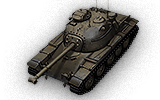<figcaption>T95E2</figcaption></figure>
<strong>Penetration (mm)</strong> <b>EU</b>  AP <strong>190</strong> /  HEAT <strong>250</strong> /  HE <strong>45</strong> → <b>RU</b>  AP <strong>212</strong> /  HEAT <strong>265</strong> /  HE <strong>45</strong>

<em>Firepower</em> 
<strong>DPM (HP/min)</strong> <small>EU</small> 2 002.56  <small>RU</small> <strong>2 145.60</strong> 
<strong>Rate of fire (rounds/min)</strong> <small>EU</small> 8.34  <small>RU</small> <strong>8.94</strong> 
<strong>Reload time (s)</strong> <small>EU</small> 7.19  <small>RU</small> <strong>6.71</strong> 

<em>Gun handling</em> 
<strong>Dispersion · moving</strong> <small>EU</small> 0.14  <small>RU</small> <strong>0.12</strong> 
<strong>Dispersion · tank traverse</strong> <small>EU</small> 0.14  <small>RU</small> <strong>0.12</strong> 

<em>Mobility</em> 
<strong>Forward speed on medium terrain (km/h)</strong> <small>EU</small> 55.48  <small>RU</small> <strong>56</strong> 
<strong>Forward speed on soft terrain (km/h)</strong> <small>EU</small> 32.12  <small>RU</small> <strong>34.18</strong> 
<strong>Engine power (hp)</strong> <small>EU</small> 592.08  <small>RU</small> <strong>630</strong> 
<strong>Power/weight (hp/t)</strong> <small>EU</small> 16.04  <small>RU</small> <strong>17.06</strong> 

XM57 · EU VIII → RU X

xm57

<a href="https://tanks.gg/v20410/tank/xm57">EU stats</a> · <a href="https://tanks.gg/v14600ru/tank/xm57">RU stats</a>
<figure style="display:inline-block">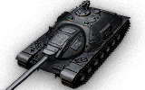<figcaption>EU · XM57</figcaption></figure><figure style="display:inline-block">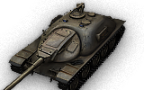<figcaption>RU · XM57</figcaption></figure>
<strong>Penetration (mm)</strong> <b>EU</b>  AP <strong>270</strong> /  APCR <strong>315</strong> /  HE <strong>90</strong> → <b>RU</b>  AP <strong>285</strong> /  HEAT <strong>360</strong> /  HE <strong>90</strong>

<strong>Damage (HP)</strong> <b>EU</b>  AP <strong>630</strong> /  APCR <strong>630</strong> /  HE <strong>900</strong> → <b>RU</b>  AP <strong>650</strong> /  HEAT <strong>650</strong> /  HE <strong>840</strong>

<em>General</em> 
<strong>Tier</strong> <small>EU</small> 8 → <small>RU</small> <strong>10</strong> 

<em>Firepower</em> 
<strong>DPM (HP/min)</strong> <small>EU</small> 2 075.02  <small>RU</small> <strong>2 824.79</strong> 
<strong>Rate of fire (rounds/min)</strong> <small>EU</small> 3.29  <small>RU</small> <strong>4.35</strong> 
<strong>Reload time (s)</strong> <small>EU</small> 18.22  <small>RU</small> <strong>13.81</strong> 
<strong>Shell velocity (m/s)</strong> <small>EU</small> 900  <small>RU</small> <strong>870</strong> 
<strong>Potential damage</strong> <small>EU</small> 18 900  <small>RU</small> <strong>19 500</strong> 

<em>Gun handling</em> 
<strong>Aim time (s)</strong> <small>EU</small> 2.88  <small>RU</small> <strong>2.30</strong> 
<strong>Dispersion (m/100 m)</strong> <small>EU</small> 0.41  <small>RU</small> <strong>0.38</strong> 
<strong>Dispersion · damaged</strong> <small>EU</small> 0.82  <small>RU</small> <strong>0.77</strong> 
<strong>Dispersion · moving</strong> <small>EU</small> 0.26  <small>RU</small> <strong>0.24</strong> 
<strong>Dispersion · tank traverse</strong> <small>EU</small> 0.26  <small>RU</small> <strong>0.24</strong> 
<strong>Dispersion · turret traverse</strong> <small>EU</small> 0.08  <small>RU</small> <strong>0.13</strong> 
<strong>Elevation (°)</strong> <small>EU</small> 15  <small>RU</small> <strong>18</strong> 
<strong>Depression (°)</strong> <small>EU</small> 7  <small>RU</small> <strong>13</strong> 

<em>Mobility</em> 
<strong>Forward speed (km/h)</strong> <small>EU</small> 24  <small>RU</small> <strong>30</strong> 
<strong>Forward speed on hard terrain (km/h)</strong> <small>EU</small> 24  <small>RU</small> <strong>30</strong> 
<strong>Forward speed on medium terrain (km/h)</strong> <small>EU</small> 24  <small>RU</small> <strong>26.81</strong> 
<strong>Forward speed on soft terrain (km/h)</strong> <small>EU</small> 16.06  <small>RU</small> <strong>15.19</strong> 
<strong>Reverse speed (km/h)</strong> <small>EU</small> 12  <small>RU</small> <strong>10</strong> 
<strong>Engine power (hp)</strong> <small>EU</small> 810  <small>RU</small> <strong>650</strong> 
<strong>Weight (kg)</strong> <small>EU</small> 60 000 → <small>RU</small> <strong>54 275</strong> 
<strong>Power/weight (hp/t)</strong> <small>EU</small> 13.50  <small>RU</small> <strong>11.98</strong> 
<strong>Terrain resist (hard)</strong> <small>EU</small> 1.34  <small>RU</small> <strong>1.44</strong> 
<strong>Terrain resist (med)</strong> <small>EU</small> 1.53  <small>RU</small> <strong>1.63</strong> 
<strong>Terrain resist (soft)</strong> <small>EU</small> 3.07  <small>RU</small> <strong>2.88</strong> 
<strong>Turret traverse (°/s)</strong> <small>EU</small> 22.95  <small>RU</small> <strong>20.86</strong> 
<strong>Tank traverse (°/s)</strong> <small>EU</small> 22.95  <small>RU</small> <strong>25.03</strong> 
<strong>Tank traverse on hard terrain (°/s)</strong> <small>EU</small> 21.80  <small>RU</small> <strong>23.78</strong> 
<strong>Tank traverse on medium terrain (°/s)</strong> <small>EU</small> 19.07  <small>RU</small> <strong>20.98</strong> 
<strong>Tank traverse on soft terrain (°/s)</strong> <small>EU</small> 9.54  <small>RU</small> <strong>11.89</strong> 
<strong>Auto siege on/off · engage (km/h)</strong> <small>EU</small> — → <small>RU</small> <strong>15</strong> 
<strong>Auto siege on/off · disengage (km/h)</strong> <small>EU</small> — → <small>RU</small> <strong>15</strong> 

<em>Armor &amp; health</em> 
<strong>Hull armor · front (mm)</strong> <small>EU</small> 120.70  <small>RU</small> <strong>300</strong> 
<strong>Hull armor · side (mm)</strong> <small>EU</small> 88.90  <small>RU</small> <strong>125</strong> 
<strong>Hull armor · rear (mm)</strong> <small>EU</small> 38.10  <small>RU</small> <strong>50</strong> 
<strong>Turret armor · front (mm)</strong> <small>EU</small> 304.80  <small>RU</small> <strong>330</strong> 
<strong>Turret armor · side (mm)</strong> <small>EU</small> 101.60  <small>RU</small> <strong>130</strong> 
<strong>Turret armor · rear (mm)</strong> <small>EU</small> 38.10  <small>RU</small> <strong>40</strong> 
<strong>Health</strong> <small>EU</small> 1 300  <small>RU</small> <strong>2 000</strong> 
<strong>Health · track</strong> <small>EU</small> 200  <small>RU</small> <strong>250</strong> 
<strong>Health · ammo rack</strong> <small>EU</small> 240  <small>RU</small> <strong>270</strong> 

<em>Miscellaneous</em> 
<strong>Stationary camo</strong> <small>EU</small> 16.36  <small>RU</small> <strong>16.19</strong> 
<strong>Stationary camo · after firing</strong> <small>EU</small> 2.21  <small>RU</small> <strong>2.19</strong> 
<strong>Moving camo</strong> <small>EU</small> 9.80  <small>RU</small> <strong>9.69</strong> 
<strong>Moving camo · after firing</strong> <small>EU</small> 1.32  <small>RU</small> <strong>1.31</strong> 
<strong>Fire chance (%)</strong> <small>EU</small> 20  <small>RU</small> <strong>12</strong> 

XM66F · EU VIII → RU IX

xm66f

<a href="https://tanks.gg/v20410/tank/xm66f">EU stats</a> · <a href="https://tanks.gg/v14600ru/tank/xm66f">RU stats</a>
<figure style="display:inline-block">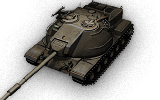<figcaption>XM66F</figcaption></figure>
<strong>Penetration (mm)</strong> <b>EU</b>  AP <strong>232</strong> /  APCR <strong>276</strong> /  HE <strong>60</strong> → <b>RU</b>  AP <strong>258</strong> /  HEAT <strong>340</strong> /  HE <strong>60</strong>

<strong>Damage (HP)</strong> <b>EU</b>  AP <strong>400</strong> /  APCR <strong>400</strong> /  HE <strong>515</strong> → <b>RU</b>  AP <strong>400</strong> /  HEAT <strong>400</strong> /  HE <strong>515</strong>

<em>General</em> 
<strong>Tier</strong> <small>EU</small> 8 → <small>RU</small> <strong>9</strong> 

<em>Firepower</em> 
<strong>DPM (HP/min)</strong> <small>EU</small> 2 634.95  <small>RU</small> <strong>2 844.55</strong> 
<strong>Rate of fire (rounds/min)</strong> <small>EU</small> 6.59  <small>RU</small> <strong>7.11</strong> 
<strong>Reload time (s)</strong> <small>EU</small> 9.11  <small>RU</small> <strong>8.44</strong> 

<em>Gun handling</em> 
<strong>Aim time (s)</strong> <small>EU</small> 1.92  <small>RU</small> <strong>1.63</strong> 
<strong>Dispersion (m/100 m)</strong> <small>EU</small> 0.36  <small>RU</small> <strong>0.35</strong> 
<strong>Dispersion · damaged</strong> <small>EU</small> 0.73  <small>RU</small> <strong>0.69</strong> 
<strong>Dispersion · moving</strong> <small>EU</small> 0.18  <small>RU</small> <strong>0.28</strong> 
<strong>Dispersion · tank traverse</strong> <small>EU</small> 0.18  <small>RU</small> <strong>0.28</strong> 
<strong>Depression (°)</strong> <small>EU</small> 10  <small>RU</small> <strong>9</strong> 
<strong>Gun traverse · left (°)</strong> <small>EU</small> -30  <small>RU</small> <strong>-60</strong> 
<strong>Gun traverse · right (°)</strong> <small>EU</small> 30  <small>RU</small> <strong>60</strong> 

<em>Mobility</em> 
<strong>Forward speed (km/h)</strong> <small>EU</small> 35  <small>RU</small> <strong>27</strong> 
<strong>Forward speed on hard terrain (km/h)</strong> <small>EU</small> 35  <small>RU</small> <strong>27</strong> 
<strong>Forward speed on medium terrain (km/h)</strong> <small>EU</small> 35  <small>RU</small> <strong>27</strong> 
<strong>Forward speed on soft terrain (km/h)</strong> <small>EU</small> 18.38  <small>RU</small> <strong>15.14</strong> 
<strong>Reverse speed (km/h)</strong> <small>EU</small> 15  <small>RU</small> <strong>12</strong> 
<strong>Engine power (hp)</strong> <small>EU</small> 850  <small>RU</small> <strong>700</strong> 
<strong>Power/weight (hp/t)</strong> <small>EU</small> 15.45  <small>RU</small> <strong>12.73</strong> 

<em>Armor &amp; health</em> 
<strong>Hull armor · front (mm)</strong> <small>EU</small> 95  <small>RU</small> <strong>150</strong> 
<strong>Hull armor · side (mm)</strong> <small>EU</small> 50  <small>RU</small> <strong>100</strong> 
<strong>Hull armor · rear (mm)</strong> <small>EU</small> 40  <small>RU</small> <strong>80</strong> 
<strong>Turret armor · front (mm)</strong> <small>EU</small> 230  <small>RU</small> <strong>240</strong> 
<strong>Health</strong> <small>EU</small> 1 300  <small>RU</small> <strong>1 850</strong> 
<strong>Health · track</strong> <small>EU</small> 200  <small>RU</small> <strong>240</strong> 

