# USA · Tier IX

[All nations and tiers](../buffs_nerfs.md) · EU v20410 → RU v14600ru · 3 November 2026

<label><strong>Find a tank</strong><input type="search" placeholder="Try is7, obj140 or xm57" aria-label="Find a tank" style="display:block;width:100%;padding:.7rem;border:1px solid #888;border-radius:4px;margin:.5rem 0;color:inherit;background:transparent"></label>

H3 · EU IX → RU X

h3

<a href="https://tanks.gg/v20410/tank/h3">EU stats</a> · <a href="https://tanks.gg/v14600ru/tank/h-3">RU stats</a>
<figure style="display:inline-block">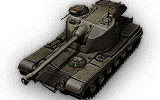<figcaption>EU · H3</figcaption></figure><figure style="display:inline-block">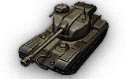<figcaption>RU · H-3</figcaption></figure>
<strong>Penetration (mm)</strong> <b>EU</b>  AP <strong>248</strong> /  APCR <strong>304</strong> /  HE <strong>60</strong> → <b>RU</b>  AP <strong>254</strong> /  HEAT <strong>320</strong> /  HE <strong>90</strong>

<strong>Damage (HP)</strong> <b>EU</b>  AP <strong>400</strong> /  APCR <strong>400</strong> /  HE <strong>515</strong> → <b>RU</b>  AP <strong>750</strong> /  HEAT <strong>750</strong> /  HE <strong>1100</strong>

<em>General</em> 
<strong>Tier</strong> <small>EU</small> 9 → <small>RU</small> <strong>10</strong> 

<em>Firepower</em> 
<strong>DPM (HP/min)</strong> <small>EU</small> 2 561.60  <small>RU</small> <strong>2 277.57</strong> 
<strong>Module damage</strong> <small>EU</small> 165  <small>RU</small> <strong>210</strong> 
<strong>Rate of fire (rounds/min)</strong> <small>EU</small> 6.40  <small>RU</small> <strong>3.04</strong> 
<strong>Reload time (s)</strong> <small>EU</small> 26.85  <small>RU</small> <strong>34.52</strong> 
<strong>Clip size</strong> <small>EU</small> 5  <small>RU</small> <strong>2</strong> 
<strong>Clip damage · damage</strong> <small>EU</small> 2 000  <small>RU</small> <strong>1 500</strong> 
<strong>Clip damage · time (s)</strong> <small>EU</small> 20  <small>RU</small> <strong>5</strong> 
<strong>Caliber</strong> <small>EU</small> 120  <small>RU</small> <strong>155</strong> 
<strong>Shell velocity (m/s)</strong> <small>EU</small> 1 045  <small>RU</small> <strong>870</strong> 
<strong>Potential damage</strong> <small>EU</small> 16 000  <small>RU</small> <strong>30 000</strong> 

<em>Gun handling</em> 
<strong>Aim time (s)</strong> <small>EU</small> 2.11  <small>RU</small> <strong>2.88</strong> 
<strong>Dispersion (m/100 m)</strong> <small>EU</small> 0.32  <small>RU</small> <strong>0.38</strong> 
<strong>Dispersion · damaged</strong> <small>EU</small> 0.63  <small>RU</small> <strong>0.77</strong> 
<strong>Dispersion · moving</strong> <small>EU</small> 0.16  <small>RU</small> <strong>0.18</strong> 
<strong>Dispersion · tank traverse</strong> <small>EU</small> 0.16  <small>RU</small> <strong>0.18</strong> 
<strong>Dispersion · turret traverse</strong> <small>EU</small> 0.10  <small>RU</small> <strong>0.16</strong> 
<strong>Depression (°)</strong> <small>EU</small> 7  <small>RU</small> <strong>10</strong> 

<em>Mobility</em> 
<strong>Forward speed (km/h)</strong> <small>EU</small> 46  <small>RU</small> <strong>50</strong> 
<strong>Forward speed on hard terrain (km/h)</strong> <small>EU</small> 46  <small>RU</small> <strong>50</strong> 
<strong>Forward speed on medium terrain (km/h)</strong> <small>EU</small> 46  <small>RU</small> <strong>50</strong> 
<strong>Forward speed on soft terrain (km/h)</strong> <small>EU</small> 26.86  <small>RU</small> <strong>46.13</strong> 
<strong>Reverse speed (km/h)</strong> <small>EU</small> 16  <small>RU</small> <strong>14</strong> 
<strong>Engine power (hp)</strong> <small>EU</small> 1 050  <small>RU</small> <strong>1 150</strong> 
<strong>Weight (kg)</strong> <small>EU</small> 61 999 → <small>RU</small> <strong>62 000</strong> 
<strong>Power/weight (hp/t)</strong> <small>EU</small> 16.94  <small>RU</small> <strong>18.55</strong> 
<strong>Terrain resist (hard)</strong> <small>EU</small> 1.15  <small>RU</small> <strong>0.56</strong> 
<strong>Terrain resist (med)</strong> <small>EU</small> 1.25  <small>RU</small> <strong>1.01</strong> 
<strong>Terrain resist (soft)</strong> <small>EU</small> 2.30  <small>RU</small> <strong>1.47</strong> 
<strong>Turret traverse (°/s)</strong> <small>EU</small> 37.55  <small>RU</small> <strong>31.29</strong> 
<strong>Tank traverse (°/s)</strong> <small>EU</small> 37.55  <small>RU</small> <strong>25.03</strong> 
<strong>Tank traverse on hard terrain (°/s)</strong> <small>EU</small> 35.67  <small>RU</small> <strong>23.78</strong> 
<strong>Tank traverse on medium terrain (°/s)</strong> <small>EU</small> 32.93  <small>RU</small> <strong>13.09</strong> 
<strong>Tank traverse on soft terrain (°/s)</strong> <small>EU</small> 17.84  <small>RU</small> <strong>8.99</strong> 

<em>Armor &amp; health</em> 
<strong>Hull armor · front (mm)</strong> <small>EU</small> 139.70  <small>RU</small> <strong>160</strong> 
<strong>Hull armor · side (mm)</strong> <small>EU</small> 63.50  <small>RU</small> <strong>50</strong> 
<strong>Hull armor · rear (mm)</strong> <small>EU</small> 50.80  <small>RU</small> <strong>40</strong> 
<strong>Turret armor · front (mm)</strong> <small>EU</small> 222.30  <small>RU</small> <strong>300</strong> 
<strong>Turret armor · side (mm)</strong> <small>EU</small> 146.10  <small>RU</small> <strong>135</strong> 
<strong>Turret armor · rear (mm)</strong> <small>EU</small> 50.80  <small>RU</small> <strong>100</strong> 
<strong>Health</strong> <small>EU</small> 1 700  <small>RU</small> <strong>2 150</strong> 
<strong>Health · engine</strong> <small>EU</small> 310  <small>RU</small> <strong>260</strong> 
<strong>Health · track</strong> <small>EU</small> 240  <small>RU</small> <strong>250</strong> 
<strong>Health · ammo rack</strong> <small>EU</small> 230  <small>RU</small> <strong>260</strong> 
<strong>Track repair time (s)</strong> <small>EU</small> 11.70  <small>RU</small> <strong>12.03</strong> 

<em>Miscellaneous</em> 
<strong>Stationary camo</strong> <small>EU</small> 3.71  <small>RU</small> <strong>4.10</strong> 
<strong>Stationary camo · after firing</strong> <small>EU</small> 0.67  <small>RU</small> <strong>0.55</strong> 
<strong>Moving camo</strong> <small>EU</small> 1.88  <small>RU</small> <strong>2.05</strong> 
<strong>Moving camo · after firing</strong> <small>EU</small> 0.34  <small>RU</small> <strong>0.28</strong> 
<strong>View range (m)</strong> <small>EU</small> 390  <small>RU</small> <strong>400</strong> 
<strong>Radio range (m)</strong> <small>EU</small> 670  <small>RU</small> <strong>745</strong> 
<strong>Shell cost</strong> <small>EU</small> 915  <small>RU</small> <strong>1 650</strong> 

M-VI-Y · Tier IX

mviy

<a href="https://tanks.gg/v20410/tank/m-vi-y">EU stats</a> · <a href="https://tanks.gg/v14600ru/tank/m-vi-y">RU stats</a>
<figure style="display:inline-block">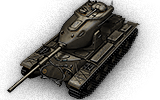<figcaption>M-VI-Y</figcaption></figure>
<strong>Penetration (mm)</strong> <b>EU</b>  AP <strong>253</strong> /  HEAT <strong>310</strong> /  HE <strong>60</strong> → <b>RU</b>  AP <strong>243</strong> /  HEAT <strong>300</strong> /  HE <strong>60</strong>

<em>Firepower</em> 
<strong>DPM (HP/min)</strong> <small>EU</small> 2 454.12  <small>RU</small> <strong>2 195.79</strong> 
<strong>Rate of fire (rounds/min)</strong> <small>EU</small> 6.14  <small>RU</small> <strong>5.49</strong> 
<strong>Reload time (s)</strong> <small>EU</small> 9.78  <small>RU</small> <strong>10.93</strong> 

<em>Gun handling</em> 
<strong>Aim time (s)</strong> <small>EU</small> 2.21  <small>RU</small> <strong>2.40</strong> 
<strong>Dispersion (m/100 m)</strong> <small>EU</small> 0.35  <small>RU</small> <strong>0.36</strong> 
<strong>Dispersion · damaged</strong> <small>EU</small> 0.71  <small>RU</small> <strong>0.73</strong> 

<em>Mobility</em> 
<strong>Forward speed (km/h)</strong> <small>EU</small> 40  <small>RU</small> <strong>45</strong> 
<strong>Forward speed on hard terrain (km/h)</strong> <small>EU</small> 40  <small>RU</small> <strong>45</strong> 
<strong>Forward speed on medium terrain (km/h)</strong> <small>EU</small> 40  <small>RU</small> <strong>45</strong> 
<strong>Forward speed on soft terrain (km/h)</strong> <small>EU</small> 26.61  <small>RU</small> <strong>29</strong> 
<strong>Reverse speed (km/h)</strong> <small>EU</small> 17  <small>RU</small> <strong>15</strong> 
<strong>Engine power (hp)</strong> <small>EU</small> 780  <small>RU</small> <strong>850</strong> 
<strong>Power/weight (hp/t)</strong> <small>EU</small> 16.78  <small>RU</small> <strong>18.28</strong> 
<strong>Turret traverse (°/s)</strong> <small>EU</small> 35.46  <small>RU</small> <strong>31.29</strong> 
<strong>Tank traverse on hard terrain (°/s)</strong> <small>EU</small> 30.36  <small>RU</small> <strong>33.35</strong> 
<strong>Tank traverse on medium terrain (°/s)</strong> <small>EU</small> 28.02  <small>RU</small> <strong>30.78</strong> 
<strong>Tank traverse on soft terrain (°/s)</strong> <small>EU</small> 15.18  <small>RU</small> <strong>16.67</strong> 

<em>Armor &amp; health</em> 
<strong>Health</strong> <small>EU</small> 1 900  <small>RU</small> <strong>1 800</strong> 

M-VII-Y · EU IX → RU VIII

mviiy

<a href="https://tanks.gg/v20410/tank/m-vii-y">EU stats</a> · <a href="https://tanks.gg/v14600ru/tank/m-vii-y">RU stats</a>
<figure style="display:inline-block">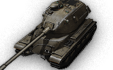<figcaption>EU · M-VII-Y</figcaption></figure><figure style="display:inline-block">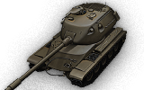<figcaption>RU · M-VII-Y</figcaption></figure>
<strong>Penetration (mm)</strong> <b>EU</b>  AP <strong>258</strong> /  HEAT <strong>315</strong> /  HE <strong>150</strong> → <b>RU</b>  APCR <strong>226</strong> /  HEAT <strong>270</strong> /  HE <strong>60</strong>

<strong>Damage (HP)</strong> <b>EU</b>  AP <strong>400</strong> /  HEAT <strong>400</strong> /  HE <strong>515</strong> → <b>RU</b>  APCR <strong>420</strong> /  HEAT <strong>420</strong> /  HE <strong>530</strong>

<em>General</em> 
<strong>Tier</strong> <small>EU</small> 9 → <small>RU</small> <strong>8</strong> 

<em>Firepower</em> 
<strong>DPM (HP/min)</strong> <small>EU</small> 2 580.62  <small>RU</small> <strong>1 775.92</strong> 
<strong>Rate of fire (rounds/min)</strong> <small>EU</small> 6.45  <small>RU</small> <strong>4.23</strong> 
<strong>Reload time (s)</strong> <small>EU</small> 9.30  <small>RU</small> <strong>14.19</strong> 
<strong>Caliber</strong> <small>EU</small> 120  <small>RU</small> <strong>120.50</strong> 
<strong>Shell velocity (m/s)</strong> <small>EU</small> 1 067  <small>RU</small> <strong>1 492</strong> 
<strong>Normalization</strong> <small>EU</small> 5  <small>RU</small> <strong>2</strong> 
<strong>Ammo capacity</strong> <small>EU</small> 40  <small>RU</small> <strong>60</strong> 
<strong>Potential damage</strong> <small>EU</small> 16 000  <small>RU</small> <strong>25 200</strong> 

<em>Gun handling</em> 
<strong>Aim time (s)</strong> <small>EU</small> 1.63  <small>RU</small> <strong>2.30</strong> 
<strong>Dispersion · damaged</strong> <small>EU</small> 0.69  <small>RU</small> <strong>0.71</strong> 
<strong>Dispersion · moving</strong> <small>EU</small> 0.16  <small>RU</small> <strong>0.20</strong> 
<strong>Dispersion · tank traverse</strong> <small>EU</small> 0.16  <small>RU</small> <strong>0.20</strong> 
<strong>Dispersion · turret traverse</strong> <small>EU</small> 0.08  <small>RU</small> <strong>0.20</strong> 
<strong>Dispersion · firing</strong> <small>EU</small> 4  <small>RU</small> <strong>4.50</strong> 
<strong>Elevation (°)</strong> <small>EU</small> 20  <small>RU</small> <strong>18</strong> 
<strong>Depression (°)</strong> <small>EU</small> 10  <small>RU</small> <strong>12</strong> 

<em>Mobility</em> 
<strong>Forward speed (km/h)</strong> <small>EU</small> 40  <small>RU</small> <strong>45</strong> 
<strong>Forward speed on hard terrain (km/h)</strong> <small>EU</small> 40  <small>RU</small> <strong>45</strong> 
<strong>Forward speed on medium terrain (km/h)</strong> <small>EU</small> 40  <small>RU</small> <strong>40.03</strong> 
<strong>Forward speed on soft terrain (km/h)</strong> <small>EU</small> 30.98  <small>RU</small> <strong>22.32</strong> 
<strong>Engine power (hp)</strong> <small>EU</small> 700  <small>RU</small> <strong>520</strong> 
<strong>Weight (kg)</strong> <small>EU</small> 43 000 → <small>RU</small> <strong>41 097</strong> 
<strong>Power/weight (hp/t)</strong> <small>EU</small> 16.28  <small>RU</small> <strong>12.65</strong> 
<strong>Terrain resist (hard)</strong> <small>EU</small> 0.96  <small>RU</small> <strong>0.63</strong> 
<strong>Terrain resist (soft)</strong> <small>EU</small> 1.92  <small>RU</small> <strong>2.07</strong> 
<strong>Turret traverse (°/s)</strong> <small>EU</small> 36.50  <small>RU</small> <strong>20.86</strong> 
<strong>Tank traverse (°/s)</strong> <small>EU</small> 35.46  <small>RU</small> <strong>37.55</strong> 
<strong>Tank traverse on hard terrain (°/s)</strong> <small>EU</small> 33.69  <small>RU</small> <strong>35.67</strong> 
<strong>Tank traverse on medium terrain (°/s)</strong> <small>EU</small> 28.07  <small>RU</small> <strong>19.41</strong> 
<strong>Tank traverse on soft terrain (°/s)</strong> <small>EU</small> 16.84  <small>RU</small> <strong>10.82</strong> 

<em>Armor &amp; health</em> 
<strong>Hull armor · front (mm)</strong> <small>EU</small> 146.10  <small>RU</small> <strong>150</strong> 
<strong>Hull armor · side (mm)</strong> <small>EU</small> 95.30  <small>RU</small> <strong>80</strong> 
<strong>Hull armor · rear (mm)</strong> <small>EU</small> 44.50  <small>RU</small> <strong>40</strong> 
<strong>Turret armor · front (mm)</strong> <small>EU</small> 323.90  <small>RU</small> <strong>300</strong> 
<strong>Turret armor · side (mm)</strong> <small>EU</small> 95.30  <small>RU</small> <strong>100</strong> 
<strong>Turret armor · rear (mm)</strong> <small>EU</small> 31.80  <small>RU</small> <strong>70</strong> 
<strong>Health</strong> <small>EU</small> 2 000  <small>RU</small> <strong>1 500</strong> 
<strong>Health · engine</strong> <small>EU</small> 310  <small>RU</small> <strong>285</strong> 
<strong>Health · track</strong> <small>EU</small> 240  <small>RU</small> <strong>200</strong> 
<strong>Health · ammo rack</strong> <small>EU</small> 230  <small>RU</small> <strong>240</strong> 
<strong>Track repair time (s)</strong> <small>EU</small> 11.70  <small>RU</small> <strong>12.03</strong> 

<em>Miscellaneous</em> 
<strong>Stationary camo</strong> <small>EU</small> 2.56  <small>RU</small> <strong>3.31</strong> 
<strong>Stationary camo · after firing</strong> <small>EU</small> 0.49  <small>RU</small> <strong>0.60</strong> 
<strong>Moving camo</strong> <small>EU</small> 1.25  <small>RU</small> <strong>1.65</strong> 
<strong>Moving camo · after firing</strong> <small>EU</small> 0.24  <small>RU</small> <strong>0.30</strong> 
<strong>View range (m)</strong> <small>EU</small> 390  <small>RU</small> <strong>380</strong> 
<strong>Radio range (m)</strong> <small>EU</small> 670  <small>RU</small> <strong>745</strong> 
<strong>Shell cost</strong> <small>EU</small> 952  <small>RU</small> <strong>1 040</strong> 

M103 · Tier IX

m103

<a href="https://tanks.gg/v20410/tank/m103">EU stats</a> · <a href="https://tanks.gg/v14600ru/tank/m103">RU stats</a>
<figure style="display:inline-block">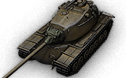<figcaption>M103</figcaption></figure>
<em>Mobility</em> 
<strong>Forward speed on soft terrain (km/h)</strong> <small>EU</small> 25.74  <small>RU</small> <strong>25.44</strong> 
<strong>Engine power (hp)</strong> <small>EU</small> 920  <small>RU</small> <strong>909.26</strong> 
<strong>Power/weight (hp/t)</strong> <small>EU</small> 16.23  <small>RU</small> <strong>16.04</strong> 
<strong>Tank traverse on hard terrain (°/s)</strong> <small>EU</small> 27.34  <small>RU</small> <strong>27.25</strong> 
<strong>Tank traverse on medium terrain (°/s)</strong> <small>EU</small> 25.23  <small>RU</small> <strong>25.16</strong> 
<strong>Tank traverse on soft terrain (°/s)</strong> <small>EU</small> 13.67  <small>RU</small> <strong>13.63</strong> 

M46 Patton · Tier IX

m46patton

<a href="https://tanks.gg/v20410/tank/m46-patton">EU stats</a> · <a href="https://tanks.gg/v14600ru/tank/m46-patton">RU stats</a>
<figure style="display:inline-block">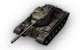<figcaption>EU · M46 Patton</figcaption></figure><figure style="display:inline-block"><figcaption>RU · M46 Patton</figcaption></figure>
<strong>Penetration (mm)</strong> <b>EU</b>  AP <strong>231</strong> /  APCR <strong>265</strong> /  HE <strong>53</strong> → <b>RU</b>  AP <strong>240</strong> /  APCR <strong>285</strong> /  HE <strong>53</strong>

<em>Gun handling</em> 
<strong>Aim time (s)</strong> <small>EU</small> 1.82  <small>RU</small> <strong>1.92</strong> 
<strong>Dispersion · moving</strong> <small>EU</small> 0.08  <small>RU</small> <strong>0.10</strong> 
<strong>Dispersion · tank traverse</strong> <small>EU</small> 0.08  <small>RU</small> <strong>0.10</strong> 
<strong>Dispersion · firing</strong> <small>EU</small> 3.50  <small>RU</small> <strong>4</strong> 

<em>Mobility</em> 
<strong>Forward speed on soft terrain (km/h)</strong> <small>EU</small> 37.85  <small>RU</small> <strong>36.46</strong> 
<strong>Engine power (hp)</strong> <small>EU</small> 900  <small>RU</small> <strong>866.97</strong> 
<strong>Power/weight (hp/t)</strong> <small>EU</small> 20.88  <small>RU</small> <strong>20.12</strong> 
<strong>Tank traverse (°/s)</strong> <small>EU</small> 59.45  <small>RU</small> <strong>39.63</strong> 
<strong>Tank traverse on hard terrain (°/s)</strong> <small>EU</small> 57.68  <small>RU</small> <strong>52.54</strong> 
<strong>Tank traverse on medium terrain (°/s)</strong> <small>EU</small> 48.80  <small>RU</small> <strong>44.45</strong> 
<strong>Tank traverse on soft terrain (°/s)</strong> <small>EU</small> 30.21  <small>RU</small> <strong>27.52</strong> 

<em>Armor &amp; health</em> 
<strong>Health</strong> <small>EU</small> 1 800  <small>RU</small> <strong>1 900</strong> 

M46 Patton FL · Tier IX

m46pattonfl

<a href="https://tanks.gg/v20410/tank/m46-fl">EU stats</a> · <a href="https://tanks.gg/v14600ru/tank/m46-fl">RU stats</a>
<figure style="display:inline-block">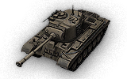<figcaption>M46 Patton FL</figcaption></figure>
<strong>Penetration (mm)</strong> <b>EU</b>  AP <strong>231</strong> /  APCR <strong>265</strong> /  HE <strong>53</strong> → <b>RU</b>  AP <strong>240</strong> /  APCR <strong>285</strong> /  HE <strong>53</strong>

<em>Gun handling</em> 
<strong>Aim time (s)</strong> <small>EU</small> 1.82  <small>RU</small> <strong>1.92</strong> 
<strong>Dispersion · moving</strong> <small>EU</small> 0.08  <small>RU</small> <strong>0.10</strong> 
<strong>Dispersion · tank traverse</strong> <small>EU</small> 0.08  <small>RU</small> <strong>0.10</strong> 
<strong>Dispersion · firing</strong> <small>EU</small> 3.50  <small>RU</small> <strong>4</strong> 

<em>Mobility</em> 
<strong>Forward speed on soft terrain (km/h)</strong> <small>EU</small> 37.85  <small>RU</small> <strong>36.46</strong> 
<strong>Engine power (hp)</strong> <small>EU</small> 900  <small>RU</small> <strong>866.97</strong> 
<strong>Power/weight (hp/t)</strong> <small>EU</small> 20.88  <small>RU</small> <strong>20.12</strong> 
<strong>Tank traverse (°/s)</strong> <small>EU</small> 59.45  <small>RU</small> <strong>39.63</strong> 
<strong>Tank traverse on hard terrain (°/s)</strong> <small>EU</small> 56.48  <small>RU</small> <strong>37.65</strong> 
<strong>Tank traverse on medium terrain (°/s)</strong> <small>EU</small> 47.79  <small>RU</small> <strong>31.86</strong> 
<strong>Tank traverse on soft terrain (°/s)</strong> <small>EU</small> 29.58  <small>RU</small> <strong>19.72</strong> 

<em>Armor &amp; health</em> 
<strong>Health</strong> <small>EU</small> 1 800  <small>RU</small> <strong>1 900</strong> 

M53/M55 · Tier IX

m53m55

<a href="https://tanks.gg/v20410/tank/m53m55">EU stats</a> · <a href="https://tanks.gg/v14600ru/tank/m53m55">RU stats</a>
<figure style="display:inline-block">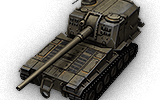<figcaption>M53/M55</figcaption></figure>
<strong>Penetration (mm)</strong> <b>EU</b>  HE <strong>52</strong> /  HE <strong>65</strong> /  AP <strong>314</strong> → <b>RU</b>  HE <strong>51</strong> /  AP <strong>314</strong>

<strong>Damage (HP)</strong> <b>EU</b>  HE <strong>850</strong> /  HE <strong>1100</strong> /  AP <strong>600</strong> → <b>RU</b>  HE <strong>1250</strong> /  AP <strong>700</strong>

<em>Firepower</em> 
<strong>DPM (HP/min)</strong> <small>EU</small> 1 266.50  <small>RU</small> <strong>1 862.50</strong> 
<strong>Explosion radius</strong> <small>EU</small> 10.50  <small>RU</small> <strong>8.50</strong> 
<strong>Stun duration · maximum (s)</strong> <small>EU</small> 28 → <small>RU</small> <strong>—</strong> 
<strong>Stun duration · minimum (s)</strong> <small>EU</small> 12.60 → <small>RU</small> <strong>—</strong> 
<strong>Max range (m)</strong> <small>EU</small> 1 290.67  <small>RU</small> <strong>1 413.14</strong> 
<strong>Potential damage</strong> <small>EU</small> 17 000  <small>RU</small> <strong>25 000</strong> 

<em>Gun handling</em> 
<strong>Dispersion (m/100 m)</strong> <small>EU</small> 0.74  <small>RU</small> <strong>0.72</strong> 
<strong>Dispersion · damaged</strong> <small>EU</small> 1.48  <small>RU</small> <strong>1.44</strong> 

<em>Mobility</em> 
<strong>Tank traverse on hard terrain (°/s)</strong> <small>EU</small> 25.10  <small>RU</small> <strong>25.11</strong> 

<em>Armor &amp; health</em> 
<strong>Health · track</strong> <small>EU</small> 240  <small>RU</small> <strong>150</strong> 
<strong>Track repair time (s)</strong> <small>EU</small> 11.70  <small>RU</small> <strong>12.63</strong> 

<em>Miscellaneous</em> 
<strong>Shell cost</strong> <small>EU</small> 1 870  <small>RU</small> <strong>2 310</strong> 

T30 · Tier IX

t30

<a href="https://tanks.gg/v20410/tank/t30">EU stats</a> · <a href="https://tanks.gg/v14600ru/tank/t30">RU stats</a>
<figure style="display:inline-block">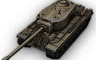<figcaption>T30</figcaption></figure>
<em>Gun handling</em> 
<strong>Dispersion · turret traverse</strong> <small>EU</small> 0.22  <small>RU</small> <strong>0.24</strong> 

<em>Mobility</em> 
<strong>Forward speed on medium terrain (km/h)</strong> <small>EU</small> 34.38  <small>RU</small> <strong>33.61</strong> 
<strong>Forward speed on soft terrain (km/h)</strong> <small>EU</small> 17.19  <small>RU</small> <strong>16.81</strong> 
<strong>Reverse speed (km/h)</strong> <small>EU</small> 12  <small>RU</small> <strong>10</strong> 
<strong>Engine power (hp)</strong> <small>EU</small> 930  <small>RU</small> <strong>909.26</strong> 
<strong>Power/weight (hp/t)</strong> <small>EU</small> 14.45  <small>RU</small> <strong>14.13</strong> 
<strong>Tank traverse (°/s)</strong> <small>EU</small> 26.08  <small>RU</small> <strong>22.95</strong> 
<strong>Tank traverse on hard terrain (°/s)</strong> <small>EU</small> 25.94  <small>RU</small> <strong>23.09</strong> 
<strong>Tank traverse on medium terrain (°/s)</strong> <small>EU</small> 22.70  <small>RU</small> <strong>20.20</strong> 
<strong>Tank traverse on soft terrain (°/s)</strong> <small>EU</small> 11.35  <small>RU</small> <strong>10.10</strong> 

<em>Armor &amp; health</em> 
<strong>Health · engine</strong> <small>EU</small> 310  <small>RU</small> <strong>260</strong> 
<strong>Health · track</strong> <small>EU</small> 240  <small>RU</small> <strong>230</strong> 
<strong>Track repair time (s)</strong> <small>EU</small> 11.70  <small>RU</small> <strong>12.03</strong> 

T30 FL · Tier IX

t30fl

<a href="https://tanks.gg/v20410/tank/t30-fl">EU stats</a> · <a href="https://tanks.gg/v14600ru/tank/t30-fl">RU stats</a>
<figure style="display:inline-block"><figcaption>T30 FL</figcaption></figure>
<em>Gun handling</em> 
<strong>Dispersion · turret traverse</strong> <small>EU</small> 0.22  <small>RU</small> <strong>0.24</strong> 

<em>Mobility</em> 
<strong>Forward speed on medium terrain (km/h)</strong> <small>EU</small> 34.38  <small>RU</small> <strong>33.61</strong> 
<strong>Forward speed on soft terrain (km/h)</strong> <small>EU</small> 17.19  <small>RU</small> <strong>16.81</strong> 
<strong>Reverse speed (km/h)</strong> <small>EU</small> 12  <small>RU</small> <strong>10</strong> 
<strong>Engine power (hp)</strong> <small>EU</small> 930  <small>RU</small> <strong>909.26</strong> 
<strong>Power/weight (hp/t)</strong> <small>EU</small> 14.45  <small>RU</small> <strong>14.13</strong> 
<strong>Tank traverse (°/s)</strong> <small>EU</small> 26.08  <small>RU</small> <strong>22.95</strong> 
<strong>Tank traverse on hard terrain (°/s)</strong> <small>EU</small> 24.77  <small>RU</small> <strong>21.80</strong> 
<strong>Tank traverse on medium terrain (°/s)</strong> <small>EU</small> 21.67  <small>RU</small> <strong>19.07</strong> 
<strong>Tank traverse on soft terrain (°/s)</strong> <small>EU</small> 10.84  <small>RU</small> <strong>9.54</strong> 

<em>Armor &amp; health</em> 
<strong>Health · engine</strong> <small>EU</small> 310  <small>RU</small> <strong>260</strong> 
<strong>Health · track</strong> <small>EU</small> 240  <small>RU</small> <strong>230</strong> 
<strong>Track repair time (s)</strong> <small>EU</small> 11.70  <small>RU</small> <strong>12.03</strong> 

T49 · Tier IX

t49

<a href="https://tanks.gg/v20410/tank/t49">EU stats</a> · <a href="https://tanks.gg/v14600ru/tank/t49">RU stats</a>
<figure style="display:inline-block">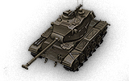<figcaption>T49</figcaption></figure>
<strong>Penetration (mm)</strong> <b>EU</b>  HEAT <strong>220</strong> / 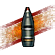 HE <strong>160</strong> /  HE <strong>76</strong> → <b>RU</b>  HE <strong>76</strong> /  HEAT <strong>152</strong> /  HE <strong>85</strong>

<strong>Damage (HP)</strong> <b>EU</b>  HEAT <strong>600</strong> /  HE <strong>750</strong> /  HE <strong>910</strong> → <b>RU</b>  HE <strong>910</strong> /  HEAT <strong>700</strong> /  HE <strong>910</strong>

<em>Firepower</em> 
<strong>DPM (HP/min)</strong> <small>EU</small> 1 632.52  <small>RU</small> <strong>2 475.99</strong> 
<strong>Ricochet angle</strong> <small>EU</small> 85  <small>RU</small> <strong>90</strong> 
<strong>Spaced armor pen loss</strong> <small>EU</small> 0.50  <small>RU</small> <strong>0</strong> 
<strong>Potential damage</strong> <small>EU</small> 13 200  <small>RU</small> <strong>20 020</strong> 
<strong>Explosion radius</strong> <small>EU</small> — → <small>RU</small> <strong>3.66</strong> 

<em>Gun handling</em> 
<strong>Aim time (s)</strong> <small>EU</small> 3.07  <small>RU</small> <strong>3.45</strong> 
<strong>Dispersion (m/100 m)</strong> <small>EU</small> 0.50  <small>RU</small> <strong>0.55</strong> 
<strong>Dispersion · damaged</strong> <small>EU</small> 1  <small>RU</small> <strong>1.09</strong> 
<strong>Dispersion · turret traverse</strong> <small>EU</small> 0.18  <small>RU</small> <strong>0.35</strong> 

<em>Mobility</em> 
<strong>Reverse speed (km/h)</strong> <small>EU</small> 27  <small>RU</small> <strong>24</strong> 
<strong>Engine power (hp)</strong> <small>EU</small> 930  <small>RU</small> <strong>900</strong> 
<strong>Power/weight (hp/t)</strong> <small>EU</small> 41.05  <small>RU</small> <strong>39.73</strong> 
<strong>Turret traverse (°/s)</strong> <small>EU</small> 50.06  <small>RU</small> <strong>45.89</strong> 
<strong>Tank traverse (°/s)</strong> <small>EU</small> 57.36  <small>RU</small> <strong>45.89</strong> 
<strong>Tank traverse on hard terrain (°/s)</strong> <small>EU</small> 61.41  <small>RU</small> <strong>52.30</strong> 
<strong>Tank traverse on medium terrain (°/s)</strong> <small>EU</small> 49.13  <small>RU</small> <strong>41.84</strong> 
<strong>Tank traverse on soft terrain (°/s)</strong> <small>EU</small> 28.90  <small>RU</small> <strong>24.61</strong> 

<em>Armor &amp; health</em> 
<strong>Track armor</strong> <small>EU</small> 10  <small>RU</small> <strong>20</strong> 
<strong>Health</strong> <small>EU</small> 1 700  <small>RU</small> <strong>1 400</strong> 

<em>Miscellaneous</em> 
<strong>Stationary camo</strong> <small>EU</small> 14.25  <small>RU</small> <strong>15.27</strong> 
<strong>Stationary camo · after firing</strong> <small>EU</small> 2.14  <small>RU</small> <strong>2.29</strong> 
<strong>Moving camo</strong> <small>EU</small> 14.25  <small>RU</small> <strong>15.27</strong> 
<strong>Moving camo · after firing</strong> <small>EU</small> 2.14  <small>RU</small> <strong>2.29</strong> 
<strong>Shell cost</strong> <small>EU</small> 1 200  <small>RU</small> <strong>750</strong> 

T54 Heavy Tank · Tier IX

t54heavytank

<a href="https://tanks.gg/v20410/tank/t54-heavy">EU stats</a> · <a href="https://tanks.gg/v14600ru/tank/t54-heavy">RU stats</a>
<figure style="display:inline-block">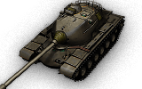<figcaption>T54 Heavy Tank</figcaption></figure>
<em>Firepower</em> 
<strong>DPM (HP/min)</strong> <small>EU</small> 2 289.51  <small>RU</small> <strong>2 166.23</strong> 
<strong>Rate of fire (rounds/min)</strong> <small>EU</small> 5.09  <small>RU</small> <strong>4.81</strong> 
<strong>Reload time (s)</strong> <small>EU</small> 11.79  <small>RU</small> <strong>12.46</strong> 

<em>Gun handling</em> 
<strong>Aim time (s)</strong> <small>EU</small> 2.40  <small>RU</small> <strong>2.30</strong> 
<strong>Dispersion (m/100 m)</strong> <small>EU</small> 0.36  <small>RU</small> <strong>0.40</strong> 
<strong>Dispersion · damaged</strong> <small>EU</small> 0.73  <small>RU</small> <strong>0.81</strong> 
<strong>Dispersion · moving</strong> <small>EU</small> 0.20  <small>RU</small> <strong>0.16</strong> 
<strong>Dispersion · tank traverse</strong> <small>EU</small> 0.20  <small>RU</small> <strong>0.16</strong> 
<strong>Dispersion · turret traverse</strong> <small>EU</small> 0.10  <small>RU</small> <strong>0.08</strong> 

<em>Mobility</em> 
<strong>Forward speed (km/h)</strong> <small>EU</small> 40  <small>RU</small> <strong>36</strong> 
<strong>Forward speed on hard terrain (km/h)</strong> <small>EU</small> 40  <small>RU</small> <strong>36</strong> 
<strong>Forward speed on medium terrain (km/h)</strong> <small>EU</small> 40  <small>RU</small> <strong>36</strong> 
<strong>Forward speed on soft terrain (km/h)</strong> <small>EU</small> 24.92  <small>RU</small> <strong>25.77</strong> 
<strong>Engine power (hp)</strong> <small>EU</small> 880  <small>RU</small> <strong>910</strong> 
<strong>Power/weight (hp/t)</strong> <small>EU</small> 15.71  <small>RU</small> <strong>16.25</strong> 
<strong>Turret traverse (°/s)</strong> <small>EU</small> 31.29  <small>RU</small> <strong>26.08</strong> 

T54E1 · Tier IX

t54e1

<a href="https://tanks.gg/v20410/tank/t54e1">EU stats</a> · <a href="https://tanks.gg/v14600ru/tank/t54e1">RU stats</a>
<figure style="display:inline-block">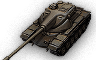<figcaption>T54E1</figcaption></figure>
<strong>Penetration (mm)</strong> <b>EU</b>  AP <strong>248</strong> /  HEAT <strong>310</strong> /  HE <strong>53</strong> → <b>RU</b>  AP <strong>248</strong> /  APCR <strong>310</strong> /  HE <strong>53</strong>

<strong>Damage (HP)</strong> <b>EU</b>  AP <strong>390</strong> /  HEAT <strong>390</strong> /  HE <strong>480</strong> → <b>RU</b>  AP <strong>390</strong> /  APCR <strong>390</strong> /  HE <strong>480</strong>

<em>Firepower</em> 
<strong>DPM (HP/min)</strong> <small>EU</small> 2 310.21  <small>RU</small> <strong>2 506.20</strong> 
<strong>Rate of fire (rounds/min)</strong> <small>EU</small> 5.92  <small>RU</small> <strong>6.43</strong> 
<strong>Reload time (s)</strong> <small>EU</small> 34.52  <small>RU</small> <strong>30.68</strong> 
<strong>Clip damage · time (s)</strong> <small>EU</small> 6  <small>RU</small> <strong>6.67</strong> 
<strong>Intra-clip reload</strong> <small>EU</small> 2  <small>RU</small> <strong>2.22</strong> 
<strong>Ammo capacity</strong> <small>EU</small> 40  <small>RU</small> <strong>36</strong> 
<strong>Potential damage</strong> <small>EU</small> 15 600  <small>RU</small> <strong>14 040</strong> 

<em>Gun handling</em> 
<strong>Dispersion (m/100 m)</strong> <small>EU</small> 0.36  <small>RU</small> <strong>0.38</strong> 
<strong>Dispersion · damaged</strong> <small>EU</small> 0.73  <small>RU</small> <strong>0.77</strong> 
<strong>Dispersion · turret traverse</strong> <small>EU</small> 0.16  <small>RU</small> <strong>0.10</strong> 

<em>Mobility</em> 
<strong>Forward speed on soft terrain (km/h)</strong> <small>EU</small> 26.45  <small>RU</small> <strong>26.04</strong> 
<strong>Engine power (hp)</strong> <small>EU</small> 870  <small>RU</small> <strong>856.40</strong> 
<strong>Power/weight (hp/t)</strong> <small>EU</small> 15.98  <small>RU</small> <strong>15.73</strong> 
<strong>Tank traverse on hard terrain (°/s)</strong> <small>EU</small> 42.76  <small>RU</small> <strong>44.68</strong> 
<strong>Tank traverse on medium terrain (°/s)</strong> <small>EU</small> 39.20  <small>RU</small> <strong>40.96</strong> 
<strong>Tank traverse on soft terrain (°/s)</strong> <small>EU</small> 20.45  <small>RU</small> <strong>21.37</strong> 

<em>Armor &amp; health</em> 
<strong>Turret armor · front (mm)</strong> <small>EU</small> 127  <small>RU</small> <strong>241.30</strong> 
<strong>Turret armor · side (mm)</strong> <small>EU</small> 69.90  <small>RU</small> <strong>139.70</strong> 
<strong>Health</strong> <small>EU</small> 1 900  <small>RU</small> <strong>1 850</strong> 

T95 · Tier IX

t95

<a href="https://tanks.gg/v20410/tank/t95">EU stats</a> · <a href="https://tanks.gg/v14600ru/tank/t95">RU stats</a>
<figure style="display:inline-block">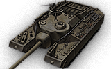<figcaption>T95</figcaption></figure>
<em>Mobility</em> 
<strong>Tank traverse on medium terrain (°/s)</strong> <small>EU</small> 25.42  <small>RU</small> <strong>25.43</strong> 
<strong>Tank traverse on soft terrain (°/s)</strong> <small>EU</small> 15.47  <small>RU</small> <strong>15.48</strong> 

<em>Armor &amp; health</em> 
<strong>Track armor</strong> <small>EU</small> 40  <small>RU</small> <strong>20</strong> 
<strong>Health · track</strong> <small>EU</small> 250  <small>RU</small> <strong>220</strong> 

TS-6 · Tier IX

ts6

<a href="https://tanks.gg/v20410/tank/ts-6">EU stats</a> · <a href="https://tanks.gg/v14600ru/tank/ts-6">RU stats</a>
<figure style="display:inline-block">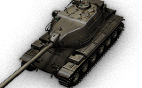<figcaption>EU · TS-6</figcaption></figure><figure style="display:inline-block">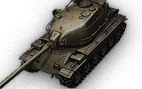<figcaption>RU · TS-6</figcaption></figure>
<strong>Penetration (mm)</strong> <b>EU</b>  AP <strong>252</strong> /  HEAT <strong>310</strong> /  HE <strong>60</strong> → <b>RU</b>  AP <strong>254</strong> /  HEAT <strong>330</strong> /  HE <strong>60</strong>

<strong>Damage (HP)</strong> <b>EU</b>  AP <strong>460</strong> /  HEAT <strong>460</strong> /  HE <strong>550</strong> → <b>RU</b>  AP <strong>400</strong> /  HEAT <strong>400</strong> /  HE <strong>530</strong>

<em>Firepower</em> 
<strong>DPM (HP/min)</strong> <small>EU</small> 2 116.68  <small>RU</small> <strong>2 503.20</strong> 
<strong>Rate of fire (rounds/min)</strong> <small>EU</small> 4.60  <small>RU</small> <strong>6.26</strong> 
<strong>Reload time (s)</strong> <small>EU</small> 13.04  <small>RU</small> <strong>9.59</strong> 
<strong>Shell velocity (m/s)</strong> <small>EU</small> 1 120  <small>RU</small> <strong>1 067</strong> 
<strong>Ammo capacity</strong> <small>EU</small> 40  <small>RU</small> <strong>60</strong> 
<strong>Potential damage</strong> <small>EU</small> 18 400  <small>RU</small> <strong>24 000</strong> 

<em>Gun handling</em> 
<strong>Aim time (s)</strong> <small>EU</small> 2.30  <small>RU</small> <strong>2.40</strong> 
<strong>Dispersion (m/100 m)</strong> <small>EU</small> 0.37  <small>RU</small> <strong>0.36</strong> 
<strong>Dispersion · damaged</strong> <small>EU</small> 0.75  <small>RU</small> <strong>0.73</strong> 
<strong>Dispersion · moving</strong> <small>EU</small> 0.18  <small>RU</small> <strong>0.12</strong> 
<strong>Dispersion · tank traverse</strong> <small>EU</small> 0.18  <small>RU</small> <strong>0.12</strong> 
<strong>Dispersion · turret traverse</strong> <small>EU</small> 0.08  <small>RU</small> <strong>0.12</strong> 
<strong>Elevation (°)</strong> <small>EU</small> 15  <small>RU</small> <strong>20</strong> 

<em>Mobility</em> 
<strong>Forward speed (km/h)</strong> <small>EU</small> 30  <small>RU</small> <strong>28</strong> 
<strong>Forward speed on hard terrain (km/h)</strong> <small>EU</small> 30  <small>RU</small> <strong>28</strong> 
<strong>Forward speed on medium terrain (km/h)</strong> <small>EU</small> 30  <small>RU</small> <strong>28</strong> 
<strong>Forward speed on soft terrain (km/h)</strong> <small>EU</small> 19.82  <small>RU</small> <strong>24.80</strong> 
<strong>Reverse speed (km/h)</strong> <small>EU</small> 14  <small>RU</small> <strong>15</strong> 
<strong>Engine power (hp)</strong> <small>EU</small> 700  <small>RU</small> <strong>680</strong> 
<strong>Weight (kg)</strong> <small>EU</small> 56 000 → <small>RU</small> <strong>57 000</strong> 
<strong>Power/weight (hp/t)</strong> <small>EU</small> 12.50  <small>RU</small> <strong>11.93</strong> 
<strong>Terrain resist (hard)</strong> <small>EU</small> 1.15  <small>RU</small> <strong>0.15</strong> 
<strong>Terrain resist (med)</strong> <small>EU</small> 1.25  <small>RU</small> <strong>0.82</strong> 
<strong>Terrain resist (soft)</strong> <small>EU</small> 2.30  <small>RU</small> <strong>1.75</strong> 
<strong>Turret traverse (°/s)</strong> <small>EU</small> 29.20  <small>RU</small> <strong>35.46</strong> 
<strong>Tank traverse (°/s)</strong> <small>EU</small> 27.12  <small>RU</small> <strong>35.46</strong> 
<strong>Tank traverse on hard terrain (°/s)</strong> <small>EU</small> 25.76  <small>RU</small> <strong>33.69</strong> 
<strong>Tank traverse on medium terrain (°/s)</strong> <small>EU</small> 23.78  <small>RU</small> <strong>6.22</strong> 
<strong>Tank traverse on soft terrain (°/s)</strong> <small>EU</small> 12.88  <small>RU</small> <strong>2.90</strong> 

<em>Armor &amp; health</em> 
<strong>Hull armor · front (mm)</strong> <small>EU</small> 150  <small>RU</small> <strong>200</strong> 
<strong>Hull armor · side (mm)</strong> <small>EU</small> 76  <small>RU</small> <strong>95</strong> 
<strong>Turret armor · front (mm)</strong> <small>EU</small> 250  <small>RU</small> <strong>275</strong> 
<strong>Turret armor · side (mm)</strong> <small>EU</small> 150  <small>RU</small> <strong>145</strong> 
<strong>Turret armor · rear (mm)</strong> <small>EU</small> 76  <small>RU</small> <strong>145</strong> 
<strong>Health</strong> <small>EU</small> 1 800  <small>RU</small> <strong>2 000</strong> 
<strong>Health · engine</strong> <small>EU</small> 310  <small>RU</small> <strong>260</strong> 
<strong>Health · ammo rack</strong> <small>EU</small> 230  <small>RU</small> <strong>260</strong> 
<strong>Track repair time (s)</strong> <small>EU</small> 11.70  <small>RU</small> <strong>12.03</strong> 

<em>Miscellaneous</em> 
<strong>Stationary camo</strong> <small>EU</small> 7.24  <small>RU</small> <strong>4.39</strong> 
<strong>Stationary camo · after firing</strong> <small>EU</small> 1.30  <small>RU</small> <strong>0.79</strong> 
<strong>Moving camo</strong> <small>EU</small> 3.59  <small>RU</small> <strong>2.22</strong> 
<strong>Moving camo · after firing</strong> <small>EU</small> 0.65  <small>RU</small> <strong>0.40</strong> 
<strong>View range (m)</strong> <small>EU</small> 380  <small>RU</small> <strong>390</strong> 
<strong>Radio range (m)</strong> <small>EU</small> 670  <small>RU</small> <strong>745</strong> 
<strong>Fire chance (%)</strong> <small>EU</small> 15  <small>RU</small> <strong>20</strong> 
<strong>Shell cost</strong> <small>EU</small> 1 069  <small>RU</small> <strong>1 110</strong> 

TS-60 · EU IX → RU X

ts60

<a href="https://tanks.gg/v20410/tank/ts-60">EU stats</a> · <a href="https://tanks.gg/v14600ru/tank/ts-60">RU stats</a>
<figure style="display:inline-block">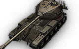<figcaption>EU · TS-60</figcaption></figure><figure style="display:inline-block">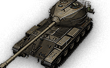<figcaption>RU · TS-60</figcaption></figure>
<strong>Penetration (mm)</strong> <b>EU</b>  AP <strong>258</strong> /  HEAT <strong>320</strong> /  HE <strong>60</strong> → <b>RU</b>  AP <strong>274</strong> /  HEAT <strong>350</strong> /  HE <strong>60</strong>

<strong>Damage (HP)</strong> <b>EU</b>  AP <strong>400</strong> /  HEAT <strong>400</strong> /  HE <strong>515</strong> → <b>RU</b>  AP <strong>450</strong> /  HEAT <strong>450</strong> /  HE <strong>550</strong>

<em>General</em> 
<strong>Tier</strong> <small>EU</small> 9 → <small>RU</small> <strong>10</strong> 

<em>Firepower</em> 
<strong>DPM (HP/min)</strong> <small>EU</small> 2 910.70  <small>RU</small> <strong>3 164.16</strong> 
<strong>Rate of fire (rounds/min)</strong> <small>EU</small> 7.28  <small>RU</small> <strong>7.03</strong> 
<strong>Reload time (s)</strong> <small>EU</small> 8.25  <small>RU</small> <strong>8.53</strong> 
<strong>Shell velocity (m/s)</strong> <small>EU</small> 1 150  <small>RU</small> <strong>1 250</strong> 
<strong>Ammo capacity</strong> <small>EU</small> 40  <small>RU</small> <strong>50</strong> 
<strong>Potential damage</strong> <small>EU</small> 16 000  <small>RU</small> <strong>22 500</strong> 

<em>Gun handling</em> 
<strong>Aim time (s)</strong> <small>EU</small> 1.63  <small>RU</small> <strong>1.92</strong> 
<strong>Dispersion (m/100 m)</strong> <small>EU</small> 0.38  <small>RU</small> <strong>0.33</strong> 
<strong>Dispersion · damaged</strong> <small>EU</small> 0.77  <small>RU</small> <strong>0.65</strong> 
<strong>Dispersion · moving</strong> <small>EU</small> 0.25  <small>RU</small> <strong>0.18</strong> 
<strong>Dispersion · tank traverse</strong> <small>EU</small> 0.25  <small>RU</small> <strong>0.18</strong> 
<strong>Dispersion · turret traverse</strong> <small>EU</small> 0.06  <small>RU</small> <strong>0.09</strong> 
<strong>Dispersion · firing</strong> <small>EU</small> 4  <small>RU</small> <strong>6</strong> 
<strong>Depression (°)</strong> <small>EU</small> 7  <small>RU</small> <strong>10</strong> 

<em>Mobility</em> 
<strong>Forward speed (km/h)</strong> <small>EU</small> 35  <small>RU</small> <strong>34</strong> 
<strong>Forward speed on hard terrain (km/h)</strong> <small>EU</small> 35  <small>RU</small> <strong>34</strong> 
<strong>Forward speed on medium terrain (km/h)</strong> <small>EU</small> 35  <small>RU</small> <strong>34</strong> 
<strong>Forward speed on soft terrain (km/h)</strong> <small>EU</small> 19.09  <small>RU</small> <strong>30.85</strong> 
<strong>Reverse speed (km/h)</strong> <small>EU</small> 12  <small>RU</small> <strong>16</strong> 
<strong>Engine power (hp)</strong> <small>EU</small> 800  <small>RU</small> <strong>850</strong> 
<strong>Weight (kg)</strong> <small>EU</small> 55 000 → <small>RU</small> <strong>55 015</strong> 
<strong>Power/weight (hp/t)</strong> <small>EU</small> 14.55  <small>RU</small> <strong>15.45</strong> 
<strong>Terrain resist (soft)</strong> <small>EU</small> 2.78  <small>RU</small> <strong>1.83</strong> 
<strong>Turret traverse (°/s)</strong> <small>EU</small> 18.77  <small>RU</small> <strong>20.86</strong> 
<strong>Tank traverse on soft terrain (°/s)</strong> <small>EU</small> 10.52  <small>RU</small> <strong>16.01</strong> 

<em>Armor &amp; health</em> 
<strong>Hull armor · front (mm)</strong> <small>EU</small> 120  <small>RU</small> <strong>200</strong> 
<strong>Hull armor · side (mm)</strong> <small>EU</small> 80  <small>RU</small> <strong>100</strong> 
<strong>Turret armor · front (mm)</strong> <small>EU</small> 300  <small>RU</small> <strong>210</strong> 
<strong>Turret armor · side (mm)</strong> <small>EU</small> 80  <small>RU</small> <strong>140</strong> 
<strong>Turret armor · rear (mm)</strong> <small>EU</small> 60  <small>RU</small> <strong>140</strong> 
<strong>Health</strong> <small>EU</small> 1 900  <small>RU</small> <strong>2 000</strong> 
<strong>Health · track</strong> <small>EU</small> 230  <small>RU</small> <strong>250</strong> 
<strong>Health · ammo rack</strong> <small>EU</small> 260  <small>RU</small> <strong>270</strong> 

<em>Miscellaneous</em> 
<strong>Stationary camo</strong> <small>EU</small> 18.24  <small>RU</small> <strong>12.88</strong> 
<strong>Stationary camo · after firing</strong> <small>EU</small> 3.28  <small>RU</small> <strong>2.32</strong> 
<strong>Moving camo</strong> <small>EU</small> 10.94  <small>RU</small> <strong>7.70</strong> 
<strong>Moving camo · after firing</strong> <small>EU</small> 1.97  <small>RU</small> <strong>1.39</strong> 
<strong>View range (m)</strong> <small>EU</small> 380  <small>RU</small> <strong>400</strong> 

