# USSR · Tier X

[All nations and tiers](../buffs_nerfs.md) · EU v20410 → RU v14600ru · 3 November 2026

<label><strong>Find a tank</strong><input type="search" placeholder="Try is7, obj140 or xm57" aria-label="Find a tank" style="display:block;width:100%;padding:.7rem;border:1px solid #888;border-radius:4px;margin:.5rem 0;color:inherit;background:transparent"></label>

IS-4 · Tier X

is4

<a href="https://tanks.gg/v20410/tank/is-4">EU stats</a> · <a href="https://tanks.gg/v14600ru/tank/is-4">RU stats</a>
<figure style="display:inline-block">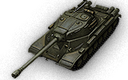<figcaption>IS-4</figcaption></figure>
<em>Firepower</em> 
<strong>Ammo capacity</strong> <small>EU</small> 40  <small>RU</small> <strong>30</strong> 
<strong>Potential damage</strong> <small>EU</small> 17 600  <small>RU</small> <strong>13 200</strong> 

<em>Mobility</em> 
<strong>Forward speed on hard terrain (km/h)</strong> <small>EU</small> 43  <small>RU</small> <strong>41.34</strong> 
<strong>Forward speed on medium terrain (km/h)</strong> <small>EU</small> 33.24  <small>RU</small> <strong>31.01</strong> 
<strong>Forward speed on soft terrain (km/h)</strong> <small>EU</small> 19.70  <small>RU</small> <strong>18.37</strong> 
<strong>Engine power (hp)</strong> <small>EU</small> 850  <small>RU</small> <strong>792.96</strong> 
<strong>Power/weight (hp/t)</strong> <small>EU</small> 13.97  <small>RU</small> <strong>13.04</strong> 
<strong>Tank traverse on hard terrain (°/s)</strong> <small>EU</small> 31.29  <small>RU</small> <strong>30.87</strong> 
<strong>Tank traverse on medium terrain (°/s)</strong> <small>EU</small> 23.47  <small>RU</small> <strong>23.16</strong> 
<strong>Tank traverse on soft terrain (°/s)</strong> <small>EU</small> 13.91  <small>RU</small> <strong>13.72</strong> 

IS-7 · Tier X

is7

<a href="https://tanks.gg/v20410/tank/is-7">EU stats</a> · <a href="https://tanks.gg/v14600ru/tank/is-7">RU stats</a>
<figure style="display:inline-block">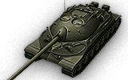<figcaption>EU · IS-7</figcaption></figure><figure style="display:inline-block">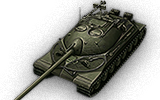<figcaption>RU · ИС-7</figcaption></figure>
<strong>Penetration (mm)</strong> <b>EU</b>  AP <strong>250</strong> /  APCR <strong>310</strong> /  HE <strong>68</strong> → <b>RU</b>  AP <strong>250</strong> /  APCR <strong>316</strong> /  HE <strong>68</strong>

<strong>Damage (HP)</strong> <b>EU</b>  AP <strong>490</strong> /  APCR <strong>490</strong> /  HE <strong>640</strong> → <b>RU</b>  AP <strong>530</strong> /  APCR <strong>530</strong> /  HE <strong>670</strong>

<em>Firepower</em> 
<strong>DPM (HP/min)</strong> <small>EU</small> 2 238.26  <small>RU</small> <strong>2 420.98</strong> 
<strong>Potential damage</strong> <small>EU</small> 14 700  <small>RU</small> <strong>15 900</strong> 

K-91 · Tier X

k91

<a href="https://tanks.gg/v20410/tank/k-91">EU stats</a> · <a href="https://tanks.gg/v14600ru/tank/k-91">RU stats</a>
<figure style="display:inline-block">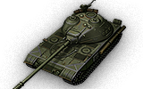<figcaption>K-91</figcaption></figure>
<em>Firepower</em> 
<strong>DPM (HP/min)</strong> <small>EU</small> 3 513.26  <small>RU</small> <strong>3 178.67</strong> 
<strong>Rate of fire (rounds/min)</strong> <small>EU</small> 10.98  <small>RU</small> <strong>9.93</strong> 
<strong>Reload time (s)</strong> <small>EU</small> 5.47  <small>RU</small> <strong>6.04</strong> 

<em>Gun handling</em> 
<strong>Dispersion (m/100 m)</strong> <small>EU</small> 0.32  <small>RU</small> <strong>0.29</strong> 
<strong>Dispersion · damaged</strong> <small>EU</small> 0.63  <small>RU</small> <strong>0.58</strong> 
<strong>Dispersion · moving</strong> <small>EU</small> 0.14  <small>RU</small> <strong>0.10</strong> 

Object 140 · Tier X

object140

<a href="https://tanks.gg/v20410/tank/obj-140">EU stats</a> · <a href="https://tanks.gg/v14600ru/tank/ob-140">RU stats</a>
<figure style="display:inline-block">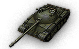<figcaption>Object 140</figcaption></figure>
<strong>Damage (HP)</strong> <b>EU</b>  APCR <strong>340</strong> /  HEAT <strong>340</strong> /  HE <strong>420</strong> → <b>RU</b>  APCR <strong>320</strong> /  HEAT <strong>320</strong> /  HE <strong>420</strong>

<em>Firepower</em> 
<strong>DPM (HP/min)</strong> <small>EU</small> 3 377.33  <small>RU</small> <strong>3 034.18</strong> 
<strong>Rate of fire (rounds/min)</strong> <small>EU</small> 9.93  <small>RU</small> <strong>9.48</strong> 
<strong>Reload time (s)</strong> <small>EU</small> 6.04  <small>RU</small> <strong>6.33</strong> 
<strong>Potential damage</strong> <small>EU</small> 17 000  <small>RU</small> <strong>16 000</strong> 

<em>Gun handling</em> 
<strong>Aim time (s)</strong> <small>EU</small> 1.82  <small>RU</small> <strong>2.01</strong> 

<em>Mobility</em> 
<strong>Forward speed on soft terrain (km/h)</strong> <small>EU</small> 49.34  <small>RU</small> <strong>55</strong> 
<strong>Engine power (hp)</strong> <small>EU</small> 700  <small>RU</small> <strong>720</strong> 
<strong>Power/weight (hp/t)</strong> <small>EU</small> 19.44  <small>RU</small> <strong>20</strong> 
<strong>Terrain resist (hard)</strong> <small>EU</small> 0.53  <small>RU</small> <strong>0.17</strong> 
<strong>Terrain resist (med)</strong> <small>EU</small> 0.62  <small>RU</small> <strong>0.50</strong> 
<strong>Terrain resist (soft)</strong> <small>EU</small> 1.44  <small>RU</small> <strong>0.96</strong> 
<strong>Tank traverse on medium terrain (°/s)</strong> <small>EU</small> 45.27  <small>RU</small> <strong>18.05</strong> 
<strong>Tank traverse on soft terrain (°/s)</strong> <small>EU</small> 19.62  <small>RU</small> <strong>9.46</strong> 

<em>Armor &amp; health</em> 
<strong>Hull armor · front (mm)</strong> <small>EU</small> 110  <small>RU</small> <strong>120</strong> 
<strong>Turret armor · front (mm)</strong> <small>EU</small> 275  <small>RU</small> <strong>240</strong> 
<strong>Health</strong> <small>EU</small> 1 950  <small>RU</small> <strong>2 050</strong> 

Object 261 · Tier X

object261

<a href="https://tanks.gg/v20410/tank/obj-261">EU stats</a> · <a href="https://tanks.gg/v14600ru/tank/ob-261">RU stats</a>
<figure style="display:inline-block">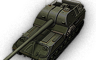<figcaption>Object 261</figcaption></figure>
<strong>Penetration (mm)</strong> <b>EU</b>  HE <strong>45</strong> /  HE <strong>56</strong> /  AP <strong>334</strong> → <b>RU</b>  HE <strong>45</strong> /  AP <strong>334</strong>

<strong>Damage (HP)</strong> <b>EU</b>  HE <strong>800</strong> /  HE <strong>1000</strong> /  AP <strong>520</strong> → <b>RU</b>  HE <strong>1100</strong> /  AP <strong>600</strong>

<em>Firepower</em> 
<strong>DPM (HP/min)</strong> <small>EU</small> 1 564.50  <small>RU</small> <strong>2 024.65</strong> 
<strong>Rate of fire (rounds/min)</strong> <small>EU</small> 1.96  <small>RU</small> <strong>1.84</strong> 
<strong>Reload time (s)</strong> <small>EU</small> 30.68  <small>RU</small> <strong>32.60</strong> 
<strong>Explosion radius</strong> <small>EU</small> 9.50  <small>RU</small> <strong>7.50</strong> 
<strong>Stun duration · maximum (s)</strong> <small>EU</small> 29 → <small>RU</small> <strong>—</strong> 
<strong>Stun duration · minimum (s)</strong> <small>EU</small> 11.60 → <small>RU</small> <strong>—</strong> 
<strong>Ammo capacity</strong> <small>EU</small> 20  <small>RU</small> <strong>28</strong> 
<strong>Potential damage</strong> <small>EU</small> 16 000  <small>RU</small> <strong>30 800</strong> 

<em>Armor &amp; health</em> 
<strong>Health · ammo rack</strong> <small>EU</small> 250  <small>RU</small> <strong>130</strong> 

<em>Miscellaneous</em> 
<strong>Shell cost</strong> <small>EU</small> 1 980  <small>RU</small> <strong>2 260</strong> 

Object 268 · Tier X

object268

<a href="https://tanks.gg/v20410/tank/obj-268">EU stats</a> · <a href="https://tanks.gg/v14600ru/tank/ob-268">RU stats</a>
<figure style="display:inline-block">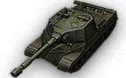<figcaption>Object 268</figcaption></figure>
<em>Gun handling</em> 
<strong>Aim time (s)</strong> <small>EU</small> 2.40  <small>RU</small> <strong>2.59</strong> 
<strong>Dispersion · moving</strong> <small>EU</small> 0.18  <small>RU</small> <strong>0.21</strong> 
<strong>Dispersion · tank traverse</strong> <small>EU</small> 0.18  <small>RU</small> <strong>0.21</strong> 
<strong>Depression (°)</strong> <small>EU</small> 6  <small>RU</small> <strong>5</strong> 

<em>Mobility</em> 
<strong>Forward speed on soft terrain (km/h)</strong> <small>EU</small> 35.47  <small>RU</small> <strong>31.58</strong> 
<strong>Engine power (hp)</strong> <small>EU</small> 950  <small>RU</small> <strong>845.82</strong> 
<strong>Power/weight (hp/t)</strong> <small>EU</small> 18.64  <small>RU</small> <strong>16.59</strong> 
<strong>Tank traverse (°/s)</strong> <small>EU</small> 34.42  <small>RU</small> <strong>29.20</strong> 
<strong>Tank traverse on hard terrain (°/s)</strong> <small>EU</small> 32.70  <small>RU</small> <strong>27.74</strong> 
<strong>Tank traverse on medium terrain (°/s)</strong> <small>EU</small> 27.67  <small>RU</small> <strong>23.48</strong> 
<strong>Tank traverse on soft terrain (°/s)</strong> <small>EU</small> 17.98  <small>RU</small> <strong>15.26</strong> 

<em>Armor &amp; health</em> 
<strong>Health · engine</strong> <small>EU</small> 345  <small>RU</small> <strong>360</strong> 
<strong>Track repair time (s)</strong> <small>EU</small> 11.79  <small>RU</small> <strong>12.03</strong> 

Object 268 Version V · Tier X

object268versionv

<a href="https://tanks.gg/v20410/tank/obj-2685">EU stats</a> · <a href="https://tanks.gg/v14600ru/tank/ob-2685">RU stats</a>
<figure style="display:inline-block">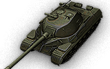<figcaption>Object 268 Version V</figcaption></figure>
<strong>Damage (HP)</strong> <b>EU</b>  AP <strong>750</strong> /  HEAT <strong>750</strong> /  HE <strong>1100</strong> → <b>RU</b>  AP <strong>650</strong> /  HEAT <strong>650</strong> /  HE <strong>840</strong>

<em>Firepower</em> 
<strong>DPM (HP/min)</strong> <small>EU</small> 2 394.64  <small>RU</small> <strong>2 510.93</strong> 
<strong>Rate of fire (rounds/min)</strong> <small>EU</small> 3.19  <small>RU</small> <strong>3.86</strong> 
<strong>Reload time (s)</strong> <small>EU</small> 18.79  <small>RU</small> <strong>15.53</strong> 
<strong>Shell velocity (m/s)</strong> <small>EU</small> 950  <small>RU</small> <strong>1 050</strong> 
<strong>Ammo capacity</strong> <small>EU</small> 30  <small>RU</small> <strong>36</strong> 
<strong>Potential damage</strong> <small>EU</small> 22 500  <small>RU</small> <strong>23 400</strong> 

<em>Gun handling</em> 
<strong>Aim time (s)</strong> <small>EU</small> 2.88  <small>RU</small> <strong>2.01</strong> 
<strong>Dispersion (m/100 m)</strong> <small>EU</small> 0.35  <small>RU</small> <strong>0.31</strong> 
<strong>Dispersion · damaged</strong> <small>EU</small> 0.69  <small>RU</small> <strong>0.61</strong> 
<strong>Dispersion · moving</strong> <small>EU</small> 0.22  <small>RU</small> <strong>0.18</strong> 
<strong>Dispersion · tank traverse</strong> <small>EU</small> 0.22  <small>RU</small> <strong>0.18</strong> 
<strong>Dispersion · turret traverse</strong> <small>EU</small> 0.20  <small>RU</small> <strong>0.10</strong> 

<em>Miscellaneous</em> 
<strong>View range (m)</strong> <small>EU</small> 360  <small>RU</small> <strong>380</strong> 

Object 430U · Tier X

object430u

<a href="https://tanks.gg/v20410/tank/obj-430u">EU stats</a> · <a href="https://tanks.gg/v14600ru/tank/ob-430u">RU stats</a>
<figure style="display:inline-block">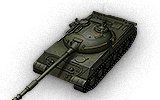<figcaption>Object 430U</figcaption></figure>
<em>Gun handling</em> 
<strong>Dispersion · moving</strong> <small>EU</small> 0.15  <small>RU</small> <strong>0.16</strong> 
<strong>Dispersion · tank traverse</strong> <small>EU</small> 0.15  <small>RU</small> <strong>0.16</strong> 
<strong>Dispersion · turret traverse</strong> <small>EU</small> 0.10  <small>RU</small> <strong>0.12</strong> 

<em>Mobility</em> 
<strong>Forward speed on soft terrain (km/h)</strong> <small>EU</small> 41.91  <small>RU</small> <strong>35.11</strong> 
<strong>Engine power (hp)</strong> <small>EU</small> 740  <small>RU</small> <strong>620</strong> 
<strong>Power/weight (hp/t)</strong> <small>EU</small> 17.62  <small>RU</small> <strong>14.76</strong> 

<em>Armor &amp; health</em> 
<strong>Hull armor · front (mm)</strong> <small>EU</small> 170  <small>RU</small> <strong>160</strong> 
<strong>Health</strong> <small>EU</small> 2 050  <small>RU</small> <strong>2 000</strong> 

Object 452K · Tier X

object452k

<a href="https://tanks.gg/v20410/tank/obj-452k">EU stats</a> · <a href="https://tanks.gg/v14600ru/tank/ob-452k">RU stats</a>
<figure style="display:inline-block">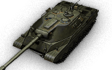<figcaption>EU · Object 452K</figcaption></figure><figure style="display:inline-block">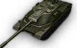<figcaption>RU · Объект 452К</figcaption></figure>
<strong>Penetration (mm)</strong> <b>EU</b>  AP <strong>260</strong> /  HEAT <strong>320</strong> /  HE <strong>65</strong> → <b>RU</b>  AP <strong>265</strong> /  HEAT <strong>330</strong> /  HE <strong>65</strong>

<strong>Damage (HP)</strong> <b>EU</b>  AP <strong>560</strong> /  HEAT <strong>560</strong> /  HE <strong>700</strong> → <b>RU</b>  AP <strong>530</strong> /  HEAT <strong>530</strong> /  HE <strong>670</strong>

<em>Firepower</em> 
<strong>DPM (HP/min)</strong> <small>EU</small> 2 503.20  <small>RU</small> <strong>2 600.82</strong> 
<strong>Rate of fire (rounds/min)</strong> <small>EU</small> 4.47  <small>RU</small> <strong>4.91</strong> 
<strong>Reload time (s)</strong> <small>EU</small> 13.42  <small>RU</small> <strong>30.68</strong> 
<strong>Shell velocity (m/s)</strong> <small>EU</small> 1 000  <small>RU</small> <strong>1 030</strong> 
<strong>Ammo capacity</strong> <small>EU</small> 30  <small>RU</small> <strong>36</strong> 
<strong>Potential damage</strong> <small>EU</small> 16 800  <small>RU</small> <strong>19 080</strong> 
<strong>Clip size</strong> <small>EU</small> — → <small>RU</small> <strong>3</strong> 
<strong>Clip damage · damage</strong> <small>EU</small> — → <small>RU</small> <strong>1 590</strong> 
<strong>Clip damage · time (s)</strong> <small>EU</small> — → <small>RU</small> <strong>6</strong> 
<strong>Intra-clip reload</strong> <small>EU</small> — → <small>RU</small> <strong>3</strong> 

<em>Gun handling</em> 
<strong>Aim time (s)</strong> <small>EU</small> 2.40  <small>RU</small> <strong>2.59</strong> 
<strong>Dispersion (m/100 m)</strong> <small>EU</small> 0.36  <small>RU</small> <strong>0.40</strong> 
<strong>Dispersion · damaged</strong> <small>EU</small> 0.73  <small>RU</small> <strong>0.81</strong> 
<strong>Dispersion · moving</strong> <small>EU</small> 0.18  <small>RU</small> <strong>0.24</strong> 
<strong>Dispersion · tank traverse</strong> <small>EU</small> 0.18  <small>RU</small> <strong>0.24</strong> 
<strong>Dispersion · turret traverse</strong> <small>EU</small> 0.08  <small>RU</small> <strong>0.12</strong> 
<strong>Dispersion · firing</strong> <small>EU</small> 4  <small>RU</small> <strong>5</strong> 

<em>Mobility</em> 
<strong>Forward speed (km/h)</strong> <small>EU</small> 40  <small>RU</small> <strong>45</strong> 
<strong>Forward speed on hard terrain (km/h)</strong> <small>EU</small> 40  <small>RU</small> <strong>41.52</strong> 
<strong>Forward speed on medium terrain (km/h)</strong> <small>EU</small> 35.82  <small>RU</small> <strong>31.75</strong> 
<strong>Forward speed on soft terrain (km/h)</strong> <small>EU</small> 24.36  <small>RU</small> <strong>21.59</strong> 
<strong>Reverse speed (km/h)</strong> <small>EU</small> 17  <small>RU</small> <strong>18</strong> 
<strong>Engine power (hp)</strong> <small>EU</small> 880  <small>RU</small> <strong>780</strong> 
<strong>Power/weight (hp/t)</strong> <small>EU</small> 16  <small>RU</small> <strong>14.18</strong> 
<strong>Turret traverse (°/s)</strong> <small>EU</small> 26.08  <small>RU</small> <strong>29.20</strong> 

<em>Armor &amp; health</em> 
<strong>Hull armor · front (mm)</strong> <small>EU</small> 210  <small>RU</small> <strong>160</strong> 
<strong>Hull armor · side (mm)</strong> <small>EU</small> 100  <small>RU</small> <strong>70</strong> 
<strong>Turret armor · front (mm)</strong> <small>EU</small> 130  <small>RU</small> <strong>140</strong> 
<strong>Turret armor · side (mm)</strong> <small>EU</small> 130  <small>RU</small> <strong>100</strong> 
<strong>Health</strong> <small>EU</small> 2 400  <small>RU</small> <strong>2 300</strong> 
<strong>Health · ammo rack</strong> <small>EU</small> 210  <small>RU</small> <strong>260</strong> 

<em>Miscellaneous</em> 
<strong>Stationary camo · after firing</strong> <small>EU</small> 1.23  <small>RU</small> <strong>1.45</strong> 
<strong>Moving camo · after firing</strong> <small>EU</small> 0.62  <small>RU</small> <strong>0.73</strong> 

Object 780 · Tier X

object780

<a href="https://tanks.gg/v20410/tank/obj-780">EU stats</a> · <a href="https://tanks.gg/v14600ru/tank/ob-780">RU stats</a>
<figure style="display:inline-block">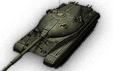<figcaption>EU · Object 780</figcaption></figure><figure style="display:inline-block"><figcaption>RU · Объект 780</figcaption></figure>
<em>Firepower</em> 
<strong>DPM (HP/min)</strong> <small>EU</small> 2 369.10  <small>RU</small> <strong>2 320.26</strong> 
<strong>Rate of fire (rounds/min)</strong> <small>EU</small> 4.47  <small>RU</small> <strong>4.38</strong> 
<strong>Reload time (s)</strong> <small>EU</small> 13.42  <small>RU</small> <strong>13.71</strong> 

ST-62 Version 2 · Tier X

st62version2

<a href="https://tanks.gg/v20410/tank/st-62-ver-2">EU stats</a> · <a href="https://tanks.gg/v14600ru/tank/st-62-var-2">RU stats</a>
<figure style="display:inline-block">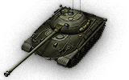<figcaption>ST-62 Version 2</figcaption></figure>
<strong>Penetration (mm)</strong> <b>EU</b>  APCR <strong>260</strong> /  HEAT <strong>330</strong> /  HE <strong>50</strong> → <b>RU</b>  APCR <strong>264</strong> /  HEAT <strong>330</strong> /  HE <strong>50</strong>

<strong>Damage (HP)</strong> <b>EU</b>  APCR <strong>320</strong> /  HEAT <strong>320</strong> /  HE <strong>420</strong> → <b>RU</b>  APCR <strong>360</strong> /  HEAT <strong>360</strong> /  HE <strong>440</strong>

<em>Firepower</em> 
<strong>DPM (HP/min)</strong> <small>EU</small> 2 503.20  <small>RU</small> <strong>3 086.14</strong> 
<strong>Rate of fire (rounds/min)</strong> <small>EU</small> 7.82  <small>RU</small> <strong>8.57</strong> 
<strong>Reload time (s)</strong> <small>EU</small> 7.67  <small>RU</small> <strong>7</strong> 
<strong>Clip size</strong> <small>EU</small> 3 → <small>RU</small> <strong>—</strong> 
<strong>Clip damage · damage</strong> <small>EU</small> 960 → <small>RU</small> <strong>—</strong> 
<strong>Clip damage · time (s)</strong> <small>EU</small> 4 → <small>RU</small> <strong>—</strong> 
<strong>Intra-clip reload</strong> <small>EU</small> 2 → <small>RU</small> <strong>—</strong> 
<strong>Shell velocity (m/s)</strong> <small>EU</small> 1 320  <small>RU</small> <strong>1 223</strong> 
<strong>Ammo capacity</strong> <small>EU</small> 50  <small>RU</small> <strong>65</strong> 
<strong>Potential damage</strong> <small>EU</small> 16 000  <small>RU</small> <strong>23 400</strong> 

<em>Gun handling</em> 
<strong>Dispersion · damaged</strong> <small>EU</small> 0.71  <small>RU</small> <strong>0.69</strong> 
<strong>Dispersion · moving</strong> <small>EU</small> 0.14  <small>RU</small> <strong>0.08</strong> 
<strong>Dispersion · tank traverse</strong> <small>EU</small> 0.14  <small>RU</small> <strong>0.08</strong> 
<strong>Dispersion · turret traverse</strong> <small>EU</small> 0.10  <small>RU</small> <strong>0.08</strong> 
<strong>Dispersion · firing</strong> <small>EU</small> 3  <small>RU</small> <strong>4</strong> 

<em>Mobility</em> 
<strong>Forward speed (km/h)</strong> <small>EU</small> 50  <small>RU</small> <strong>65</strong> 
<strong>Forward speed on hard terrain (km/h)</strong> <small>EU</small> 50  <small>RU</small> <strong>65</strong> 
<strong>Forward speed on medium terrain (km/h)</strong> <small>EU</small> 50  <small>RU</small> <strong>65</strong> 
<strong>Forward speed on soft terrain (km/h)</strong> <small>EU</small> 43.82  <small>RU</small> <strong>37.53</strong> 
<strong>Reverse speed (km/h)</strong> <small>EU</small> 20  <small>RU</small> <strong>25</strong> 
<strong>Engine power (hp)</strong> <small>EU</small> 700  <small>RU</small> <strong>600</strong> 
<strong>Weight (kg)</strong> <small>EU</small> 38 000 → <small>RU</small> <strong>38 025</strong> 
<strong>Power/weight (hp/t)</strong> <small>EU</small> 18.42  <small>RU</small> <strong>15.78</strong> 
<strong>Turret traverse (°/s)</strong> <small>EU</small> 52.15  <small>RU</small> <strong>56.32</strong> 
<strong>Tank traverse (°/s)</strong> <small>EU</small> 57.36  <small>RU</small> <strong>62.58</strong> 
<strong>Tank traverse on hard terrain (°/s)</strong> <small>EU</small> 57.36  <small>RU</small> <strong>62.58</strong> 
<strong>Tank traverse on medium terrain (°/s)</strong> <small>EU</small> 49.17  <small>RU</small> <strong>53.64</strong> 
<strong>Tank traverse on soft terrain (°/s)</strong> <small>EU</small> 21.51  <small>RU</small> <strong>23.47</strong> 

<em>Armor &amp; health</em> 
<strong>Hull armor · front (mm)</strong> <small>EU</small> 100  <small>RU</small> <strong>120</strong> 
<strong>Hull armor · side (mm)</strong> <small>EU</small> 75  <small>RU</small> <strong>90</strong> 
<strong>Hull armor · rear (mm)</strong> <small>EU</small> 40  <small>RU</small> <strong>50</strong> 
<strong>Turret armor · front (mm)</strong> <small>EU</small> 290  <small>RU</small> <strong>230</strong> 
<strong>Turret armor · side (mm)</strong> <small>EU</small> 150  <small>RU</small> <strong>120</strong> 
<strong>Turret armor · rear (mm)</strong> <small>EU</small> 50  <small>RU</small> <strong>100</strong> 

<em>Miscellaneous</em> 
<strong>Stationary camo · after firing</strong> <small>EU</small> 3.27  <small>RU</small> <strong>3.45</strong> 
<strong>Moving camo · after firing</strong> <small>EU</small> 2.45  <small>RU</small> <strong>2.59</strong> 
<strong>View range (m)</strong> <small>EU</small> 390  <small>RU</small> <strong>400</strong> 
<strong>Fire chance (%)</strong> <small>EU</small> 10  <small>RU</small> <strong>12</strong> 
<strong>Shell cost</strong> <small>EU</small> 1 100  <small>RU</small> <strong>1 150</strong> 

ST-II · Tier X

stii

<a href="https://tanks.gg/v20410/tank/st-ii">EU stats</a> · <a href="https://tanks.gg/v14600ru/tank/st-ii">RU stats</a>
<figure style="display:inline-block">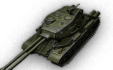<figcaption>EU · ST-II</figcaption></figure><figure style="display:inline-block"><figcaption>RU · СТ-II</figcaption></figure>
<strong>Penetration (mm)</strong> <b>EU</b>  AP <strong>258</strong> /  HEAT <strong>310</strong> /  HE <strong>68</strong> → <b>RU</b>  AP <strong>258</strong> /  HEAT <strong>320</strong> /  HE <strong>68</strong>

<em>Firepower</em> 
<strong>DPM (HP/min)</strong> <small>EU</small> 2 458.50  <small>RU</small> <strong>2 353.44</strong> 
<strong>Rate of fire (rounds/min)</strong> <small>EU</small> 5.59  <small>RU</small> <strong>5.35</strong> 
<strong>Reload time (s)</strong> <small>EU</small> 10.74  <small>RU</small> <strong>11.22</strong> 

<em>Mobility</em> 
<strong>Forward speed on hard terrain (km/h)</strong> <small>EU</small> 38.44  <small>RU</small> <strong>40</strong> 
<strong>Forward speed on medium terrain (km/h)</strong> <small>EU</small> 28.83  <small>RU</small> <strong>40</strong> 
<strong>Forward speed on soft terrain (km/h)</strong> <small>EU</small> 17.09  <small>RU</small> <strong>25.20</strong> 
<strong>Reverse speed (km/h)</strong> <small>EU</small> 13  <small>RU</small> <strong>15</strong> 
<strong>Terrain resist (hard)</strong> <small>EU</small> 1.15  <small>RU</small> <strong>0.67</strong> 
<strong>Terrain resist (med)</strong> <small>EU</small> 1.53  <small>RU</small> <strong>1.06</strong> 
<strong>Terrain resist (soft)</strong> <small>EU</small> 2.59  <small>RU</small> <strong>1.75</strong> 
<strong>Turret traverse (°/s)</strong> <small>EU</small> 23.99  <small>RU</small> <strong>27.12</strong> 
<strong>Tank traverse on medium terrain (°/s)</strong> <small>EU</small> 20.34  <small>RU</small> <strong>17.28</strong> 
<strong>Tank traverse on soft terrain (°/s)</strong> <small>EU</small> 12.05  <small>RU</small> <strong>10.42</strong> 

<em>Armor &amp; health</em> 
<strong>Hull armor · front (mm)</strong> <small>EU</small> 150  <small>RU</small> <strong>160</strong> 
<strong>Turret armor · front (mm)</strong> <small>EU</small> 325  <small>RU</small> <strong>300</strong> 

Alternate mode

<a href="https://tanks.gg/v20410/tank/st-ii-siege">EU stats</a> · <a href="https://tanks.gg/v14600ru/tank/st-ii-siege">RU stats</a>
<em>Firepower</em> 
<strong>DPM (HP/min)</strong> <small>EU</small> 2 458.50  <small>RU</small> <strong>2 353.44</strong> 
<strong>Rate of fire (rounds/min)</strong> <small>EU</small> 5.59  <small>RU</small> <strong>5.35</strong> 
<strong>Reload time (s)</strong> <small>EU</small> 10.74  <small>RU</small> <strong>11.22</strong> 

<em>Mobility</em> 
<strong>Forward speed on hard terrain (km/h)</strong> <small>EU</small> 38.44  <small>RU</small> <strong>40</strong> 
<strong>Forward speed on medium terrain (km/h)</strong> <small>EU</small> 28.83  <small>RU</small> <strong>40</strong> 
<strong>Forward speed on soft terrain (km/h)</strong> <small>EU</small> 17.09  <small>RU</small> <strong>25.20</strong> 
<strong>Reverse speed (km/h)</strong> <small>EU</small> 13  <small>RU</small> <strong>15</strong> 
<strong>Terrain resist (hard)</strong> <small>EU</small> 1.15  <small>RU</small> <strong>0.67</strong> 
<strong>Terrain resist (med)</strong> <small>EU</small> 1.53  <small>RU</small> <strong>1.06</strong> 
<strong>Terrain resist (soft)</strong> <small>EU</small> 2.59  <small>RU</small> <strong>1.75</strong> 
<strong>Turret traverse (°/s)</strong> <small>EU</small> 23.99  <small>RU</small> <strong>27.12</strong> 
<strong>Tank traverse on medium terrain (°/s)</strong> <small>EU</small> 20.34  <small>RU</small> <strong>17.28</strong> 
<strong>Tank traverse on soft terrain (°/s)</strong> <small>EU</small> 12.05  <small>RU</small> <strong>10.42</strong> 

<em>Armor &amp; health</em> 
<strong>Hull armor · front (mm)</strong> <small>EU</small> 150  <small>RU</small> <strong>160</strong> 
<strong>Turret armor · front (mm)</strong> <small>EU</small> 325  <small>RU</small> <strong>300</strong> 

T-100 LT · Tier X

t100lt

<a href="https://tanks.gg/v20410/tank/t-100-lt">EU stats</a> · <a href="https://tanks.gg/v14600ru/tank/t-100-lt">RU stats</a>
<figure style="display:inline-block">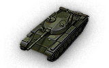<figcaption>T-100 LT</figcaption></figure>
<em>Firepower</em> 
<strong>DPM (HP/min)</strong> <small>EU</small> 2 503.20  <small>RU</small> <strong>2 357.31</strong> 
<strong>Rate of fire (rounds/min)</strong> <small>EU</small> 8.34  <small>RU</small> <strong>7.86</strong> 
<strong>Reload time (s)</strong> <small>EU</small> 7.19  <small>RU</small> <strong>7.64</strong> 

<em>Gun handling</em> 
<strong>Dispersion (m/100 m)</strong> <small>EU</small> 0.38  <small>RU</small> <strong>0.44</strong> 
<strong>Dispersion · damaged</strong> <small>EU</small> 0.77  <small>RU</small> <strong>0.88</strong> 

<em>Mobility</em> 
<strong>Forward speed (km/h)</strong> <small>EU</small> 75  <small>RU</small> <strong>72</strong> 
<strong>Forward speed on hard terrain (km/h)</strong> <small>EU</small> 75  <small>RU</small> <strong>72</strong> 
<strong>Forward speed on medium terrain (km/h)</strong> <small>EU</small> 75  <small>RU</small> <strong>72</strong> 
<strong>Forward speed on soft terrain (km/h)</strong> <small>EU</small> 75  <small>RU</small> <strong>72</strong> 
<strong>Reverse speed (km/h)</strong> <small>EU</small> 30  <small>RU</small> <strong>25</strong> 
<strong>Terrain resist (hard)</strong> <small>EU</small> 0.96  <small>RU</small> <strong>1.20</strong> 
<strong>Terrain resist (med)</strong> <small>EU</small> 1.25  <small>RU</small> <strong>1.56</strong> 
<strong>Terrain resist (soft)</strong> <small>EU</small> 1.82  <small>RU</small> <strong>2.28</strong> 
<strong>Tank traverse (°/s)</strong> <small>EU</small> 56.32  <small>RU</small> <strong>58.41</strong> 
<strong>Tank traverse on hard terrain (°/s)</strong> <small>EU</small> 53.51  <small>RU</small> <strong>55.49</strong> 
<strong>Tank traverse on medium terrain (°/s)</strong> <small>EU</small> 41.16  <small>RU</small> <strong>42.68</strong> 
<strong>Tank traverse on soft terrain (°/s)</strong> <small>EU</small> 28.16  <small>RU</small> <strong>29.20</strong> 

<em>Armor &amp; health</em> 
<strong>Health</strong> <small>EU</small> 1 700  <small>RU</small> <strong>1 500</strong> 

<em>Miscellaneous</em> 
<strong>View range (m)</strong> <small>EU</small> 400  <small>RU</small> <strong>390</strong> 

T-62A · Tier X

t62a

<a href="https://tanks.gg/v20410/tank/t-62a">EU stats</a> · <a href="https://tanks.gg/v14600ru/tank/t-62a">RU stats</a>
<figure style="display:inline-block">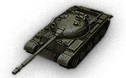<figcaption>T-62A</figcaption></figure>
<strong>Damage (HP)</strong> <b>EU</b>  APCR <strong>320</strong> /  HEAT <strong>320</strong> /  HE <strong>420</strong> → <b>RU</b>  APCR <strong>360</strong> /  HEAT <strong>360</strong> /  HE <strong>440</strong>

<em>Firepower</em> 
<strong>DPM (HP/min)</strong> <small>EU</small> 3 034.18  <small>RU</small> <strong>3 213.81</strong> 
<strong>Rate of fire (rounds/min)</strong> <small>EU</small> 9.48  <small>RU</small> <strong>8.93</strong> 
<strong>Reload time (s)</strong> <small>EU</small> 6.33  <small>RU</small> <strong>6.72</strong> 
<strong>Potential damage</strong> <small>EU</small> 16 000  <small>RU</small> <strong>18 000</strong> 

<em>Gun handling</em> 
<strong>Dispersion (m/100 m)</strong> <small>EU</small> 0.33  <small>RU</small> <strong>0.31</strong> 
<strong>Dispersion · damaged</strong> <small>EU</small> 0.65  <small>RU</small> <strong>0.61</strong> 

<em>Mobility</em> 
<strong>Forward speed (km/h)</strong> <small>EU</small> 50  <small>RU</small> <strong>57</strong> 
<strong>Forward speed on hard terrain (km/h)</strong> <small>EU</small> 50  <small>RU</small> <strong>57</strong> 
<strong>Forward speed on medium terrain (km/h)</strong> <small>EU</small> 50  <small>RU</small> <strong>57</strong> 
<strong>Forward speed on soft terrain (km/h)</strong> <small>EU</small> 45.06  <small>RU</small> <strong>55.10</strong> 
<strong>Engine power (hp)</strong> <small>EU</small> 613.22  <small>RU</small> <strong>750</strong> 
<strong>Power/weight (hp/t)</strong> <small>EU</small> 16.57  <small>RU</small> <strong>20.27</strong> 

<em>Miscellaneous</em> 
<strong>Stationary camo</strong> <small>EU</small> 15.28  <small>RU</small> <strong>17.95</strong> 
<strong>Stationary camo · after firing</strong> <small>EU</small> 3.02  <small>RU</small> <strong>3.56</strong> 
<strong>Moving camo</strong> <small>EU</small> 11.46  <small>RU</small> <strong>13.45</strong> 
<strong>Moving camo · after firing</strong> <small>EU</small> 2.27  <small>RU</small> <strong>2.66</strong> 
<strong>Shell cost</strong> <small>EU</small> 1 100  <small>RU</small> <strong>1 200</strong> 

