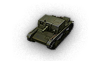
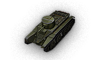
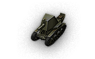
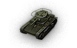
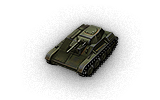
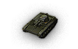
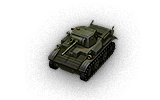

# USSR · Tier II

[All nations and tiers](../buffs_nerfs.md) · EU v20410 → RU v14600ru · 3 November 2026

<label><strong>Find a tank</strong><input type="search" placeholder="Try is7, obj140 or xm57" aria-label="Find a tank" style="display:block;width:100%;padding:.7rem;border:1px solid #888;border-radius:4px;margin:.5rem 0;color:inherit;background:transparent"></label>

AT-1 · Tier II

at1

<a href="https://tanks.gg/v20410/tank/at-1">EU stats</a> · <a href="https://tanks.gg/v14600ru/tank/at-1">RU stats</a>
<figure style="display:inline-block"><figcaption>AT-1</figcaption></figure>
<em>Gun handling</em> 
<strong>Dispersion (m/100 m)</strong> <small>EU</small> 0.41  <small>RU</small> <strong>0.38</strong> 
<strong>Dispersion · damaged</strong> <small>EU</small> 0.82  <small>RU</small> <strong>0.77</strong> 
<strong>Dispersion · moving</strong> <small>EU</small> 0.28  <small>RU</small> <strong>0.24</strong> 
<strong>Dispersion · tank traverse</strong> <small>EU</small> 0.28  <small>RU</small> <strong>0.24</strong> 
<strong>Dispersion · turret traverse</strong> <small>EU</small> 0.16  <small>RU</small> <strong>0.10</strong> 

<em>Armor &amp; health</em> 
<strong>Health</strong> <small>EU</small> 250  <small>RU</small> <strong>410</strong> 
<strong>Track repair time (s)</strong> <small>EU</small> 12.03  <small>RU</small> <strong>3</strong> 

<em>Miscellaneous</em> 
<strong>View range (m)</strong> <small>EU</small> 250  <small>RU</small> <strong>300</strong> 

BT-2 · Tier II

bt2

<a href="https://tanks.gg/v20410/tank/bt-2">EU stats</a> · <a href="https://tanks.gg/v14600ru/tank/bt-2">RU stats</a>
<figure style="display:inline-block"><figcaption>BT-2</figcaption></figure>
<em>Firepower</em> 
<strong>DPM (HP/min)</strong> <small>EU</small> 1 278.81  <small>RU</small> <strong>1 400.60</strong> 
<strong>Rate of fire (rounds/min)</strong> <small>EU</small> 27.21  <small>RU</small> <strong>29.80</strong> 
<strong>Reload time (s)</strong> <small>EU</small> 2.21  <small>RU</small> <strong>2.01</strong> 

<em>Gun handling</em> 
<strong>Aim time (s)</strong> <small>EU</small> 2.21  <small>RU</small> <strong>1.53</strong> 
<strong>Dispersion · firing</strong> <small>EU</small> 3  <small>RU</small> <strong>1</strong> 

<em>Mobility</em> 
<strong>Engine power (hp)</strong> <small>EU</small> 490  <small>RU</small> <strong>475.78</strong> 
<strong>Power/weight (hp/t)</strong> <small>EU</small> 45.54  <small>RU</small> <strong>44.22</strong> 
<strong>Tank traverse (°/s)</strong> <small>EU</small> 52.15  <small>RU</small> <strong>41.72</strong> 
<strong>Tank traverse on hard terrain (°/s)</strong> <small>EU</small> 55.52  <small>RU</small> <strong>40.63</strong> 
<strong>Tank traverse on medium terrain (°/s)</strong> <small>EU</small> 50.48  <small>RU</small> <strong>36.93</strong> 
<strong>Tank traverse on soft terrain (°/s)</strong> <small>EU</small> 24.14  <small>RU</small> <strong>17.66</strong> 

<em>Armor &amp; health</em> 
<strong>Health</strong> <small>EU</small> 320  <small>RU</small> <strong>360</strong> 
<strong>Track repair time (s)</strong> <small>EU</small> 12.03  <small>RU</small> <strong>3</strong> 

<em>Miscellaneous</em> 
<strong>View range (m)</strong> <small>EU</small> 280  <small>RU</small> <strong>310</strong> 

SU-18 · Tier II

su18

<a href="https://tanks.gg/v20410/tank/su-18">EU stats</a> · <a href="https://tanks.gg/v14600ru/tank/su-18">RU stats</a>
<figure style="display:inline-block"><figcaption>SU-18</figcaption></figure>
<em>Armor &amp; health</em> 
<strong>Health</strong> <small>EU</small> 140  <small>RU</small> <strong>200</strong> 
<strong>Track repair time (s)</strong> <small>EU</small> 13.16  <small>RU</small> <strong>3</strong> 

T-26 · Tier II

t26

<a href="https://tanks.gg/v20410/tank/t-26">EU stats</a> · <a href="https://tanks.gg/v14600ru/tank/t-26">RU stats</a>
<figure style="display:inline-block"><figcaption>T-26</figcaption></figure>
<strong>Penetration (mm)</strong> <b>EU</b>  AP <strong>58</strong> /  APCR <strong>92</strong> /  HE <strong>19</strong> → <b>RU</b>  AP <strong>78</strong> /  APCR <strong>112</strong> /  HE <strong>19</strong>

<em>Firepower</em> 
<strong>DPM (HP/min)</strong> <small>EU</small> 1 088.35  <small>RU</small> <strong>1 251.60</strong> 
<strong>Rate of fire (rounds/min)</strong> <small>EU</small> 27.21  <small>RU</small> <strong>31.29</strong> 
<strong>Reload time (s)</strong> <small>EU</small> 2.21  <small>RU</small> <strong>1.92</strong> 

<em>Gun handling</em> 
<strong>Aim time (s)</strong> <small>EU</small> 2.21  <small>RU</small> <strong>1.53</strong> 
<strong>Dispersion (m/100 m)</strong> <small>EU</small> 0.37  <small>RU</small> <strong>0.36</strong> 
<strong>Dispersion · damaged</strong> <small>EU</small> 0.75  <small>RU</small> <strong>0.73</strong> 
<strong>Dispersion · moving</strong> <small>EU</small> 0.22  <small>RU</small> <strong>0.20</strong> 
<strong>Dispersion · tank traverse</strong> <small>EU</small> 0.22  <small>RU</small> <strong>0.20</strong> 
<strong>Dispersion · turret traverse</strong> <small>EU</small> 0.14  <small>RU</small> <strong>0.10</strong> 
<strong>Dispersion · firing</strong> <small>EU</small> 4  <small>RU</small> <strong>2</strong> 

<em>Armor &amp; health</em> 
<strong>Track repair time (s)</strong> <small>EU</small> 12.03  <small>RU</small> <strong>3</strong> 

T-45 · Tier II

t45

<a href="https://tanks.gg/v20410/tank/t-45">EU stats</a> · <a href="https://tanks.gg/v14600ru/tank/t-45">RU stats</a>
<figure style="display:inline-block"><figcaption>T-45</figcaption></figure>
<em>Firepower</em> 
<strong>DPM (HP/min)</strong> <small>EU</small> 783.33  <small>RU</small> <strong>940</strong> 
<strong>Rate of fire (rounds/min)</strong> <small>EU</small> 16.67  <small>RU</small> <strong>20</strong> 
<strong>Reload time (s)</strong> <small>EU</small> 3.60  <small>RU</small> <strong>3</strong> 

<em>Gun handling</em> 
<strong>Aim time (s)</strong> <small>EU</small> 2.40  <small>RU</small> <strong>1.80</strong> 
<strong>Dispersion · turret traverse</strong> <small>EU</small> 0.16  <small>RU</small> <strong>0.12</strong> 

<em>Mobility</em> 
<strong>Forward speed (km/h)</strong> <small>EU</small> 41  <small>RU</small> <strong>40.52</strong> 
<strong>Forward speed on hard terrain (km/h)</strong> <small>EU</small> 41  <small>RU</small> <strong>40.52</strong> 
<strong>Forward speed on medium terrain (km/h)</strong> <small>EU</small> 41  <small>RU</small> <strong>40.52</strong> 
<strong>Forward speed on soft terrain (km/h)</strong> <small>EU</small> 23.95  <small>RU</small> <strong>29.32</strong> 
<strong>Engine power (hp)</strong> <small>EU</small> 89.87  <small>RU</small> <strong>110</strong> 
<strong>Power/weight (hp/t)</strong> <small>EU</small> 13.22  <small>RU</small> <strong>16.18</strong> 

<em>Armor &amp; health</em> 
<strong>Health</strong> <small>EU</small> 280  <small>RU</small> <strong>350</strong> 
<strong>Track repair time (s)</strong> <small>EU</small> 12.03  <small>RU</small> <strong>3</strong> 

T-60 · Tier II

t60

<a href="https://tanks.gg/v20410/tank/t-60">EU stats</a> · <a href="https://tanks.gg/v14600ru/tank/t-60">RU stats</a>
<figure style="display:inline-block"><figcaption>EU · T-60</figcaption></figure><figure style="display:inline-block"><figcaption>RU · Т-60</figcaption></figure>
<strong>Penetration (mm)</strong> <b>EU</b>  AP <strong>58</strong> /  APCR <strong>92</strong> /  HE <strong>19</strong> → <b>RU</b>  AP <strong>78</strong> /  APCR <strong>112</strong> /  HE <strong>19</strong>

<em>Firepower</em> 
<strong>DPM (HP/min)</strong> <small>EU</small> 960  <small>RU</small> <strong>1 000</strong> 
<strong>Rate of fire (rounds/min)</strong> <small>EU</small> 24  <small>RU</small> <strong>25</strong> 
<strong>Reload time (s)</strong> <small>EU</small> 2.50  <small>RU</small> <strong>2.40</strong> 

<em>Gun handling</em> 
<strong>Aim time (s)</strong> <small>EU</small> 2.20  <small>RU</small> <strong>1.50</strong> 
<strong>Dispersion (m/100 m)</strong> <small>EU</small> 0.38  <small>RU</small> <strong>0.39</strong> 
<strong>Dispersion · damaged</strong> <small>EU</small> 0.76  <small>RU</small> <strong>0.78</strong> 
<strong>Dispersion · moving</strong> <small>EU</small> 0.26  <small>RU</small> <strong>0.24</strong> 
<strong>Dispersion · tank traverse</strong> <small>EU</small> 0.26  <small>RU</small> <strong>0.24</strong> 
<strong>Dispersion · turret traverse</strong> <small>EU</small> 0.12  <small>RU</small> <strong>0.10</strong> 
<strong>Dispersion · firing</strong> <small>EU</small> 3  <small>RU</small> <strong>1</strong> 

<em>Mobility</em> 
<strong>Forward speed on soft terrain (km/h)</strong> <small>EU</small> 30.59  <small>RU</small> <strong>24.99</strong> 
<strong>Reverse speed (km/h)</strong> <small>EU</small> 18  <small>RU</small> <strong>15</strong> 
<strong>Engine power (hp)</strong> <small>EU</small> 110  <small>RU</small> <strong>89.87</strong> 
<strong>Power/weight (hp/t)</strong> <small>EU</small> 16.88  <small>RU</small> <strong>13.79</strong> 
<strong>Terrain resist (hard)</strong> <small>EU</small> 1.05  <small>RU</small> <strong>0.34</strong> 
<strong>Terrain resist (med)</strong> <small>EU</small> 1.15  <small>RU</small> <strong>0.79</strong> 
<strong>Tank traverse (°/s)</strong> <small>EU</small> 67.80  <small>RU</small> <strong>54.24</strong> 
<strong>Tank traverse on hard terrain (°/s)</strong> <small>EU</small> 70.95  <small>RU</small> <strong>52.31</strong> 
<strong>Tank traverse on medium terrain (°/s)</strong> <small>EU</small> 65.03  <small>RU</small> <strong>22.42</strong> 
<strong>Tank traverse on soft terrain (°/s)</strong> <small>EU</small> 37.16  <small>RU</small> <strong>8.83</strong> 

<em>Armor &amp; health</em> 
<strong>Health</strong> <small>EU</small> 340  <small>RU</small> <strong>360</strong> 
<strong>Health · engine</strong> <small>EU</small> 65  <small>RU</small> <strong>40</strong> 
<strong>Track repair time (s)</strong> <small>EU</small> 11.70  <small>RU</small> <strong>3</strong> 

Tetrarch · Tier II

tetrarch

<a href="https://tanks.gg/v20410/tank/tetrarch">EU stats</a> · <a href="https://tanks.gg/v14600ru/tank/tetrarkh">RU stats</a>
<figure style="display:inline-block"><figcaption>Tetrarch</figcaption></figure>
<em>Firepower</em> 
<strong>DPM (HP/min)</strong> <small>EU</small> 985.63  <small>RU</small> <strong>1 005.75</strong> 
<strong>Rate of fire (rounds/min)</strong> <small>EU</small> 21.90  <small>RU</small> <strong>22.35</strong> 
<strong>Reload time (s)</strong> <small>EU</small> 2.74  <small>RU</small> <strong>2.68</strong> 

<em>Gun handling</em> 
<strong>Aim time (s)</strong> <small>EU</small> 2.19  <small>RU</small> <strong>1.92</strong> 
<strong>Dispersion · moving</strong> <small>EU</small> 0.29  <small>RU</small> <strong>0.27</strong> 
<strong>Dispersion · tank traverse</strong> <small>EU</small> 0.29  <small>RU</small> <strong>0.27</strong> 
<strong>Dispersion · turret traverse</strong> <small>EU</small> 0.16  <small>RU</small> <strong>0.10</strong> 
<strong>Dispersion · firing</strong> <small>EU</small> 4  <small>RU</small> <strong>3</strong> 

<em>Armor &amp; health</em> 
<strong>Health</strong> <small>EU</small> 280  <small>RU</small> <strong>340</strong> 
<strong>Track repair time (s)</strong> <small>EU</small> 12.03  <small>RU</small> <strong>3</strong> 

<em>Miscellaneous</em> 
<strong>View range (m)</strong> <small>EU</small> 260  <small>RU</small> <strong>300</strong> 

