# USSR · Tier III

[All nations and tiers](../buffs_nerfs.md) · EU v20410 → RU v14600ru · 3 November 2026

<label><strong>Find a tank</strong><input type="search" placeholder="Try is7, obj140 or xm57" aria-label="Find a tank" style="display:block;width:100%;padding:.7rem;border:1px solid #888;border-radius:4px;margin:.5rem 0;color:inherit;background:transparent"></label>

BT-5 · Tier III

bt5

<a href="https://tanks.gg/v20410/tank/bt-5">EU stats</a> · <a href="https://tanks.gg/v14600ru/tank/bt-5">RU stats</a>
<figure style="display:inline-block">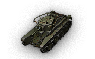<figcaption>EU · BT-5</figcaption></figure><figure style="display:inline-block"><figcaption>RU · БТ-5</figcaption></figure>
<strong>Penetration (mm)</strong> <b>EU</b>  AP <strong>42</strong> /  APCR <strong>52</strong> /  HE <strong>19</strong> → <b>RU</b>  AP <strong>55</strong> /  APCR <strong>90</strong> /  HE <strong>23</strong>

<strong>Damage (HP)</strong> <b>EU</b>  AP <strong>40</strong> /  APCR <strong>40</strong> /  HE <strong>50</strong> → <b>RU</b>  AP <strong>47</strong> /  APCR <strong>47</strong> /  HE <strong>62</strong>

<em>Firepower</em> 
<strong>DPM (HP/min)</strong> <small>EU</small> 1 823.09  <small>RU</small> <strong>1 278.81</strong> 
<strong>Module damage</strong> <small>EU</small> 50  <small>RU</small> <strong>61</strong> 
<strong>Rate of fire (rounds/min)</strong> <small>EU</small> 45.58  <small>RU</small> <strong>27.21</strong> 
<strong>Reload time (s)</strong> <small>EU</small> 6.23  <small>RU</small> <strong>2.21</strong> 
<strong>Clip size</strong> <small>EU</small> 6 → <small>RU</small> <strong>—</strong> 
<strong>Clip size · burst size</strong> <small>EU</small> 3 → <small>RU</small> <strong>—</strong> 
<strong>Clip damage · damage</strong> <small>EU</small> 240 → <small>RU</small> <strong>—</strong> 
<strong>Clip damage · time (s)</strong> <small>EU</small> 1.67 → <small>RU</small> <strong>—</strong> 
<strong>Clip damage · burst damage · damage</strong> <small>EU</small> 120 → <small>RU</small> <strong>—</strong> 
<strong>Clip damage · burst damage · time (s)</strong> <small>EU</small> 0.67 → <small>RU</small> <strong>—</strong> 
<strong>Intra-clip reload</strong> <small>EU</small> 0.33 → <small>RU</small> <strong>—</strong> 
<strong>Caliber</strong> <small>EU</small> 37  <small>RU</small> <strong>45</strong> 
<strong>Shell velocity (m/s)</strong> <small>EU</small> 915  <small>RU</small> <strong>757</strong> 
<strong>Ammo capacity</strong> <small>EU</small> 150  <small>RU</small> <strong>145</strong> 
<strong>Potential damage</strong> <small>EU</small> 6 000  <small>RU</small> <strong>6 815</strong> 

<em>Gun handling</em> 
<strong>Aim time (s)</strong> <small>EU</small> 1.82  <small>RU</small> <strong>1.53</strong> 
<strong>Dispersion (m/100 m)</strong> <small>EU</small> 0.38  <small>RU</small> <strong>0.37</strong> 
<strong>Dispersion · damaged</strong> <small>EU</small> 0.77  <small>RU</small> <strong>0.75</strong> 
<strong>Dispersion · moving</strong> <small>EU</small> 0.16  <small>RU</small> <strong>0.26</strong> 
<strong>Dispersion · tank traverse</strong> <small>EU</small> 0.16  <small>RU</small> <strong>0.26</strong> 
<strong>Dispersion · firing</strong> <small>EU</small> 1.50  <small>RU</small> <strong>3.50</strong> 

<em>Mobility</em> 
<strong>Engine power (hp)</strong> <small>EU</small> 460  <small>RU</small> <strong>444.06</strong> 
<strong>Weight (kg)</strong> <small>EU</small> 10 640 → <small>RU</small> <strong>10 740</strong> 
<strong>Power/weight (hp/t)</strong> <small>EU</small> 43.23  <small>RU</small> <strong>41.35</strong> 
<strong>Tank traverse on hard terrain (°/s)</strong> <small>EU</small> 54.84  <small>RU</small> <strong>53.13</strong> 
<strong>Tank traverse on medium terrain (°/s)</strong> <small>EU</small> 43.88  <small>RU</small> <strong>42.50</strong> 
<strong>Tank traverse on soft terrain (°/s)</strong> <small>EU</small> 19.08  <small>RU</small> <strong>18.48</strong> 

<em>Armor &amp; health</em> 
<strong>Health</strong> <small>EU</small> 410  <small>RU</small> <strong>460</strong> 
<strong>Track repair time (s)</strong> <small>EU</small> 8.02  <small>RU</small> <strong>4</strong> 

<em>Miscellaneous</em> 
<strong>Stationary camo · after firing</strong> <small>EU</small> 4.96  <small>RU</small> <strong>4.79</strong> 
<strong>Moving camo · after firing</strong> <small>EU</small> 4.96  <small>RU</small> <strong>4.79</strong> 
<strong>View range (m)</strong> <small>EU</small> 300  <small>RU</small> <strong>310</strong> 
<strong>Radio range (m)</strong> <small>EU</small> 360  <small>RU</small> <strong>615</strong> 
<strong>Shell cost</strong> <small>EU</small> 35  <small>RU</small> <strong>14</strong> 

BT-7 artillery · Tier III

bt7artillery

<a href="https://tanks.gg/v20410/tank/bt-7-art">EU stats</a> · <a href="https://tanks.gg/v14600ru/tank/bt-7-art">RU stats</a>
<figure style="display:inline-block">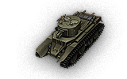<figcaption>BT-7 artillery</figcaption></figure>
<strong>Penetration (mm)</strong> <b>EU</b>  HE <strong>38</strong> /  AP <strong>37</strong> → <b>RU</b>  HE <strong>38</strong> /  AP <strong>56</strong>

<em>Gun handling</em> 
<strong>Aim time (s)</strong> <small>EU</small> 2.30  <small>RU</small> <strong>2.01</strong> 
<strong>Dispersion (m/100 m)</strong> <small>EU</small> 0.58  <small>RU</small> <strong>0.48</strong> 
<strong>Dispersion · damaged</strong> <small>EU</small> 1.15  <small>RU</small> <strong>0.96</strong> 
<strong>Dispersion · turret traverse</strong> <small>EU</small> 0.18  <small>RU</small> <strong>0.12</strong> 

<em>Armor &amp; health</em> 
<strong>Health</strong> <small>EU</small> 390  <small>RU</small> <strong>460</strong> 

<em>Miscellaneous</em> 
<strong>View range (m)</strong> <small>EU</small> 290  <small>RU</small> <strong>300</strong> 

BT-SV · Tier III

btsv

<a href="https://tanks.gg/v20410/tank/bt-sv">EU stats</a> · <a href="https://tanks.gg/v14600ru/tank/bt-sv">RU stats</a>
<figure style="display:inline-block">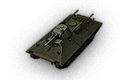<figcaption>BT-SV</figcaption></figure>
<em>Firepower</em> 
<strong>DPM (HP/min)</strong> <small>EU</small> 1 233.75  <small>RU</small> <strong>1 231.44</strong> 
<strong>Rate of fire (rounds/min)</strong> <small>EU</small> 26.25  <small>RU</small> <strong>26.20</strong> 

<em>Gun handling</em> 
<strong>Aim time (s)</strong> <small>EU</small> 1.64  <small>RU</small> <strong>1.63</strong> 
<strong>Dispersion · firing</strong> <small>EU</small> 3  <small>RU</small> <strong>2</strong> 

<em>Armor &amp; health</em> 
<strong>Health</strong> <small>EU</small> 425  <small>RU</small> <strong>450</strong> 
<strong>Track repair time (s)</strong> <small>EU</small> 10.03  <small>RU</small> <strong>4</strong> 

<em>Miscellaneous</em> 
<strong>View range (m)</strong> <small>EU</small> 280  <small>RU</small> <strong>300</strong> 

LTP · Tier III

ltp

<a href="https://tanks.gg/v20410/tank/ltp">EU stats</a> · <a href="https://tanks.gg/v14600ru/tank/ltp">RU stats</a>
<figure style="display:inline-block">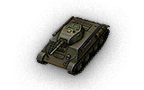<figcaption>LTP</figcaption></figure>
<em>Gun handling</em> 
<strong>Aim time (s)</strong> <small>EU</small> 2.10  <small>RU</small> <strong>1.60</strong> 
<strong>Dispersion (m/100 m)</strong> <small>EU</small> 0.46  <small>RU</small> <strong>0.40</strong> 
<strong>Dispersion · damaged</strong> <small>EU</small> 0.92  <small>RU</small> <strong>0.80</strong> 
<strong>Dispersion · moving</strong> <small>EU</small> 0.26  <small>RU</small> <strong>0.20</strong> 
<strong>Dispersion · tank traverse</strong> <small>EU</small> 0.26  <small>RU</small> <strong>0.20</strong> 
<strong>Dispersion · turret traverse</strong> <small>EU</small> 0.16  <small>RU</small> <strong>0.10</strong> 
<strong>Dispersion · firing</strong> <small>EU</small> 3.50  <small>RU</small> <strong>1.50</strong> 

<em>Armor &amp; health</em> 
<strong>Health</strong> <small>EU</small> 410  <small>RU</small> <strong>450</strong> 
<strong>Track repair time (s)</strong> <small>EU</small> 10.03  <small>RU</small> <strong>4</strong> 

M3 Light · Tier III

m3light

<a href="https://tanks.gg/v20410/tank/m3-light">EU stats</a> · <a href="https://tanks.gg/v14600ru/tank/m3-legkii">RU stats</a>
<figure style="display:inline-block">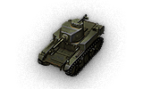<figcaption>M3 Light</figcaption></figure>
<strong>Penetration (mm)</strong> <b>EU</b>  AP <strong>48</strong> /  APCR <strong>70</strong> /  HE <strong>19</strong> → <b>RU</b>  AP <strong>54</strong> /  APCR <strong>85</strong> /  HE <strong>19</strong>

<em>Firepower</em> 
<strong>DPM (HP/min)</strong> <small>EU</small> 960  <small>RU</small> <strong>1 090.91</strong> 
<strong>Rate of fire (rounds/min)</strong> <small>EU</small> 24  <small>RU</small> <strong>27.27</strong> 
<strong>Reload time (s)</strong> <small>EU</small> 2.50  <small>RU</small> <strong>2.20</strong> 

<em>Gun handling</em> 
<strong>Aim time (s)</strong> <small>EU</small> 1.82  <small>RU</small> <strong>1.53</strong> 
<strong>Dispersion (m/100 m)</strong> <small>EU</small> 0.44  <small>RU</small> <strong>0.38</strong> 
<strong>Dispersion · damaged</strong> <small>EU</small> 0.88  <small>RU</small> <strong>0.77</strong> 
<strong>Dispersion · turret traverse</strong> <small>EU</small> 0.16  <small>RU</small> <strong>0.10</strong> 
<strong>Dispersion · firing</strong> <small>EU</small> 4  <small>RU</small> <strong>2</strong> 

<em>Armor &amp; health</em> 
<strong>Health</strong> <small>EU</small> 390  <small>RU</small> <strong>450</strong> 
<strong>Track repair time (s)</strong> <small>EU</small> 10.03  <small>RU</small> <strong>4</strong> 

<em>Miscellaneous</em> 
<strong>View range (m)</strong> <small>EU</small> 280  <small>RU</small> <strong>300</strong> 

SU-26 · Tier III

su26

<a href="https://tanks.gg/v20410/tank/su-26">EU stats</a> · <a href="https://tanks.gg/v14600ru/tank/su-26">RU stats</a>
<figure style="display:inline-block">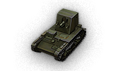<figcaption>SU-26</figcaption></figure>
<em>Armor &amp; health</em> 
<strong>Health</strong> <small>EU</small> 195  <small>RU</small> <strong>260</strong> 
<strong>Track repair time (s)</strong> <small>EU</small> 12.63  <small>RU</small> <strong>4</strong> 

<em>Miscellaneous</em> 
<strong>View range (m)</strong> <small>EU</small> 260  <small>RU</small> <strong>300</strong> 

SU-76I · Tier III

su76i

<a href="https://tanks.gg/v20410/tank/su-76i">EU stats</a> · <a href="https://tanks.gg/v14600ru/tank/su-76i">RU stats</a>
<figure style="display:inline-block">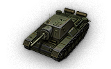<figcaption>SU-76I</figcaption></figure>
<em>Armor &amp; health</em> 
<strong>Health</strong> <small>EU</small> 285  <small>RU</small> <strong>510</strong> 
<strong>Track repair time (s)</strong> <small>EU</small> 10.03  <small>RU</small> <strong>4</strong> 

T-116 · Tier III

t116

<a href="https://tanks.gg/v20410/tank/t-116">EU stats</a> · <a href="https://tanks.gg/v14600ru/tank/t-116">RU stats</a>
<figure style="display:inline-block">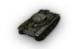<figcaption>T-116</figcaption></figure>
<em>Gun handling</em> 
<strong>Aim time (s)</strong> <small>EU</small> 1.90  <small>RU</small> <strong>1.60</strong> 
<strong>Dispersion (m/100 m)</strong> <small>EU</small> 0.42  <small>RU</small> <strong>0.38</strong> 
<strong>Dispersion · damaged</strong> <small>EU</small> 0.84  <small>RU</small> <strong>0.76</strong> 
<strong>Dispersion · moving</strong> <small>EU</small> 0.22  <small>RU</small> <strong>0.18</strong> 
<strong>Dispersion · tank traverse</strong> <small>EU</small> 0.22  <small>RU</small> <strong>0.18</strong> 
<strong>Dispersion · turret traverse</strong> <small>EU</small> 0.14  <small>RU</small> <strong>0.10</strong> 
<strong>Dispersion · firing</strong> <small>EU</small> 3.50  <small>RU</small> <strong>1.50</strong> 

<em>Armor &amp; health</em> 
<strong>Health</strong> <small>EU</small> 410  <small>RU</small> <strong>460</strong> 
<strong>Track repair time (s)</strong> <small>EU</small> 10.03  <small>RU</small> <strong>4</strong> 

T-127 · Tier III

t127

<a href="https://tanks.gg/v20410/tank/t-127">EU stats</a> · <a href="https://tanks.gg/v14600ru/tank/t-127">RU stats</a>
<figure style="display:inline-block">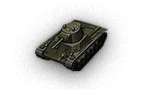<figcaption>T-127</figcaption></figure>
<em>Armor &amp; health</em> 
<strong>Health</strong> <small>EU</small> 445  <small>RU</small> <strong>460</strong> 
<strong>Track repair time (s)</strong> <small>EU</small> 10.03  <small>RU</small> <strong>4</strong> 

T-29 · Tier III

t29

<a href="https://tanks.gg/v20410/tank/t-29">EU stats</a> · <a href="https://tanks.gg/v14600ru/tank/t-29">RU stats</a>
<figure style="display:inline-block">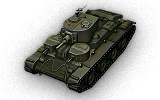<figcaption>T-29</figcaption></figure>
<em>Gun handling</em> 
<strong>Aim time (s)</strong> <small>EU</small> 2.21  <small>RU</small> <strong>1.82</strong> 

<em>Armor &amp; health</em> 
<strong>Health</strong> <small>EU</small> 445  <small>RU</small> <strong>540</strong> 
<strong>Track repair time (s)</strong> <small>EU</small> 10.03  <small>RU</small> <strong>4</strong> 

T-46 · Tier III

t46

<a href="https://tanks.gg/v20410/tank/t-46">EU stats</a> · <a href="https://tanks.gg/v14600ru/tank/t-46">RU stats</a>
<figure style="display:inline-block">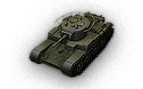<figcaption>T-46</figcaption></figure>
<em>Firepower</em> 
<strong>DPM (HP/min)</strong> <small>EU</small> 1 996.09  <small>RU</small> <strong>2 262.48</strong> 
<strong>Rate of fire (rounds/min)</strong> <small>EU</small> 49.90  <small>RU</small> <strong>56.56</strong> 
<strong>Clip size</strong> <small>EU</small> 5  <small>RU</small> <strong>6</strong> 
<strong>Clip damage · damage</strong> <small>EU</small> 200  <small>RU</small> <strong>240</strong> 
<strong>Clip damage · time (s)</strong> <small>EU</small> 1.41  <small>RU</small> <strong>1.76</strong> 

<em>Armor &amp; health</em> 
<strong>Health</strong> <small>EU</small> 445  <small>RU</small> <strong>460</strong> 
<strong>Track repair time (s)</strong> <small>EU</small> 12.03  <small>RU</small> <strong>4</strong> 

T-70 · Tier III

t70

<a href="https://tanks.gg/v20410/tank/t-70">EU stats</a> · <a href="https://tanks.gg/v14600ru/tank/t-70">RU stats</a>
<figure style="display:inline-block">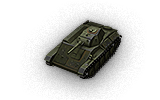<figcaption>T-70</figcaption></figure>
<em>Gun handling</em> 
<strong>Aim time (s)</strong> <small>EU</small> 2.30  <small>RU</small> <strong>1.60</strong> 
<strong>Dispersion · turret traverse</strong> <small>EU</small> 0.16  <small>RU</small> <strong>0.12</strong> 
<strong>Dispersion · firing</strong> <small>EU</small> 4  <small>RU</small> <strong>2</strong> 

<em>Mobility</em> 
<strong>Forward speed on soft terrain (km/h)</strong> <small>EU</small> 33.42  <small>RU</small> <strong>32.47</strong> 
<strong>Engine power (hp)</strong> <small>EU</small> 185  <small>RU</small> <strong>179.74</strong> 
<strong>Power/weight (hp/t)</strong> <small>EU</small> 18.44  <small>RU</small> <strong>17.92</strong> 
<strong>Tank traverse (°/s)</strong> <small>EU</small> 67.80  <small>RU</small> <strong>54.24</strong> 
<strong>Tank traverse on hard terrain (°/s)</strong> <small>EU</small> 72.04  <small>RU</small> <strong>60.20</strong> 
<strong>Tank traverse on medium terrain (°/s)</strong> <small>EU</small> 66.04  <small>RU</small> <strong>55.18</strong> 
<strong>Tank traverse on soft terrain (°/s)</strong> <small>EU</small> 37.74  <small>RU</small> <strong>31.53</strong> 

<em>Armor &amp; health</em> 
<strong>Health</strong> <small>EU</small> 410  <small>RU</small> <strong>460</strong> 
<strong>Health · engine</strong> <small>EU</small> 100  <small>RU</small> <strong>70</strong> 
<strong>Health · track</strong> <small>EU</small> 75  <small>RU</small> <strong>70</strong> 
<strong>Track repair time (s)</strong> <small>EU</small> 11.85  <small>RU</small> <strong>4</strong> 

