# USSR · Tier IV

[All nations and tiers](../buffs_nerfs.md) · EU v20410 → RU v14600ru · 3 November 2026

<label><strong>Find a tank</strong><input type="search" placeholder="Try is7, obj140 or xm57" aria-label="Find a tank" style="display:block;width:100%;padding:.7rem;border:1px solid #888;border-radius:4px;margin:.5rem 0;color:inherit;background:transparent"></label>

A-32 · Tier IV

a32

<a href="https://tanks.gg/v20410/tank/a-32">EU stats</a> · <a href="https://tanks.gg/v14600ru/tank/a-32">RU stats</a>
<figure style="display:inline-block">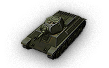<figcaption>A-32</figcaption></figure>
<em>Armor &amp; health</em> 
<strong>Health</strong> <small>EU</small> 550  <small>RU</small> <strong>630</strong> 
<strong>Track repair time (s)</strong> <small>EU</small> 8.02  <small>RU</small> <strong>5</strong> 

BT-7 · Tier IV

bt7

<a href="https://tanks.gg/v20410/tank/bt-7">EU stats</a> · <a href="https://tanks.gg/v14600ru/tank/bt-7">RU stats</a>
<figure style="display:inline-block">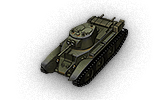<figcaption>BT-7</figcaption></figure>
<strong>Penetration (mm)</strong> <b>EU</b>  AP <strong>98</strong> /  APCR <strong>133</strong> /  HE <strong>19</strong> → <b>RU</b>  AP <strong>78</strong> /  APCR <strong>112</strong> /  HE <strong>19</strong>

<strong>Damage (HP)</strong> <b>EU</b>  AP <strong>45</strong> /  APCR <strong>45</strong> /  HE <strong>60</strong> → <b>RU</b>  AP <strong>40</strong> /  APCR <strong>40</strong> /  HE <strong>50</strong>

<em>Firepower</em> 
<strong>DPM (HP/min)</strong> <small>EU</small> 1 656.53  <small>RU</small> <strong>1 390.67</strong> 
<strong>Rate of fire (rounds/min)</strong> <small>EU</small> 36.81  <small>RU</small> <strong>34.77</strong> 
<strong>Reload time (s)</strong> <small>EU</small> 1.63  <small>RU</small> <strong>1.73</strong> 
<strong>Potential damage</strong> <small>EU</small> 9 000  <small>RU</small> <strong>8 000</strong> 

<em>Gun handling</em> 
<strong>Aim time (s)</strong> <small>EU</small> 1.44  <small>RU</small> <strong>1.63</strong> 
<strong>Dispersion (m/100 m)</strong> <small>EU</small> 0.34  <small>RU</small> <strong>0.35</strong> 
<strong>Dispersion · damaged</strong> <small>EU</small> 0.67  <small>RU</small> <strong>0.69</strong> 
<strong>Dispersion · moving</strong> <small>EU</small> 0.14  <small>RU</small> <strong>0.16</strong> 
<strong>Dispersion · tank traverse</strong> <small>EU</small> 0.14  <small>RU</small> <strong>0.16</strong> 
<strong>Dispersion · firing</strong> <small>EU</small> 2  <small>RU</small> <strong>1.50</strong> 

<em>Mobility</em> 
<strong>Forward speed on soft terrain (km/h)</strong> <small>EU</small> 63.60  <small>RU</small> <strong>58.68</strong> 
<strong>Engine power (hp)</strong> <small>EU</small> 550  <small>RU</small> <strong>507.49</strong> 
<strong>Power/weight (hp/t)</strong> <small>EU</small> 38.43  <small>RU</small> <strong>35.46</strong> 
<strong>Tank traverse on hard terrain (°/s)</strong> <small>EU</small> 57.71  <small>RU</small> <strong>51.38</strong> 
<strong>Tank traverse on medium terrain (°/s)</strong> <small>EU</small> 46.17  <small>RU</small> <strong>41.10</strong> 
<strong>Tank traverse on soft terrain (°/s)</strong> <small>EU</small> 20.07  <small>RU</small> <strong>17.87</strong> 

<em>Armor &amp; health</em> 
<strong>Track repair time (s)</strong> <small>EU</small> 8.02  <small>RU</small> <strong>5</strong> 

IT-3 · Tier IV

it3

<a href="https://tanks.gg/v20410/tank/it-3">EU stats</a> · <a href="https://tanks.gg/v14600ru/tank/it-3">RU stats</a>
<figure style="display:inline-block">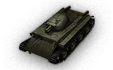<figcaption>IT-3</figcaption></figure>
<strong>Penetration (mm)</strong> <b>EU</b>  AP <strong>68</strong> / 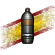 HEAT <strong>100</strong> /  HE <strong>38</strong> → <b>RU</b>  AP <strong>86</strong> /  HEAT <strong>102</strong> /  HE <strong>58</strong>

<strong>Damage (HP)</strong> <b>EU</b>  AP <strong>110</strong> /  HEAT <strong>110</strong> /  HE <strong>164</strong> → <b>RU</b>  AP <strong>110</strong> /  HEAT <strong>110</strong> /  HE <strong>210</strong>

<em>Firepower</em> 
<strong>DPM (HP/min)</strong> <small>EU</small> 1 376.76  <small>RU</small> <strong>1 529.73</strong> 
<strong>Rate of fire (rounds/min)</strong> <small>EU</small> 12.52  <small>RU</small> <strong>13.91</strong> 
<strong>Reload time (s)</strong> <small>EU</small> 4.79  <small>RU</small> <strong>4.31</strong> 
<strong>Shell velocity (m/s)</strong> <small>EU</small> 612  <small>RU</small> <strong>742</strong> 
<strong>Ammo capacity</strong> <small>EU</small> 75  <small>RU</small> <strong>60</strong> 
<strong>Potential damage</strong> <small>EU</small> 8 250  <small>RU</small> <strong>6 600</strong> 

<em>Gun handling</em> 
<strong>Aim time (s)</strong> <small>EU</small> 2.30  <small>RU</small> <strong>2.49</strong> 

<em>Mobility</em> 
<strong>Forward speed (km/h)</strong> <small>EU</small> 50  <small>RU</small> <strong>60</strong> 
<strong>Forward speed on hard terrain (km/h)</strong> <small>EU</small> 50  <small>RU</small> <strong>60</strong> 
<strong>Forward speed on medium terrain (km/h)</strong> <small>EU</small> 50  <small>RU</small> <strong>60</strong> 
<strong>Forward speed on soft terrain (km/h)</strong> <small>EU</small> 42.70  <small>RU</small> <strong>59.26</strong> 
<strong>Reverse speed (km/h)</strong> <small>EU</small> 15  <small>RU</small> <strong>20</strong> 
<strong>Engine power (hp)</strong> <small>EU</small> 370  <small>RU</small> <strong>528.64</strong> 
<strong>Weight (kg)</strong> <small>EU</small> 17 000 → <small>RU</small> <strong>17 500</strong> 
<strong>Power/weight (hp/t)</strong> <small>EU</small> 21.76  <small>RU</small> <strong>30.21</strong> 
<strong>Turret traverse (°/s)</strong> <small>EU</small> 35.46  <small>RU</small> <strong>39.63</strong> 

<em>Armor &amp; health</em> 
<strong>Health</strong> <small>EU</small> 560  <small>RU</small> <strong>630</strong> 
<strong>Health · ammo rack</strong> <small>EU</small> 130  <small>RU</small> <strong>150</strong> 
<strong>Track repair time (s)</strong> <small>EU</small> 12.03  <small>RU</small> <strong>5</strong> 

<em>Miscellaneous</em> 
<strong>Stationary camo</strong> <small>EU</small> 13.57  <small>RU</small> <strong>13.91</strong> 
<strong>Stationary camo · after firing</strong> <small>EU</small> 3.53  <small>RU</small> <strong>3.62</strong> 
<strong>Moving camo</strong> <small>EU</small> 10.15  <small>RU</small> <strong>10.43</strong> 
<strong>Moving camo · after firing</strong> <small>EU</small> 2.64  <small>RU</small> <strong>2.71</strong> 

SU-5 · Tier IV

su5

<a href="https://tanks.gg/v20410/tank/su-5">EU stats</a> · <a href="https://tanks.gg/v14600ru/tank/su-5">RU stats</a>
<figure style="display:inline-block">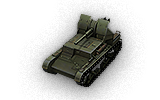<figcaption>SU-5</figcaption></figure>
<strong>Penetration (mm)</strong> <b>EU</b>  HE <strong>35</strong> /  HE <strong>44</strong> /  AP <strong>100</strong> → <b>RU</b>  HE <strong>44</strong> /  AP <strong>100</strong>

<strong>Damage (HP)</strong> <b>EU</b>  HE <strong>350</strong> /  HE <strong>450</strong> /  AP <strong>300</strong> → <b>RU</b>  HE <strong>450</strong> /  AP <strong>300</strong>

<em>Firepower</em> 
<strong>DPM (HP/min)</strong> <small>EU</small> 1 288.41  <small>RU</small> <strong>1 656.53</strong> 
<strong>Explosion radius</strong> <small>EU</small> 6.20  <small>RU</small> <strong>4.60</strong> 
<strong>Stun duration · maximum (s)</strong> <small>EU</small> 6.50 → <small>RU</small> <strong>—</strong> 
<strong>Stun duration · minimum (s)</strong> <small>EU</small> 3.90 → <small>RU</small> <strong>—</strong> 
<strong>Shell velocity (m/s)</strong> <small>EU</small> 285  <small>RU</small> <strong>305</strong> 
<strong>Max range (m)</strong> <small>EU</small> 601.67  <small>RU</small> <strong>689.07</strong> 
<strong>Potential damage</strong> <small>EU</small> 6 300  <small>RU</small> <strong>8 100</strong> 

<em>Armor &amp; health</em> 
<strong>Health</strong> <small>EU</small> 245  <small>RU</small> <strong>300</strong> 
<strong>Track repair time (s)</strong> <small>EU</small> 12.28  <small>RU</small> <strong>5</strong> 

<em>Miscellaneous</em> 
<strong>View range (m)</strong> <small>EU</small> 250  <small>RU</small> <strong>300</strong> 
<strong>Shell cost</strong> <small>EU</small> 290  <small>RU</small> <strong>350</strong> 

SU-76M · Tier IV

su76m

<a href="https://tanks.gg/v20410/tank/su-76m">EU stats</a> · <a href="https://tanks.gg/v14600ru/tank/su-76m">RU stats</a>
<figure style="display:inline-block">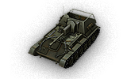<figcaption>SU-76M</figcaption></figure>
<strong>Penetration (mm)</strong> <b>EU</b>  AP <strong>116</strong> /  APCR <strong>162</strong> /  HE <strong>38</strong> → <b>RU</b>  AP <strong>112</strong> /  APCR <strong>189</strong> /  HE <strong>29</strong>

<strong>Damage (HP)</strong> <b>EU</b>  AP <strong>110</strong> /  APCR <strong>110</strong> /  HE <strong>156</strong> → <b>RU</b>  AP <strong>85</strong> /  APCR <strong>85</strong> /  HE <strong>95</strong>

<em>Firepower</em> 
<strong>DPM (HP/min)</strong> <small>EU</small> 1 678.98  <small>RU</small> <strong>1 773.10</strong> 
<strong>Module damage</strong> <small>EU</small> 105  <small>RU</small> <strong>76</strong> 
<strong>Rate of fire (rounds/min)</strong> <small>EU</small> 15.26  <small>RU</small> <strong>20.86</strong> 
<strong>Reload time (s)</strong> <small>EU</small> 3.93  <small>RU</small> <strong>2.88</strong> 
<strong>Caliber</strong> <small>EU</small> 76  <small>RU</small> <strong>57</strong> 
<strong>Shell velocity (m/s)</strong> <small>EU</small> 880  <small>RU</small> <strong>990</strong> 
<strong>Ammo capacity</strong> <small>EU</small> 95  <small>RU</small> <strong>110</strong> 
<strong>Potential damage</strong> <small>EU</small> 10 450  <small>RU</small> <strong>9 350</strong> 

<em>Gun handling</em> 
<strong>Aim time (s)</strong> <small>EU</small> 1.92  <small>RU</small> <strong>1.63</strong> 
<strong>Dispersion (m/100 m)</strong> <small>EU</small> 0.35  <small>RU</small> <strong>0.33</strong> 
<strong>Dispersion · damaged</strong> <small>EU</small> 0.69  <small>RU</small> <strong>0.65</strong> 
<strong>Dispersion · firing</strong> <small>EU</small> 3.50  <small>RU</small> <strong>2</strong> 

<em>Mobility</em> 
<strong>Forward speed on soft terrain (km/h)</strong> <small>EU</small> 33.55  <small>RU</small> <strong>31.33</strong> 
<strong>Reverse speed (km/h)</strong> <small>EU</small> 14  <small>RU</small> <strong>12</strong> 
<strong>Engine power (hp)</strong> <small>EU</small> 200  <small>RU</small> <strong>179.74</strong> 
<strong>Weight (kg)</strong> <small>EU</small> 10 803 → <small>RU</small> <strong>10 398</strong> 
<strong>Power/weight (hp/t)</strong> <small>EU</small> 18.51  <small>RU</small> <strong>17.29</strong> 
<strong>Tank traverse (°/s)</strong> <small>EU</small> 54.24  <small>RU</small> <strong>43.81</strong> 
<strong>Tank traverse on hard terrain (°/s)</strong> <small>EU</small> 55.10  <small>RU</small> <strong>48.35</strong> 
<strong>Tank traverse on medium terrain (°/s)</strong> <small>EU</small> 50.51  <small>RU</small> <strong>44.32</strong> 
<strong>Tank traverse on soft terrain (°/s)</strong> <small>EU</small> 28.86  <small>RU</small> <strong>25.32</strong> 

<em>Armor &amp; health</em> 
<strong>Health</strong> <small>EU</small> 410  <small>RU</small> <strong>550</strong> 
<strong>Health · engine</strong> <small>EU</small> 135  <small>RU</small> <strong>70</strong> 
<strong>Health · track</strong> <small>EU</small> 95  <small>RU</small> <strong>80</strong> 
<strong>Track repair time (s)</strong> <small>EU</small> 11.82  <small>RU</small> <strong>5</strong> 

<em>Miscellaneous</em> 
<strong>Stationary camo · after firing</strong> <small>EU</small> 5.56  <small>RU</small> <strong>6.30</strong> 
<strong>Moving camo · after firing</strong> <small>EU</small> 3.34  <small>RU</small> <strong>3.78</strong> 

SU-85B · Tier IV

su85b

<a href="https://tanks.gg/v20410/tank/su-85b">EU stats</a> · <a href="https://tanks.gg/v14600ru/tank/su-85b">RU stats</a>
<figure style="display:inline-block">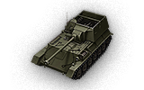<figcaption>SU-85B</figcaption></figure>
<em>Gun handling</em> 
<strong>Aim time (s)</strong> <small>EU</small> 2.21  <small>RU</small> <strong>1.92</strong> 
<strong>Dispersion (m/100 m)</strong> <small>EU</small> 0.40  <small>RU</small> <strong>0.36</strong> 
<strong>Dispersion · damaged</strong> <small>EU</small> 0.81  <small>RU</small> <strong>0.73</strong> 

<em>Armor &amp; health</em> 
<strong>Health</strong> <small>EU</small> 380  <small>RU</small> <strong>560</strong> 
<strong>Track repair time (s)</strong> <small>EU</small> 10.03  <small>RU</small> <strong>5</strong> 

T-28 · Tier IV

t28

<a href="https://tanks.gg/v20410/tank/t-28">EU stats</a> · <a href="https://tanks.gg/v14600ru/tank/t-28">RU stats</a>
<figure style="display:inline-block">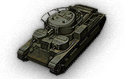<figcaption>T-28</figcaption></figure>
<em>Gun handling</em> 
<strong>Aim time (s)</strong> <small>EU</small> 2.21  <small>RU</small> <strong>1.73</strong> 
<strong>Dispersion · moving</strong> <small>EU</small> 0.23  <small>RU</small> <strong>0.20</strong> 
<strong>Dispersion · tank traverse</strong> <small>EU</small> 0.23  <small>RU</small> <strong>0.20</strong> 

<em>Mobility</em> 
<strong>Engine power (hp)</strong> <small>EU</small> 540  <small>RU</small> <strong>528.64</strong> 
<strong>Power/weight (hp/t)</strong> <small>EU</small> 31.62  <small>RU</small> <strong>30.95</strong> 
<strong>Tank traverse (°/s)</strong> <small>EU</small> 55.28  <small>RU</small> <strong>41.72</strong> 
<strong>Tank traverse on hard terrain (°/s)</strong> <small>EU</small> 57.12  <small>RU</small> <strong>43.70</strong> 
<strong>Tank traverse on medium terrain (°/s)</strong> <small>EU</small> 48.33  <small>RU</small> <strong>36.97</strong> 
<strong>Tank traverse on soft terrain (°/s)</strong> <small>EU</small> 29.92  <small>RU</small> <strong>22.89</strong> 

<em>Armor &amp; health</em> 
<strong>Health</strong> <small>EU</small> 570  <small>RU</small> <strong>630</strong> 
<strong>Track repair time (s)</strong> <small>EU</small> 10.03  <small>RU</small> <strong>5</strong> 

T-28E with F-30 · Tier IV

t28ewithf30

<a href="https://tanks.gg/v20410/tank/t-28e-f-30">EU stats</a> · <a href="https://tanks.gg/v14600ru/tank/t-28e-f-30">RU stats</a>
<figure style="display:inline-block">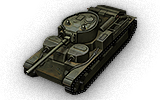<figcaption>T-28E with F-30</figcaption></figure>
<em>Mobility</em> 
<strong>Forward speed on soft terrain (km/h)</strong> <small>EU</small> 22.24  <small>RU</small> <strong>21.77</strong> 
<strong>Engine power (hp)</strong> <small>EU</small> 540  <small>RU</small> <strong>528.64</strong> 
<strong>Power/weight (hp/t)</strong> <small>EU</small> 16.36  <small>RU</small> <strong>16.02</strong> 

<em>Armor &amp; health</em> 
<strong>Health</strong> <small>EU</small> 580  <small>RU</small> <strong>620</strong> 
<strong>Track repair time (s)</strong> <small>EU</small> 10.03  <small>RU</small> <strong>5</strong> 

T-34 with L-11 · Tier IV

t34withl11

<a href="https://tanks.gg/v20410/tank/t-34-1941">EU stats</a> · <a href="https://tanks.gg/v14600ru/tank/t-34-1941-g">RU stats</a>
<figure style="display:inline-block">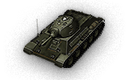<figcaption>T-34 with L-11</figcaption></figure>
<em>Firepower</em> 
<strong>DPM (HP/min)</strong> <small>EU</small> 983.40  <small>RU</small> <strong>1 229.25</strong> 
<strong>Rate of fire (rounds/min)</strong> <small>EU</small> 8.94  <small>RU</small> <strong>11.18</strong> 
<strong>Reload time (s)</strong> <small>EU</small> 6.71  <small>RU</small> <strong>5.37</strong> 

<em>Gun handling</em> 
<strong>Aim time (s)</strong> <small>EU</small> 2.90  <small>RU</small> <strong>1.80</strong> 
<strong>Dispersion (m/100 m)</strong> <small>EU</small> 0.51  <small>RU</small> <strong>0.42</strong> 
<strong>Dispersion · damaged</strong> <small>EU</small> 1.02  <small>RU</small> <strong>0.84</strong> 
<strong>Dispersion · moving</strong> <small>EU</small> 0.29  <small>RU</small> <strong>0.20</strong> 
<strong>Dispersion · tank traverse</strong> <small>EU</small> 0.29  <small>RU</small> <strong>0.20</strong> 
<strong>Dispersion · turret traverse</strong> <small>EU</small> 0.16  <small>RU</small> <strong>0.12</strong> 
<strong>Dispersion · firing</strong> <small>EU</small> 4  <small>RU</small> <strong>2</strong> 

<em>Armor &amp; health</em> 
<strong>Health</strong> <small>EU</small> 560  <small>RU</small> <strong>620</strong> 
<strong>Track repair time (s)</strong> <small>EU</small> 12.03  <small>RU</small> <strong>5</strong> 

T-80 · Tier IV

t80

<a href="https://tanks.gg/v20410/tank/t-80">EU stats</a> · <a href="https://tanks.gg/v14600ru/tank/t-80">RU stats</a>
<figure style="display:inline-block">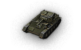<figcaption>T-80</figcaption></figure>
<em>Firepower</em> 
<strong>DPM (HP/min)</strong> <small>EU</small> 2 168.67  <small>RU</small> <strong>2 454.55</strong> 
<strong>Rate of fire (rounds/min)</strong> <small>EU</small> 54.22  <small>RU</small> <strong>61.36</strong> 
<strong>Clip size</strong> <small>EU</small> 5  <small>RU</small> <strong>6</strong> 
<strong>Clip damage · damage</strong> <small>EU</small> 200  <small>RU</small> <strong>240</strong> 
<strong>Clip damage · time (s)</strong> <small>EU</small> 1.33  <small>RU</small> <strong>1.67</strong> 

<em>Gun handling</em> 
<strong>Dispersion (m/100 m)</strong> <small>EU</small> 0.43  <small>RU</small> <strong>0.40</strong> 
<strong>Dispersion · damaged</strong> <small>EU</small> 0.86  <small>RU</small> <strong>0.81</strong> 
<strong>Dispersion · moving</strong> <small>EU</small> 0.24  <small>RU</small> <strong>0.20</strong> 
<strong>Dispersion · tank traverse</strong> <small>EU</small> 0.24  <small>RU</small> <strong>0.20</strong> 
<strong>Dispersion · firing</strong> <small>EU</small> 2  <small>RU</small> <strong>1.50</strong> 

<em>Armor &amp; health</em> 
<strong>Health</strong> <small>EU</small> 540  <small>RU</small> <strong>510</strong> 
<strong>Track repair time (s)</strong> <small>EU</small> 8.02  <small>RU</small> <strong>5</strong> 

Valentine II · Tier IV

valentineii

<a href="https://tanks.gg/v20410/tank/valentine-ii">EU stats</a> · <a href="https://tanks.gg/v14600ru/tank/valentain-ii">RU stats</a>
<figure style="display:inline-block">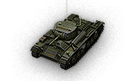<figcaption>Valentine II</figcaption></figure>
<em>Firepower</em> 
<strong>DPM (HP/min)</strong> <small>EU</small> 1 286.80  <small>RU</small> <strong>1 470.63</strong> 
<strong>Rate of fire (rounds/min)</strong> <small>EU</small> 27.38  <small>RU</small> <strong>31.29</strong> 
<strong>Reload time (s)</strong> <small>EU</small> 2.19  <small>RU</small> <strong>1.92</strong> 

<em>Gun handling</em> 
<strong>Aim time (s)</strong> <small>EU</small> 1.71  <small>RU</small> <strong>1.70</strong> 
<strong>Dispersion (m/100 m)</strong> <small>EU</small> 0.41  <small>RU</small> <strong>0.37</strong> 
<strong>Dispersion · damaged</strong> <small>EU</small> 0.82  <small>RU</small> <strong>0.74</strong> 
<strong>Dispersion · turret traverse</strong> <small>EU</small> 0.08  <small>RU</small> <strong>0.10</strong> 
<strong>Dispersion · firing</strong> <small>EU</small> 3  <small>RU</small> <strong>2</strong> 

<em>Armor &amp; health</em> 
<strong>Track repair time (s)</strong> <small>EU</small> 10.03  <small>RU</small> <strong>5</strong> 

